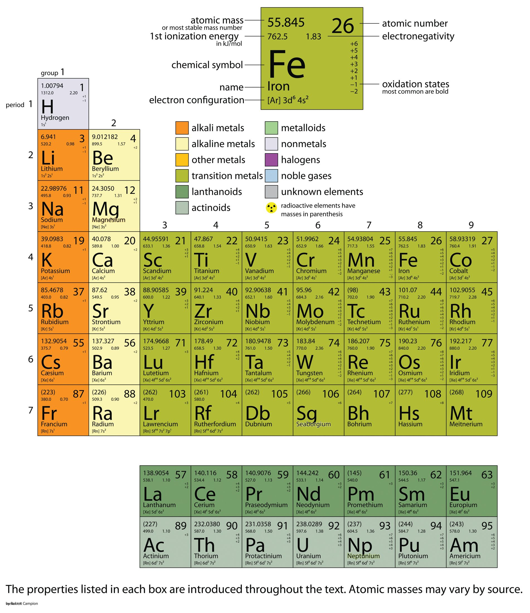
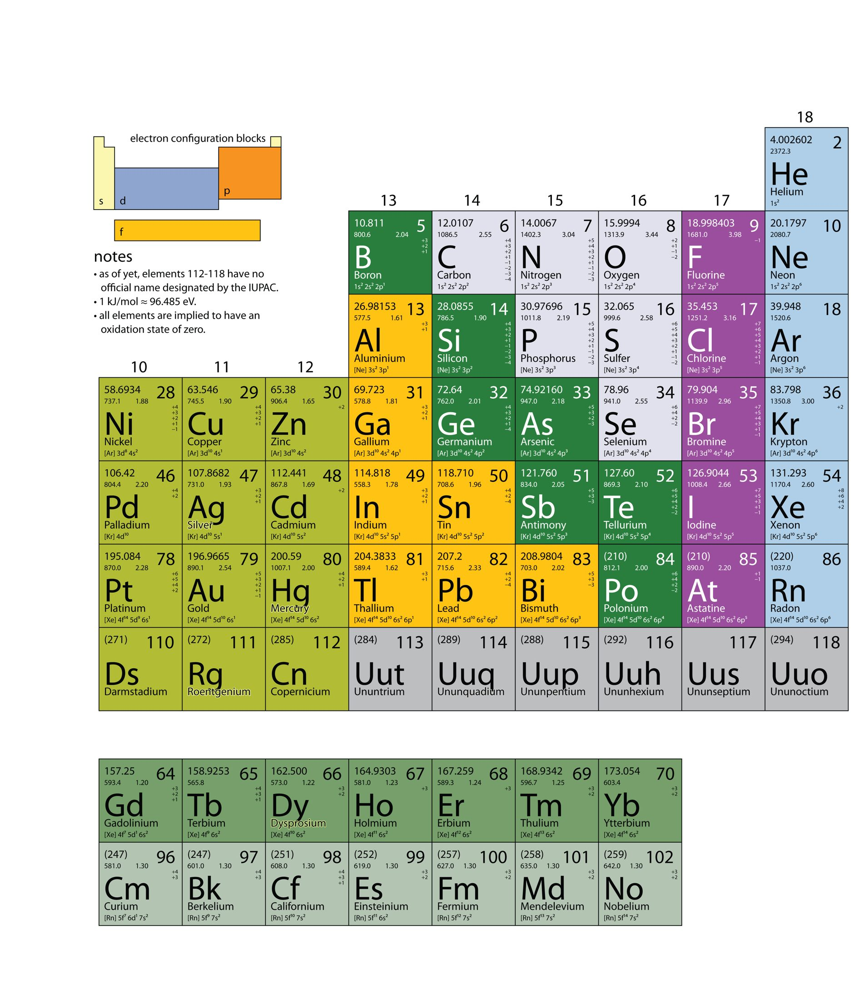

(ch:ch17)=

# Chapter 17 Appendix: Periodic Table of the Elements

In this chapter, we present some data on the chemical elements. The periodic table, introduced in {ref}`Chapter 3 "Atoms, Molecules, and Ions" <ch:ch03>`, lists all the known chemical elements, arranged by atomic number (that is, the number of protons in the nucleus). The periodic table is arguably the best tool in all of science; no other branch of science can summarize its fundamental constituents in such a concise and useful way. Many of the physical and chemical properties of the elements are either known or understood based on their positions on the periodic table. Periodic tables are available with a variety of chemical and physical properties listed in each element’s box. What follows here is a more complex version of the periodic table than what was presented in {ref}`Chapter 3 "Atoms, Molecules, and Ions" <ch:ch03>`. The Internet is a great place to find periodic tables that contain additional information.

One item on most periodic tables is the atomic mass of each element. For many applications, only one or two decimal places are necessary for the atomic mass. However, some applications (especially nuclear chemistry; see {ref}`Chapter 15 "Nuclear Chemistry" <ch:ch15>`) require more decimal places. The atomic masses in {ref}`Table 17.1 "The Basics of the Elements of the Periodic Table" <tbl:ch17:t01>` represent the number of decimal places recognized by the International Union of Pure and Applied Chemistry, the worldwide body that develops standards for chemistry. The atomic masses of some elements are known very precisely, to a large number of decimal places. The atomic masses of other elements, especially radioactive elements, are not known as precisely. Some elements, such as lithium, can have varying atomic masses depending on how their isotopes are isolated.

The web offers many interactive periodic table resources. For example, see [http://www.ptable.com](http://www.ptable.com).



*Chapter 17 Appendix: Periodic Table of the Elements*



*Chapter 17 Appendix: Periodic Table of the Elements*

```{table} The Basics of the Elements of the Periodic Table
:label: tbl:ch17:t01

| Name | Atomic Symbol | Atomic Number | Atomic Mass | Footnotes |
| --- | --- | --- | --- | --- |
| actinium\* | Ac | 89 |   |   |
| aluminum | Al | 13 | 26.9815386(8) |   |
| americium\* | Am | 95 |   |   |
| antimony | Sb | 51 | 121.760(1) | g |
| argon | Ar | 18 | 39.948(1) | g, r |
| arsenic | As | 33 | 74.92160(2) |   |
| astatine\* | At | 85 |   |   |
| barium | Ba | 56 | 137.327(7) |   |
| berkelium\* | Bk | 97 |   |   |
| beryllium | Be | 4 | 9.012182(3) |   |
| bismuth | Bi | 83 | 208.98040(1) |   |
| bohrium\* | Bh | 107 |   |   |
| boron | B | 5 | 10.811(7) | g, m, r |
| bromine | Br | 35 | 79.904(1) |   |
| cadmium | Cd | 48 | 112.411(8) | g |
| caesium (cesium) | Cs | 55 | 132.9054519(2) |   |
| calcium | Ca | 20 | 40.078(4) | g |
| californium\* | Cf | 98 |   |   |
| carbon | C | 6 | 12.0107(8) | g, r |
| cerium | Ce | 58 | 140.116(1) | g |
| chlorine | Cl | 17 | 35.453(2) | g, m, r |
| chromium | Cr | 24 | 51.9961(6) |   |
| cobalt | Co | 27 | 58.933195(5) |   |
| copernicium\* | Cn | 112 |   |   |
| copper | Cu | 29 | 63.546(3) | r |
| curium\* | Cm | 96 |   |   |
| darmstadtium\* | Ds | 110 |   |   |
| dubnium\* | Db | 105 |   |   |
| dysprosium | Dy | 66 | 162.500(1) | g |
| einsteinium\* | Es | 99 |   |   |
| erbium | Er | 68 | 167.259(3) | g |
| europium | Eu | 63 | 151.964(1) | g |
| fermium\* | Fm | 100 |   |   |
| fluorine | F | 9 | 18.9984032(5) |   |
| francium\* | Fr | 87 |   |   |
| gadolinium | Gd | 64 | 157.25(3) | g |
| gallium | Ga | 31 | 69.723(1) |   |
| germanium | Ge | 32 | 72.64(1) |   |
| gold | Au | 79 | 196.966569(4) |   |
| hafnium | Hf | 72 | 178.49(2) |   |
| hassium\* | Hs | 108 |   |   |
| helium | He | 2 | 4.002602(2) | g, r |
| holmium | Ho | 67 | 164.93032(2) |   |
| hydrogen | H | 1 | 1.00794(7) | g, m, r |
| indium | In | 49 | 114.818(3) |   |
| iodine | I | 53 | 126.90447(3) |   |
| iridium | Ir | 77 | 192.217(3) |   |
| iron | Fe | 26 | 55.845(2) |   |
| krypton | Kr | 36 | 83.798(2) | g, m |
| lanthanum | La | 57 | 138.90547(7) | g |
| lawrencium\* | Lr | 103 |   |   |
| lead | Pb | 82 | 207.2(1) | g, r |
| lithium | Li | 3 | [6.941(2)]† | g, m, r |
| lutetium | Lu | 71 | 174.967(1) | g |
| magnesium | Mg | 12 | 24.3050(6) |   |
| manganese | Mn | 25 | 54.938045(5) |   |
| meitnerium\* | Mt | 109 |   |   |
| mendelevium\* | Md | 101 |   |   |
| mercury | Hg | 80 | 200.59(2) |   |
| molybdenum | Mo | 42 | 95.94(2) | g |
| neodymium | Nd | 60 | 144.242(3) | g |
| neon | Ne | 10 | 20.1797(6) | g, m |
| neptunium\* | Np | 93 |   |   |
| nickel | Ni | 28 | 58.6934(2) |   |
| niobium | Nb | 41 | 92.90638(2) |   |
| nitrogen | N | 7 | 14.0067(2) | g, r |
| nobelium\* | No | 102 |   |   |
| osmium | Os | 76 | 190.23(3) | g |
| oxygen | O | 8 | 15.9994(3) | g, r |
| palladium | Pd | 46 | 106.42(1) | g |
| phosphorus | P | 15 | 30.973762(2) |   |
| platinum | Pt | 78 | 195.084(9) |   |
| plutonium\* | Pu | 94 |   |   |
| polonium\* | Po | 84 |   |   |
| potassium | K | 19 | 39.0983(1) |   |
| praseodymium | Pr | 59 | 140.90765(2) |   |
| promethium\* | Pm | 61 |   |   |
| protactinium\* | Pa | 91 | 231.03588(2) |   |
| radium\* | Ra | 88 |   |   |
| radon\* | Rn | 86 |   |   |
| roentgenium\* | Rg | 111 |   |   |
| rhenium | Re | 75 | 186.207(1) |   |
| rhodium | Rh | 45 | 102.90550(2) |   |
| rubidium | Rb | 37 | 85.4678(3) | g |
| ruthenium | Ru | 44 | 101.07(2) | g |
| rutherfordium\* | Rf | 104 |   |   |
| samarium | Sm | 62 | 150.36(2) | g |
| scandium | Sc | 21 | 44.955912(6) |   |
| seaborgium\* | Sg | 106 |   |   |
| selenium | Se | 34 | 78.96(3) | r |
| silicon | Si | 14 | 28.0855(3) | r |
| silver | Ag | 47 | 107.8682(2) | g |
| sodium | Na | 11 | 22.98976928(2) |   |
| strontium | Sr | 38 | 87.62(1) | g, r |
| sulfur | S | 16 | 32.065(5) | g, r |
| tantalum | Ta | 73 | 180.94788(2) |   |
| technetium\* | Tc | 43 |   |   |
| tellurium | Te | 52 | 127.60(3) | g |
| terbium | Tb | 65 | 158.92535(2) |   |
| thallium | Tl | 81 | 204.3833(2) |   |
| thorium\* | Th | 90 | 232.03806(2) | g |
| thulium | Tm | 69 | 168.93421(2) |   |
| tin | Sn | 50 | 118.710(7) | g |
| titanium | Ti | 22 | 47.867(1) |   |
| tungsten | W | 74 | 183.84(1) |   |
| ununhexium\* | Uuh | 116 |   |   |
| ununoctium\* | Uuo | 118 |   |   |
| ununpentium\* | Uup | 115 |   |   |
| ununquadium\* | Uuq | 114 |   |   |
| ununtrium\* | Uut | 113 |   |   |
| uranium\* | U | 92 | 238.02891(3) | g, m |
| vanadium | V | 23 | 50.9415(1) |   |
| xenon | Xe | 54 | 131.293(6) | g, m |
| ytterbium | Yb | 70 | 173.04(3) | g |
| yttrium | Y | 39 | 88.90585(2) |   |
| zinc | Zn | 30 | 65.409(4) |   |
| zirconium | Zr | 40 | 91.224(2) | g |

\*Element has no stable nuclides. However, three such elements (Th, Pa, and U) have a characteristic terrestrial isotopic composition, and for these an atomic mass is tabulated. †Commercially available Li materials have atomic weights that range between 6.939 and 6.996; if a more accurate value is required, it must be determined for the specific material. g Geological specimens are known in which the element has an isotopic composition outside the limits for normal material. The difference between the atomic mass of the element in such specimens and that given in the table may exceed the stated uncertainty. m Modified isotopic compositions may be found in commercially available material because it has been subjected to an undisclosed or inadvertent isotopic fractionation. Substantial deviations in the atomic mass of the element from that given in the table can occur. r Range in isotopic composition of normal terrestrial material prevents a more precise *A*r(E) being given; the tabulated *A*r(E) value and uncertainty should be applicable to normal material.
```
