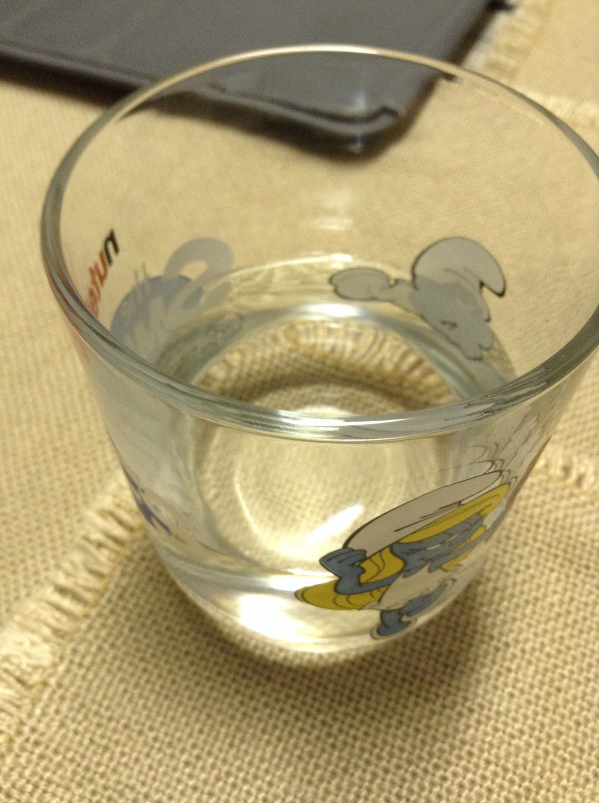
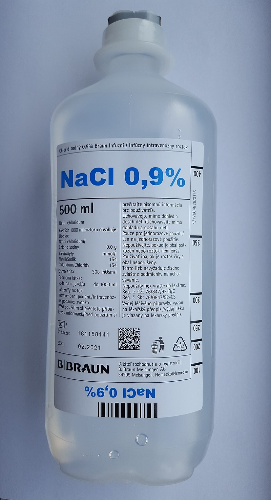

(sec:ch01:s01)=

# 1.1 Some Basic Definitions

```{note} Learning Objective

1. Learn the basic terms used to describe matter.
```

The definition of chemistry—the study of the interactions of matter with other matter and with energy—uses some terms that should also be defined. We start the study of chemistry by defining some basic terms.

**Matter** (*Anything that has mass and takes up space.*) is anything that has mass and takes up space. A book is matter, a computer is matter, food is matter, and dirt in the ground is matter. Sometimes matter may be difficult to identify. For example, air is matter, but because it is so thin compared to other matter (e.g., a book, a computer, food, and dirt), we sometimes forget that air has mass and takes up space. Things that are not matter include thoughts, ideas, emotions, and hopes.

```{exercise}
:label: ex:ball-ch01-s01-n02

**Example 1**

Which of the following is matter and not matter?

1. a hot dog
2. love
3. a tree
```

```{solution} ex:ball-ch01-s01-n02
:label: sol:ball-ch01-s01-n02
:class: dropdown

1. A hot dog has mass and takes up space, so it is matter.
2. Love is an emotion, and emotions are not matter.
3. A tree has mass and takes up space, so it is matter.
```

```{exercise}
:label: ex:ball-ch01-s01-n02-ty2

**Test Yourself**

Which of the following is matter and not matter?

1. the moon
2. an idea for a new invention
```

```{solution} ex:ball-ch01-s01-n02-ty2
:label: sol:ball-ch01-s01-n02-ty2
:class: dropdown

1. The moon is matter.
2. The invention itself may be matter, but the idea for it is not.
```

To understand matter and how it changes, we need to be able to describe matter. There are two basic ways to describe matter: physical properties and chemical properties. **Physical properties** (*A characteristic that describes matter as it exists.*) are characteristics that describe matter as it exists. Some of many physical characteristics of matter are shape, color, size, and temperature. An important physical property is the **phase** (or **state**) of matter. The three fundamental phases of matter are solid, liquid, and gas (see {ref}`Figure 1.1 "The Phases of Matter" <fig:ch01:s01:f01>`).

```{figure} ../images/restored/fig-1-1a.jpg
:label: fig:ch01:s01:f01
:enumerator: 1.1
:alt: Ice cubes floating in liquid water in drinking glasses.
:align: center
:width: 70%

**The Phases of Matter.** Ice and liquid water in glasses, a glass of water, and a steaming kettle illustrate the solid, liquid, and gas phases of water. Water vapor itself is invisible; the visible mist near a kettle consists of tiny liquid droplets.




Credits: [Ice cubes on water — Cleiton Andrade from Alfenas, Brasil](https://commons.wikimedia.org/wiki/File:Ice_cubes_on_water.jpg), [CC0](https://creativecommons.org/publicdomain/zero/1.0/deed.en); [Glass of water — deavmi](https://commons.wikimedia.org/wiki/File:Glass_of_water.jpg), [CC BY-SA 4.0](https://creativecommons.org/licenses/by-sa/4.0); [Steaming Kettle - Boston, MA — Daderot](https://commons.wikimedia.org/wiki/File:Steaming_Kettle_-_Boston,_MA.jpg), [CC0](https://creativecommons.org/publicdomain/zero/1.0/deed.en). Images resized for the web.
```

**Chemical properties** (*A characteristic that describes how matter changes form in the presence of other matter.*) are characteristics of matter that describe how matter changes form in the presence of other matter. Does a sample of matter burn? Burning is a chemical property. Does it behave violently when put in water? This reaction is a chemical property as well ({ref}`Figure 1.2 "Chemical Properties" <fig:ch01:s01:f02>`). In the following chapters, we will see how descriptions of physical and chemical properties are important aspects of chemistry.

```{figure} ../images/restored/fig-1-2.jpg
:label: fig:ch01:s01:f02
:enumerator: 1.2
:alt: A wooden match burning with a bright flame.
:align: center
:width: 70%

**Chemical Properties.** A burning match demonstrates a chemical property: the match material reacts with oxygen to form new substances.

Credits: [Burning matchstick 2010 — Maja Dumat from Deutschland (Germany)](https://commons.wikimedia.org/wiki/File:Burning_matchstick_2010.jpg), [CC BY 2.0](https://creativecommons.org/licenses/by/2.0). Images resized for the web.
```

If matter always stayed the same, chemistry would be rather boring. Fortunately, a major part of chemistry involves change. A **physical change** (*A change that occurs when a sample of matter changes one or more of its physical properties.*) occurs when a sample of matter changes one or more of its physical properties. For example, a solid may melt ({ref}`Figure 1.3 "Physical Changes" <fig:ch01:s01:f03>`), or alcohol in a thermometer may change volume as the temperature changes. A physical change does not affect the chemical composition of matter.

```{figure} ../images/restored/fig-1-3.jpg
:label: fig:ch01:s01:f03
:enumerator: 1.3
:alt: A small melting ice cube on a stone, with water running onto the pavement.
:align: center
:width: 70%

**Physical Changes.** An ice cube melts on a sunlit stone. Melting changes water from a solid to a liquid without changing its chemical composition.

Credits: [Eiswürfel auf Stein — ThoBel-0043](https://commons.wikimedia.org/wiki/File:Eisw%C3%BCrfel_auf_Stein.jpg), [CC BY 4.0](https://creativecommons.org/licenses/by/4.0). Images resized for the web.
```

A **chemical change** (*The process of demonstrating a chemical property.*) is the process of demonstrating a chemical property, such as the burning match in {ref}`Figure 1.2 "Chemical Properties" <fig:ch01:s01:f02>`. As the matter in the match burns, its chemical composition changes, and new forms of matter with new physical properties are created. Note that chemical changes are frequently accompanied by physical changes, as the new matter will likely have different physical properties from the original matter.

```{exercise}
:label: ex:ball-ch01-s01-n03

**Example 2**

Describe each process as a physical change or a chemical change.

1. Water in the air turns into snow.
2. A person’s hair is cut.
3. Bread dough becomes fresh bread in an oven.
```

```{solution} ex:ball-ch01-s01-n03
:label: sol:ball-ch01-s01-n03
:class: dropdown

1. Because the water is going from a gas phase to a solid phase, this is a physical change.
2. Your long hair is being shortened. This is a physical change.
3. Because of the oven’s temperature, chemical changes are occurring in the bread dough to make fresh bread. These are chemical changes. (In fact, a lot of cooking involves chemical changes.)
```

```{exercise}
:label: ex:ball-ch01-s01-n03-ty2

**Test Yourself**

Identify each process as a physical change or a chemical change.

1. A fire is raging in a fireplace.
2. Water is warmed to make a cup of coffee.
```

```{solution} ex:ball-ch01-s01-n03-ty2
:label: sol:ball-ch01-s01-n03-ty2
:class: dropdown

1. chemical change
2. physical change
```

A sample of matter that has the same physical and chemical properties throughout is called a **substance** (*Matter that has the same physical and chemical properties throughout.*). Sometimes the phrase *pure substance* is used, but the word *pure* isn’t needed. The definition of the term *substance* is an example of how chemistry has a specific definition for a word that is used in everyday language with a different, vaguer definition. Here, we will use the term *substance* with its strict chemical definition.

Chemistry recognizes two different types of substances: elements and compounds. An **element** (*A substance that cannot be broken down into simpler chemical substances by ordinary chemical means.*) is the simplest type of chemical substance; it cannot be broken down into simpler chemical substances by ordinary chemical means. There are about 115 elements known to science, of which 80 are stable. (The other elements are radioactive, a condition we will consider in {ref}`Chapter 15 "Nuclear Chemistry" <ch:ch15>`.) Each element has its own unique set of physical and chemical properties. Examples of elements include iron, carbon, and gold.

A **compound** (*A combination of more than one element.*) is a combination of more than one element. The physical and chemical properties of a compound are different from the physical and chemical properties of its constituent elements; that is, it behaves as a completely different substance. There are over 50 million compounds known, and more are being discovered daily. Examples of compounds include water, penicillin, and sodium chloride (the chemical name for common table salt).

Elements and compounds are not the only ways in which matter can be present. We frequently encounter objects that are physical combinations of more than one element or compound. Physical combinations of more than one substance are called **mixtures** (*A physical combination of more than one substance.*). There are two types of mixtures. A **heterogeneous mixture** (*A mixture composed of two or more substances.*) is a mixture composed of two or more substances. It is easy to tell, sometimes by the naked eye, that more than one substance is present. A **homogeneous mixture** (*A combination of two or more substances that is so intimately mixed that the mixture behaves as a single substance.*) is a combination of two or more substances that is so intimately mixed that the mixture behaves as a single substance. Another word for a homogeneous mixture is **solution** (*Another name for a homogeneous mixture.*). Thus, a combination of salt and steel wool is a heterogeneous mixture because it is easy to see which particles of the matter are salt crystals and which are steel wool. On the other hand, if you take salt crystals and dissolve them in water, it is very difficult to tell that you have more than one substance present just by looking—even if you use a powerful microscope. The salt dissolved in water is a homogeneous mixture, or a solution ({ref}`Figure 1.4 "Types of Mixtures" <fig:ch01:s01:f04>`).

```{figure} ../images/restored/fig-1-4a.jpg
:label: fig:ch01:s01:f04
:enumerator: 1.4
:alt: A mixture of nuts and dried fruit with visibly different components.
:align: center
:width: 70%

**Types of Mixtures.** The nuts and dried fruit in trail mix remain visibly distinct, making it a heterogeneous mixture. In the saline solution shown below, sodium chloride is dissolved uniformly in water. Its dissolved ions cannot be distinguished by looking at the liquid.



Credits: [Studentenfutter 01 — Thogru](https://commons.wikimedia.org/wiki/File:Studentenfutter_01.JPG), [CC BY-SA 3.0](https://creativecommons.org/licenses/by-sa/3.0); [Saline solution — Pythones](https://commons.wikimedia.org/wiki/File:Saline_solution.jpg), [CC BY-SA 4.0](https://creativecommons.org/licenses/by-sa/4.0). Images resized for the web.
```

```{exercise}
:label: ex:ball-ch01-s01-n04

**Example 3**

Identify the following combinations as heterogeneous mixtures or homogeneous mixtures.

1. soda water (Carbon dioxide is dissolved in water.)
2. a mixture of iron metal filings and sulfur powder (Both iron and sulfur are elements.)
```

```{solution} ex:ball-ch01-s01-n04
:label: sol:ball-ch01-s01-n04
:class: dropdown

1. Because carbon dioxide is dissolved in water, we can infer from the behavior of salt crystals dissolved in water that carbon dioxide dissolved in water is (also) a homogeneous mixture.
2. Assuming that the iron and sulfur are simply mixed together, it should be easy to see what is iron and what is sulfur, so this is a heterogeneous mixture.
```

```{exercise}
:label: ex:ball-ch01-s01-n04-ty2

**Test Yourself**

Are the following combinations homogeneous mixtures or heterogeneous mixtures?

1. the human body
2. an amalgam, a combination of some other metals dissolved in a small amount of mercury
```

```{solution} ex:ball-ch01-s01-n04-ty2
:label: sol:ball-ch01-s01-n04-ty2
:class: dropdown

1. heterogeneous mixture
2. homogeneous mixture
```

There are other descriptors that we can use to describe matter, especially elements. We can usually divide elements into metals and nonmetals, and each set shares certain (but not always all) properties. A **metal** (*An element that conducts electricity and heat well and is shiny, silvery, solid, ductile, and malleable.*) is an element that is solid at room temperature (although mercury is a well-known exception), is shiny and silvery, conducts electricity and heat well, can be pounded into thin sheets (a property called *malleability*), and can be drawn into thin wires (a property called *ductility*). A **nonmetal** (*An element that exists in various colors and phases, is brittle, and does not conduct electricity or heat well.*) is an element that is brittle when solid, does not conduct electricity or heat very well, and cannot be made into thin sheets or wires ({ref}`Figure 1.5 "Semimetals" <fig:ch01:s01:f05>`). Nonmetals also exist in a variety of phases and colors at room temperature. Some elements have properties of both metals and nonmetals and are called **semimetals (or metalloids)** (*An element that has properties of both metals and nonmetals.*). We will see later how these descriptions can be assigned rather easily to various elements.

```{figure} ../images/restored/fig-1-5.jpg
:label: fig:ch01:s01:f05
:enumerator: 1.5
:alt: A shiny, irregular piece of crystalline silicon.
:align: center
:width: 70%

**Semimetals.** Silicon is a metalloid: it has a metallic luster but is brittle, and its electrical conductivity is intermediate between that of typical metals and nonmetals.

Credits: [SiliconCroda — Enricoros at English Wikipedia](https://commons.wikimedia.org/wiki/File:SiliconCroda.jpg), [Public domain](https://creativecommons.org/publicdomain/mark/1.0/). Images resized for the web.
```

{ref}`Figure 1.6 "Describing Matter" <fig:ch01:s01:f06>` is a flowchart of the relationships among the different ways of describing matter.

```{figure} ../images/figures/c8130947fc1b8985141d902e0b80ed6c.jpg
:label: fig:ch01:s01:f06
:alt: "Describing Matter. This flowchart shows how matter can be described."
:align: center

Describing Matter. This flowchart shows how matter can be described.
```

```{tip} Chemistry Is Everywhere: In the Morning

Most people have a morning ritual, a process that they go through every morning to get ready for the day. Chemistry appears in many of these activities.

- If you take a shower or bath in the morning, you probably use soap, shampoo, or both. These items contain chemicals that interact with the oil and dirt on your body and hair to remove them and wash them away. Many of these products also contain chemicals that make you smell good; they are called *fragrances*.
- When you brush your teeth in the morning, you usually use toothpaste, a form of soap, to clean your teeth. Toothpastes typically contain tiny, hard particles called *abrasives* that physically scrub your teeth. Many toothpastes also contain fluoride, a substance that chemically interacts with the surface of the teeth to help prevent cavities.
- Perhaps you take vitamins, supplements, or medicines every morning. Vitamins and other supplements contain chemicals your body needs in small amounts to function properly. Medicines are chemicals that help combat diseases and promote health.
- Perhaps you make some fried eggs for breakfast. Frying eggs involves heating them enough so that a chemical reaction occurs to cook the eggs.
- After you eat, the food in your stomach is chemically reacted so that the body (mostly the intestines) can absorb food, water, and other nutrients.
- If you drive or take the bus to school or work, you are using a vehicle that probably burns gasoline, a material that burns fairly easily and provides energy to power the vehicle. Recall that burning is a chemical change.

These are just a few examples of how chemistry impacts your everyday life. And we haven’t even made it to lunch yet!
```

```{figure} ../images/restored/shampoo.jpg
:label: fig:ch01:s01:f07
:enumerator: 1.7
:alt: A green shampoo bottle with a pump dispenser.
:align: center
:width: 70%

**Chemistry in Real Life.** Hygiene products, cooked food, and motor vehicles illustrate chemistry in everyday life. Cleaning, cooking, and fuel combustion involve the properties and transformations of matter.


Credits: [Green shampoo bottle — Mezoneni](https://commons.wikimedia.org/wiki/File:Green_shampoo_bottle.jpg), [CC BY-SA 4.0](https://creativecommons.org/licenses/by-sa/4.0); [English breakfast from the Blue Lion Pub — RandomKatze](https://commons.wikimedia.org/wiki/File:English_breakfast_from_the_Blue_Lion_Pub.jpg), [CC0](https://creativecommons.org/publicdomain/zero/1.0/deed.en); [Malaysia Federal Highway Traffic Jam — Countryball mys123](https://commons.wikimedia.org/wiki/File:Malaysia_Federal_Highway_Traffic_Jam.jpg), [CC BY 4.0](https://creativecommons.org/licenses/by/4.0). Images resized for the web.
```

```{important} Key Takeaways

- Chemistry is the study of matter and its interactions with other matter and energy.
- Matter is anything that has mass and takes up space.
- Matter can be described in terms of physical properties and chemical properties.
- Physical properties and chemical properties of matter can change.
- Matter is composed of elements and compounds.
- Combinations of different substances are called mixtures.
- Elements can be described as metals, nonmetals, and semimetals.
```

## Exercises

```{exercise}
:label: ex:ball-ch01-qs01-qd01-qa01

**Exercise 1.**

Identify each as either matter or not matter.

a. a book
b. hate
c. light
d. a car
e. a fried egg
```

```{solution} ex:ball-ch01-qs01-qd01-qa01
:label: sol:ball-ch01-qs01-qd01-qa01
:class: dropdown

a. matter
b. not matter
c. not matter
d. matter
e. matter
```

```{exercise}
:label: ex:ball-ch01-qs01-qd01-qa02

**Exercise 2.**

Give an example of matter in each phase: solid, liquid, or gas.
```

```{exercise}
:label: ex:ball-ch01-qs01-qd01-qa03

**Exercise 3.**

Does each statement represent a physical property or a chemical property?

a. Sulfur is yellow.
b. Steel wool burns when ignited by a flame.
c. A gallon of milk weighs over eight pounds.
```

```{solution} ex:ball-ch01-qs01-qd01-qa03
:label: sol:ball-ch01-qs01-qd01-qa03
:class: dropdown

a. physical property
b. chemical property
c. physical property
```

```{exercise}
:label: ex:ball-ch01-qs01-qd01-qa04

**Exercise 4.**

Does each statement represent a physical property or a chemical property?

a. A pile of leaves slowly rots in the backyard.
b. In the presence of oxygen, hydrogen can interact to make water.
c. Gold can be stretched into very thin wires.
```

```{exercise}
:label: ex:ball-ch01-qs01-qd01-qa05

**Exercise 5.**

Does each statement represent a physical change or a chemical change?

a. Water boils and becomes steam.
b. Food is converted into usable form by the digestive system.
c. The alcohol in many thermometers freezes at about −40 degrees Fahrenheit.
```

```{solution} ex:ball-ch01-qs01-qd01-qa05
:label: sol:ball-ch01-qs01-qd01-qa05
:class: dropdown

a. physical change
b. chemical change
c. physical change
```

```{exercise}
:label: ex:ball-ch01-qs01-qd01-qa06

**Exercise 6.**

Does each statement represent a physical change or a chemical change?

a. Graphite, a form of elemental carbon, can be turned into diamond, another form of carbon, at very high temperatures and pressures.
b. The house across the street has been painted a new color.
c. The elements sodium and chlorine come together to make a new substance called sodium chloride.
```

```{exercise}
:label: ex:ball-ch01-qs01-qd01-qa07

**Exercise 7.**

Distinguish between an element and a compound. About how many of each are known?
```

```{solution} ex:ball-ch01-qs01-qd01-qa07
:label: sol:ball-ch01-qs01-qd01-qa07
:class: dropdown

An element is a fundamental chemical part of a substance; there are about 115 known elements. A compound is a combination of elements that acts as a different substance; there are over 50 million known substances.
```

```{exercise}
:label: ex:ball-ch01-qs01-qd01-qa08

**Exercise 8.**

What is the difference between a homogeneous mixture and a heterogeneous mixture?
```

```{exercise}
:label: ex:ball-ch01-qs01-qd01-qa09

**Exercise 9.**

Identify each as a heterogeneous mixture or a homogeneous mixture.

a. Salt is mixed with pepper.
b. Sugar is dissolved in water.
c. Pasta is cooked in boiling water.
```

```{solution} ex:ball-ch01-qs01-qd01-qa09
:label: sol:ball-ch01-qs01-qd01-qa09
:class: dropdown

a. heterogeneous
b. homogeneous
c. heterogeneous
```

```{exercise}
:label: ex:ball-ch01-qs01-qd01-qa10

**Exercise 10.**

Identify each as a heterogeneous mixture or a homogeneous mixture.

a. air
b. dirt
c. a television set
```

```{exercise}
:label: ex:ball-ch01-qs01-qd01-qa11

**Exercise 11.**

In Exercise 9, which choices are also solutions?
```

```{solution} ex:ball-ch01-qs01-qd01-qa11
:label: sol:ball-ch01-qs01-qd01-qa11
:class: dropdown

Choice b is a solution.
```

```{exercise}
:label: ex:ball-ch01-qs01-qd01-qa12

**Exercise 12.**

In Exercise 10, which choices are also solutions?
```

```{exercise}
:label: ex:ball-ch01-qs01-qd01-qa13

**Exercise 13.**

Why is iron considered a metal?
```

```{solution} ex:ball-ch01-qs01-qd01-qa13
:label: sol:ball-ch01-qs01-qd01-qa13
:class: dropdown

Iron is a metal because it is solid, is shiny, and conducts electricity and heat well.
```

```{exercise}
:label: ex:ball-ch01-qs01-qd01-qa14

**Exercise 14.**

Why is oxygen considered a nonmetal?
```

```{exercise}
:label: ex:ball-ch01-qs01-qd01-qa15

**Exercise 15.**

Distinguish between a metal and a nonmetal.
```

```{solution} ex:ball-ch01-qs01-qd01-qa15
:label: sol:ball-ch01-qs01-qd01-qa15
:class: dropdown

Metals are typically shiny, conduct electricity and heat well, and are malleable and ductile; nonmetals are a variety of colors and phases, are brittle in the solid phase, and do not conduct heat or electricity well.
```

```{exercise}
:label: ex:ball-ch01-qs01-qd01-qa16

**Exercise 16.**

What properties do semimetals have?
```

```{exercise}
:label: ex:ball-ch01-qs01-qd01-qa17

**Exercise 17.**

Elemental carbon is a black, dull-looking solid that conducts heat and electricity well. It is very brittle and cannot be made into thin sheets or long wires. Of these properties, how does carbon behave as a metal? How does carbon behave as a nonmetal?
```

```{solution} ex:ball-ch01-qs01-qd01-qa17
:label: sol:ball-ch01-qs01-qd01-qa17
:class: dropdown

Carbon behaves as a metal because it conducts heat and electricity well. It is a nonmetal because it is black and brittle and cannot be made into sheets or wires.
```

```{exercise}
:label: ex:ball-ch01-qs01-qd01-qa18

**Exercise 18.**

Pure silicon is shiny and silvery but does not conduct electricity or heat well. Of these properties, how does silicon behave as a metal? How does silicon behave as a nonmetal?
```
