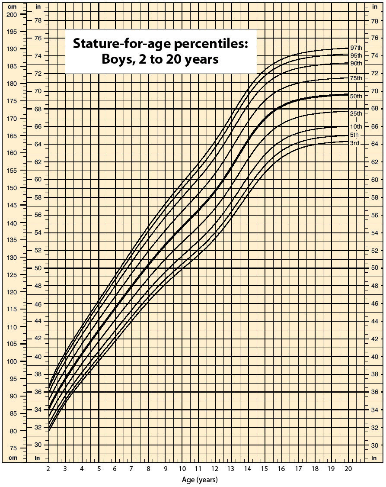

(ch:ch02)=

# Chapter 2 Measurements

```{note} Opening Essay

Data suggest that a male child will weigh 50% of his adult weight at about 11 years of age. However, he will reach 50% of his adult height at only 2 years of age. It is obvious, then, that people eventually stop growing up but continue to grow out. Data also suggest that the average human height has been increasing over time. In industrialized countries, the average height of people increased 5.5 inches from 1810 to 1984. Most scientists attribute this simple, basic measurement of the human body to better health and nutrition.

(fig:ch02:f01)=



*Chapter 2 Measurements*
```

In 1983, an Air Canada airplane had to make an emergency landing because it unexpectedly ran out of fuel; ground personnel had filled the fuel tanks with a certain number of pounds of fuel, not kilograms of fuel. In 1999, the Mars Climate Orbiter spacecraft was lost attempting to orbit Mars because the thrusters were programmed in terms of English units, even though the engineers built the spacecraft using metric units. In 1993, a nurse mistakenly administered 23 units of morphine to a patient rather than the “2–3” units prescribed. (The patient ultimately survived.) These incidents occurred because people weren’t paying attention to quantities.

Chemistry, like all sciences, is quantitative. It deals with *quantities*, things that have amounts and units. Dealing with quantities is very important in chemistry, as is relating quantities to each other. In this chapter, we will discuss how we deal with numbers and units, including how they are combined and manipulated.
