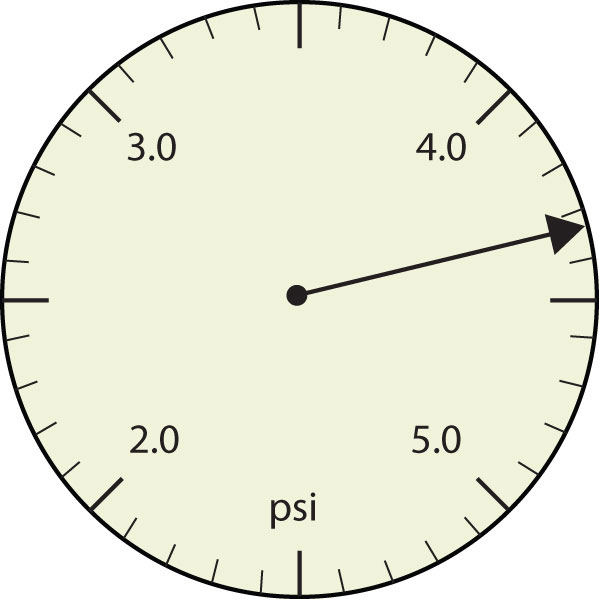
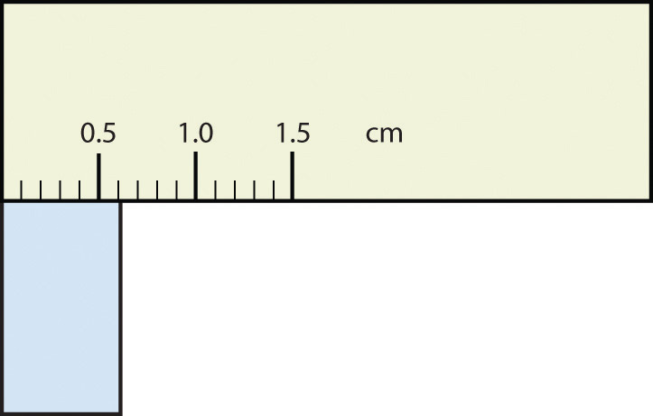
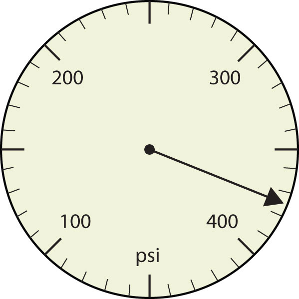
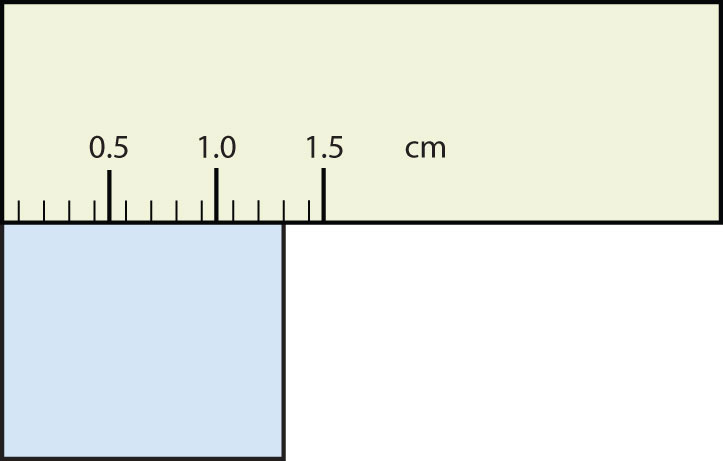
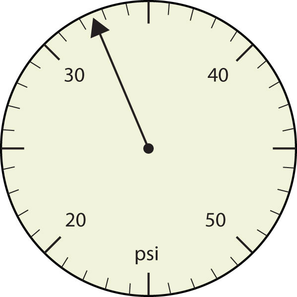
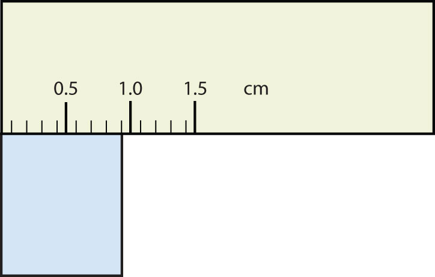

(sec:ch02:s03)=

# 2.3 Significant Figures

```{note} Learning Objectives

1. Apply the concept of significant figures to limit a measurement to the proper number of digits.
2. Recognize the number of significant figures in a given quantity.
3. Limit mathematical results to the proper number of significant figures.
```

If you use a calculator to evaluate the expression 337/217, you will get the following:

$$
\frac{337}{217}=1.55299539171...
$$

and so on for many more digits. Although this answer is correct, it is somewhat presumptuous. You start with two values that each have three digits, and the answer has *twelve* digits? That does not make much sense from a strict numerical point of view.

Consider using a ruler to measure the width of an object, as shown in {ref}`Figure 2.6 "Expressing Width" <fig:ch02:s03:f01>`. The object is definitely more than 1 cm long, so we know that the first digit in our measurement is 1. We see by counting the tick marks on the ruler that the object is at least three ticks after the 1. If each tick represents 0.1 cm, then we know the object is at least 1.3 cm wide. But our ruler does not have any more ticks between the 0.3 and the 0.4 marks, so we can’t know exactly how much the next decimal place is. But with a practiced eye we can estimate it. Let us estimate it as about six-tenths of the way between the third and fourth tick marks, which estimates our hundredths place as 6, so we identify a measurement of 1.36 cm for the width of the object.

```{figure} ../images/figures/eb7d58a9777dbb124396d7c8bcb75793.jpg
:label: fig:ch02:s03:f01
:alt: "Expressing Width. What is the proper way to express the width of this object?"
:align: center
:width: 85%

Expressing Width. What is the proper way to express the width of this object?
```

Does it make any sense to try to report a thousandths place for the measurement? No, it doesn’t; we are not exactly sure of the hundredths place (after all, it was an estimate only), so it would be fruitless to estimate a thousandths place. Our best measurement, then, stops at the hundredths place, and we report 1.36 cm as proper measurement.

This concept of reporting the proper number of digits in a measurement or a calculation is called **significant figures** (*The limit of the number of places a measurement can be properly expressed with.*). Significant figures (sometimes called significant digits) represent the limits of what values of a measurement or a calculation we are sure of. The convention for a measurement is that the quantity reported should be all known values and the first estimated value. The conventions for calculations are discussed as follows.

```{exercise}
:label: ex:ball-ch02-s03-n02

**Example 3**

Use each diagram to report a measurement to the proper number of significant figures.

1. (fig:ch02:s03:f02)=

   

   *2.3 Significant Figures*
2. (fig:ch02:s03:f03)=

   

   *2.3 Significant Figures*
```

```{solution} ex:ball-ch02-s03-n02
:label: sol:ball-ch02-s03-n02
:class: dropdown

1. The arrow is between 4.0 and 5.0, so the measurement is at least 4.0. The arrow is between the third and fourth small tick marks, so it’s at least 0.3. We will have to estimate the last place. It looks like about one-third of the way across the space, so let us estimate the hundredths place as 3. Combining the digits, we have a measurement of 4.33 psi (psi stands for “pounds per square inch” and is a unit of pressure, like air in a tire). We say that the measurement is reported to three significant figures.
2. The rectangle is at least 1.0 cm wide but certainly not 2.0 cm wide, so the first significant digit is 1. The rectangle’s width is past the second tick mark but not the third; if each tick mark represents 0.1, then the rectangle is at least 0.2 in the next significant digit. We have to estimate the next place because there are no markings to guide us. It appears to be about halfway between 0.2 and 0.3, so we will estimate the next place to be a 5. Thus, the measured width of the rectangle is 1.25 cm. Again, the measurement is reported to three significant figures.
```

```{exercise}
:label: ex:ball-ch02-s03-n02-ty2

**Test Yourself**

What would be the reported width of this rectangle?

(fig:ch02:s03:f04)=



*2.3 Significant Figures*
```

```{solution} ex:ball-ch02-s03-n02-ty2
:label: sol:ball-ch02-s03-n02-ty2
:class: dropdown

0.63 cm
```

In many cases, you will be given a measurement. How can you tell by looking what digits are significant? For example, the reported population of the United States is 306,000,000. Does that mean that it is *exactly* three hundred six million or is some estimation occurring?

The following conventions dictate which numbers in a reported measurement are significant and which are not significant:

1. Any nonzero digit is significant.
2. Any zeros between nonzero digits (i.e., embedded zeros) are significant.
3. Zeros at the end of a number without a decimal point (i.e., trailing zeros) are not significant; they serve only to put the significant digits in the correct positions. However, zeros at the end of any number with a decimal point are significant.
4. Zeros at the beginning of a decimal number (i.e., leading zeros) are not significant; again, they serve only to put the significant digits in the correct positions.

So, by these rules, the population figure of the United States has only three significant figures: the 3, the 6, and the zero between them. The remaining six zeros simply put the 306 in the millions position. (See {ref}`Figure 2.7 "Significant Figures" <fig:ch02:s03:f05>` for another example.)

```{figure} ../images/restored/fig-2-7.jpg
:label: fig:ch02:s03:f05
:enumerator: 2.7
:alt: A digital automobile odometer reading 173386.2 miles.
:align: center
:width: 70%

**Significant Figures.** This odometer reads 173386.2 miles, reporting distance to the nearest tenth of a mile. The last displayed digit indicates the resolution of the measurement; adding further digits would imply unsupported precision.

Credits: [Digital odometer 1987 Oldsmobile Toronado — Jacek Rużyczka](https://commons.wikimedia.org/wiki/File:Digital_odometer_1987_Oldsmobile_Toronado.JPG), [CC BY-SA 4.0](https://creativecommons.org/licenses/by-sa/4.0). Images resized for the web.
```

```{exercise}
:label: ex:ball-ch02-s03-n03

**Example 4**

Give the number of significant figures in each measurement.

1. 36.7 m
2. 0.006606 s
3. 2,002 kg
4. 306,490,000 people
```

```{solution} ex:ball-ch02-s03-n03
:label: sol:ball-ch02-s03-n03
:class: dropdown

1. By rule 1, all nonzero digits are significant, so this measurement has three significant figures.
2. By rule 4, the first three zeros are not significant, but by rule 2 the zero between the sixes is; therefore, this number has four significant figures.
3. By rule 2, the two zeros between the twos are significant, so this measurement has four significant figures.
4. The four trailing zeros in the number are not significant, but the other five numbers are, so this number has five significant figures.
```

```{exercise}
:label: ex:ball-ch02-s03-n03-ty2

**Test Yourself**

Give the number of significant figures in each measurement.

1. 0.000601 m
2. 65.080 kg
```

```{solution} ex:ball-ch02-s03-n03-ty2
:label: sol:ball-ch02-s03-n03-ty2
:class: dropdown

1. three significant figures
2. five significant figures
```

How are significant figures handled in calculations? It depends on what type of calculation is being performed. If the calculation is an addition or a subtraction, the rule is as follows: limit the reported answer to the rightmost column that all numbers have significant figures in common. For example, if you were to add 1.2 and 4.71, we note that the first number stops its significant figures in the tenths column, while the second number stops its significant figures in the hundredths column. We therefore limit our answer to the tenths column.

```{figure} ../images/figures/529440a4e2f4b43906813b22eda127f6.jpg
:label: fig:fwk:ball:eq02:001
:alt: "2.3 Significant Figures"
:align: center
:width: 85%

2.3 Significant Figures
```

We drop the last digit—the 1—because it is not significant to the final answer.

The dropping of positions in sums and differences brings up the topic of rounding. Although there are several conventions, in this text we will adopt the following rule: the final answer should be rounded up if the first dropped digit is 5 or greater and rounded down if the first dropped digit is less than 5.

```{figure} ../images/figures/ab6a79e359c62e701d09064f4ef21621.jpg
:label: fig:fwk:ball:eq02:002
:alt: "2.3 Significant Figures"
:align: center
:width: 85%

2.3 Significant Figures
```

```{exercise}
:label: ex:ball-ch02-s03-n04

**Example 5**

Express the final answer to the proper number of significant figures.

1. 101.2 + 18.702 = ?
2. 202.88 − 1.013 = ?
```

```{solution} ex:ball-ch02-s03-n04
:label: sol:ball-ch02-s03-n04
:class: dropdown

1. If we use a calculator to add these two numbers, we would get 119.902. However, most calculators do not understand significant figures, and we need to limit the final answer to the tenths place. Thus, we drop the 02 and report a final answer of 119.9 (rounding down).
2. A calculator would answer 201.867. However, we have to limit our final answer to the hundredths place. Because the first number being dropped is 7, which is greater than 7, we round up and report a final answer of 201.87.
```

```{exercise}
:label: ex:ball-ch02-s03-n04-ty2

**Test Yourself**

Express the answer for 3.445 + 90.83 − 72.4 to the proper number of significant figures.
```

```{solution} ex:ball-ch02-s03-n04-ty2
:label: sol:ball-ch02-s03-n04-ty2
:class: dropdown

21.9
```

If the operations being performed are multiplication or division, the rule is as follows: limit the answer to the number of significant figures that the data value with the *least* number of significant figures has. So if we are dividing 23 by 448, which have two and three significant figures each, we should limit the final reported answer to two significant figures (the lesser of two and three significant figures):

$$
\frac{23}{448}=0.051339286...=0.051
$$

The same rounding rules apply in multiplication and division as they do in addition and subtraction.

```{exercise}
:label: ex:ball-ch02-s03-n05

**Example 6**

Express the final answer to the proper number of significant figures.

1. 76.4 × 180.4 = ?
2. 934.9 ÷ 0.00455 = ?
```

```{solution} ex:ball-ch02-s03-n05
:label: sol:ball-ch02-s03-n05
:class: dropdown

1. The first number has three significant figures, while the second number has four significant figures. Therefore, we limit our final answer to three significant figures: 76.4 × 180.4 = 13,782.56 = 13,800.
2. The first number has four significant figures, while the second number has three significant figures. Therefore we limit our final answer to three significant figures: 934.9 ÷ 0.00455 = 205,472.5275… = 205,000.
```

```{exercise}
:label: ex:ball-ch02-s03-n05-ty2

**Test Yourself**

Express the final answer to the proper number of significant figures.

1. 22.4 × 8.314 = ?
2. 1.381 ÷ 6.02 = ?
```

```{solution} ex:ball-ch02-s03-n05-ty2
:label: sol:ball-ch02-s03-n05-ty2
:class: dropdown

1. 186
2. 0.229
```

As you have probably realized by now, the biggest issue in determining the number of significant figures in a value is the zero. Is the zero significant or not? One way to unambiguously determine whether a zero is significant or not is to write a number in scientific notation. Scientific notation will include zeros in the coefficient of the number *only if they are significant*. Thus, the number 8.666 × 10<sup>6</sup> has four significant figures. However, the number 8.6660 × 10<sup>6</sup> has five significant figures. That last zero is significant; if it were not, it would not be written in the coefficient. So when in doubt about expressing the number of significant figures in a quantity, use scientific notation and include the number of zeros that are truly significant.

```{important} Key Takeaways

- Significant figures in a quantity indicate the number of known values plus one place that is estimated.
- There are rules for which numbers in a quantity are significant and which are not significant.
- In calculations involving addition and subtraction, limit significant figures based on the rightmost place that all values have in common.
- In calculations involving multiplication and division, limit significant figures to the least number of significant figures in all the data values.
```

## Exercises

```{exercise}
:label: ex:ball-ch02-s03-qs01-qd01-qa01

**Exercise 1.**

Express each measurement to the correct number of significant figures.

a. (fig:ch02:s03:qs01:f1)=

   

   *2.3 Significant Figures*
b. (fig:ch02:s03:qs01:f2)=

   

   *2.3 Significant Figures*
```

```{solution} ex:ball-ch02-s03-qs01-qd01-qa01
:label: sol:ball-ch02-s03-qs01-qd01-qa01
:class: dropdown

a. 375 psi
b. 1.30 cm
```

```{exercise}
:label: ex:ball-ch02-s03-qs01-qd01-qa02

**Exercise 2.**

Express each measurement to the correct number of significant figures.

a. (fig:ch02:s03:qs01:f3)=

   

   *2.3 Significant Figures*
b. (fig:ch02:s03:qs01:f4)=

   

   *2.3 Significant Figures*
```

```{exercise}
:label: ex:ball-ch02-s03-qs01-qd01-qa03

**Exercise 3.**

How many significant figures do these numbers have?

a. 23
b. 23.0
c. 0.00023
d. 0.0002302
```

```{solution} ex:ball-ch02-s03-qs01-qd01-qa03
:label: sol:ball-ch02-s03-qs01-qd01-qa03
:class: dropdown

a. two
b. three
c. two
d. four
```

```{exercise}
:label: ex:ball-ch02-s03-qs01-qd01-qa04

**Exercise 4.**

How many significant figures do these numbers have?

a. 5.44 × 10<sup>8</sup>
b. 1.008 × 10<sup>−5</sup>
c. 43.09
d. 0.0000001381
```

```{exercise}
:label: ex:ball-ch02-s03-qs01-qd01-qa05

**Exercise 5.**

How many significant figures do these numbers have?

a. 765,890
b. 765,890.0
c. 1.2000 × 10<sup>5</sup>
d. 0.0005060
```

```{solution} ex:ball-ch02-s03-qs01-qd01-qa05
:label: sol:ball-ch02-s03-qs01-qd01-qa05
:class: dropdown

a. five
b. seven
c. five
d. four
```

```{exercise}
:label: ex:ball-ch02-s03-qs01-qd01-qa06

**Exercise 6.**

How many significant figures do these numbers have?

a. 0.009
b. 0.0000009
c. 65,444
d. 65,040
```

```{exercise}
:label: ex:ball-ch02-s03-qs01-qd01-qa07

**Exercise 7.**

Compute and express each answer with the proper number of significant figures, rounding as necessary.

a. 56.0 + 3.44 = ?
b. 0.00665 + 1.004 = ?
c. 45.99 − 32.8 = ?
d. 45.99 − 32.8 + 75.02 = ?
```

```{solution} ex:ball-ch02-s03-qs01-qd01-qa07
:label: sol:ball-ch02-s03-qs01-qd01-qa07
:class: dropdown

a. 59.4
b. 1.011
c. 13.2
d. 88.2
```

```{exercise}
:label: ex:ball-ch02-s03-qs01-qd01-qa08

**Exercise 8.**

Compute and express each answer with the proper number of significant figures, rounding as necessary.

a. 1.005 + 17.88 = ?
b. 56,700 − 324 = ?
c. 405,007 − 123.3 = ?
d. 55.5 + 66.66 − 77.777 = ?
```

```{exercise}
:label: ex:ball-ch02-s03-qs01-qd01-qa09

**Exercise 9.**

Compute and express each answer with the proper number of significant figures, rounding as necessary.

a. 56.7 × 66.99 = ?
b. 1.000 ÷ 77 = ?
c. 1.000 ÷ 77.0 = ?
d. 6.022 × 1.89 = ?
```

```{solution} ex:ball-ch02-s03-qs01-qd01-qa09
:label: sol:ball-ch02-s03-qs01-qd01-qa09
:class: dropdown

a. 3.80 × 10<sup>3</sup>
b. 0.013
c. 0.0130
d. 11.4
```

```{exercise}
:label: ex:ball-ch02-s03-qs01-qd01-qa10

**Exercise 10.**

Compute and express each answer with the proper number of significant figures, rounding as necessary.

a. 0.000440 × 17.22 = ?
b. 203,000 ÷ 0.044 = ?
c. 67 × 85.0 × 0.0028 = ?
d. 999,999 ÷ 3,310 = ?
```

```{exercise}
:label: ex:ball-ch02-s03-qs01-qd01-qa11

**Exercise 11.**

a. Write the number 87,449 in scientific notation with four significant figures.
b. Write the number 0.000066600 in scientific notation with five significant figures.
```

```{solution} ex:ball-ch02-s03-qs01-qd01-qa11
:label: sol:ball-ch02-s03-qs01-qd01-qa11
:class: dropdown

a. 8.745 × 10<sup>4</sup>
b. 6.6600 × 10<sup>−5</sup>
```

```{exercise}
:label: ex:ball-ch02-s03-qs01-qd01-qa12

**Exercise 12.**

a. Write the number 306,000,000 in scientific notation to the proper number of significant figures.
b. Write the number 0.0000558 in scientific notation with two significant figures.
```

```{exercise}
:label: ex:ball-ch02-s03-qs01-qd01-qa13

**Exercise 13.**

Perform each calculation and limit each answer to three significant figures.

a. 67,883 × 0.004321 = ?
b. (9.67 × 10<sup>3</sup>) × 0.0055087 = ?
```

```{solution} ex:ball-ch02-s03-qs01-qd01-qa13
:label: sol:ball-ch02-s03-qs01-qd01-qa13
:class: dropdown

a. 293
b. 53.3
```

```{exercise}
:label: ex:ball-ch02-s03-qs01-qd01-qa14

**Exercise 14.**

Perform each calculation and limit each answer to four significant figures.

a. 18,900 × 76.33 ÷ 0.00336 = ?
b. 0.77604 ÷ 76,003 × 8.888 = ?
```
