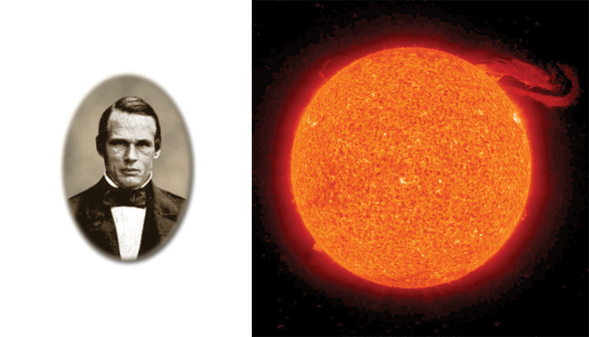

(ch:ch03)=

# Chapter 3 Atoms, Molecules, and Ions

```{note} Opening Essay

Although not an SI unit, the angstrom (Å) is a useful unit of length. It is one ten-billionth of a meter, or 10<sup>−10</sup> m. Why is it a useful unit? The ultimate particles that compose all matter are about 10<sup>−10</sup> m in size, or about 1 Å. This makes the angstrom a natural—though not approved—unit for describing these particles.

The angstrom unit is named after Anders Jonas Ångström, a nineteenth-century Swedish physicist. Ångström’s research dealt with light being emitted by glowing objects, including the sun. Ångström studied the brightness of the different colors of light that the sun emitted and was able to deduce that the sun is composed of the same kinds of matter that are present on the earth. By extension, we now know that all matter throughout the universe is similar to the matter that exists on our own planet.

(fig:ch03:f01)=



*Anders Jonas Ångstrom, a Swedish physicist, studied the light coming from the sun. His contributions to science were sufficient to have a tiny unit of length named after him, the angstrom, which is one ten-billionth of a meter.*
```

The basic building block of all matter is the atom. Curiously, the idea of atoms was first proposed in the fifth century BCE, when the Greek philosophers Leucippus and Democritus proposed their existence in a surprisingly modern fashion. However, their ideas never took hold among their contemporaries, and it wasn’t until the early 1800s that evidence amassed to make scientists reconsider the idea. Today, the concept of the atom is central to the study of matter.
