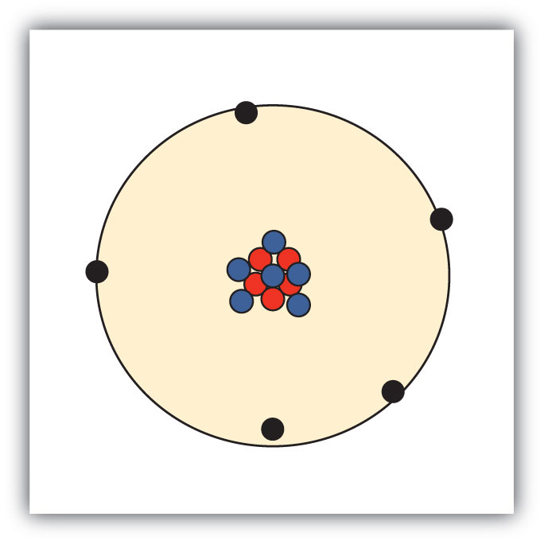

(sec:ch03:s01)=

# 3.1 Atomic Theory

```{note} Learning Objectives

1. State the modern atomic theory.
2. Learn how atoms are constructed.
```

The smallest piece of an element that maintains the identity of that element is called an **atom** (*The smallest piece of an element that maintains the identity of that element.*). Individual atoms are extremely small. It would take about fifty million atoms in a row to make a line that is 1 cm long. The period at the end of a printed sentence has several million atoms in it. Atoms are so small that it is difficult to believe that all matter is made from atoms—but it is.

The concept that atoms play a fundamental role in chemistry is formalized by the **modern atomic theory** (*The concept that atoms play a fundamental role in chemistry.*), first stated by John Dalton, an English scientist, in 1808. It consists of three parts:

1. All matter is composed of atoms.
2. Atoms of the same element are the same; atoms of different elements are different.
3. Atoms combine in whole-number ratios to form compounds.

These concepts form the basis of chemistry.

Although the word *atom* comes from a Greek word that means “indivisible,” we understand now that atoms themselves are composed of smaller parts called *subatomic particles*. The first part to be discovered was the **electron** (*A tiny subatomic particle with a negative charge.*), a tiny subatomic particle with a negative charge. It is often represented as e<sup>−</sup>, with the right superscript showing the negative charge. Later, two larger particles were discovered. The **proton** (*A subatomic particle with a positive charge.*) is a more massive (but still tiny) subatomic particle with a positive charge, represented as p<sup>+</sup>. The **neutron** (*A subatomic particle with no charge.*) is a subatomic particle with about the same mass as a proton but no charge. It is represented as either n or n<sup>0</sup>. We now know that all atoms of all elements are composed of electrons, protons, and (with one exception) neutrons. {ref}`Table 3.1 "Properties of the Three Subatomic Particles" <tbl:ch03:s01:t01>` summarizes the properties of these three subatomic particles.

```{table} Properties of the Three Subatomic Particles
:label: tbl:ch03:s01:t01

| Name | Symbol | Mass (approx.; kg) | Charge |
| --- | --- | --- | --- |
| Proton | p<sup>+</sup> | 1.6 × 10<sup>−27</sup> | 1+ |
| Neutron | n, n<sup>0</sup> | 1.6 × 10<sup>−27</sup> | none |
| Electron | e<sup>−</sup> | 9.1 × 10<sup>−31</sup> | 1− |
```

How are these particles arranged in atoms? They are not arranged at random. Experiments by Ernest Rutherford in England in the 1910s pointed to a **nuclear model** (*The model of an atom that has the protons and neutrons in a central nucleus with the electrons in orbit about the nucleus.*) of the atom. The relatively massive protons and neutrons are collected in the center of an atom, in a region called the **nucleus** (*The center of an atom that contains protons and neutrons.*) of the atom (plural *nuclei*). The electrons are outside the nucleus and spend their time orbiting in space about the nucleus. (See {ref}`Figure 3.1 "The Structure of the Atom" <fig:ch03:s01:f01>`.)

```{figure} ../images/figures/aa75bfb8bf80d005723102d8be134e17.jpg
:label: fig:ch03:s01:f01
:alt: "The Structure of the Atom. Atoms have protons and neutrons in the center, making the nucleus, while the electrons orbit the nucleus."
:align: center
:width: 85%

The Structure of the Atom. Atoms have protons and neutrons in the center, making the nucleus, while the electrons orbit the nucleus.
```

The modern atomic theory states that atoms of one element are the same, while atoms of different elements are different. What makes atoms of different elements different? The fundamental characteristic that all atoms of the same element share is the *number of protons*. All atoms of hydrogen have one and only one proton in the nucleus; all atoms of iron have 26 protons in the nucleus. This number of protons is so important to the identity of an atom that it is called the **atomic number** (*The number of protons in an atom.*) of the element. Thus, hydrogen has an atomic number of 1, while iron has an atomic number of 26. Each element has its own characteristic atomic number.

Atoms of the same element can have different numbers of neutrons, however. Atoms of the same element (i.e., atoms with the same number of protons) with different numbers of neutrons are called **isotopes** (*Atoms of the same element that have different numbers of neutrons.*). Most naturally occurring elements exist as isotopes. For example, most hydrogen atoms have a single proton in their nucleus. However, a small number (about one in 6,400) of hydrogen atoms have a proton and a neutron in their nuclei. This particular isotope of hydrogen is called deuterium. A very rare form of hydrogen has one proton and two neutrons in the nucleus; this isotope of hydrogen is called tritium. The sum of the number of protons and neutrons in the nucleus is called the **mass number** (*The sum of the number of protons and neutrons in a nucleus.*) of the isotope.

Neutral atoms have the same number of electrons as they have protons, so their overall charge is zero. However, as we shall see later, this will not always be the case.

```{exercise}
:label: ex:ball-ch03-s01-n02

**Example 1**

1. The most common carbon atoms have six protons and six neutrons in their nuclei. What are the atomic number and the mass number of these carbon atoms?
2. An isotope of uranium has an atomic number of 92 and a mass number of 235. What are the number of protons and neutrons in the nucleus of this atom?
```

```{solution} ex:ball-ch03-s01-n02
:label: sol:ball-ch03-s01-n02
:class: dropdown

1. If a carbon atom has six protons in its nucleus, its atomic number is 6. If it also has six neutrons in the nucleus, then the mass number is 6 + 6, or 12.
2. If the atomic number of uranium is 92, then that is the number of protons in the nucleus. Because the mass number is 235, then the number of neutrons in the nucleus is 235 − 92, or 143.
```

```{exercise}
:label: ex:ball-ch03-s01-n02-ty2

**Test Yourself**

The number of protons in the nucleus of a tin atom is 50, while the number of neutrons in the nucleus is 68. What are the atomic number and the mass number of this isotope?
```

```{solution} ex:ball-ch03-s01-n02-ty2
:label: sol:ball-ch03-s01-n02-ty2
:class: dropdown

Atomic number = 50, mass number = 118
```

When referring to an atom, we simply use the element’s name: the term *sodium* refers to the element as well as an atom of sodium. But it can be unwieldy to use the name of elements all the time. Instead, chemistry defines a symbol for each element. The **atomic symbol** (*A one- or two-letter representation of the name of an element.*) is a one- or two-letter abbreviation of the name of the element. By convention, the first letter of an element’s symbol is always capitalized, while the second letter (if present) is lowercase. Thus, the symbol for hydrogen is H, the symbol for sodium is Na, and the symbol for nickel is Ni. Most symbols come from the English name of the element, although some symbols come from an element’s Latin name. (The symbol for sodium, Na, comes from its Latin name, *natrium*.) {ref}`Table 3.2 "Names and Symbols of Common Elements" <tbl:ch03:s01:t02>` lists some common elements and their symbols. You should memorize the symbols in {ref}`Table 3.2 "Names and Symbols of Common Elements" <tbl:ch03:s01:t02>`, as this is how we will be representing elements throughout chemistry.

```{table} Names and Symbols of Common Elements
:label: tbl:ch03:s01:t02

| Element Name | Symbol |   | Element Name | Symbol |
| --- | --- | --- | --- | --- |
| Aluminum | Al |   | Mercury | Hg |
| Argon | Ar |   | Molybdenum | Mo |
| Arsenic | As |   | Neon | Ne |
| Barium | Ba |   | Nickel | Ni |
| Beryllium | Be |   | Nitrogen | N |
| Bismuth | Bi |   | Oxygen | O |
| Boron | B |   | Palladium | Pd |
| Bromine | Br |   | Phosphorus | P |
| Calcium | Ca |   | Platinum | Pt |
| Carbon | C |   | Potassium | K |
| Chlorine | Cl |   | Radium | Ra |
| Chromium | Cr |   | Radon | Rn |
| Cobalt | Co |   | Rubidium | Rb |
| Copper | Cu |   | Scandium | Sc |
| Fluorine | F |   | Selenium | Se |
| Gallium | Ga |   | Silicon | Si |
| Germanium | Ge |   | Silver | Ag |
| Gold | Au |   | Sodium | Na |
| Helium | He |   | Strontium | Sr |
| Hydrogen | H |   | Sulfur | S |
| Iodine | I |   | Tantalum | Ta |
| Iridium | Ir |   | Tin | Sn |
| Iron | Fe |   | Titanium | Ti |
| Krypton | Kr |   | Tungsten | W |
| Lead | Pb |   | Uranium | U |
| Lithium | Li |   | Xenon | Xe |
| Magnesium | Mg |   | Zinc | Zn |
| Manganese | Mn |   | Zirconium | Zr |
```

The elements are grouped together in a special chart called the **periodic table** (*A chart of all the elements.*). A simple periodic table is shown in {ref}`Figure 3.2 "A Simple Periodic Table" <fig:ch03:s01:f02>`, while a more extensive one is presented in {ref}`Chapter 17 "Appendix: Periodic Table of the Elements" <ch:ch17>`. The elements on the periodic table are listed in order of ascending atomic number. The periodic table has a special shape that will become important to us when we consider the organization of electrons in atoms (see {ref}`Chapter 8 "Electronic Structure" <ch:ch08>`). One immediate use of the periodic table helps us identify metals and nonmetals. Nonmetals are in the upper right corner of the periodic table, on one side of the heavy line splitting the right-hand part of the chart. All other elements are metals.

```{figure} ../images/figures/6225ca2f4d7049043eb82acf02661d77.jpg
:label: fig:ch03:s01:f02
:alt: "A Simple Periodic Table"
:align: center
:width: 85%

A Simple Periodic Table
```

There is an easy way to represent isotopes using the atomic symbols. We use the construction

$$
{_{Z}^{A}}\text{X}
$$

where X is the symbol of the element, *A* is the mass number, and *Z* is the atomic number. Thus, for the isotope of carbon that has 6 protons and 6 neutrons, the symbol is

$$
{_{\text{6}}^{\text{12}}}\text{C}
$$

where C is the symbol for the element, 6 represents the atomic number, and 12 represents the mass number.

```{exercise}
:label: ex:ball-ch03-s01-n03

**Example 2**

1. What is the symbol for an isotope of uranium that has an atomic number of 92 and a mass number of 235?
2. How many protons and neutrons are in ${_{\text{26}}^{\text{56}}}\text{F}\text{e}$?
```

```{solution} ex:ball-ch03-s01-n03
:label: sol:ball-ch03-s01-n03
:class: dropdown

1. The symbol for this isotope is ${_{\text{92}}^{\text{235}}}\text{U}$.
2. This iron atom has 26 protons and 56 − 26 = 30 neutrons.
```

```{exercise}
:label: ex:ball-ch03-s01-n03-ty2

**Test Yourself**

How many protons are in ${_{\text{11}}^{\text{23}}}\text{N}\text{a}$?
```

```{solution} ex:ball-ch03-s01-n03-ty2
:label: sol:ball-ch03-s01-n03-ty2
:class: dropdown

11 protons
```

It is also common to state the mass number after the name of an element to indicate a particular isotope. *Carbon-12* represents an isotope of carbon with 6 protons and 6 neutrons, while *uranium-238* is an isotope of uranium that has 146 neutrons.

```{important} Key Takeaways

- Chemistry is based on the modern atomic theory, which states that all matter is composed of atoms.
- Atoms themselves are composed of protons, neutrons, and electrons.
- Each element has its own atomic number, which is equal to the number of protons in its nucleus.
- Isotopes of an element contain different numbers of neutrons.
- Elements are represented by an atomic symbol.
- The periodic table is a chart that organizes all the elements.
```

## Exercises

```{exercise}
:label: ex:ball-ch03-s01-qs01-qd01-qa01

**Exercise 1.**

List the three statements that make up the modern atomic theory.
```

```{solution} ex:ball-ch03-s01-qs01-qd01-qa01
:label: sol:ball-ch03-s01-qs01-qd01-qa01
:class: dropdown

All matter is composed of atoms; atoms of the same element are the same, and atoms of different elements are different; atoms combine in whole-number ratios to form compounds.
```

```{exercise}
:label: ex:ball-ch03-s01-qs01-qd01-qa02

**Exercise 2.**

Explain how atoms are composed.
```

```{exercise}
:label: ex:ball-ch03-s01-qs01-qd01-qa03

**Exercise 3.**

Which is larger, a proton or an electron?
```

```{solution} ex:ball-ch03-s01-qs01-qd01-qa03
:label: sol:ball-ch03-s01-qs01-qd01-qa03
:class: dropdown

A proton is larger than an electron.
```

```{exercise}
:label: ex:ball-ch03-s01-qs01-qd01-qa04

**Exercise 4.**

Which is larger, a neutron or an electron?
```

```{exercise}
:label: ex:ball-ch03-s01-qs01-qd01-qa05

**Exercise 5.**

What are the charges for each of the three subatomic particles?
```

```{solution} ex:ball-ch03-s01-qs01-qd01-qa05
:label: sol:ball-ch03-s01-qs01-qd01-qa05
:class: dropdown

proton: 1+; electron: 1−; neutron: 0
```

```{exercise}
:label: ex:ball-ch03-s01-qs01-qd01-qa06

**Exercise 6.**

Where is most of the mass of an atom located?
```

```{exercise}
:label: ex:ball-ch03-s01-qs01-qd01-qa07

**Exercise 7.**

Sketch a diagram of a boron atom, which has five protons and six neutrons in its nucleus.
```

```{solution} ex:ball-ch03-s01-qs01-qd01-qa07
:label: sol:ball-ch03-s01-qs01-qd01-qa07
:class: dropdown



*3.1 Atomic Theory*
```

```{exercise}
:label: ex:ball-ch03-s01-qs01-qd01-qa08

**Exercise 8.**

Sketch a diagram of a helium atom, which has two protons and two neutrons in its nucleus.
```

```{exercise}
:label: ex:ball-ch03-s01-qs01-qd01-qa09

**Exercise 9.**

Define *atomic number*. What is the atomic number for a boron atom?
```

```{solution} ex:ball-ch03-s01-qs01-qd01-qa09
:label: sol:ball-ch03-s01-qs01-qd01-qa09
:class: dropdown

The atomic number is the number of protons in a nucleus. Boron has an atomic number of five.
```

```{exercise}
:label: ex:ball-ch03-s01-qs01-qd01-qa10

**Exercise 10.**

What is the atomic number of helium?
```

```{exercise}
:label: ex:ball-ch03-s01-qs01-qd01-qa11

**Exercise 11.**

Define *isotope* and give an example.
```

```{solution} ex:ball-ch03-s01-qs01-qd01-qa11
:label: sol:ball-ch03-s01-qs01-qd01-qa11
:class: dropdown

Isotopes are atoms of the same element but with different numbers of neutrons. ${_{\text{1}}^{\text{1}}}\text{H}$ and ${_{\text{1}}^{\text{2}}}\text{H}$ are examples.
```

```{exercise}
:label: ex:ball-ch03-s01-qs01-qd01-qa12

**Exercise 12.**

What is the difference between deuterium and tritium?
```

```{exercise}
:label: ex:ball-ch03-s01-qs01-qd01-qa13

**Exercise 13.**

Which pair represents isotopes?

a. ${_{2}^{4}}\text{H}\text{e}$ and ${_{2}^{3}}\text{H}\text{e}$
b. ${_{26}^{56}}\text{F}\text{e}$ and ${_{25}^{56}}\text{M}\text{n}$
c. ${_{14}^{28}}\text{S}\text{i}$ and ${_{15}^{31}}\text{P}$
```

```{solution} ex:ball-ch03-s01-qs01-qd01-qa13
:label: sol:ball-ch03-s01-qs01-qd01-qa13
:class: dropdown

a. isotopes
b. not isotopes
c. not isotopes
```

```{exercise}
:label: ex:ball-ch03-s01-qs01-qd01-qa14

**Exercise 14.**

Which pair represents isotopes?

a. ${_{20}^{40}}\text{C}\text{a}$ and ${_{19}^{40}}\text{K}$
b. ${_{26}^{56}}\text{F}\text{e}$ and ${_{26}^{58}}\text{F}\text{e}$
c. ${_{92}^{238}}\text{U}$ and ${_{92}^{235}}\text{U}$
```

```{exercise}
:label: ex:ball-ch03-s01-qs01-qd01-qa15

**Exercise 15.**

Give complete symbols of each atom, including the atomic number and the mass number.

a. an oxygen atom with 8 protons and 8 neutrons
b. a potassium atom with 19 protons and 20 neutrons
c. a lithium atom with 3 protons and 4 neutrons
```

```{solution} ex:ball-ch03-s01-qs01-qd01-qa15
:label: sol:ball-ch03-s01-qs01-qd01-qa15
:class: dropdown

a. ${_{8}^{16}}\text{O}$
b. ${_{19}^{39}}\text{K}$
c. ${_{3}^{7}}\text{L}\text{i}$
```

```{exercise}
:label: ex:ball-ch03-s01-qs01-qd01-qa16

**Exercise 16.**

Give complete symbols of each atom, including the atomic number and the mass number.

a. a magnesium atom with 12 protons and 12 neutrons
b. a magnesium atom with 12 protons and 13 neutrons
c. a xenon atom with 54 protons and 77 neutrons
```

```{exercise}
:label: ex:ball-ch03-s01-qs01-qd01-qa17

**Exercise 17.**

Americium-241 is an isotope used in smoke detectors. What is the complete symbol for this isotope?
```

```{solution} ex:ball-ch03-s01-qs01-qd01-qa17
:label: sol:ball-ch03-s01-qs01-qd01-qa17
:class: dropdown

${_{95}^{241}}\text{A}\text{m}$
```

```{exercise}
:label: ex:ball-ch03-s01-qs01-qd01-qa18

**Exercise 18.**

Carbon-14 is an isotope used to perform radioactive dating tests on previously living material. What is the complete symbol for this isotope?
```

```{exercise}
:label: ex:ball-ch03-s01-qs01-qd01-qa19

**Exercise 19.**

Give atomic symbols for each element.

a. sodium
b. argon
c. nitrogen
d. radon
```

```{solution} ex:ball-ch03-s01-qs01-qd01-qa19
:label: sol:ball-ch03-s01-qs01-qd01-qa19
:class: dropdown

a. Na
b. Ar
c. N
d. Rn
```

```{exercise}
:label: ex:ball-ch03-s01-qs01-qd01-qa20

**Exercise 20.**

Give atomic symbols for each element.

a. silver
b. gold
c. mercury
d. iodine
```

```{exercise}
:label: ex:ball-ch03-s01-qs01-qd01-qa21

**Exercise 21.**

Give the name of the element.

a. Si
b. Mn
c. Fe
d. Cr
```

```{solution} ex:ball-ch03-s01-qs01-qd01-qa21
:label: sol:ball-ch03-s01-qs01-qd01-qa21
:class: dropdown

a. silicon
b. manganese
c. iron
d. chromium
```

```{exercise}
:label: ex:ball-ch03-s01-qs01-qd01-qa22

**Exercise 22.**

Give the name of the element.

a. F
b. Cl
c. Br
d. I
```
