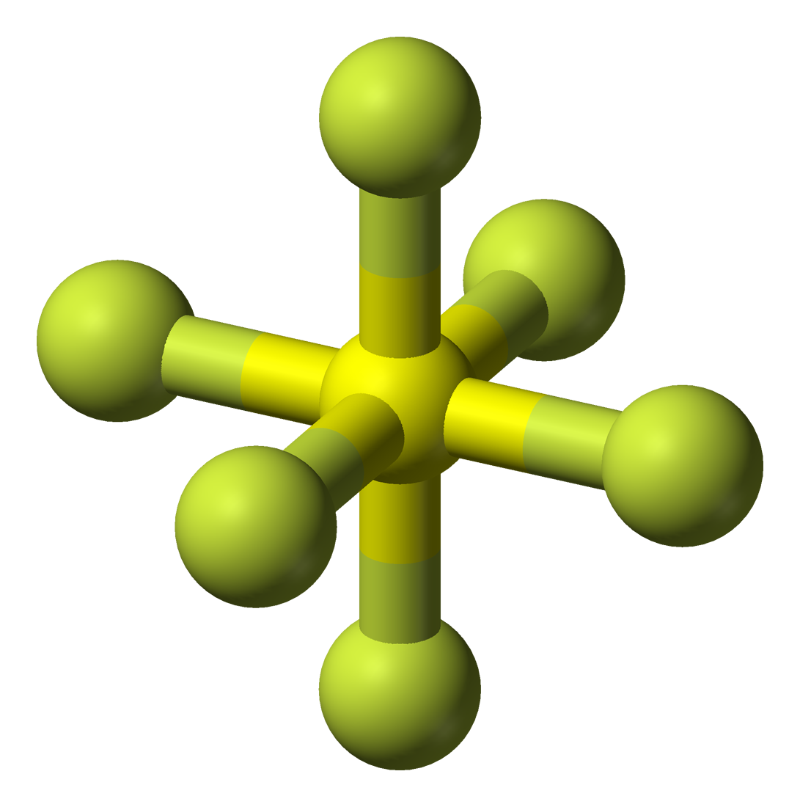
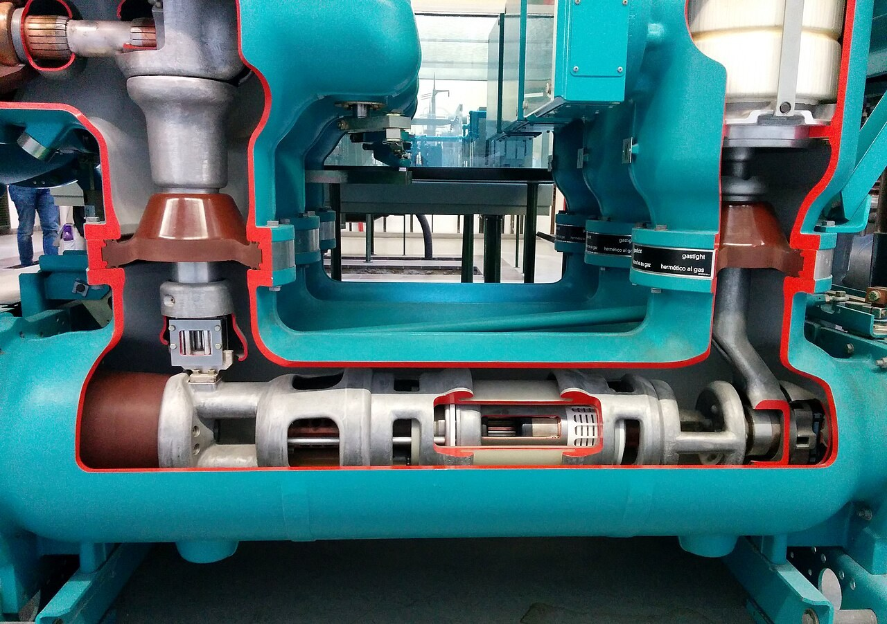

(sec:ch03:s03)=

# 3.3 Masses of Atoms and Molecules

```{note} Learning Objective

1. Express the masses of atoms and molecules.
```

Because matter is defined as anything that has mass and takes up space, it should not be surprising to learn that atoms and molecules have mass.

Individual atoms and molecules, however, are very small, and the masses of individual atoms and molecules are also very small. For macroscopic objects, we use units such as grams and kilograms to state their masses, but these units are much too big to comfortably describe the masses of individual atoms and molecules. Another scale is needed.

The **atomic mass unit** (*One-twelfth of the mass of a carbon-12 atom.*) (u; some texts use amu, but this older style is no longer accepted) is defined as one-twelfth of the mass of a carbon-12 atom, an isotope of carbon that has six protons and six neutrons in its nucleus. By this scale, the mass of a proton is 1.00728 u, the mass of a neutron is 1.00866 u, and the mass of an electron is 0.000549 u. There will not be much error if you estimate the mass of an atom by simply counting the total number of protons and neutrons in the nucleus (i.e., identify its mass number) and ignore the electrons. Thus, the mass of carbon-12 is about 12 u, the mass of oxygen-16 is about 16 u, and the mass of uranium-238 is about 238 u. More exact masses are found in scientific references—for example, the exact mass of uranium-238 is 238.050788 u, so you can see that we are not far off by using the whole-number value as the mass of the atom.

What is the mass of an element? This is somewhat more complicated because most elements exist as a mixture of isotopes, each of which has its own mass. Thus, although it is easy to speak of the mass of an atom, when talking about the mass of an element, we must take the isotopic mixture into account.

The **atomic mass** (*The weighted average of the masses of the isotopes that compose an element.*) of an element is a weighted average of the masses of the isotopes that compose an element. What do we mean by a weighted average? Well, consider an element that consists of two isotopes, 50% with mass 10 u and 50% with mass 11 u. A weighted average is found by multiplying each mass by its fractional occurrence (in decimal form) and then adding all the products. The sum is the weighted average and serves as the formal atomic mass of the element. In this example, we have the following:

| 0.50 × 10 u | = 5.0 u |
| --- | --- |
| 0.50 × 11 u | = 5.5 u |
| Sum | = 10.5 u = the atomic mass of our element |

Note that no atom in our hypothetical element has a mass of 10.5 u; rather, that is the average mass of the atoms, weighted by their percent occurrence.

This example is similar to a real element. Boron exists as about 20% boron-10 (five protons and five neutrons in the nuclei) and about 80% boron-11 (five protons and six neutrons in the nuclei). The atomic mass of boron is calculated similarly to what we did for our hypothetical example, but the percentages are different:

| 0.20 × 10 u | = 2.0 u |
| --- | --- |
| 0.80 × 11 u | = 8.8 u |
| Sum | = 10.8 u = the atomic mass of boron |

Thus, we use 10.8 u for the atomic mass of boron.

Virtually all elements exist as mixtures of isotopes, so atomic masses may vary significantly from whole numbers. {ref}`Table 3.5 "Selected Atomic Masses of Some Elements" <tbl:ch03:s03:t01>` lists the atomic masses of some elements; a more expansive table is in {ref}`Chapter 17 "Appendix: Periodic Table of the Elements" <ch:ch17>`. The atomic masses in {ref}`Table 3.5 "Selected Atomic Masses of Some Elements" <tbl:ch03:s03:t01>` are listed to three decimal places where possible, but in most cases, only one or two decimal places are needed. Note that many of the atomic masses, especially the larger ones, are not very close to whole numbers. This is, in part, the effect of an increasing number of isotopes as the atoms increase in size. (The record number is 10 isotopes for tin.)

```{table} Selected Atomic Masses of Some Elements
:label: tbl:ch03:s03:t01

| Element Name | Atomic Mass (u) |   | Element Name | Atomic Mass (u) |
| --- | --- | --- | --- | --- |
| Aluminum | 26.981 |   | Molybdenum | 95.94 |
| Argon | 39.948 |   | Neon | 20.180 |
| Arsenic | 74.922 |   | Nickel | 58.693 |
| Barium | 137.327 |   | Nitrogen | 14.007 |
| Beryllium | 9.012 |   | Oxygen | 15.999 |
| Bismuth | 208.980 |   | Palladium | 106.42 |
| Boron | 10.811 |   | Phosphorus | 30.974 |
| Bromine | 79.904 |   | Platinum | 195.084 |
| Calcium | 40.078 |   | Potassium | 39.098 |
| Carbon | 12.011 |   | Radium | n/a |
| Chlorine | 35.453 |   | Radon | n/a |
| Cobalt | 58.933 |   | Rubidium | 85.468 |
| Copper | 63.546 |   | Scandium | 44.956 |
| Fluorine | 18.998 |   | Selenium | 78.96 |
| Gallium | 69.723 |   | Silicon | 28.086 |
| Germanium | 72.64 |   | Silver | 107.868 |
| Gold | 196.967 |   | Sodium | 22.990 |
| Helium | 4.003 |   | Strontium | 87.62 |
| Hydrogen | 1.008 |   | Sulfur | 32.065 |
| Iodine | 126.904 |   | Tantalum | 180.948 |
| Iridium | 192.217 |   | Tin | 118.710 |
| Iron | 55.845 |   | Titanium | 47.867 |
| Krypton | 83.798 |   | Tungsten | 183.84 |
| Lead | 207.2 |   | Uranium | 238.029 |
| Lithium | 6.941 |   | Xenon | 131.293 |
| Magnesium | 24.305 |   | Zinc | 65.409 |
| Manganese | 54.938 |   | Zirconium | 91.224 |
| Mercury | 200.59 |   | Molybdenum | 95.94 |

Note: Atomic mass is given to three decimal places, if known.
```

Now that we understand that atoms have mass, it is easy to extend the concept to the mass of molecules. The **molecular mass** (*The sum of the masses of the atoms in a molecule.*) is the sum of the masses of the atoms in a molecule. This may seem like a trivial extension of the concept, but it is important to count the number of each type of atom in the molecular formula. Also, although each atom in a molecule is a particular isotope, we use the weighted average, or atomic mass, for each atom in the molecule.

For example, if we were to determine the molecular mass of dinitrogen trioxide, N<sub>2</sub>O<sub>3</sub>, we would need to add the atomic mass of nitrogen two times with the atomic mass of oxygen three times:

| 2 N masses = 2 × 14.007 u | = 28.014 u |
| --- | --- |
| 3 O masses = 3 × 15.999 u | = 47.997 u |
| Total | = 76.011 u = the molecular mass of N<sub>2</sub>O<sub>3</sub> |

We would not be far off if we limited our numbers to one or even two decimal places.

```{exercise}
:label: ex:ball-ch03-s03-n02

**Example 5**

What is the molecular mass of each substance?

1. NBr<sub>3</sub>
2. C<sub>2</sub>H<sub>6</sub>
```

```{solution} ex:ball-ch03-s03-n02
:label: sol:ball-ch03-s03-n02
:class: dropdown

1. Add one atomic mass of nitrogen and three atomic masses of bromine:

   | 1 N mass | = 14.007 u |
   | --- | --- |
   | 3 Br masses = 3 × 79.904 u | = 239.712 u |
   | Total | = 253.719 u = the molecular mass of NBr<sub>3</sub> |
2. Add two atomic masses of carbon and six atomic masses of hydrogen:

   | 2 C masses = 2 × 12.011 u | = 24.022 u |
   | --- | --- |
   | 6 H masses = 6 × 1.008 u | = 6.048 u |
   | Total | = 30.070 u = the molecular mass of C<sub>2</sub>H<sub>6</sub> |

   The compound C<sub>2</sub>H<sub>6</sub> also has a common name—ethane.
```

```{exercise}
:label: ex:ball-ch03-s03-n02-ty2

**Test Yourself**

What is the molecular mass of each substance?

1. SO<sub>2</sub>
2. PF<sub>3</sub>
```

```{solution} ex:ball-ch03-s03-n02-ty2
:label: sol:ball-ch03-s03-n02-ty2
:class: dropdown

1. 64.063 u
2. 87.968 u
```

```{tip} Chemistry Is Everywhere: Sulfur Hexafluoride

On March 20, 1995, the Japanese terrorist group Aum Shinrikyo (Sanskrit for “Supreme Truth”) released some sarin gas in the Tokyo subway system; twelve people were killed, and thousands were injured. The training scene in part (a) of {ref}`Figure 3.4 "Sarin and Sulfur Hexafluoride" <fig:ch03:s03:f01>` illustrates preparation for hazardous exposures. Sarin (molecular formula C<sub>4</sub>H<sub>10</sub>FPO<sub>2</sub>) is a nerve toxin that was first synthesized in 1938. It is regarded as one of the most deadly toxins known, estimated to be about 500 times more potent than cyanide. Scientists and engineers who study the spread of chemical weapons such as sarin (yes, there are such scientists) would like to have a less dangerous chemical, indeed one that is nontoxic, so they are not at risk themselves.

Sulfur hexafluoride is used as a model compound for sarin. SF<sub>6</sub> (a molecular model of which is shown in part (b) of {ref}`Figure 3.4 "Sarin and Sulfur Hexafluoride" <fig:ch03:s03:f01>`) has a similar molecular mass (about 146 u) as sarin (about 140 u), so it has similar physical properties in the vapor phase. Sulfur hexafluoride is also very easy to accurately detect, even at low levels, and it is not a normal part of the atmosphere, so there is little potential for contamination from natural sources. Consequently, SF<sub>6</sub> is also used as an aerial tracer for ventilation systems in buildings. It is nontoxic and very chemically inert, so workers do not have to take special precautions other than watching for asphyxiation.

Sulfur hexafluoride also has another interesting use: a spark suppressant in high-voltage electrical equipment. High-pressure SF<sub>6</sub> gas is used in place of older oils that may have contaminants that are environmentally unfriendly (part (c) of {ref}`Figure 3.4 "Sarin and Sulfur Hexafluoride" <fig:ch03:s03:f01>`).
```

```{figure} ../images/restored/hazmat.jpg
:label: fig:ch03:s03:f01
:enumerator: 3.4
:alt: Soldiers participating in a medical decontamination training exercise.
:align: center
:width: 70%

**Sarin and Sulfur Hexafluoride.** (a) A medical decontamination training exercise. (b) A molecular model of SF₆. (c) A cutaway of an SF₆ circuit breaker. The training photograph illustrates preparation for hazardous exposures.





Credits: [Medical decontamination exercise (8856731) — U.S. Army National Guard photo by Spc. Israel Fernandez](https://commons.wikimedia.org/wiki/File:Medical_decontamination_exercise_(8856731).jpg), [Public domain](https://creativecommons.org/publicdomain/mark/1.0/); [Sulfur-hexafluoride-3D-balls — Ben Mills (Benjah-bmm27)](https://commons.wikimedia.org/wiki/File:Sulfur-hexafluoride-3D-balls.png), [Public domain](https://creativecommons.org/publicdomain/mark/1.0/); [SF6 Schaltanlage Schnittmodel Leistungsschalter — Photograph: wdwd](https://commons.wikimedia.org/wiki/File:SF6_Schaltanlage_Schnittmodel_Leistungsschalter.jpg), [CC BY-SA 4.0](https://creativecommons.org/licenses/by-sa/4.0). Images resized for the web.
```

```{important} Key Takeaways

- The atomic mass unit (u) is a unit that describes the masses of individual atoms and molecules.
- The atomic mass is the weighted average of the masses of all isotopes of an element.
- The molecular mass is the sum of the masses of the atoms in a molecule.
```

## Exercises

```{exercise}
:label: ex:ball-ch03-s03-qs01-qd01-qa01

**Exercise 1.**

Define *atomic mass unit*. What is its abbreviation?
```

```{solution} ex:ball-ch03-s03-qs01-qd01-qa01
:label: sol:ball-ch03-s03-qs01-qd01-qa01
:class: dropdown

The atomic mass unit is defined as one-twelfth of the mass of a carbon-12 atom. Its abbreviation is u.
```

```{exercise}
:label: ex:ball-ch03-s03-qs01-qd01-qa02

**Exercise 2.**

Define *atomic mass*. What is its unit?
```

```{exercise}
:label: ex:ball-ch03-s03-qs01-qd01-qa03

**Exercise 3.**

Estimate the mass, in whole numbers, of each isotope.

a. hydrogen-1
b. hydrogen-3
c. iron-56
```

```{solution} ex:ball-ch03-s03-qs01-qd01-qa03
:label: sol:ball-ch03-s03-qs01-qd01-qa03
:class: dropdown

a. 1
b. 3
c. 56
```

```{exercise}
:label: ex:ball-ch03-s03-qs01-qd01-qa04

**Exercise 4.**

Estimate the mass, in whole numbers, of each isotope.

a. phosphorus-31
b. carbon-14
c. americium-241
```

```{exercise}
:label: ex:ball-ch03-s03-qs01-qd01-qa05

**Exercise 5.**

Determine the atomic mass of each element, given the isotopic composition.

a. lithium, which is 92.4% lithium-7 (mass 7.016 u) and 7.60% lithium-6 (mass 6.015 u)
b. oxygen, which is 99.76% oxygen-16 (mass 15.995 u), 0.038% oxygen-17 (mass 16.999 u), and 0.205% oxygen-18 (mass 17.999 u)
```

```{solution} ex:ball-ch03-s03-qs01-qd01-qa05
:label: sol:ball-ch03-s03-qs01-qd01-qa05
:class: dropdown

a. 6.940 u
b. 16.000 u
```

```{exercise}
:label: ex:ball-ch03-s03-qs01-qd01-qa06

**Exercise 6.**

Determine the atomic mass of each element, given the isotopic composition.

a. neon, which is 90.48% neon-20 (mass 19.992 u), 0.27% neon-21 (mass 20.994 u), and 9.25% neon-22 (mass 21.991 u)
b. uranium, which is 99.27% uranium-238 (mass 238.051 u) and 0.720% uranium-235 (mass 235.044 u)
```

```{exercise}
:label: ex:ball-ch03-s03-qs01-qd01-qa07

**Exercise 7.**

How far off would your answer be from Exercise 5a if you used whole-number masses for individual isotopes of lithium?
```

```{solution} ex:ball-ch03-s03-qs01-qd01-qa07
:label: sol:ball-ch03-s03-qs01-qd01-qa07
:class: dropdown

We would get 6.924 u.
```

```{exercise}
:label: ex:ball-ch03-s03-qs01-qd01-qa08

**Exercise 8.**

How far off would your answer be from Exercise 6b if you used whole-number masses for individual isotopes of uranium?
```

```{exercise}
:label: ex:ball-ch03-s03-qs01-qd01-qa09

**Exercise 9.**

a. What is the atomic mass of an oxygen atom?
b. What is the molecular mass of oxygen in its elemental form?
```

```{solution} ex:ball-ch03-s03-qs01-qd01-qa09
:label: sol:ball-ch03-s03-qs01-qd01-qa09
:class: dropdown

a. 15.999 u
b. 31.998 u
```

```{exercise}
:label: ex:ball-ch03-s03-qs01-qd01-qa10

**Exercise 10.**

a. What is the atomic mass of bromine?
b. What is the molecular mass of bromine in its elemental form?
```

```{exercise}
:label: ex:ball-ch03-s03-qs01-qd01-qa11

**Exercise 11.**

Determine the mass of each substance.

a. F<sub>2</sub>
b. CO
c. CO<sub>2</sub>
```

```{solution} ex:ball-ch03-s03-qs01-qd01-qa11
:label: sol:ball-ch03-s03-qs01-qd01-qa11
:class: dropdown

a. 37.996 u
b. 28.010 u
c. 44.009 u
```

```{exercise}
:label: ex:ball-ch03-s03-qs01-qd01-qa12

**Exercise 12.**

Determine the mass of each substance.

a. Kr
b. KrF<sub>4</sub>
c. PF<sub>5</sub>
```

```{exercise}
:label: ex:ball-ch03-s03-qs01-qd01-qa13

**Exercise 13.**

Determine the mass of each substance.

a. Na
b. B<sub>2</sub>O<sub>3</sub>
c. S<sub>2</sub>Cl<sub>2</sub>
```

```{solution} ex:ball-ch03-s03-qs01-qd01-qa13
:label: sol:ball-ch03-s03-qs01-qd01-qa13
:class: dropdown

a. 22.990 u
b. 69.619 u
c. 135.036 u
```

```{exercise}
:label: ex:ball-ch03-s03-qs01-qd01-qa14

**Exercise 14.**

Determine the mass of each substance.

a. IBr<sub>3</sub>
b. N<sub>2</sub>O<sub>5</sub>
c. CCl<sub>4</sub>
```

```{exercise}
:label: ex:ball-ch03-s03-qs01-qd01-qa15

**Exercise 15.**

Determine the mass of each substance.

a. GeO<sub>2</sub>
b. IF<sub>3</sub>
c. XeF<sub>6</sub>
```

```{solution} ex:ball-ch03-s03-qs01-qd01-qa15
:label: sol:ball-ch03-s03-qs01-qd01-qa15
:class: dropdown

a. 104.64 u
b. 183.898 u
c. 245.281 u
```

```{exercise}
:label: ex:ball-ch03-s03-qs01-qd01-qa16

**Exercise 16.**

Determine the mass of each substance.

a. NO
b. N<sub>2</sub>O<sub>4</sub>
c. Ca
```
