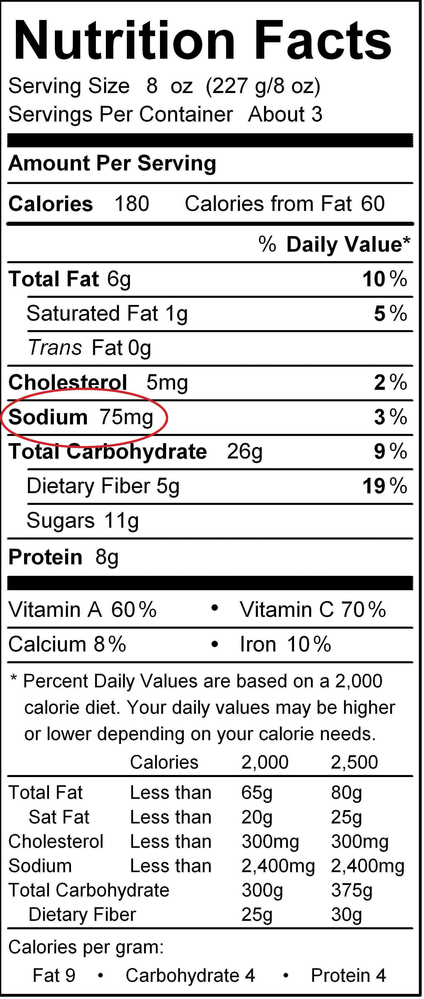

(sec:ch03:s04)=

# 3.4 Ions and Ionic Compounds

```{note} Learning Objectives

1. Know how ions form.
2. Learn the characteristic charges that ions have.
3. Construct a proper formula for an ionic compound.
4. Generate a proper name for an ionic compound.
```

So far, we have discussed elements and compounds that are electrically neutral. They have the same number of electrons as protons, so the negative charges of the electrons is balanced by the positive charges of the protons. However, this is not always the case. Electrons can move from one atom to another; when they do, species with overall electric charges are formed. Such species are called **ions** (*A species with an overall electric charge.*). Species with overall positive charges are termed **cations** (*A species with an overall positive charge.*), while species with overall negative charges are called **anions** (*A species with an overall negative charge.*). Remember that ions are formed only when *electrons* move from one atom to another; a proton never moves from one atom to another. Compounds formed from positive and negative ions are called **ionic compounds** (*A compound formed from positive and negative ions.*).

Individual atoms can gain or lose electrons. When they do, they become *monatomic* ions. When atoms gain or lose electrons, they usually gain or lose a characteristic number of electrons and so take on a characteristic overall charge. {ref}`Table 3.6 "Monatomic Ions of Various Charges" <tbl:ch03:s04:t01>` lists some common ions in terms of how many electrons they lose (making cations) or gain (making anions). There are several things to notice about the ions in {ref}`Table 3.6 "Monatomic Ions of Various Charges" <tbl:ch03:s04:t01>`. First, each element that forms cations is a metal, except for one (hydrogen), while each element that forms anions is a nonmetal. This is actually one of the chemical properties of metals and nonmetals: metals tend to form cations, while nonmetals tend to form anions. Second, most atoms form ions of a single characteristic charge. When sodium atoms form ions, they always form a 1+ charge, never a 2+ or 3+ or even 1− charge. Thus, if you commit the information in {ref}`Table 3.6 "Monatomic Ions of Various Charges" <tbl:ch03:s04:t01>` to memory, you will always know what charges most atoms form. (In {ref}`Chapter 9 "Chemical Bonds" <ch:ch09>`, we will discuss *why* atoms form the charges they do.)

```{table} Monatomic Ions of Various Charges
:label: tbl:ch03:s04:t01

| Ions formed by losing a single electron | H<sup>+</sup> |
| --- | --- |
|   | Na<sup>+</sup> |
|   | K<sup>+</sup> |
|   | Rb<sup>+</sup> |
|   | Ag<sup>+</sup> |
|   | Au<sup>+</sup> |
| Ions formed by losing two electrons | Mg<sup>2+</sup> |
|   | Ca<sup>2+</sup> |
|   | Sr<sup>2+</sup> |
|   | Fe<sup>2+</sup> |
|   | Co<sup>2+</sup> |
|   | Ni<sup>2+</sup> |
|   | Cu<sup>2+</sup> |
|   | Zn<sup>2+</sup> |
|   | Sn<sup>2+</sup> |
|   | Hg<sup>2+</sup> |
|   | Pb<sup>2+</sup> |
| Ions formed by losing three electrons | Sc<sup>3+</sup> |
|   | Fe<sup>3+</sup> |
|   | Co<sup>3+</sup> |
|   | Ni<sup>3+</sup> |
|   | Au<sup>3+</sup> |
|   | Al<sup>3+</sup> |
|   | Cr<sup>3+</sup> |
| Ions formed by losing four electrons | Ti<sup>4+</sup> |
|   | Sn<sup>4+</sup> |
|   | Pb<sup>4+</sup> |
| Ions formed by gaining a single electron | F<sup>−</sup> |
|   | Cl<sup>−</sup> |
|   | Br<sup>−</sup> |
|   | I<sup>−</sup> |
| Ions formed by gaining two electrons | O<sup>2−</sup> |
|   | S<sup>2−</sup> |
|   | Se<sup>2−</sup> |
| Ions formed by gaining three electrons | N<sup>3−</sup> |
|   | P<sup>3−</sup> |
```

Third, there are some exceptions to the previous point. A few elements, all metals, can form more than one possible charge. For example, iron atoms can form 2+ cations or 3+ cations. Cobalt is another element that can form more than one possible charged ion (2+ and 3+), while lead can form 2+ or 4+ cations. Unfortunately, there is little understanding which two charges a metal atom may take, so it is best to just memorize the possible charges a particular element can have.

Note the convention for indicating an ion. The magnitude of the charge is listed as a right superscript next to the symbol of the element. If the charge is a single positive or negative one, the number 1 is not written; if the magnitude of the charge is greater than 1, then the number is written *before* the + or − sign. An element symbol without a charge written next to it is assumed to be the uncharged atom.

Naming an ion is straightforward. For a cation, simply use the name of the element and add the word *ion* (or if you want to be more specific, add *cation*) after the element’s name. So Na<sup>+</sup> is the sodium ion; Ca<sup>2+</sup> is the calcium ion. If the element has more than one possible charge, the value of the charge comes after the element name and before the word *ion*. Thus, Fe<sup>2+</sup> is the iron two ion, while Fe<sup>3+</sup> is the iron three ion. In print, we use roman numerals in parentheses to represent the charge on the ion, so these two iron ions would be represented as the iron(II) cation and the iron(III) cation, respectively.

For a monatomic anion, use the stem of the element name and append the suffix *-ide* to it, and then add *ion*. This is similar to how we named molecular compounds. Thus, Cl<sup>−</sup> is the chloride ion, and N<sup>3−</sup> is the nitride ion.

```{exercise}
:label: ex:ball-ch03-s04-n02

**Example 6**

Name each species.

1. O<sup>2−</sup>
2. Co
3. Co<sup>2+</sup>
```

```{solution} ex:ball-ch03-s04-n02
:label: sol:ball-ch03-s04-n02
:class: dropdown

1. This species has a 2− charge on it, so it is an anion. Anions are named using the stem of the element name with the suffix *-ide* added. This is the oxide anion.
2. Because this species has no charge, it is an atom in its elemental form. This is cobalt.
3. In this case, there is a 2+ charge on the atom, so it is a cation. We note from {ref}`Table 3.6 "Monatomic Ions of Various Charges" <tbl:ch03:s04:t01>` that cobalt cations can have two possible charges, so the name of the ion must specify which charge the ion has. This is the cobalt(II) cation.
```

```{exercise}
:label: ex:ball-ch03-s04-n02-ty2

**Test Yourself**

Name each species.

1. P<sup>3−</sup>
2. Sr<sup>2+</sup>
```

```{solution} ex:ball-ch03-s04-n02-ty2
:label: sol:ball-ch03-s04-n02-ty2
:class: dropdown

1. the phosphide anion
2. the strontium cation
```

Chemical formulas for ionic compounds are called **ionic formulas** (*The chemical formula for an ionic compound.*). A proper ionic formula has a cation and an anion in it; an ionic compound is never formed between two cations only or two anions only. The key to writing proper ionic formulas is simple: the total positive charge must balance the total negative charge. Because the charges on the ions are characteristic, sometimes we have to have more than one of a cation or an anion to balance the overall positive and negative charges. It is conventional to use the lowest ratio of ions that are needed to balance the charges.

For example, consider the ionic compound between Na<sup>+</sup> and Cl<sup>−</sup>. Each ion has a single charge, one positive and one negative, so we need only one ion of each to balance the overall charge. When writing the ionic formula, we follow two additional conventions: (1) write the formula for the cation first and the formula for the anion next, but (2) do not write the charges on the ions. Thus, for the compound between Na<sup>+</sup> and Cl<sup>−</sup>, we have the ionic formula NaCl (Figure 3.5 "NaCl = Table Salt"). The formula Na<sub>2</sub>Cl<sub>2</sub> also has balanced charges, but the convention is to use the lowest ratio of ions, which would be one of each. (Remember from our conventions for writing formulas that we don’t write a 1 subscript if there is only one atom of a particular element present.) For the ionic compound between magnesium cations (Mg<sup>2+</sup>) and oxide anions (O<sup>2−</sup>), again we need only one of each ion to balance the charges. By convention, the formula is MgO.

For the ionic compound between Mg<sup>2+</sup> ions and Cl<sup>−</sup> ions, we now consider the fact that the charges have different magnitudes, 2+ on the magnesium ion and 1− on the chloride ion. To balance the charges with the lowest number of ions possible, we need to have two chloride ions to balance the charge on the one magnesium ion. Rather than write the formula MgClCl, we combine the two chloride ions and write it with a 2 subscript: MgCl<sub>2</sub>.

What is the formula MgCl<sub>2</sub> telling us? There are two chloride ions in the formula. Although chlorine as an element is a diatomic molecule, Cl<sub>2</sub>, elemental chlorine is not part of this ionic compound. The chlorine is in the form of a negatively charged *ion*, not the neutral *element*. The 2 subscript is in the ionic formula because we need two Cl<sup>−</sup> ions to balance the charge on one Mg<sup>2+</sup> ion.

```{exercise}
:label: ex:ball-ch03-s04-n03

**Example 7**

Write the proper ionic formula for each of the two given ions.

1. Ca<sup>2+</sup> and Cl<sup>−</sup>
2. Al<sup>3+</sup> and F<sup>−</sup>
3. Al<sup>3+</sup> and O<sup>2−</sup>
```

```{solution} ex:ball-ch03-s04-n03
:label: sol:ball-ch03-s04-n03
:class: dropdown

1. We need two Cl<sup>−</sup> ions to balance the charge on one Ca<sup>2+</sup> ion, so the proper ionic formula is CaCl<sub>2</sub>.
2. We need three F<sup>−</sup> ions to balance the charge on the Al<sup>3+</sup> ion, so the proper ionic formula is AlF<sub>3</sub>.
3. With Al<sup>3+</sup> and O<sup>2−</sup>, note that neither charge is a perfect multiple of the other. This means we have to go to a least common multiple, which in this case will be six. To get a total of 6+, we need two Al<sup>3+</sup> ions; to get 6−, we need three O<sup>2−</sup> ions. Hence the proper ionic formula is Al<sub>2</sub>O<sub>3</sub>.
```

```{exercise}
:label: ex:ball-ch03-s04-n03-ty2

**Test Yourself**

Write the proper ionic formulas for each of the two given ions.

1. Fe<sup>2+</sup> and S<sup>2−</sup>
2. Fe<sup>3+</sup> and S<sup>2−</sup>
```

```{solution} ex:ball-ch03-s04-n03-ty2
:label: sol:ball-ch03-s04-n03-ty2
:class: dropdown

1. FeS
2. Fe<sub>2</sub>S<sub>3</sub>
```

Naming ionic compounds is simple: combine the name of the cation and the name of the anion, in both cases omitting the word *ion*. *Do not use numerical prefixes if there is more than one ion necessary to balance the charges.* NaCl is sodium chloride, a combination of the name of the cation (sodium) and the anion (chloride). MgO is magnesium oxide. MgCl<sub>2</sub> is magnesium chloride—*not* magnesium dichloride.

In naming ionic compounds whose cations can have more than one possible charge, we must also include the charge, in parentheses and in roman numerals, as part of the name. Hence FeS is iron(II) sulfide, while Fe<sub>2</sub>S<sub>3</sub> is iron(III) sulfide. Again, no numerical prefixes appear in the name. The number of ions in the formula is dictated by the need to balance the positive and negative charges.

```{exercise}
:label: ex:ball-ch03-s04-n04

**Example 8**

Name each ionic compound.

1. CaCl<sub>2</sub>
2. AlF<sub>3</sub>
3. Co<sub>2</sub>O<sub>3</sub>
```

```{solution} ex:ball-ch03-s04-n04
:label: sol:ball-ch03-s04-n04
:class: dropdown

1. Using the names of the ions, this ionic compound is named calcium chloride. *It is not calcium(II) chloride* because calcium forms only one cation when it forms an ion, and it has a characteristic charge of 2+.
2. The name of this ionic compound is aluminum fluoride.
3. We know that cobalt can have more than one possible charge; we just need to determine what it is. Oxide always has a 2− charge, so with three oxide ions, we have a total negative charge of 6−. This means that the two cobalt ions have to contribute 6+, which for two cobalt ions means that each one is 3+. Therefore, the proper name for this ionic compound is cobalt(III) oxide.
```

```{exercise}
:label: ex:ball-ch03-s04-n04-ty2

**Test Yourself**

Name each ionic compound.

1. Sc<sub>2</sub>O<sub>3</sub>
2. AgCl
```

```{solution} ex:ball-ch03-s04-n04-ty2
:label: sol:ball-ch03-s04-n04-ty2
:class: dropdown

1. scandium oxide
2. silver chloride
```

How do you know whether a formula—and by extension, a name—is for a molecular compound or for an ionic compound? Molecular compounds form between nonmetals and nonmetals, while ionic compounds form between metals and nonmetals. The periodic table ({ref}`Figure 3.2 "A Simple Periodic Table" <fig:ch03:s01:f02>`) can be used to determine which elements are metals and nonmetals.

There also exists a group of ions that contain more than one atom. These are called **polyatomic ions** (*An ion that contains more than one atom.*). {ref}`Table 3.7 "Common Polyatomic Ions" <tbl:ch03:s04:t02>` lists the formulas, charges, and names of some common polyatomic ions. Only one of them, the ammonium ion, is a cation; the rest are anions. Most of them also contain oxygen atoms, so sometimes they are referred to as *oxyanions*. Some of them, such as nitrate and nitrite, and sulfate and sulfite, have very similar formulas and names, so care must be taken to get the formulas and names correct. Note that the -ite polyatomic ion has one less oxygen atom in its formula than the -ate ion but with the same ionic charge.

```{table} Common Polyatomic Ions
:label: tbl:ch03:s04:t02

| Name | Formula and Charge |   | Name | Formula and Charge |
| --- | --- | --- | --- | --- |
| ammonium | NH<sub>4</sub><sup>+</sup> |   | hydroxide | OH<sup>−</sup> |
| acetate | C<sub>2</sub>H<sub>3</sub>O<sub>2</sub><sup>−</sup>, or CH<sub>3</sub>COO<sup>−</sup> |   | nitrate | NO<sub>3</sub><sup>−</sup> |
| bicarbonate (hydrogen carbonate) | HCO<sub>3</sub><sup>−</sup> |   | nitrite | NO<sub>2</sub><sup>−</sup> |
| bisulfate (hydrogen sulfate) | HSO<sub>4</sub><sup>−</sup> |   | peroxide | O<sub>2</sub><sup>2−</sup> |
| carbonate | CO<sub>3</sub><sup>2−</sup> |   | perchlorate | ClO<sub>4</sub><sup>−</sup> |
| chlorate | ClO<sub>3</sub><sup>−</sup> |   | phosphate | PO<sub>4</sub><sup>3−</sup> |
| chromate | CrO<sub>4</sub><sup>2−</sup> |   | sulfate | SO<sub>4</sub><sup>2−</sup> |
| cyanide | CN<sup>−</sup> |   | sulfite | SO<sub>3</sub><sup>2−</sup> |
| dichromate | Cr<sub>2</sub>O<sub>7</sub><sup>2−</sup> |   | triiodide | I<sub>3</sub><sup>−</sup> |
```

The naming of ionic compounds that contain polyatomic ions follows the same rules as the naming for other ionic compounds: simply combine the name of the cation and the name of the anion. Do not use numerical prefixes in the name if there is more than one polyatomic ion; the only exception to this is if the name of the ion itself contains a numerical prefix, such as dichromate or triiodide.

Writing the formulas of ionic compounds has one important difference. If more than one polyatomic ion is needed to balance the overall charge in the formula, enclose the formula of the polyatomic ion in parentheses and write the proper numerical subscript to the right and *outside* the parentheses. Thus, the formula between calcium ions, Ca<sup>2+</sup>, and nitrate ions, NO<sub>3</sub><sup>−</sup>, is properly written Ca(NO<sub>3</sub>)<sub>2</sub>, not CaNO<sub>32</sub> or CaN<sub>2</sub>O<sub>6</sub>. Use parentheses where required. The name of this ionic compound is simply calcium nitrate.

```{exercise}
:label: ex:ball-ch03-s04-n05

**Example 9**

Write the proper formula and give the proper name for each ionic compound formed between the two listed ions.

1. NH<sub>4</sub><sup>+</sup> and S<sup>2−</sup>
2. Al<sup>3+</sup> and PO<sub>4</sub><sup>3−</sup>
3. Fe<sup>2+</sup> and PO<sub>4</sub><sup>3−</sup>
```

```{solution} ex:ball-ch03-s04-n05
:label: sol:ball-ch03-s04-n05
:class: dropdown

1. Because the ammonium ion has a 1+ charge and the sulfide ion has a 2− charge, we need two ammonium ions to balance the charge on a single sulfide ion. Enclosing the formula for the ammonium ion in parentheses, we have (NH<sub>4</sub>)<sub>2</sub>S. The compound’s name is ammonium sulfide.
2. Because the ions have the same magnitude of charge, we need only one of each to balance the charges. The formula is AlPO<sub>4</sub>, and the name of the compound is aluminum phosphate.
3. Neither charge is an exact multiple of the other, so we have to go to the least common multiple of 6. To get 6+, we need three iron(II) ions, and to get 6−, we need two phosphate ions. The proper formula is Fe<sub>3</sub>(PO<sub>4</sub>)<sub>2</sub>, and the compound’s name is iron(II) phosphate.
```

```{exercise}
:label: ex:ball-ch03-s04-n05-ty2

**Test Yourself**

Write the proper formula and give the proper name for each ionic compound formed between the two listed ions.

1. NH<sub>4</sub><sup>+</sup> and PO<sub>4</sub><sup>3−</sup>
2. Co<sup>3+</sup> and NO<sub>2</sub><sup>−</sup>
```

```{solution} ex:ball-ch03-s04-n05-ty2
:label: sol:ball-ch03-s04-n05-ty2
:class: dropdown

1. (NH<sub>4</sub>)<sub>3</sub>PO<sub>4</sub>, ammonium phosphate
2. Co(NO<sub>2</sub>)<sub>3</sub>, cobalt(III) nitrite
```

```{tip} Food and Drink App: Sodium in Your Food

The element sodium, at least in its ionic form as Na<sup>+</sup>, is a necessary nutrient for humans to live. In fact, the human body is approximately 0.15% sodium, with the average person having one-twentieth to one-tenth of a kilogram in their body at any given time, mostly in fluids outside cells and in other bodily fluids.

Sodium is also present in our diet. The common table salt we use on our foods is an ionic sodium compound. Many processed foods also contain significant amounts of sodium added to them as a variety of ionic compounds. Why are sodium compounds used so much? Usually sodium compounds are inexpensive, but, more importantly, most ionic sodium compounds dissolve easily. This allows processed food manufacturers to add sodium-containing substances to food mixtures and know that the compound will dissolve and distribute evenly throughout the food. Simple ionic compounds such as sodium nitrite (NaNO<sub>2</sub>) are added to cured meats, such as bacon and deli-style meats, while a compound called sodium benzoate is added to many packaged foods as a preservative. {ref}`Table 3.8 "Some Sodium Compounds Added to Food" <tbl:ch03:s04:t03>` is a partial list of some sodium additives used in food. Some of them you may recognize after reading this chapter. Others you may not recognize, but they are all ionic sodium compounds with some negatively charged ion also present.

(tbl:ch03:s04:t03)=

**Some Sodium Compounds Added to Food**

| Sodium Compound | Use in Food |
| --- | --- |
| Sodium acetate | preservative, acidity regulator |
| Sodium adipate | food acid |
| Sodium alginate | thickener, vegetable gum, stabilizer, gelling agent, emulsifier |
| Sodium aluminum phosphate | acidity regulator, emulsifier |
| Sodium aluminosilicate | anticaking agent |
| Sodium ascorbate | antioxidant |
| Sodium benzoate | preservative |
| Sodium bicarbonate | mineral salt |
| Sodium bisulfite | preservative, antioxidant |
| Sodium carbonate | mineral salt |
| Sodium carboxymethylcellulose | emulsifier |
| Sodium citrates | food acid |
| Sodium dehydroacetate | preservative |
| Sodium erythorbate | antioxidant |
| Sodium erythorbin | antioxidant |
| Sodium ethyl para-hydroxybenzoate | preservative |
| Sodium ferrocyanide | anticaking agent |
| Sodium formate | preservative |
| Sodium fumarate | food acid |
| Sodium gluconate | stabilizer |
| Sodium hydrogen acetate | preservative, acidity regulator |
| Sodium hydroxide | mineral salt |
| Sodium lactate | food acid |
| Sodium malate | food acid |
| Sodium metabisulfite | preservative, antioxidant, bleaching agent |
| Sodium methyl para-hydroxybenzoate | preservative |
| Sodium nitrate | preservative, color fixative |
| Sodium nitrite | preservative, color fixative |
| Sodium orthophenyl phenol | preservative |
| Sodium propionate | preservative |
| Sodium propyl para-hydroxybenzoate | preservative |
| Sodium sorbate | preservative |
| Sodium stearoyl lactylate | emulsifier |
| Sodium succinates | acidity regulator, flavor enhancer |
| Sodium salts of fatty acids | emulsifier, stabilizer, anticaking agent |
| Sodium sulfite | mineral salt, preservative, antioxidant |
| Sodium sulfite | preservative, antioxidant |
| Sodium tartrate | food acid |
| Sodium tetraborate | preservative |

The use of so many sodium compounds in prepared and processed foods has alarmed some physicians and nutritionists. They argue that the average person consumes too much sodium from his or her diet. The average person needs only about 500 mg of sodium every day; most people consume more than this—up to 10 times as much. Some studies have implicated increased sodium intake with high blood pressure; newer studies suggest that the link is questionable. However, there has been a push to reduce the amount of sodium most people ingest every day: avoid processed and manufactured foods, read labels on packaged foods (which include an indication of the sodium content), don’t oversalt foods, and use other herbs and spices besides salt in cooking.

(fig:ch03:s04:f02)=



*Food labels include the amount of sodium per serving. This particular label shows that there are 75 mg of sodium in one serving of this particular food item.*
```

```{important} Key Takeaways

- Ions form when atoms lose or gain electrons.
- Ionic compounds have positive ions and negative ions.
- Ionic formulas balance the total positive and negative charges.
- Ionic compounds have a simple system of naming.
- Groups of atoms can have an overall charge and make ionic compounds.
```

## Exercises

```{exercise}
:label: ex:ball-ch03-s04-qs01-qd01-qa01

**Exercise 1.**

Explain how cations form.
```

```{solution} ex:ball-ch03-s04-qs01-qd01-qa01
:label: sol:ball-ch03-s04-qs01-qd01-qa01
:class: dropdown

Cations form by losing electrons.
```

```{exercise}
:label: ex:ball-ch03-s04-qs01-qd01-qa02

**Exercise 2.**

Explain how anions form.
```

```{exercise}
:label: ex:ball-ch03-s04-qs01-qd01-qa03

**Exercise 3.**

Give the charge each atom takes when it forms an ion. If more than one charge is possible, list both.

a. K
b. O
c. Co
```

```{solution} ex:ball-ch03-s04-qs01-qd01-qa03
:label: sol:ball-ch03-s04-qs01-qd01-qa03
:class: dropdown

a. 1+
b. 2−
c. 2+, 3+
```

```{exercise}
:label: ex:ball-ch03-s04-qs01-qd01-qa04

**Exercise 4.**

Give the charge each atom takes when it forms an ion. If more than one charge is possible, list both.

a. Ca
b. I
c. Fe
```

```{exercise}
:label: ex:ball-ch03-s04-qs01-qd01-qa05

**Exercise 5.**

Give the charge each atom takes when it forms an ion. If more than one charge is possible, list both.

a. Ag
b. Au
c. Br
```

```{solution} ex:ball-ch03-s04-qs01-qd01-qa05
:label: sol:ball-ch03-s04-qs01-qd01-qa05
:class: dropdown

a. 1+
b. 1+, 3+
c. 1−
```

```{exercise}
:label: ex:ball-ch03-s04-qs01-qd01-qa06

**Exercise 6.**

Give the charge each atom takes when it forms an ion. If more than one charge is possible, list both.

a. S
b. Na
c. H
```

```{exercise}
:label: ex:ball-ch03-s04-qs01-qd01-qa07

**Exercise 7.**

Name the ions from Exercise 3.
```

```{solution} ex:ball-ch03-s04-qs01-qd01-qa07
:label: sol:ball-ch03-s04-qs01-qd01-qa07
:class: dropdown

a. the potassium ion
b. the oxide ion
c. the cobalt(II) and cobalt(III) ions, respectively
```

```{exercise}
:label: ex:ball-ch03-s04-qs01-qd01-qa08

**Exercise 8.**

Name the ions from Exercise 4.
```

```{exercise}
:label: ex:ball-ch03-s04-qs01-qd01-qa09

**Exercise 9.**

Name the ions from Exercise 5.
```

```{solution} ex:ball-ch03-s04-qs01-qd01-qa09
:label: sol:ball-ch03-s04-qs01-qd01-qa09
:class: dropdown

a. the silver ion
b. the gold(I) and gold(III) ions, respectively
c. the bromide ion
```

```{exercise}
:label: ex:ball-ch03-s04-qs01-qd01-qa10

**Exercise 10.**

Name the ions from Exercise 6.
```

```{exercise}
:label: ex:ball-ch03-s04-qs01-qd01-qa11

**Exercise 11.**

Give the formula and name for each ionic compound formed between the two listed ions.

a. Mg<sup>2+</sup> and Cl<sup>−</sup>
b. Fe<sup>2+</sup> and O<sup>2−</sup>
c. Fe<sup>3+</sup> and O<sup>2−</sup>
```

```{solution} ex:ball-ch03-s04-qs01-qd01-qa11
:label: sol:ball-ch03-s04-qs01-qd01-qa11
:class: dropdown

a. magnesium chloride, MgCl<sub>2</sub>
b. iron(II) oxide, FeO
c. iron(III) oxide, Fe<sub>2</sub>O<sub>3</sub>
```

```{exercise}
:label: ex:ball-ch03-s04-qs01-qd01-qa12

**Exercise 12.**

Give the formula and name for each ionic compound formed between the two listed ions.

a. K<sup>+</sup> and S<sup>2−</sup>
b. Ag<sup>+</sup> and Br<sup>−</sup>
c. Sr<sup>2+</sup> and N<sup>3−</sup>
```

```{exercise}
:label: ex:ball-ch03-s04-qs01-qd01-qa13

**Exercise 13.**

Give the formula and name for each ionic compound formed between the two listed ions.

a. Cu<sup>2+</sup> and F<sup>−</sup>
b. Ca<sup>2+</sup> and O<sup>2−</sup>
c. K<sup>+</sup> and P<sup>3−</sup>
```

```{solution} ex:ball-ch03-s04-qs01-qd01-qa13
:label: sol:ball-ch03-s04-qs01-qd01-qa13
:class: dropdown

a. copper(II) fluoride, CuF<sub>2</sub>
b. calcium oxide, CaO
c. potassium phosphide, K<sub>3</sub>P
```

```{exercise}
:label: ex:ball-ch03-s04-qs01-qd01-qa14

**Exercise 14.**

Give the formula and name for each ionic compound formed between the two listed ions.

a. Na<sup>+</sup> and N<sup>3−</sup>
b. Co<sup>2+</sup> and I<sup>−</sup>
c. Au<sup>3+</sup> and S<sup>2−</sup>
```

```{exercise}
:label: ex:ball-ch03-s04-qs01-qd01-qa15

**Exercise 15.**

Give the formula and name for each ionic compound formed between the two listed ions.

a. K<sup>+</sup> and SO<sub>4</sub><sup>2−</sup>
b. NH<sub>4</sub><sup>+</sup> and S<sup>2−</sup>
c. NH<sub>4</sub><sup>+</sup> and PO<sub>4</sub><sup>3−</sup>
```

```{solution} ex:ball-ch03-s04-qs01-qd01-qa15
:label: sol:ball-ch03-s04-qs01-qd01-qa15
:class: dropdown

a. potassium sulfate, K<sub>2</sub>SO<sub>4</sub>
b. ammonium sulfide, (NH<sub>4</sub>)<sub>2</sub>S
c. ammonium phosphate, (NH<sub>4</sub>)<sub>3</sub>PO<sub>4</sub>
```

```{exercise}
:label: ex:ball-ch03-s04-qs01-qd01-qa16

**Exercise 16.**

Give the formula and name for each ionic compound formed between the two listed ions.

a. Ca<sup>2+</sup> and NO<sub>3</sub><sup>−</sup>
b. Ca<sup>2+</sup> and NO<sub>2</sub><sup>−</sup>
c. Sc<sup>3+</sup> and C<sub>2</sub>H<sub>3</sub>O<sub>2</sub><sup>−</sup>
```

```{exercise}
:label: ex:ball-ch03-s04-qs01-qd01-qa17

**Exercise 17.**

Give the formula and name for each ionic compound formed between the two listed ions.

a. Pb<sup>4+</sup> and SO<sub>4</sub><sup>2−</sup>
b. Na<sup>+</sup> and I<sub>3</sub><sup>−</sup>
c. Li<sup>+</sup> and Cr<sub>2</sub>O<sub>7</sub><sup>2−</sup>
```

```{solution} ex:ball-ch03-s04-qs01-qd01-qa17
:label: sol:ball-ch03-s04-qs01-qd01-qa17
:class: dropdown

a. lead(IV) sulfate, Pb(SO<sub>4</sub>)<sub>2</sub>
b. sodium triiodide, NaI<sub>3</sub>
c. lithium dichromate, Li<sub>2</sub>Cr<sub>2</sub>O<sub>7</sub>
```

```{exercise}
:label: ex:ball-ch03-s04-qs01-qd01-qa18

**Exercise 18.**

Give the formula and name for each ionic compound formed between the two listed ions.

a. NH<sub>4</sub><sup>+</sup> and N<sup>3−</sup>
b. Mg<sup>2+</sup> and CO<sub>3</sub><sup>2−</sup>
c. Al<sup>3+</sup> and OH<sup>−</sup>
```

```{exercise}
:label: ex:ball-ch03-s04-qs01-qd01-qa19

**Exercise 19.**

Give the formula and name for each ionic compound formed between the two listed ions.

a. Ag<sup>+</sup> and SO<sub>3</sub><sup>2−</sup>
b. Na<sup>+</sup> and HCO<sub>3</sub><sup>−</sup>
c. Fe<sup>3+</sup> and ClO<sub>3</sub><sup>−</sup>
```

```{solution} ex:ball-ch03-s04-qs01-qd01-qa19
:label: sol:ball-ch03-s04-qs01-qd01-qa19
:class: dropdown

a. silver sulfite, Ag<sub>2</sub>SO<sub>3</sub>
b. sodium hydrogen carbonate, NaHCO<sub>3</sub>
c. iron(III) chlorate, Fe(ClO<sub>3</sub>)<sub>3</sub>
```

```{exercise}
:label: ex:ball-ch03-s04-qs01-qd01-qa20

**Exercise 20.**

Give the formula and name for each ionic compound formed between the two listed ions.

a. Rb<sup>+</sup> and O<sub>2</sub><sup>2−</sup>
b. Au<sup>3+</sup> and HSO<sub>4</sub><sup>−</sup>
c. Sr<sup>2+</sup> and NO<sub>2</sub><sup>−</sup>
```

```{exercise}
:label: ex:ball-ch03-s04-qs01-qd01-qa21

**Exercise 21.**

What is the difference between SO<sub>3</sub> and SO<sub>3</sub><sup>2−</sup>?
```

```{solution} ex:ball-ch03-s04-qs01-qd01-qa21
:label: sol:ball-ch03-s04-qs01-qd01-qa21
:class: dropdown

SO<sub>3</sub> is sulfur trioxide, while SO<sub>3</sub><sup>2−</sup> is the sulfite ion.
```

```{exercise}
:label: ex:ball-ch03-s04-qs01-qd01-qa22

**Exercise 22.**

What is the difference between NO<sub>2</sub> and NO<sub>2</sub><sup>−</sup>?
```
