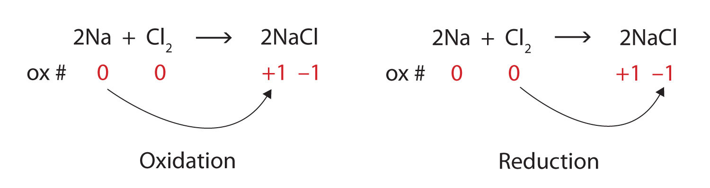
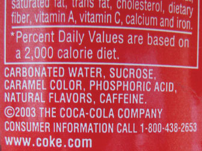

(sec:ch04:s06)=

# 4.6 Oxidation-Reduction Reactions

```{note} Learning Objectives

1. Define *oxidation* and *reduction*.
2. Assign oxidation numbers to atoms in simple compounds.
3. Recognize a reaction as an oxidation-reduction reaction.
```

Consider this chemical reaction:

$$
\text{2Na(s) + Cl2(g) }\rightarrow{}\text{ 2NaCl}
$$

The reactants are elements, and it is assumed that they are electrically neutral; they have the same number of electrons as protons. The product, however, is ionic; it is composed of Na<sup>+</sup> and Cl<sup>−</sup> ions. Somehow, the individual sodium atoms as reactants had to lose an electron to make the Na<sup>+</sup> ion, while the chlorine atoms as reactants had to each gain an electron to become the Cl<sup>−</sup> ion. This reaction involves the *transfer of electrons* between atoms.

In reality, electrons are lost by some atoms and gained by other atoms simultaneously. However, mentally we can separate the two processes. **Oxidation** (*The loss of one or more electrons by an atom; an increase in oxidation number.*) is defined as the loss of one or more electrons by an atom. **Reduction** (*The gain of one or more electrons by an atom; a decrease in oxidation number.*) is defined as the gain of one or more electrons by an atom. In reality, oxidation and reduction always occur together; it is only mentally that we can separate them. Chemical reactions that involve the transfer of electrons are called **oxidation-reduction (or redox) reactions** (*A chemical reaction that involves the transfer of electrons.*).

Redox reactions require that we keep track of the electrons assigned to each atom in a chemical reaction. How do we do that? We use an artificial count called the **oxidation number** (*A number assigned to an atom that helps keep track of the number of electrons on the atom.*) to keep track of electrons in atoms. Oxidation numbers are assigned to atoms based on a series of rules. Oxidation numbers are not necessarily equal to the charge on the atom; we must keep the concepts of charge and oxidation numbers separate.

The rules for assigning oxidation numbers to atoms are as follows:

1. Atoms in their elemental state are assigned an oxidation number of 0.
2. Atoms in monatomic (i.e., one-atom) ions are assigned an oxidation number equal to their charge. Oxidation numbers are usually written with the sign first, then the magnitude, which differentiates them from charges.
3. In compounds, fluorine is assigned a −1 oxidation number; oxygen is usually assigned a −2 oxidation number (except in peroxide compounds [where it is −1] and in binary compounds with fluorine [where it is positive]); and hydrogen is usually assigned a +1 oxidation number (except when it exists as the hydride ion, H<sup>−</sup>, in which case rule 2 prevails).
4. In compounds, all other atoms are assigned an oxidation number so that the sum of the oxidation numbers on all the atoms in the species equals the charge on the species (which is zero if the species is neutral).

Let us work through a few examples for practice. In H<sub>2</sub>, both hydrogen atoms have an oxidation number of 0, by rule 1. In NaCl, sodium has an oxidation number of +1, while chlorine has an oxidation number of −1, by rule 2. In H<sub>2</sub>O, the hydrogen atoms each have an oxidation number of +1, while the oxygen has an oxidation number of −2, even though hydrogen and oxygen do not exist as ions in this compound as per rule 3. By contrast, by rule 3 in hydrogen peroxide (H<sub>2</sub>O<sub>2</sub>), each hydrogen atom has an oxidation number of +1, while each oxygen atom has an oxidation number of −1. We can use rule 4 to determine oxidation numbers for the atoms in SO<sub>2</sub>. Each oxygen atom has an oxidation number of −2; for the sum of the oxidation numbers to equal the charge on the species (which is zero), the sulfur atom is assigned an oxidation number of +4. Does this mean that the sulfur atom has a 4+ charge on it? No, it only means that the sulfur atom is assigned a +4 oxidation number by our rules of apportioning electrons among the atoms in a compound.

```{exercise}
:label: ex:ball-ch04-s06-n02

**Example 13**

Assign oxidation numbers to the atoms in each substance.

1. Br<sub>2</sub>
2. SiO<sub>2</sub>
3. Ba(NO<sub>3</sub>)<sub>2</sub>
```

```{solution} ex:ball-ch04-s06-n02
:label: sol:ball-ch04-s06-n02
:class: dropdown

1. Br<sub>2</sub> is the elemental form of bromine. Therefore, by rule 1, each atom has an oxidation number of 0.
2. By rule 3, oxygen is normally assigned an oxidation number of −2. For the sum of the oxidation numbers to equal the charge on the species (which is zero), the silicon atom is assigned an oxidation number of +4.
3. The compound barium nitrate can be separated into two parts: the Ba<sup>2+</sup> ion and the nitrate ion. Considering these separately, the Ba<sup>2+</sup> ion has an oxidation number of +2 by rule 2. Now consider the NO<sub>3</sub><sup>−</sup> ion. Oxygen is assigned an oxidation number of −2, and there are three oxygens. According to rule 4, the sum of the oxidation number on all atoms must equal the charge on the species, so we have the simple algebraic equation

   $\text{x + 3(}-\text{2) = }-\text{1}$

   where *x* is the oxidation number of the nitrogen atom and −1 represents the charge on the species. Evaluating,

   $\text{x + (}-\text{6) = }-\text{1}$ $\text{x = +5}$

   Thus, the oxidation number on the N atom in the nitrate ion is +5.
```

```{exercise}
:label: ex:ball-ch04-s06-n02-ty2

**Test Yourself**

Assign oxidation numbers to the atoms in H<sub>3</sub>PO<sub>4</sub>.
```

```{solution} ex:ball-ch04-s06-n02-ty2
:label: sol:ball-ch04-s06-n02-ty2
:class: dropdown

H = +1, O = −2, P = +5
```

All redox reactions occur with a simultaneous change in the oxidation numbers of some atoms. At least two elements must change their oxidation numbers. When an oxidation number of an atom is increased in the course of a redox reaction, that atom is being *oxidized*. When an oxidation number of an atom is decreased in the course of a redox reaction, that atom is being *reduced*. Oxidation and reduction are thus also defined in terms of increasing or decreasing oxidation numbers, respectively.

```{exercise}
:label: ex:ball-ch04-s06-n03

**Example 14**

Identify what is being oxidized and reduced in this redox equation.

$\text{2Na + Cl2 }\rightarrow{}\text{ 2NaCl}$
```

```{solution} ex:ball-ch04-s06-n03
:label: sol:ball-ch04-s06-n03
:class: dropdown

Consider the reactants. Because both reactants are the elemental forms of their atoms, the Na and Cl atoms as reactants have oxidation numbers of 0. In the ionic product, the sodium ions have an oxidation number of +1, while the chloride ions have an oxidation number of −1:

(fig:fwk:ball:eq04:001)=


*4.6 Oxidation-Reduction Reactions*

We note that the sodium is increasing its oxidation number from 0 to +1, so it is being oxidized; chlorine is decreasing its oxidation number from 0 to −1, so it is being reduced:

(fig:fwk:ball:eq04:002)=



*4.6 Oxidation-Reduction Reactions*

Because oxidation numbers are changing, this is a redox reaction. Note that the total number of electrons lost by the sodium (two, one lost from each atom) is gained by the chlorine atoms (two, one gained for each atom).
```

```{exercise}
:label: ex:ball-ch04-s06-n03-ty2

**Test Yourself**

Identify what is being oxidized and reduced in this redox equation.

$\text{C + O2 }\rightarrow{}\text{ CO2}$
```

```{solution} ex:ball-ch04-s06-n03-ty2
:label: sol:ball-ch04-s06-n03-ty2
:class: dropdown

C is being oxidized from 0 to +4; O is being reduced from 0 to −2.
```

In this introduction to oxidation-reduction reactions, we are using straightforward examples. However, oxidation reactions can become quite complex; the following equation represents a redox reaction:

```{figure} ../images/figures/81f2e1f047c59a2a88c58426a2ed3784.jpg
:label: fig:fwk:ball:eq04:003
:alt: "4.6 Oxidation-Reduction Reactions"
:align: center
:width: 85%

4.6 Oxidation-Reduction Reactions
```

To demonstrate that this is a redox reaction, the oxidation numbers of the species being oxidized and reduced are listed; can you determine what is being oxidized and what is being reduced? This is also an example of a net ionic reaction; spectator ions that do not change oxidation numbers are not displayed in the equation.

```{tip} Food and Drink App: Acids in Foods

Many foods and beverages contain acids. Acids impart a sour note to the taste of foods, which may add some pleasantness to the food. For example, orange juice contains citric acid, H<sub>3</sub>C<sub>6</sub>H<sub>5</sub>O<sub>7</sub>. Note how this formula shows hydrogen atoms in two places; the first hydrogen atoms written are the hydrogen atoms that can form H<sup>+</sup> ions, while the second hydrogen atoms written are part of the citrate ion, C<sub>6</sub>H<sub>5</sub>O<sub>7</sub><sup>3−</sup>. Lemons and limes contain much more citric acid—about 60 times as much—which accounts for these citrus fruits being more sour than most oranges. Vinegar is essentially a ~5% solution of acetic acid (HC<sub>2</sub>H<sub>3</sub>O<sub>2</sub>) in water. Apples contain malic acid (H<sub>2</sub>C<sub>4</sub>H<sub>4</sub>O<sub>5</sub>; the name *malic acid* comes from the apple’s botanical genus name, *malus*), while lactic acid (HC<sub>3</sub>H<sub>5</sub>O<sub>3</sub>) is found in wine and sour milk products, such as yogurt and some cottage cheeses.

{ref}`Table 4.2 "Various Acids Found in Food and Beverages" <tbl:ch04:s06:t01>` lists some acids found in foods, either naturally or as an additive. Frequently, the salts of acid anions are used as additives, such as monosodium glutamate (MSG), which is the sodium salt derived from glutamic acid. As you read the list, you should come to the inescapable conclusion that it is impossible to avoid acids in food and beverages.

(tbl:ch04:s06:t01)=

**Various Acids Found in Food and Beverages**

| Acid Name | Acid Formula | Use and Appearance |
| --- | --- | --- |
| acetic acid | HC<sub>2</sub>H<sub>3</sub>O<sub>2</sub> | flavoring; found in vinegar |
| adipic acid | H<sub>2</sub>C<sub>6</sub>H<sub>8</sub>O<sub>4</sub> | flavoring; found in processed foods and some antacids |
| alginic acid | various | thickener; found in drinks, ice cream, and weight loss products |
| ascorbic acid | HC<sub>6</sub>H<sub>7</sub>O<sub>6</sub> | antioxidant, also known as vitamin C; found in fruits and vegetables |
| benzoic acid | HC<sub>6</sub>H<sub>5</sub>CO<sub>2</sub> | preservative; found in processed foods |
| citric acid | H<sub>3</sub>C<sub>6</sub>H<sub>5</sub>O<sub>7</sub> | flavoring; found in citrus fruits |
| dehydroacetic acid | HC<sub>8</sub>H<sub>7</sub>O<sub>4</sub> | preservative, especially for strawberries and squash |
| erythrobic acid | HC<sub>6</sub>H<sub>7</sub>O<sub>6</sub> | antioxidant; found in processed foods |
| fatty acids | various | thickener and emulsifier; found in processed foods |
| fumaric acid | H<sub>2</sub>C<sub>4</sub>H<sub>2</sub>O<sub>4</sub> | flavoring; acid reactant in some baking powders |
| glutamic acid | H<sub>2</sub>C<sub>5</sub>H<sub>7</sub>NO<sub>4</sub> | flavoring; found in processed foods and in tomatoes, some cheeses, and soy products |
| lactic acid | HC<sub>3</sub>H<sub>5</sub>O<sub>3</sub> | flavoring; found in wine, yogurt, cottage cheese, and other sour milk products |
| malic acid | H<sub>2</sub>C<sub>4</sub>H<sub>4</sub>O<sub>5</sub> | flavoring; found in apples and unripe fruit |
| phosphoric acid | H<sub>3</sub>PO<sub>4</sub> | flavoring; found in some colas |
| propionic acid | HC<sub>3</sub>H<sub>5</sub>O<sub>2</sub> | preservative; found in baked goods |
| sorbic acid | HC<sub>6</sub>H<sub>7</sub>O<sub>2</sub> | preservative; found in processed foods |
| stearic acid | HC<sub>18</sub>H<sub>35</sub>O<sub>2</sub> | anticaking agent; found in hard candies |
| succinic acid | H<sub>2</sub>C<sub>4</sub>H<sub>4</sub>O<sub>4</sub> | flavoring; found in wine and beer |
| tartaric acid | H<sub>2</sub>C<sub>4</sub>H<sub>4</sub>O<sub>6</sub> | flavoring; found in grapes, bananas, and tamarinds |

(fig:ch04:s06:f01)=



*This cola can clearly shows that an acid (phosphoric acid) is an ingredient.*
```

```{important} Key Takeaways

- Oxidation-reduction (redox) reactions involve the transfer of electrons from one atom to another.
- Oxidation numbers are used to keep track of electrons in atoms.
- There are rules for assigning oxidation numbers to atoms.
- Oxidation is an increase of oxidation number (a loss of electrons); reduction is a decrease in oxidation number (a gain of electrons).
```

## Exercises

```{exercise}
:label: ex:ball-ch04-s06-qs01-qd01-qa01

**Exercise 1.**

Is the reaction

$\text{2K(s) + Br2(}\ell{}\text{) }\rightarrow{}\text{ 2KBr(s)}$

an oxidation-reduction reaction? Explain your answer.
```

```{solution} ex:ball-ch04-s06-qs01-qd01-qa01
:label: sol:ball-ch04-s06-qs01-qd01-qa01
:class: dropdown

Yes; both K and Br are changing oxidation numbers.
```

```{exercise}
:label: ex:ball-ch04-s06-qs01-qd01-qa02

**Exercise 2.**

Is the reaction

$\text{NaCl(aq) + AgNO3(aq) }\rightarrow{}\text{ NaNO3(aq) + AgCl(s)}$

an oxidation-reduction reaction? Explain your answer.
```

```{exercise}
:label: ex:ball-ch04-s06-qs01-qd01-qa03

**Exercise 3.**

In the reaction

$\text{2Ca(s) + O2(g) }\rightarrow{}\text{ 2CaO}$

indicate what has lost electrons and what has gained electrons.
```

```{solution} ex:ball-ch04-s06-qs01-qd01-qa03
:label: sol:ball-ch04-s06-qs01-qd01-qa03
:class: dropdown

Ca has lost electrons, and O has gained electrons.
```

```{exercise}
:label: ex:ball-ch04-s06-qs01-qd01-qa04

**Exercise 4.**

In the reaction

$\text{16Fe(s) + 3S8(s) }\rightarrow{}\text{ 8Fe2S3(s)}$

indicate what has lost electrons and what has gained electrons.
```

```{exercise}
:label: ex:ball-ch04-s06-qs01-qd01-qa05

**Exercise 5.**

In the reaction

$\text{2Li(s) + O2(g) }\rightarrow{}\text{ Li2O2(s)}$

indicate what has been oxidized and what has been reduced.
```

```{solution} ex:ball-ch04-s06-qs01-qd01-qa05
:label: sol:ball-ch04-s06-qs01-qd01-qa05
:class: dropdown

Li has been oxidized, and O has been reduced.
```

```{exercise}
:label: ex:ball-ch04-s06-qs01-qd01-qa06

**Exercise 6.**

In the reaction

$\text{2Ni(s) + 3I2(s) }\rightarrow{}\text{ 2NiI3(s)}$

indicate what has been oxidized and what has been reduced.
```

```{exercise}
:label: ex:ball-ch04-s06-qs01-qd01-qa07

**Exercise 7.**

What are two different definitions of oxidation?
```

```{solution} ex:ball-ch04-s06-qs01-qd01-qa07
:label: sol:ball-ch04-s06-qs01-qd01-qa07
:class: dropdown

loss of electrons; increase in oxidation number
```

```{exercise}
:label: ex:ball-ch04-s06-qs01-qd01-qa08

**Exercise 8.**

What are two different definitions of reduction?
```

```{exercise}
:label: ex:ball-ch04-s06-qs01-qd01-qa09

**Exercise 9.**

Assign oxidation numbers to each atom in each substance.

a. P<sub>4</sub>
b. SO<sub>2</sub>
c. SO<sub>2</sub><sup>2−</sup>
d. Ca(NO<sub>3</sub>)<sub>2</sub>
```

```{solution} ex:ball-ch04-s06-qs01-qd01-qa09
:label: sol:ball-ch04-s06-qs01-qd01-qa09
:class: dropdown

a. P: 0
b. S: +4; O: −2
c. S: +2; O: −2
d. Ca: 2+; N: +5; O: −2
```

```{exercise}
:label: ex:ball-ch04-s06-qs01-qd01-qa10

**Exercise 10.**

Assign oxidation numbers to each atom in each substance.

a. PF<sub>5</sub>
b. (NH<sub>4</sub>)<sub>2</sub>S
c. Hg
d. Li<sub>2</sub>O<sub>2</sub> (lithium peroxide)
```

```{exercise}
:label: ex:ball-ch04-s06-qs01-qd01-qa11

**Exercise 11.**

Assign oxidation numbers to each atom in each substance.

a. CO
b. CO<sub>2</sub>
c. NiCl<sub>2</sub>
d. NiCl<sub>3</sub>
```

```{solution} ex:ball-ch04-s06-qs01-qd01-qa11
:label: sol:ball-ch04-s06-qs01-qd01-qa11
:class: dropdown

a. C: +2; O: −2
b. C: +4; O: −2
c. Ni: +2; Cl: −1
d. Ni: +3; Cl: −1
```

```{exercise}
:label: ex:ball-ch04-s06-qs01-qd01-qa12

**Exercise 12.**

Assign oxidation numbers to each atom in each substance.

a. NaH (sodium hydride)
b. NO<sub>2</sub>
c. NO<sub>2</sub><sup>−</sup>
d. AgNO<sub>3</sub>
```

```{exercise}
:label: ex:ball-ch04-s06-qs01-qd01-qa13

**Exercise 13.**

Assign oxidation numbers to each atom in each substance.

a. CH<sub>2</sub>O
b. NH<sub>3</sub>
c. Rb<sub>2</sub>SO<sub>4</sub>
d. Zn(C<sub>2</sub>H<sub>3</sub>O<sub>2</sub>)<sub>2</sub>
```

```{solution} ex:ball-ch04-s06-qs01-qd01-qa13
:label: sol:ball-ch04-s06-qs01-qd01-qa13
:class: dropdown

a. C: 0; H: +1; O: −2
b. N: −3; H: +1
c. Rb: +1; S: +6; O: −2
d. Zn: +2; C: 0; H: +1; O: −2
```

```{exercise}
:label: ex:ball-ch04-s06-qs01-qd01-qa14

**Exercise 14.**

Assign oxidation numbers to each atom in each substance.

a. C<sub>6</sub>H<sub>6</sub>
b. B(OH)<sub>3</sub>
c. Li<sub>2</sub>S
d. Au
```

```{exercise}
:label: ex:ball-ch04-s06-qs01-qd01-qa15

**Exercise 15.**

Identify what is being oxidized and reduced in this redox equation by assigning oxidation numbers to the atoms.

$\text{2NO + Cl2 }\rightarrow{}\text{ 2NOCl}$
```

```{solution} ex:ball-ch04-s06-qs01-qd01-qa15
:label: sol:ball-ch04-s06-qs01-qd01-qa15
:class: dropdown

N is being oxidized, and Cl is being reduced.
```

```{exercise}
:label: ex:ball-ch04-s06-qs01-qd01-qa16

**Exercise 16.**

Identify what is being oxidized and reduced in this redox equation by assigning oxidation numbers to the atoms.

$\text{Fe + SO3 }\rightarrow{}\text{ FeSO3}$
```

```{exercise}
:label: ex:ball-ch04-s06-qs01-qd01-qa17

**Exercise 17.**

Identify what is being oxidized and reduced in this redox equation by assigning oxidation numbers to the atoms.

$\text{2KrF2 + 2H2O }\rightarrow{}\text{ 2Kr + 4HF + O2}$
```

```{solution} ex:ball-ch04-s06-qs01-qd01-qa17
:label: sol:ball-ch04-s06-qs01-qd01-qa17
:class: dropdown

O is being oxidized, and Kr is being reduced.
```

```{exercise}
:label: ex:ball-ch04-s06-qs01-qd01-qa18

**Exercise 18.**

Identify what is being oxidized and reduced in this redox equation by assigning oxidation numbers to the atoms.

$\text{SO3 + SCl2 }\rightarrow{}\text{ SOCl2 + SO2}$
```

```{exercise}
:label: ex:ball-ch04-s06-qs01-qd01-qa19

**Exercise 19.**

Identify what is being oxidized and reduced in this redox equation by assigning oxidation numbers to the atoms.

$\text{2K + MgCl2 }\rightarrow{}\text{ 2KCl + Mg}$
```

```{solution} ex:ball-ch04-s06-qs01-qd01-qa19
:label: sol:ball-ch04-s06-qs01-qd01-qa19
:class: dropdown

K is being oxidized, and Mg is being reduced.
```

```{exercise}
:label: ex:ball-ch04-s06-qs01-qd01-qa20

**Exercise 20.**

Identify what is being oxidized and reduced in this redox equation by assigning oxidation numbers to the atoms.

$\text{C7H16 + 11O2 }\rightarrow{}\text{ 7CO2 + 8H2O}$
```
