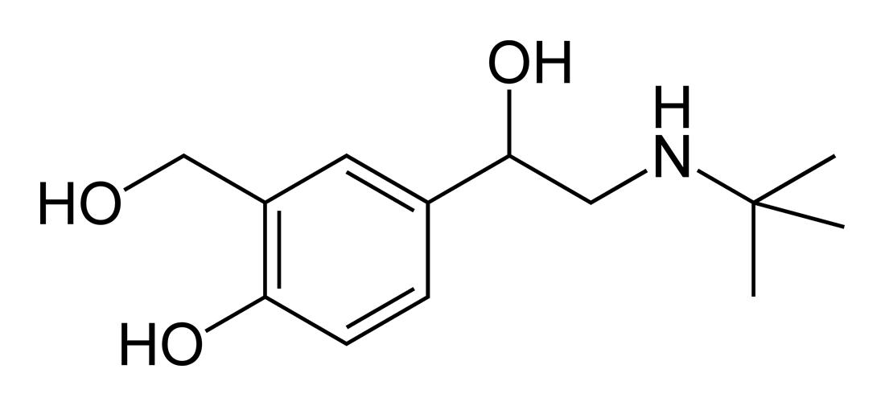

(sec:ch05:s05)=

# 5.5 Yields

```{note} Learning Objective

1. Define and determine theoretical yields, actual yields, and percent yields.
```

In all the previous calculations we have performed involving balanced chemical equations, we made two assumptions: (1) the reaction goes exactly as written, and (2) the reaction proceeds completely. In reality, such things as side reactions occur that make some chemical reactions rather messy. For example, in the actual combustion of some carbon-containing compounds, such as methane, some CO is produced as well as CO<sub>2</sub>. However, we will continue to ignore side reactions, unless otherwise noted.

The second assumption, that the reaction proceeds completely, is more troublesome. Many chemical reactions do not proceed to completion as written, for a variety of reasons (some of which we will consider in {ref}`Chapter 13 "Chemical Equilibrium" <ch:ch13>`). When we calculate an amount of product assuming that all the reactant reacts, we calculate the **theoretical yield** (*An amount that is theoretically produced as calculated using the balanced chemical reaction.*), an amount that is theoretically produced as calculated using the balanced chemical reaction.

In many cases, however, this is not what really happens. In many cases, less—sometimes much less—of a product is made during the course of a chemical reaction. The amount that is actually produced in a reaction is called the **actual yield** (*The amount that is actually produced in a chemical reaction.*). By definition, the actual yield is less than or equal to the theoretical yield. If it is not, then an error has been made.

Both theoretical yields and actual yields are expressed in units of moles or grams. It is also common to see something called a percent yield. The **percent yield** (*Actual yield divided by theoretical yield times 100% to give a percentage between 0% and 100%.*) is a comparison between the actual yield and the theoretical yield and is defined as

$$
\text{percent yield}=\frac{\text{actual yield}}{\text{theoretical yield}}\,\times{}\,\text{1}00\%
$$

It does not matter whether the actual and theoretical yields are expressed in moles or grams, as long as they are expressed in the same units. However, the percent yield always has units of percent. Proper percent yields are between 0% and 100%—again, if percent yield is greater than 100%, an error has been made.

```{exercise}
:label: ex:ball-ch05-s05-n02

**Example 13**

A worker reacts 30.5 g of Zn with nitric acid and evaporates the remaining water to obtain 65.2 g of Zn(NO<sub>3</sub>)<sub>2</sub>. What are the theoretical yield, the actual yield, and the percent yield?

$\text{Zn(s) + 2HNO}_{3}\text{(aq) }\rightarrow{}\text{ Zn(NO}_{3}\text{)}_{2}\text{(aq) + H}_{2}\text{(g)}$
```

```{solution} ex:ball-ch05-s05-n02
:label: sol:ball-ch05-s05-n02
:class: dropdown

A mass-mass calculation can be performed to determine the theoretical yield. We need the molar masses of Zn (65.39 g/mol) and Zn(NO<sub>3</sub>)<sub>2</sub> (189.41 g/mol). In three steps, the mass-mass calculation is

$$
30.5\text{ g Zn}\,\times{}\,\frac{\text{1}\text{ mol Zn}}{65.39\text{ g Zn}}\times{}\frac{\text{1}{\text{ mol Zn(NO}}_{3}{)}_{2}}{1\text{ mol Zn}}\,\times{}\,\frac{189.41{\text{ g Zn(NO}}_{3}{)}_{2}}{1{\text{ mol Zn(NO}}_{3}{)}_{2}}=88.3{\text{ g Zn(NO}}_{3}{)}_{2}
$$

Thus, the theoretical yield is 88.3 g of Zn(NO<sub>3</sub>)<sub>2</sub>. The actual yield is the amount that was actually made, which was 65.2 g of Zn(NO<sub>3</sub>)<sub>2</sub>. To calculate the percent yield, we take the actual yield and divide it by the theoretical yield and multiply by 100:

$$
\frac{65.2{\text{ g Zn(NO}}_{3}{)}_{2}}{88.3{\text{ Zn(NO}}_{3}{)}_{2}}\,\times{}\,100\%=73.8\%
$$

The worker achieved almost three-fourths of the possible yield.
```

```{exercise}
:label: ex:ball-ch05-s05-n02-ty2

**Test Yourself**

A synthesis produced 2.05 g of NH<sub>3</sub> from 16.5 g of N<sub>2</sub>. What is the theoretical yield and the percent yield?

$\text{N}_{2}\text{(g) + 3H}_{2}\text{(g) }\rightarrow{}\text{ 2NH}_{3}\text{(g)}$
```

```{solution} ex:ball-ch05-s05-n02-ty2
:label: sol:ball-ch05-s05-n02-ty2
:class: dropdown

theoretical yield = 20.1 g; percent yield = 10.2%
```

```{tip} Chemistry Is Everywhere: Actual Yields in Drug Synthesis and Purification

Many drugs are the product of several steps of chemical synthesis. Each step typically occurs with less than 100% yield, so the overall percent yield might be very small. The general rule is that the overall percent yield is the product of the percent yields of the individual synthesis steps. For a drug synthesis that has many steps, the overall percent yield can be very tiny, which is one factor in the huge cost of some drugs. For example, if a 10-step synthesis has a percent yield of 90% for each step, the overall yield for the entire synthesis is only 35%. Many scientists work every day trying to improve percent yields of the steps in the synthesis to decrease costs, improve profits, and minimize waste.

Even purifications of complex molecules into drug-quality purity are subject to percent yields. Consider the purification of impure albuterol. Albuterol (C<sub>13</sub>H<sub>21</sub>NO<sub>2</sub>; accompanying figure) is an inhaled drug used to treat asthma, bronchitis, and other obstructive pulmonary diseases. It is synthesized from norepinephrine, a naturally occurring hormone and neurotransmitter. Its initial synthesis makes very impure albuterol that is purified in five chemical steps. The details of the steps do not concern us; only the percent yields do:

| impure albuterol → intermediate A | percent yield = 70% |
| --- | --- |
| intermediate A → intermediate B | percent yield = 100% |
| intermediate B → intermediate C | percent yield = 40% |
| intermediate C → intermediate D | percent yield = 72% |
| intermediate D → purified albuterol | percent yield = 35% |
| overall percent yield = 70% × 100% × 40% × 72% × 35% = 7.5% |   |

That is, only about *one-fourteenth* of the original material was turned into the purified drug. This gives you one reason why some drugs are so expensive; a lot of material is lost in making a high-purity pharmaceutical.
```

```{figure} ../images/restored/albuterol-inhaler.jpg
:label: fig:ch05:albuterol
:enumerated: false
:alt: An albuterol inhaler and its removable medicine canister.
:align: center
:width: 70%

**Albuterol and Drug Purification.** An albuterol inhaler and a structural formula of albuterol. Drug manufacture and purification often require several steps, so the overall yield depends on the yield of each step.



Credits: [Albuterol Inhaler — ParentingPatch](https://commons.wikimedia.org/wiki/File:Albuterol_Inhaler.JPG), [CC BY-SA 3.0](https://creativecommons.org/licenses/by-sa/3.0); [Salbutamol-2D-skeletal — Ben Mills (Benjah-bmm27)](https://commons.wikimedia.org/wiki/File:Salbutamol-2D-skeletal.png), [Public domain](https://creativecommons.org/publicdomain/mark/1.0/). Images resized for the web.
```

```{important} Key Takeaways

- Theoretical yield is what you calculate the yield will be using the balanced chemical reaction.
- Actual yield is what you actually get in a chemical reaction.
- Percent yield is a comparison of the actual yield with the theoretical yield.
```

## Exercises

```{exercise}
:label: ex:ball-ch05-s05-qs01-qd01-qa01

**Exercise 1.**

What is the difference between the theoretical yield and the actual yield?
```

```{solution} ex:ball-ch05-s05-qs01-qd01-qa01
:label: sol:ball-ch05-s05-qs01-qd01-qa01
:class: dropdown

Theoretical yield is what you expect stoichiometrically from a chemical reaction; actual yield is what you actually get from a chemical reaction.
```

```{exercise}
:label: ex:ball-ch05-s05-qs01-qd01-qa02

**Exercise 2.**

What is the difference between the actual yield and the percent yield?
```

```{exercise}
:label: ex:ball-ch05-s05-qs01-qd01-qa03

**Exercise 3.**

A worker isolates 2.675 g of SiF<sub>4</sub> after reacting 2.339 g of SiO<sub>2</sub> with HF. What are the theoretical yield and the actual yield?

$\text{SiO}_{2}\text{(s) + 4HF(g) }\rightarrow{}\text{ SiF}_{4}\text{(g) + 2H}_{2}\text{O(}\ell{}\text{)}$
```

```{solution} ex:ball-ch05-s05-qs01-qd01-qa03
:label: sol:ball-ch05-s05-qs01-qd01-qa03
:class: dropdown

theoretical yield = 4.052 g; actual yield = 2.675 g
```

```{exercise}
:label: ex:ball-ch05-s05-qs01-qd01-qa04

**Exercise 4.**

A worker synthesizes aspirin, C<sub>9</sub>H<sub>8</sub>O<sub>4</sub>, according to this chemical equation. If 12.66 g of C<sub>7</sub>H<sub>6</sub>O<sub>3</sub> are reacted and 12.03 g of aspirin are isolated, what are the theoretical yield and the actual yield?

$\text{C}_{7}\text{H}_{6}\text{O}_{3}\text{ + C}_{4}\text{H}_{6}\text{O}_{3}\text{ }\rightarrow{}\text{ C}_{9}\text{H}_{8}\text{O}_{4}\text{ + HC}_{2}\text{H}_{3}\text{O}_{2}$
```

```{exercise}
:label: ex:ball-ch05-s05-qs01-qd01-qa05

**Exercise 5.**

A chemist decomposes 1.006 g of NaHCO<sub>3</sub> and obtains 0.0334 g of Na<sub>2</sub>CO<sub>3</sub>. What are the theoretical yield and the actual yield?

$\text{2NaHCO}_{3}\text{(s) }\rightarrow{}\text{ Na}_{2}\text{CO}_{3}\text{(s) + H}_{2}\text{O(}\ell{}\text{) + CO}_{2}\text{(g)}$
```

```{solution} ex:ball-ch05-s05-qs01-qd01-qa05
:label: sol:ball-ch05-s05-qs01-qd01-qa05
:class: dropdown

theoretical yield = 0.635 g; actual yield = 0.0334 g
```

```{exercise}
:label: ex:ball-ch05-s05-qs01-qd01-qa06

**Exercise 6.**

A chemist combusts a 3.009 g sample of C<sub>5</sub>H<sub>12</sub> and obtains 3.774 g of H<sub>2</sub>O. What are the theoretical yield and the actual yield?

$\text{C}_{5}\text{H}_{12}\text{(}\ell{}\text{) + 8O}_{2}\text{(g) }\rightarrow{}\text{ 5CO}_{2}\text{ + 6H}_{2}\text{O(}\ell{}\text{)}$
```

```{exercise}
:label: ex:ball-ch05-s05-qs01-qd01-qa07

**Exercise 7.**

What is the percent yield in Exercise 3?
```

```{solution} ex:ball-ch05-s05-qs01-qd01-qa07
:label: sol:ball-ch05-s05-qs01-qd01-qa07
:class: dropdown

66.02%
```

```{exercise}
:label: ex:ball-ch05-s05-qs01-qd01-qa08

**Exercise 8.**

What is the percent yield in Exercise 4?
```

```{exercise}
:label: ex:ball-ch05-s05-qs01-qd01-qa09

**Exercise 9.**

What is the percent yield in Exercise 5?
```

```{solution} ex:ball-ch05-s05-qs01-qd01-qa09
:label: sol:ball-ch05-s05-qs01-qd01-qa09
:class: dropdown

5.26%
```

```{exercise}
:label: ex:ball-ch05-s05-qs01-qd01-qa10

**Exercise 10.**

What is the percent yield in Exercise 6?
```
