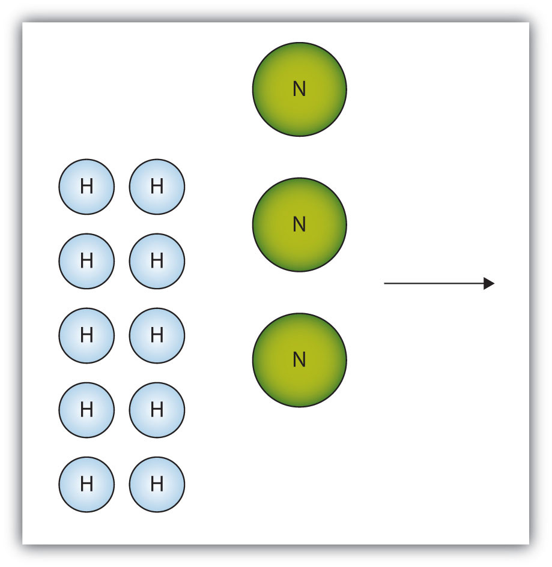
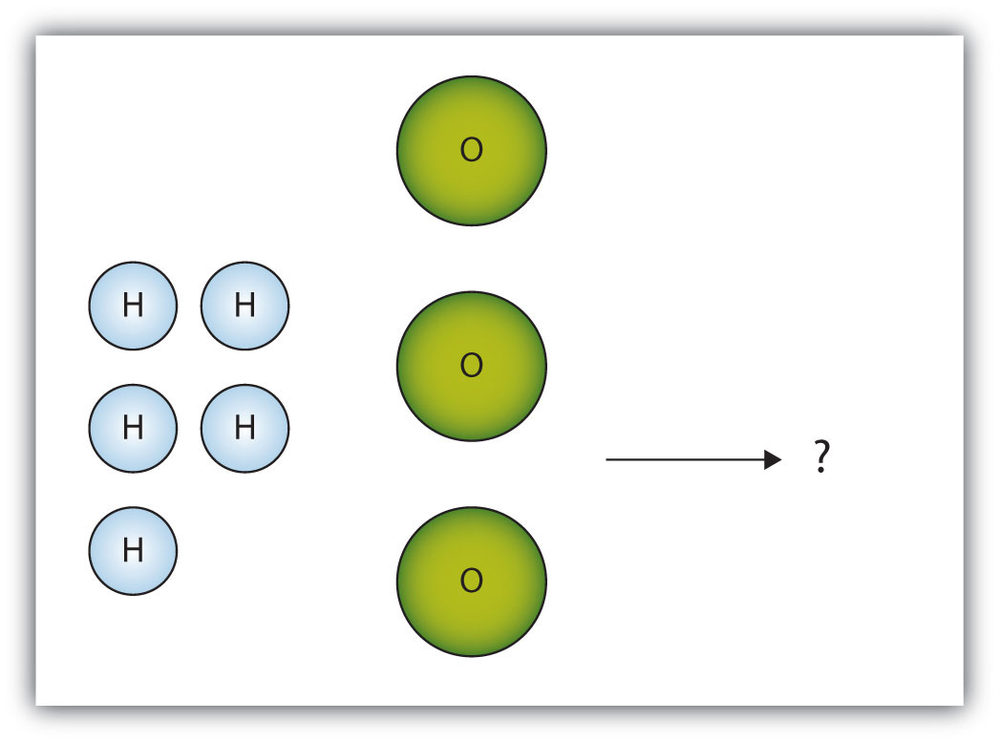

(sec:ch05:s06)=

# 5.6 Limiting Reagents

```{note} Learning Objectives

1. Identify a limiting reagent from a set of reactants.
2. Calculate how much product will be produced from the limiting reagent.
3. Calculate how much reactant(s) remains when the reaction is complete.
```

One additional assumption we have made about chemical reactions—in addition to the assumption that reactions proceed all the way to completion—is that all the reactants are present in the proper quantities to react to products. This is not always the case.

Consider {ref}`Figure 5.2 "Making Water" <fig:ch05:s06:f01>`. Here we are taking hydrogen atoms and oxygen atoms (left) to make water molecules (right). However, there are not enough oxygen atoms to use up all the hydrogen atoms. We run out of oxygen atoms and cannot make any more water molecules, so the process stops when we run out of oxygen atoms.

```{figure} ../images/figures/1721bb04befb1e95d44d0297bc20ad8b.jpg
:label: fig:ch05:s06:f01
:alt: "Making Water. In this scenario for making water molecules, we run out of O atoms before we use up all the H atoms. Similar situations exist for many chemical reactions when one reactant runs out before the other."
:align: center
:width: 85%

Making Water. In this scenario for making water molecules, we run out of O atoms before we use up all the H atoms. Similar situations exist for many chemical reactions when one reactant runs out before the other.
```

A similar situation exists for many chemical reactions: you usually run out of one reactant before all of the other reactant has reacted. The reactant you run out of is called the **limiting reagent** (*The reactant that runs out first.*); the other reactant or reactants are considered to be *in excess*. A crucial skill in evaluating the conditions of a chemical process is to determine which reactant is the limiting reagent and which is in excess.

The key to recognizing which reactant is the limiting reagent is based on a mole-mass or mass-mass calculation: whichever reactant gives the *lesser* amount of product is the limiting reagent. What we need to do is determine an amount of one product (either moles or mass) assuming all of each reactant reacts. Whichever reactant gives the least amount of that particular product is the limiting reagent. It does not matter which product we use, as long as we use the same one each time. It does not matter whether we determine the number of moles or grams of that product; however, we will see shortly that knowing the final mass of product can be useful.

For example, consider this reaction:

$$
\text{4As(s) + 3O}_{2}\text{(g) }\rightarrow{}\text{ 2As}_{2}\text{O}_{3}\text{(s)}
$$

Suppose we start a reaction with 50.0 g of As and 50.0 g of O<sub>2</sub>. Which one is the limiting reagent? We need to perform two mole-mass calculations, each assuming that each reactant reacts completely. Then we compare the amount of the product produced by each and determine which is less.

The calculations are as follows:

$$
\text{50}\text{.0}\text{ g As}\,\times{}\,\frac{\text{1}\text{ mol As}}{\text{74}\text{.92}\text{ g As}}\,\times{}\,\frac{{\text{2 mol As}}_{2}{\text{O}}_{3}}{\text{4}\text{ mol As}}=0.334{\text{ mol As}}_{2}{\text{O}}_{3}
$$

$$
\text{50}\text{.0}{\text{ g O}}_{2}\,\times{}\,\frac{\text{1}{\text{ mol O}}_{2}}{\text{ 32}\text{.00}{\text{ g O}}_{2}}\,\times{}\,\frac{2{\text{ mol As}}_{2}{\text{O}}_{3}}{\text{3}{\text{ mol O}}_{2}}=1.04{\text{ mol As}}_{2}{\text{O}}_{3}
$$

Comparing these two answers, it is clear that 0.334 mol of As<sub>2</sub>O<sub>3</sub> is less than 1.04 mol of As<sub>2</sub>O<sub>3</sub>, so arsenic is the limiting reagent. If this reaction is performed under these initial conditions, the arsenic will run out before the oxygen runs out. We say that the oxygen is “in excess.”

Identifying the limiting reagent, then, is straightforward. However, there are usually two associated questions: (1) what mass of product (or products) is then actually formed? and (2) what mass of what reactant is left over? The first question is straightforward to answer: simply perform a conversion from the number of moles of product formed to its mass, using its molar mass. For As<sub>2</sub>O<sub>3</sub>, the molar mass is 197.84 g/mol; knowing that we will form 0.334 mol of As<sub>2</sub>O<sub>3</sub> under the given conditions, we will get

$$
\text{0}\text{.334}{\text{ mol As}}_{2}{\text{O}}_{3}\,\times{}\,\frac{\text{197}{\text{.84 g As}}_{2}{\text{O}}_{3}}{1{\text{ mol As}}_{2}{\text{O}}_{3}}=66.1{\text{ g As}}_{2}{\text{O}}_{3}
$$

The second question is somewhat more convoluted to answer. First, we must do a mass-mass calculation relating the limiting reagent (here, As) to the other reagent (O<sub>2</sub>). Once we determine the mass of O<sub>2</sub> that reacted, we subtract that from the original amount to determine the amount left over. According to the mass-mass calculation,

$$
\text{50}\text{.0}\text{ g As}\,\times{}\,\frac{\text{1}\text{ mol As}}{74.92\text{ g As}}\times{}\frac{\text{3}{\text{ mol O}}_{2}}{\text{4}\text{ mol As}}\times{}\frac{32.00{\text{ g O}}_{2}}{\text{1}{\text{ mol O}}_{2}}=16.0{\text{ g O}}_{2}\text{ reacted}
$$

Because we reacted 16.0 g of our original O<sub>2</sub>, we subtract that from the original amount, 50.0 g, to get the mass of O<sub>2</sub> remaining:

$$
\text{50.0 g O}_{2}\text{ }-\text{ 16.0 g O}_{2}\text{ reacted = 34.0 g O}_{2}\text{ left over}
$$

You must remember to perform this final subtraction to determine the amount remaining; a common error is to report the 16.0 g as the amount remaining.

```{exercise}
:label: ex:ball-ch05-s06-n02

**Example 14**

A 5.00 g quantity of Rb are combined with 3.44 g of MgCl<sub>2</sub> according to this chemical reaction:

$\text{2Rb(s) + MgCl}_{2}\text{(s) }\rightarrow{}\text{ Mg(s) + 2RbCl(s)}$

What mass of Mg is formed, and what mass of what reactant is left over?
```

```{solution} ex:ball-ch05-s06-n02
:label: sol:ball-ch05-s06-n02
:class: dropdown

Because the question asks what mass of magnesium is formed, we can perform two mass-mass calculations and determine which amount is less.

$$
\text{5}\text{.00}\text{ g Rb}\,\times{}\,\frac{\text{1}\text{ mol Rb}}{85.47\text{ g Rb}}\,\times{}\,\frac{\text{1}\text{ mol Mg}}{\text{2}\text{ mol Rb}}\,\times{}\,\frac{24.31\text{ g Mg}}{\text{1}\text{ mol Mg}}=\text{0}\text{.711 g Mg}
$$

$$
\text{3}\text{.44}{\text{ g MgCl}}_{2}\,\times{}\,\frac{\text{1}{\text{ mol MgCl}}_{2}}{95.21{\text{ g MgCl}}_{2}}\,\times{}\,\frac{\text{1}\text{ mol Mg}}{\text{1}{\text{ mol MgCl}}_{2}}\,\times{}\,\frac{24.31\text{ g Mg}}{\text{1}\text{ mol Mg}}=\text{0}\text{.878 g Mg}
$$

The 0.711 g of Mg is the lesser quantity, so the associated reactant—5.00 g of Rb—is the limiting reagent. To determine how much of the other reactant is left, we have to do one more mass-mass calculation to determine what mass of MgCl<sub>2</sub> reacted with the 5.00 g of Rb and then subtract the amount reacted from the original amount.

$$
\text{5}\text{.00}\text{ g Rb}\,\times{}\,\frac{\text{1}\text{ mol Rb}}{85.47\text{ g Rb}}\,\times{}\,\frac{\text{1}{\text{ mol MgCl}}_{2}}{\text{2}\text{ mol Rb}}\,\times{}\,\frac{95.21\text{ g Mg}}{\text{1}{\text{ mol MgCl}}_{2}}=\text{2}{\text{.78 g MgCl}}_{2}\text{ reacted}
$$

Because we started with 3.44 g of MgCl<sub>2</sub>, we have

$\text{3.44 g MgCl}_{2}\text{ }-\text{ 2.78 g MgCl}_{2}\text{ reacted = 0.66 g MgCl}_{2}\text{ left}$
```

```{exercise}
:label: ex:ball-ch05-s06-n02-ty2

**Test Yourself**

Given the initial amounts listed, what is the limiting reagent, and what is the mass of the leftover reagent?

$$
\underset{\text{22}.\text{7 g}}{\text{MgO(s) }}+\underset{\text{17}.\text{9 g}}{{\text{H}}_{\text{2}}\text{S(g)}}\rightarrow{}\text{MgS(s)}+{\text{H}}_{\text{2}}\text{O(}\ell{}\text{)}
$$
```

```{solution} ex:ball-ch05-s06-n02-ty2
:label: sol:ball-ch05-s06-n02-ty2
:class: dropdown

H<sub>2</sub>S is the limiting reagent; 1.5 g of MgO are left over.
```

```{important} Key Takeaways

- The limiting reagent is that reactant that produces the least amount of product.
- Mass-mass calculations can determine how much product is produced and how much of the other reactants remain.
```

## Exercises

```{exercise}
:label: ex:ball-ch05-s06-qs01-qd01-qa01

**Exercise 1.**

The box below shows a group of nitrogen and hydrogen molecules that will react to produce ammonia, NH<sub>3</sub>. What is the limiting reagent?



*5.6 Limiting Reagents*
```

```{solution} ex:ball-ch05-s06-qs01-qd01-qa01
:label: sol:ball-ch05-s06-qs01-qd01-qa01
:class: dropdown

Nitrogen is the limiting reagent.
```

```{exercise}
:label: ex:ball-ch05-s06-qs01-qd01-qa02

**Exercise 2.**

The box below shows a group of hydrogen and oxygen molecules that will react to produce water, H<sub>2</sub>O. What is the limiting reagent?



*5.6 Limiting Reagents*
```

```{exercise}
:label: ex:ball-ch05-s06-qs01-qd01-qa03

**Exercise 3.**

Given the statement “20.0 g of methane is burned in excess oxygen,” is it obvious which reactant is the limiting reagent?
```

```{solution} ex:ball-ch05-s06-qs01-qd01-qa03
:label: sol:ball-ch05-s06-qs01-qd01-qa03
:class: dropdown

Yes; methane is the limiting reagent.
```

```{exercise}
:label: ex:ball-ch05-s06-qs01-qd01-qa04

**Exercise 4.**

Given the statement “the metal is heated in the presence of excess hydrogen,” is it obvious which substance is the limiting reagent despite not specifying any quantity of reactant?
```

```{exercise}
:label: ex:ball-ch05-s06-qs01-qd01-qa05

**Exercise 5.**

Acetylene (C<sub>2</sub>H<sub>2</sub>) is formed by reacting 7.08 g of C and 4.92 g of H<sub>2</sub>.

$\text{2C(s) + H}_{2}\text{(g) }\rightarrow{}\text{ C}_{2}\text{H}_{2}\text{(g)}$

What is the limiting reagent? How much of the other reactant is in excess?
```

```{solution} ex:ball-ch05-s06-qs01-qd01-qa05
:label: sol:ball-ch05-s06-qs01-qd01-qa05
:class: dropdown

C is the limiting reagent; 4.33 g of H<sub>2</sub> are left over.
```

```{exercise}
:label: ex:ball-ch05-s06-qs01-qd01-qa06

**Exercise 6.**

Ethane (C<sub>2</sub>H<sub>6</sub>) is formed by reacting 7.08 g of C and 4.92 g of H<sub>2</sub>.

$\text{2C(s) + 3H}_{2}\text{(g) }\rightarrow{}\text{ C}_{2}\text{H}_{6}\text{(g)}$

What is the limiting reagent? How much of the other reactant is in excess?
```

```{exercise}
:label: ex:ball-ch05-s06-qs01-qd01-qa07

**Exercise 7.**

Given the initial amounts listed, what is the limiting reagent, and how much of the other reactant is in excess?

$$
\,\underset{\text{35}.\text{6 g}}{{\text{P}}_{\text{4}}{\text{O}}_{\text{6}}\text{(s) }}+\underset{\text{4}.\text{77 g}}{{\text{6H}}_{\text{2}}\text{O(}\ell{}\text{)}}\rightarrow{}{\text{4H}}_{\text{3}}{\text{PO}}_{\text{4}}
$$
```

```{solution} ex:ball-ch05-s06-qs01-qd01-qa07
:label: sol:ball-ch05-s06-qs01-qd01-qa07
:class: dropdown

H<sub>2</sub>O is the limiting reagent; 25.9 g of P<sub>4</sub>O<sub>6</sub> are left over.
```

```{exercise}
:label: ex:ball-ch05-s06-qs01-qd01-qa08

**Exercise 8.**

Given the initial amounts listed, what is the limiting reagent, and how much of the other reactant is in excess?

$$
\,\underset{\text{377 g}}{{\text{3NO}}_{\text{2}}\text{(g) }}+\underset{\text{244 g}}{{\text{H}}_{\text{2}}\text{O(}\ell{}\text{)}}\rightarrow{}{\text{2HNO}}_{\text{3}}\text{(aq)}+\text{NO(g)}
$$
```

```{exercise}
:label: ex:ball-ch05-s06-qs01-qd01-qa09

**Exercise 9.**

To form the precipitate PbCl<sub>2</sub>, 2.88 g of NaCl and 7.21 g of Pb(NO<sub>3</sub>)<sub>2</sub> are mixed in solution. How much precipitate is formed? How much of which reactant is in excess?
```

```{solution} ex:ball-ch05-s06-qs01-qd01-qa09
:label: sol:ball-ch05-s06-qs01-qd01-qa09
:class: dropdown

6.06 g of PbCl<sub>2</sub> are formed; 0.33 g of NaCl is left over.
```

```{exercise}
:label: ex:ball-ch05-s06-qs01-qd01-qa10

**Exercise 10.**

In a neutralization reaction, 18.06 g of KOH are reacted with 13.43 g of HNO<sub>3</sub>. What mass of H<sub>2</sub>O is produced, and what mass of which reactant is in excess?
```
