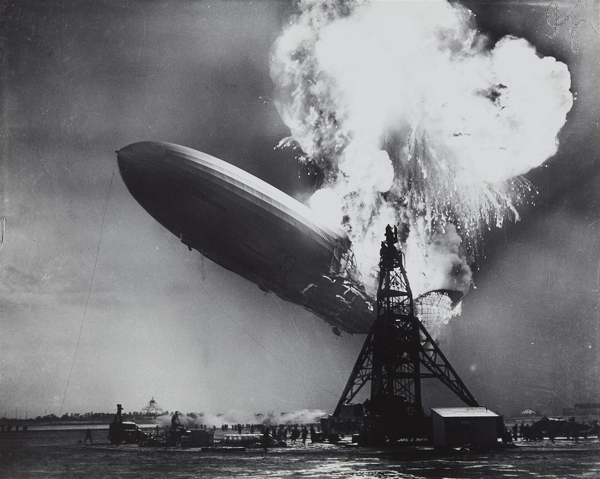

(ch:ch06)=

# Chapter 6 Gases

```{note} Opening Essay

Perhaps one of the most spectacular chemical reactions involving a gas occurred on May 6, 1937, when the German airship *Hindenburg* exploded on approach to the Naval Air Station in Lakehurst, New Jersey. The actual cause of the explosion is still unknown, but the entire volume of hydrogen gas used to float the airship, about 200,000 m<sup>3</sup>, burned in less than a minute. Thirty-six people, including one on the ground, were killed.

Hydrogen is the lightest known gas. Any balloon filled with hydrogen gas will float in air if its mass is not too great. This makes hydrogen an obvious choice for flying machines based on balloons—airships, dirigibles, and blimps. However, hydrogen also has one obvious drawback: it burns in air according to the well-known chemical equation

$\text{2H}_{2}\text{(g) + O}_{2}\text{(g) }\rightarrow{}\text{ 2H}_{2}\text{O(}\ell{}\text{)}$

So although hydrogen is an obvious choice, it is also a dangerous choice.

Helium gas is also lighter than air and has 92% of the lifting power of hydrogen. Why, then, was helium not used in the *Hindenburg*? In the 1930s, helium was much more expensive. In addition, the best source of helium at the time was the United States, which banned helium exports to pre–World War II Germany. Today all airships use helium, a legacy of the *Hindenburg* disaster.
```

```{figure} ../images/restored/hindenburg-flight.jpg
:label: fig:ch06:hindenburg
:enumerated: false
:alt: The Hindenburg airship at Lakehurst before the disaster.
:align: center
:width: 70%

**Hydrogen and the Hindenburg.** The Hindenburg at Lakehurst and during the 1937 disaster. Hydrogen provided lift but also burned readily in air. Modern airships generally use nonflammable helium.



Credits: [Hindenburg at Lakehurst — U.S. Navy, Bureau of Aeronautics](https://commons.wikimedia.org/wiki/File:Hindenburg_at_lakehurst.jpg), [Public domain](https://creativecommons.org/publicdomain/mark/1.0/); [Hindenburg disaster — Sam Shere](https://commons.wikimedia.org/wiki/File:Hindenburg_disaster.jpg), [Public domain](https://creativecommons.org/publicdomain/mark/1.0/). Images resized for the web.
```

Of the three basic phases of matter—solids, liquids, and gases—only one of them has predictable physical properties: gases. In fact, the study of the properties of gases was the beginning of the development of modern chemistry from its alchemical roots. The interesting thing about some of these properties is that they are independent of the identity of the gas. That is, it doesn’t matter if the gas is helium gas, oxygen gas, or sulfur vapors; some of their behavior is predictable and, as we will find, very similar. In this chapter, we will review some of the common behaviors of gases.

Let us start by reviewing some properties of gases. Gases have no definite shape or volume; they tend to fill whatever container they are in. They can compress and expand, sometimes to a great extent. Gases have extremely low densities, one-thousandth or less the density of a liquid or solid. Combinations of gases tend to mix together spontaneously; that is, they form solutions. Air, for example, is a solution of mostly nitrogen and oxygen. Any understanding of the properties of gases must be able to explain these characteristics.
