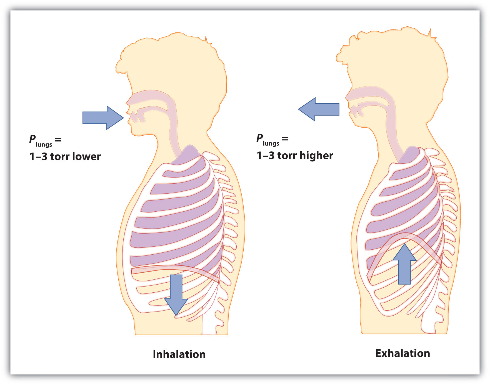

(sec:ch06:s05)=

# 6.5 The Ideal Gas Law and Some Applications

```{note} Learning Objectives

1. Learn the ideal gas law.
2. Apply the ideal gas law to any set of conditions of a gas.
3. Apply the ideal gas law to molar volumes, density, and stoichiometry problems.
```

So far, the gas laws we have considered have all required that the gas change its conditions; then we predict a resulting change in one of its properties. Are there any gas laws that relate the physical properties of a gas at any given time?

Consider a further extension of the combined gas law to include *n*. By analogy to Avogadro’s law, *n* is positioned in the denominator of the fraction, opposite the volume. So

$$
\frac{PV}{nT}=\text{constant}
$$

Because pressure, volume, temperature, and amount are the only four independent physical properties of a gas, the constant in the above equation is truly a constant; indeed, because we do not need to specify the identity of a gas to apply the gas laws, this constant is the same for all gases. We define this constant with the symbol *R*, so the previous equation is written as

$$
\frac{PV}{nT}=R
$$

which is usually rearranged as

$$
\mathit{PV}\text{ = }\mathit{nRT}
$$

This equation is called the **ideal gas law** (*A gas law that relates all four independent physical properties of a gas under any conditions.*). It relates the four independent properties of a gas at any time. The constant *R* is called the ideal gas law constant. Its value depends on the units used to express pressure and volume. {ref}`Table 6.1 "Values of the Ideal Gas Law Constant " <tbl:ch06:s05:t01>` lists the numerical values of *R*.

```{table} Values of the Ideal Gas Law Constant R
:label: tbl:ch06:s05:t01

| Numerical Value | Units |
| --- | --- |
| 0.08205 | $\frac{\text{L}\cdot{}\text{atm}}{\text{mol}\cdot{}\text{K}}$ |
| 62.36 | $\frac{\text{L}\cdot{}\text{torr}}{\text{mol}\cdot{}\text{K}}=\frac{\text{L}\cdot{}\text{mmHg}}{\text{mol}\cdot{}\text{K}}$ |
| 8.314 | $\frac{\text{J}}{\text{mol}\cdot{}\text{K}}$ |
```

The ideal gas law is used like any other gas law, with attention paid to the unit and making sure that temperature is expressed in Kelvin. However, *the ideal gas law does not require a change in the conditions of a gas sample*. The ideal gas law implies that if you know any three of the physical properties of a gas, you can calculate the fourth property.

```{exercise}
:label: ex:ball-ch06-s05-n02

**Example 9**

A 4.22 mol sample of Ar has a pressure of 1.21 atm and a temperature of 34°C. What is its volume?
```

```{solution} ex:ball-ch06-s05-n02
:label: sol:ball-ch06-s05-n02
:class: dropdown

The first step is to convert temperature to kelvins:

$\text{34 + 273 = 307 K}$

Now we can substitute the conditions into the ideal gas law:

$$
(\text{1}.\text{21 atm})(V)=(\text{4}.\text{22 mol})(\text{0}\text{.08205 }\frac{\text{L}\cdot{}\text{atm}}{\text{mol}\cdot{}\text{K}})(\text{3}0\text{7 K})
$$

The *atm* unit is in the numerator of both sides, so it cancels. On the right side of the equation, the *mol* and *K* units appear in the numerator and the denominator, so they cancel as well. The only unit remaining is *L*, which is the unit of volume that we are looking for. We isolate the volume variable by dividing both sides of the equation by 1.21:

$$
V=\frac{(4.22)(0.08205)(307)}{1.21}\text{ L}
$$

Then solving for volume, we get

$V\text{ = 87.9 L}$
```

```{exercise}
:label: ex:ball-ch06-s05-n02-ty2

**Test Yourself**

A 0.0997 mol sample of O<sub>2</sub> has a pressure of 0.692 atm and a temperature of 333 K. What is its volume?
```

```{solution} ex:ball-ch06-s05-n02-ty2
:label: sol:ball-ch06-s05-n02-ty2
:class: dropdown

3.94 L
```

```{exercise}
:label: ex:ball-ch06-s05-n03

**Example 10**

At a given temperature, 0.00332 g of Hg in the gas phase has a pressure of 0.00120 mmHg and a volume of 435 L. What is its temperature?
```

```{solution} ex:ball-ch06-s05-n03
:label: sol:ball-ch06-s05-n03
:class: dropdown

We are not given the number of moles of Hg directly, but we are given a mass. We can use the molar mass of Hg to convert to the number of moles.

$$
\text{0}\text{.00332}\text{ g Hg}\,\times{}\,\frac{\text{1 mol Hg}}{\text{200}\text{.59}\text{ g Hg}}=0.0000165\text{ mol}=\text{1}\text{.65}\,\times{}\,{\text{10}}^{-\text{5}}\text{ mol}
$$

Pressure is given in units of millimeters of mercury. We can either convert this to atmospheres or use the value of the ideal gas constant that includes the mmHg unit. We will take the second option. Substituting into the ideal gas law,

$$
\text{(0}\text{.00120 mmHg)(435 L) = (1}\text{.65}\,\times{}\,{\text{10}}^{-\text{5}}\text{ mol)}(\text{62}\text{.36 }\frac{\text{L}\cdot{}\text{mmHg}}{\text{mol}\cdot{}\text{K}})T
$$

The mmHg, L, and mol units cancel, leaving the K unit, the unit of temperature. Isolating *T* all by itself on one side, we get

$$
T=\frac{\text{(0}\text{.00120)(435)}}{\text{(1}\text{.65}\times{}{\text{10}}^{-\text{5}}\text{)(62}\text{.36)}}\text{ K}
$$

Then solving for K, we get

$T\text{ = 507 K}$
```

```{exercise}
:label: ex:ball-ch06-s05-n03-ty2

**Test Yourself**

For a 0.00554 mol sample of H<sub>2</sub>, *P* = 23.44 torr and *T* = 557 K. What is its volume?
```

```{solution} ex:ball-ch06-s05-n03-ty2
:label: sol:ball-ch06-s05-n03-ty2
:class: dropdown

8.21 L
```

The ideal gas law can also be used in stoichiometry problems.

```{exercise}
:label: ex:ball-ch06-s05-n04

**Example 11**

What volume of H<sub>2</sub> is produced at 299 K and 1.07 atm when 55.8 g of Zn metal react with excess HCl?

$\text{Zn(s) + 2HCl(aq) }\rightarrow{}\text{ ZnCl}_{2}\text{(aq) + H}_{2}\text{(g)}$
```

```{solution} ex:ball-ch06-s05-n04
:label: sol:ball-ch06-s05-n04
:class: dropdown

Here we have a stoichiometry problem where we need to find the number of moles of H<sub>2</sub> produced. Then we can use the ideal gas law, with the given temperature and pressure, to determine the volume of gas produced. First, the number of moles of H<sub>2</sub> is calculated:

$$
\text{55}\text{.8}\text{ g Zn}\,\times{}\,\frac{\text{1}\text{ mol Zn}}{\text{65}\text{.41}\text{ g Zn}}\,\times{}\,\frac{{\text{1 mol H}}_{\text{2}}}{1\text{ mol Zn}}=0.853{\text{ mol H}}_{\text{2}}
$$

Now that we know the number of moles of gas, we can use the ideal gas law to determine the volume, given the other conditions:

$$
\text{(1}\text{.07 atm)}V=\text{(0}\text{.853 mol)}(\text{0}\text{.08205 }\frac{\text{L}\cdot{}\text{atm}}{\text{mol}\cdot{}\text{K}})(\text{299 K)}
$$

All the units cancel except for L, for volume, which means

$V\text{ = 19.6 L}$
```

```{exercise}
:label: ex:ball-ch06-s05-n04-ty2

**Test Yourself**

What pressure of HCl is generated if 3.44 g of Cl<sub>2</sub> are reacted in 4.55 L at 455 K?

$\text{H}_{2}\text{(g) + Cl}_{2}\text{(g) }\rightarrow{}\text{ 2HCl(g)}$
```

```{solution} ex:ball-ch06-s05-n04-ty2
:label: sol:ball-ch06-s05-n04-ty2
:class: dropdown

0.796 atm
```

It should be obvious by now that some physical properties of gases depend strongly on the conditions. What we need is a set of standard conditions so that properties of gases can be properly compared to each other. **Standard temperature and pressure (STP)** (*A set of benchmark conditions used to compare other properties of gases; about 1 atm for pressure and 273 K for temperature.*) is defined as exactly 100 kPa of pressure (0.986 atm) and 273 K (0°C). For simplicity, we will use 1 atm as standard pressure. Defining STP allows us to compare more directly the properties of gases that differ from each other.

One property shared among gases is a molar volume. The **molar volume** (*The volume of exactly 1 mol of a gas; equal to 22.4 L at STP.*) is the volume of 1 mol of a gas. At STP, the molar volume of a gas can be easily determined by using the ideal gas law:

$$
\text{(1 atm)}V=\text{(1 mol)}(\text{0}\text{.08205 }\frac{\text{L}\cdot{}\text{atm}}{\text{mol}\cdot{}\text{K}})(\text{273 K)}
$$

All the units cancel except for L, the unit of volume. So

$$
V\text{ = 22.4 L}
$$

Note that we have not specified the identity of the gas; we have specified only that the pressure is 1 atm and the temperature is 273 K. This makes for a very useful approximation: *any gas at STP has a volume of 22.4 L per mole of gas*; that is, the molar volume at STP is 22.4 L/mol ({ref}`Figure 6.4 "Molar Volume" <fig:ch06:s05:f01>`). This molar volume makes a useful conversion factor in stoichiometry problems if the conditions are at STP. If the conditions are not at STP, a molar volume of 22.4 L/mol is not applicable. However, if the conditions are not at STP, the combined gas law can be used to calculate what the volume of the gas would be if at STP; then the 22.4 L/mol molar volume can be used.

```{figure} ../images/figures/d08b3d46dd4273db855403297968d347.jpg
:label: fig:ch06:s05:f01
:alt: "Molar Volume. A mole of gas at STP occupies 22.4 L, the volume of a cube that is 28.2 cm on a side."
:align: center
:width: 45%

Molar Volume. A mole of gas at STP occupies 22.4 L, the volume of a cube that is 28.2 cm on a side.
```

```{exercise}
:label: ex:ball-ch06-s05-n05

**Example 12**

How many moles of Ar are present in 38.7 L at STP?
```

```{solution} ex:ball-ch06-s05-n05
:label: sol:ball-ch06-s05-n05
:class: dropdown

We can use the molar volume, 22.4 L/mol, as a conversion factor, but we need to reverse the fraction so that the L units cancel and mol units are introduced. It is a one-step conversion:

$$
\text{38}\text{.7}\text{ L}\,\times{}\,\frac{\text{1 mol}}{\text{22}\text{.4}\text{ L}}=1.73\text{ mol}
$$
```

```{exercise}
:label: ex:ball-ch06-s05-n05-ty2

**Test Yourself**

What volume does 4.87 mol of Kr have at STP?
```

```{solution} ex:ball-ch06-s05-n05-ty2
:label: sol:ball-ch06-s05-n05-ty2
:class: dropdown

109 L
```

```{exercise}
:label: ex:ball-ch06-s05-n06

**Example 13**

What volume of H<sub>2</sub> is produced at STP when 55.8 g of Zn metal react with excess HCl?

$\text{Zn(s) + 2HCl(aq) }\rightarrow{}\text{ ZnCl}_{2}\text{(aq) + H}_{2}\text{(g)}$
```

```{solution} ex:ball-ch06-s05-n06
:label: sol:ball-ch06-s05-n06
:class: dropdown

This is a stoichiometry problem with a twist: we need to use the molar volume of a gas at STP to determine the final answer. The first part of the calculation is the same as in a previous example:

$$
\text{55}\text{.8}\text{ g Zn}\,\times{}\,\frac{\text{1}\text{ mol Zn}}{\text{65}\text{.41}\text{ g Zn}}\,\times{}\,\frac{{\text{1 mol H}}_{\text{2}}}{1\text{ mol Zn}}=0.853{\text{ mol H}}_{\text{2}}
$$

Now we can use the molar volume, 22.4 L/mol, because the gas is at STP:

$$
\text{0}\text{.853}{\text{ mol H}}_{\text{2}}\,\times{}\,\frac{\text{22}\text{.4 L}}{\text{1}{\text{ mol H}}_{\text{2}}}=19.1{\text{ L H}}_{\text{2}}
$$

Alternatively, we could have applied the molar volume as a third conversion factor in the original stoichiometry calculation.
```

```{exercise}
:label: ex:ball-ch06-s05-n06-ty2

**Test Yourself**

What volume of HCl is generated if 3.44 g of Cl<sub>2</sub> are reacted at STP?

$\text{H}_{2}\text{(g) + Cl}_{2}\text{(g) }\rightarrow{}\text{ 2HCl(g)}$
```

```{solution} ex:ball-ch06-s05-n06-ty2
:label: sol:ball-ch06-s05-n06-ty2
:class: dropdown

2.17 L
```

The ideal gas law can also be used to determine the densities of gases. Density, recall, is defined as the mass of a substance divided by its volume:

$$
d=\frac{m}{V}
$$

Assume that you have exactly 1 mol of a gas. If you know the identity of the gas, you can determine the molar mass of the substance. Using the ideal gas law, you can also determine the volume of that mole of gas, using whatever the temperature and pressure conditions are. Then you can calculate the density of the gas by using

$$
\text{density = }\frac{\text{molar mass}}{\text{molar volume}}
$$

```{exercise}
:label: ex:ball-ch06-s05-n07

**Example 14**

What is the density of N<sub>2</sub> at 25°C and 0.955 atm?
```

```{solution} ex:ball-ch06-s05-n07
:label: sol:ball-ch06-s05-n07
:class: dropdown

First, we must convert the temperature into kelvins:

$\text{25 + 273 = 298 K}$

If we assume exactly 1 mol of N<sub>2</sub>, then we know its mass: 28.0 g. Using the ideal gas law, we can calculate the volume:

$$
\text{(0}\text{.955 atm)}V=\text{(1 mol)}(\text{0}\text{.08205 }\frac{\text{L}\cdot{}\text{atm}}{\text{mol}\cdot{}\text{K}})(\text{298 K)}
$$

All the units cancel except for L, the unit of volume. So

$V\text{ = 25.6 L}$

Knowing the molar mass and the molar volume, we can determine the density of N<sub>2</sub> under these conditions:

$$
d=\frac{\text{28}\text{.0 g}}{\text{25}\text{.6 L}}=1.09\text{ g/L}
$$
```

```{exercise}
:label: ex:ball-ch06-s05-n07-ty2

**Test Yourself**

What is the density of CO<sub>2</sub> at a pressure of 0.0079 atm and 227 K? (These are the approximate atmospheric conditions on Mars.)
```

```{solution} ex:ball-ch06-s05-n07-ty2
:label: sol:ball-ch06-s05-n07-ty2
:class: dropdown

0.019 g/L
```

```{tip} Chemistry Is Everywhere: Breathing

Breathing (more properly called *respiration*) is the process by which we draw air into our lungs so that our bodies can take up oxygen from the air. Let us apply the gas laws to breathing.

Start by considering pressure. We draw air into our lungs because the diaphragm, a muscle underneath the lungs, moves down to reduce pressure in the lungs, causing external air to rush in to fill the lower-pressure volume. We expel air by the diaphragm pushing against the lungs, increasing pressure inside the lungs and forcing the high-pressure air out. What are the pressure changes involved? A quarter of an atmosphere? A tenth of an atmosphere? Actually, under normal conditions, it’s only 1 or 2 torr of pressure difference that makes us breathe in and out.

(fig:ch06:s05:f02)=



*Breathing Mechanics. Breathing involves pressure differences between the inside of the lungs and the air outside. The pressure differences are only a few torr.*

A normal breath is about 0.50 L. If room temperature is about 22°C, then the air has a temperature of about 295 K. With normal pressure being 1.0 atm, how many moles of air do we take in for every breath? The ideal gas law gives us an answer:

$$
(\text{1}\text{.0 atm)(0}\text{.50 L) = }n(0.08205\,\frac{\text{L}\cdot{}\text{atm}}{\text{mol}\cdot{}\text{K}})(295\text{ K)}
$$

Solving for the number of moles, we get

$n\text{ = 0.021 mol air}$

This ends up being about 0.6 g of air per breath—not much but enough to keep us alive.
```

```{important} Key Takeaways

- The ideal gas law relates the four independent physical properties of a gas at any time.
- The ideal gas law can be used in stoichiometry problems whose chemical reactions involve gases.
- Standard temperature and pressure (STP) are a useful set of benchmark conditions to compare other properties of gases.
- At STP, gases have a volume of 22.4 L per mole.
- The ideal gas law can be used to determine densities of gases.
```

## Exercises

```{exercise}
:label: ex:ball-ch06-s05-qs01-qd01-qa01

**Exercise 1.**

What is the ideal gas law? What is the significance of *R*?
```

```{solution} ex:ball-ch06-s05-qs01-qd01-qa01
:label: sol:ball-ch06-s05-qs01-qd01-qa01
:class: dropdown

The ideal gas law is *PV* = *nRT*. *R* is the ideal gas law constant, which relates the other four variables.
```

```{exercise}
:label: ex:ball-ch06-s05-qs01-qd01-qa02

**Exercise 2.**

Why does *R* have different numerical values (see {ref}`Table 6.1 "Values of the Ideal Gas Law Constant " <tbl:ch06:s05:t01>`)?
```

```{exercise}
:label: ex:ball-ch06-s05-qs01-qd01-qa03

**Exercise 3.**

A sample of gas has a volume of 3.91 L, a temperature of 305 K, and a pressure of 2.09 atm. How many moles of gas are present?
```

```{solution} ex:ball-ch06-s05-qs01-qd01-qa03
:label: sol:ball-ch06-s05-qs01-qd01-qa03
:class: dropdown

0.327 mol
```

```{exercise}
:label: ex:ball-ch06-s05-qs01-qd01-qa04

**Exercise 4.**

A 3.88 mol sample of gas has a temperature of 28°C and a pressure of 885 torr. What is its volume?
```

```{exercise}
:label: ex:ball-ch06-s05-qs01-qd01-qa05

**Exercise 5.**

A 0.0555 mol sample of Kr has a temperature of 188°C and a volume of 0.577 L. What pressure does it have?
```

```{solution} ex:ball-ch06-s05-qs01-qd01-qa05
:label: sol:ball-ch06-s05-qs01-qd01-qa05
:class: dropdown

3.64 atm
```

```{exercise}
:label: ex:ball-ch06-s05-qs01-qd01-qa06

**Exercise 6.**

If 1.000 mol of gas has a volume of 5.00 L and a pressure of 5.00 atm, what is its temperature?
```

```{exercise}
:label: ex:ball-ch06-s05-qs01-qd01-qa07

**Exercise 7.**

A sample of 7.55 g of He has a volume of 5,520 mL and a temperature of 123°C. What is its pressure in torr?
```

```{solution} ex:ball-ch06-s05-qs01-qd01-qa07
:label: sol:ball-ch06-s05-qs01-qd01-qa07
:class: dropdown

8,440 torr
```

```{exercise}
:label: ex:ball-ch06-s05-qs01-qd01-qa08

**Exercise 8.**

A sample of 87.4 g of Cl<sub>2</sub> has a temperature of −22°C and a pressure of 993 torr. What is its volume in milliliters?
```

```{exercise}
:label: ex:ball-ch06-s05-qs01-qd01-qa09

**Exercise 9.**

A sample of Ne has a pressure of 0.772 atm and a volume of 18.95 L. If its temperature is 295 K, what mass is present in the sample?
```

```{solution} ex:ball-ch06-s05-qs01-qd01-qa09
:label: sol:ball-ch06-s05-qs01-qd01-qa09
:class: dropdown

12.2 g
```

```{exercise}
:label: ex:ball-ch06-s05-qs01-qd01-qa10

**Exercise 10.**

A mercury lamp contains 0.0055 g of Hg vapor in a volume of 15.0 mL. If the operating temperature is 2,800 K, what is the pressure of the mercury vapor?
```

```{exercise}
:label: ex:ball-ch06-s05-qs01-qd01-qa11

**Exercise 11.**

Oxygen is a product of the decomposition of mercury(II) oxide:

$\text{2HgO(s) }\rightarrow{}\text{ 2Hg(}\ell{}\text{) + O}_{2}\text{(g)}$

What volume of O<sub>2</sub> is formed from the decomposition of 3.009 g of HgO if the gas has a pressure of 744 torr and a temperature of 122°C?
```

```{solution} ex:ball-ch06-s05-qs01-qd01-qa11
:label: sol:ball-ch06-s05-qs01-qd01-qa11
:class: dropdown

0.230 L
```

```{exercise}
:label: ex:ball-ch06-s05-qs01-qd01-qa12

**Exercise 12.**

Lithium oxide is used to absorb carbon dioxide:

$\text{Li}_{2}\text{O(s) + CO}_{2}\text{(g) }\rightarrow{}\text{ Li}_{2}\text{CO}_{3}\text{(s)}$

What volume of CO<sub>2</sub> can 6.77 g of Li<sub>2</sub>O absorb if the CO<sub>2</sub> pressure is 3.5 × 10<sup>−4</sup> atm and the temperature is 295 K?
```

```{exercise}
:label: ex:ball-ch06-s05-qs01-qd01-qa13

**Exercise 13.**

What is the volume of 17.88 mol of Ar at STP?
```

```{solution} ex:ball-ch06-s05-qs01-qd01-qa13
:label: sol:ball-ch06-s05-qs01-qd01-qa13
:class: dropdown

401 L
```

```{exercise}
:label: ex:ball-ch06-s05-qs01-qd01-qa14

**Exercise 14.**

How many moles are present in 334 L of H<sub>2</sub> at STP?
```

```{exercise}
:label: ex:ball-ch06-s05-qs01-qd01-qa15

**Exercise 15.**

How many liters, at STP, of CO<sub>2</sub> are produced from 100.0 g of C<sub>8</sub>H<sub>18</sub>, the approximate formula of gasoline?

$\text{2C}_{8}\text{H}_{18}\text{(}\ell{}\text{) + 25O}_{2}\text{(g) }\rightarrow{}\text{ 16CO}_{2}\text{(g) + 18H}_{2}\text{O(}\ell{}\text{)}$
```

```{solution} ex:ball-ch06-s05-qs01-qd01-qa15
:label: sol:ball-ch06-s05-qs01-qd01-qa15
:class: dropdown

157 L
```

```{exercise}
:label: ex:ball-ch06-s05-qs01-qd01-qa16

**Exercise 16.**

How many liters, at STP, of O<sub>2</sub> are required to burn 3.77 g of butane from a disposable lighter?

$\text{2C}_{4}\text{H}_{10}\text{(g) + 13O}_{2}\text{(g) }\rightarrow{}\text{ 8CO}_{2}\text{(g) + 10H}_{2}\text{O(}\ell{}\text{)}$
```

```{exercise}
:label: ex:ball-ch06-s05-qs01-qd01-qa17

**Exercise 17.**

What is the density of each gas at STP?

a. He
b. Ne
c. Ar
d. Kr
```

```{solution} ex:ball-ch06-s05-qs01-qd01-qa17
:label: sol:ball-ch06-s05-qs01-qd01-qa17
:class: dropdown

a. 0.179 g/L
b. 0.901 g/L
c. 1.78 g/L
d. 3.74 g/L
```

```{exercise}
:label: ex:ball-ch06-s05-qs01-qd01-qa18

**Exercise 18.**

What is the density of each gas at STP?

a. H<sub>2</sub>
b. O<sub>2</sub>
c. N<sub>2</sub>
```

```{exercise}
:label: ex:ball-ch06-s05-qs01-qd01-qa19

**Exercise 19.**

What is the density of SF<sub>6</sub> at 335 K and 788 torr?
```

```{solution} ex:ball-ch06-s05-qs01-qd01-qa19
:label: sol:ball-ch06-s05-qs01-qd01-qa19
:class: dropdown

5.51 g/L
```

```{exercise}
:label: ex:ball-ch06-s05-qs01-qd01-qa20

**Exercise 20.**

What is the density of He at −200°C and 33.9 torr?
```
