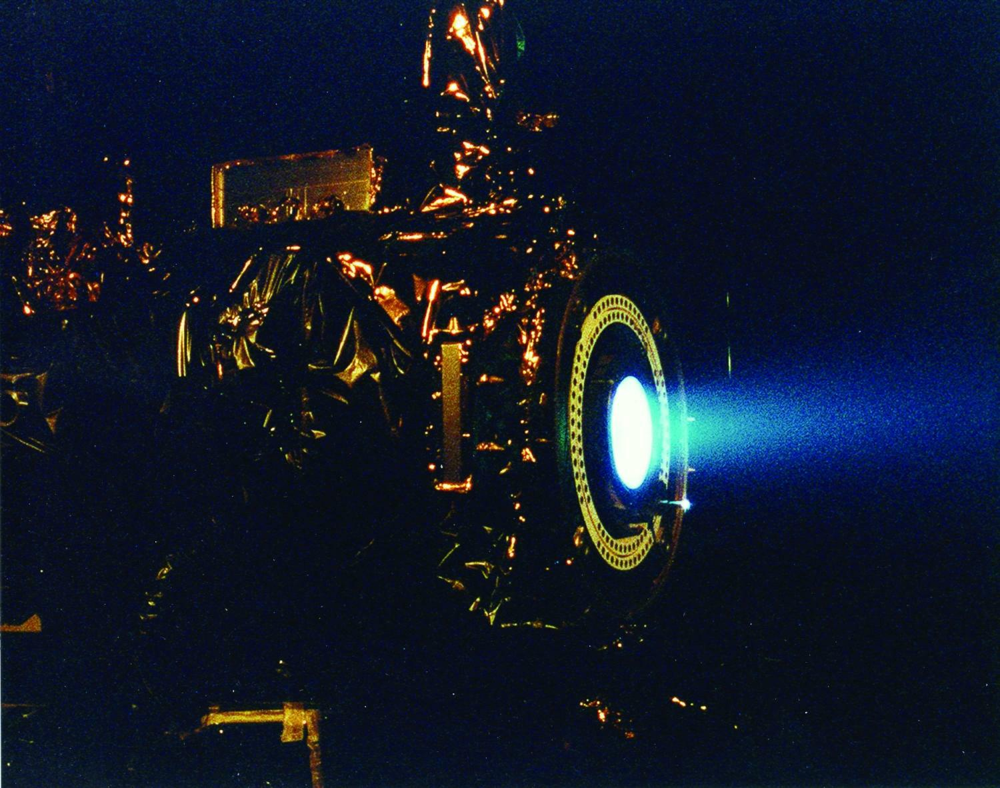

(ch:ch07)=

# Chapter 7 Energy and Chemistry

```{note} Opening Essay

It takes energy to launch a spaceship into space. If it takes 1 energy unit to warm 0.25 g of water by 1°C, then it takes over 15,100 energy units to put that 0.25 g of water into earth orbit. The most powerful engines designed to lift rockets into space were part of the Saturn V rocket, that was built by the National Aeronautics and Space Administration (NASA). The rocket had three stages, with the first stage having the capability of launching about 3.5 million kg of mass. About 2.3 million kg was the actual fuel for the first stage; rockets in space have the unpleasant task of having to take their own chemicals with them to provide thrust.

Having to carry its own fuel puts a lot of mass burden on an engine in space. This is why NASA is developing other types of engines to minimize fuel mass. An ion thruster uses xenon atoms that have had at least one electron removed from their atoms. The resulting ions can be accelerated by electric fields, causing a thrust. Because xenon atoms are very large for atoms, the thrusting efficiency is high even though the actual thrust is low. Because of this, ion engines are useful only in space.

(fig:ch07:f02)=



*Ion drives have low thrust but high efficiency. They have already been used on several space missions, including NASA’s *Deep Space 1* spacecraft and Japan’s *Hayabusa* asteroid sampling probe.*
```

Energy is a very important quantity in science and the world around us. Although most of our energy ultimately comes from the sun, much of the energy we use on a daily basis is rooted in chemical reactions. The gasoline in your car, the electricity in your house, the food in your diet—all provide substances for chemical reactions to provide energy (gasoline, food) or are produced from chemical reactions (electricity, about 50% of which is generated by burning coal). As such, it is only natural that the study of chemistry involves energy.
