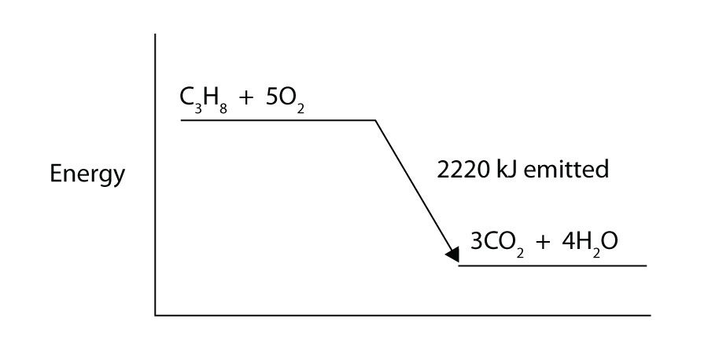

(sec:ch07:s03)=

# 7.3 Enthalpy and Chemical Reactions

```{note} Learning Objectives

1. Define *enthalpy*.
2. Properly express the enthalpy change of chemical reactions.
3. Explain how enthalpy changes are measured experimentally.
```

Now that we have shown how energy, work, and heat are related, we are ready to consider energy changes in chemical reactions. A fundamental concept is that *every chemical reaction occurs with a concurrent change in energy*. Now we need to learn how to properly express these energy changes.

Our study of gases in {ref}`Chapter 6 "Gases" <ch:ch06>` and our definition of work in {ref}`Section 7.2 "Work and Heat" <sec:ch07:s02>` indicate that conditions like pressure, volume, and temperature affect the energy content of a system. What we need is a definition of energy that holds when some of these conditions are specified (somewhat similar to our definition of standard temperature and pressure in our study of gases). We define the **enthalpy change** (*The heat of a process at constant pressure; denoted $\Delta{}H$.*) (Δ*H*) as the heat of a process when pressure is held constant:

$$
\begin{aligned}
\Delta{}H\equiv{}q & \text{at constant pressure}
\end{aligned}
$$

The letter *H* stands for “enthalpy,” a kind of energy, while the Δ implies a change in the quantity. We will always be interested in the change in *H*, rather than the absolute value of *H* itself.

When a chemical reaction occurs, there is a characteristic change in enthalpy. The enthalpy change for a reaction is typically written after a balanced chemical equation and on the same line. For example, when two moles of hydrogen react with one mole of oxygen to make two moles of water, the characteristic enthalpy change is 570 kJ. We write the equation as

$$
\text{2H}_{2}\text{(g) + O}_{2}\text{(g) }\rightarrow{}\text{ 2H}_{2}\text{O(}\ell{}\text{)     }\Delta{}H\text{ = }-\text{570 kJ}
$$

A chemical equation that includes an enthalpy change is called a **thermochemical equation** (*A chemical equation that includes an enthalpy change.*). A thermochemical equation is assumed to refer to the equation in molar quantities, which means it must be interpreted in terms of moles, not individual molecules.

```{exercise}
:label: ex:ball-ch07-s03-n02

**Example 5**

Write the thermochemical equation for the reaction of PCl<sub>3</sub>(g) with Cl<sub>2</sub>(g) to make PCl<sub>5</sub>(g), which has an enthalpy change of −88 kJ.
```

```{solution} ex:ball-ch07-s03-n02
:label: sol:ball-ch07-s03-n02
:class: dropdown

The thermochemical equation is

$\text{PCl}_{3}\text{(g) + Cl}_{2}\text{(g) }\rightarrow{}\text{ PCl}_{5}\text{(g)     }\Delta{}H\text{ = }-\text{88 kJ}$
```

```{exercise}
:label: ex:ball-ch07-s03-n02-ty2

**Test Yourself**

Write the thermochemical equation for the reaction of N<sub>2</sub>(g) with O<sub>2</sub>(g) to make 2NO(g), which has an enthalpy change of 181 kJ.
```

```{solution} ex:ball-ch07-s03-n02-ty2
:label: sol:ball-ch07-s03-n02-ty2
:class: dropdown

$\text{N}_{2}\text{(g) + O}_{2}\text{(g) }\rightarrow{}\text{ 2NO(g)     }\Delta{}H\text{ = 181 kJ}$
```

You may have noticed that the Δ*H* for a chemical reaction may be positive or negative. The number is assumed to be positive if it has no sign; a + sign can be added explicitly to avoid confusion. A chemical reaction that has a positive Δ*H* is said to be **endothermic** (*A chemical reaction that has a positive change in enthalpy.*), while a chemical reaction that has a negative Δ*H* is said to be **exothermic** (*A chemical reaction that has a negative change in enthalpy.*).

What does it mean if the Δ*H* of a process is positive? It means that the system in which the chemical reaction is occurring is gaining energy. If one considers the energy of a system as being represented as a height on a vertical energy plot, the enthalpy change that accompanies the reaction can be diagrammed as in part (a) in {ref}`Figure 7.3 "Reaction Energy" <fig:ch07:s03:f01>`: the energy of the reactants has some energy, and the system increases its energy as it goes to products. The products are higher on the vertical scale than the reactants. Endothermic, then, implies that the system *gains*, or absorbs, energy.

An opposite situation exists for an exothermic process, as shown in part (b) in {ref}`Figure 7.3 "Reaction Energy" <fig:ch07:s03:f01>`. If the enthalpy change of a reaction is negative, the system is losing energy, so the products have less energy than the reactants, and the products are lower on the vertical energy scale than the reactants are. Exothermic, then, implies that the system *loses*, or gives off, energy.

```{figure} ../images/figures/607be9e5d31c6e1ed07ee11758948935.jpg
:label: fig:ch07:s03:f01
:alt: "Reaction Energy. (a) In an endothermic reaction, the energy of the system increases (i.e., moves higher on the vertical scale of energy). (b) In an exothermic reaction, the energy of the system decreases (i.e., moves lower on the vertical scale of energy)."
:align: center
:width: 85%

Reaction Energy. (a) In an endothermic reaction, the energy of the system increases (i.e., moves higher on the vertical scale of energy). (b) In an exothermic reaction, the energy of the system decreases (i.e., moves lower on the vertical scale of energy).
```

```{exercise}
:label: ex:ball-ch07-s03-n03

**Example 6**

Consider this thermochemical equation.

$\text{2CO(g) + O}_{2}\text{(g) }\rightarrow{}\text{ 2CO}_{2}\text{(g)     }\Delta{}H\text{ = }-\text{565 kJ}$

Is it exothermic or endothermic? How much energy is given off or absorbed?
```

```{solution} ex:ball-ch07-s03-n03
:label: sol:ball-ch07-s03-n03
:class: dropdown

By definition, a chemical reaction that has a negative Δ*H* is exothermic, meaning that this much energy—in this case, 565 kJ—is given off by the reaction.
```

```{exercise}
:label: ex:ball-ch07-s03-n03-ty2

**Test Yourself**

Consider this thermochemical equation.

$\text{CO}_{2}\text{(g) + H}_{2}\text{(g) }\rightarrow{}\text{ CO(g) + H}_{2}\text{O(g)     }\Delta{}H\text{ = 42 kJ}$

Is it exothermic or endothermic? How much energy is given off or absorbed?
```

```{solution} ex:ball-ch07-s03-n03-ty2
:label: sol:ball-ch07-s03-n03-ty2
:class: dropdown

Endothermic; 42 kJ are absorbed.
```

How are Δ*H* values measured experimentally? Actually, Δ*H* is not measured; *q* is measured. But the measurements are performed under conditions of constant pressure, so Δ*H* is equal to the *q* measured.

Experimentally, *q* is measured by taking advantage of the equation

$$
q\text{ = }\mathit{mc}\Delta{}T
$$

We premeasure the mass of the chemicals in a system. Then we let the chemical reaction occur and measure the change in temperature (Δ*T*) of the system. If we know the specific heat of the materials in the system (typically, we do), we can calculate *q*. That value of *q* is numerically equal to the Δ*H* of the process, which we can scale up to a molar scale. The container in which the system resides is typically insulated, so any energy change goes into changing the temperature of the system, rather than being leaked from the system. The container is referred to as a **calorimeter** (*A container used to measure the heat of a chemical reaction.*), and the process of measuring changes in enthalpy is called **calorimetry** (*The process of measuring enthalpy changes for chemical reactions.*).

```{figure} ../images/figures/e89704a09c2c08d4053d9fa493253f31.jpg
:label: fig:ch07:s03:f02
:alt: "Calorimeters. A simple calorimeter can be constructed from some nested foam coffee cups, a cover, a thermometer, and a stirrer."
:align: center
:width: 45%

Calorimeters. A simple calorimeter can be constructed from some nested foam coffee cups, a cover, a thermometer, and a stirrer.
```

For example, suppose 4.0 g of NaOH, or 0.10 mol of NaOH, are dissolved to make 100.0 mL of aqueous solution, while 3.65 g of HCl, or 0.10 mol of HCl, are dissolved to make another 100.0 mL of aqueous solution. The two solutions are mixed in an insulated calorimeter, a thermometer is inserted, and the calorimeter is covered (see {ref}`Figure 7.4 "Calorimeters" <fig:ch07:s03:f02>` for an example setup). The thermometer measures the temperature change as the following chemical reaction occurs:

$$
\text{NaOH (aq) + HCl(aq) }\rightarrow{}\text{ NaCl(aq) + H}_{2}\text{O(}\ell{}\text{)}
$$

An observer notes that the temperature increases from 22.4°C to 29.1°C. Assuming that the heat capacities and densities of the solutions are the same as those of pure water, we now have the information we need to determine the enthalpy change of the chemical reaction. The total amount of solution is 200.0 mL, and with a density of 1.00 g/mL, we thus have 200.0 g of solution. Using the equation for *q*, we substitute for our experimental measurements and the specific heat of water ({ref}`Table 7.1 "Specific Heats of Various Substances" <tbl:ch07:s02:t01>`):

$$
q=\text{(200}\text{.0}\text{ g)}(4.184\,\frac{\text{J}}{\text{ g}\cdot{}^{\circ}\text{C}})(6.7^{\circ}\text{C)}
$$

Solving for *q*, we get

$$
q=\text{5,6}00\text{ J}\equiv{}\Delta{}H\text{ for the reaction}
$$

The heat *q* is equal to the Δ*H* for the reaction because the chemical reaction occurs at constant pressure. However, the reaction is giving off this amount of energy, so the actual sign on Δ*H* is negative:

$$
\Delta{}H\text{ = }-\text{5,600 J for the reaction}
$$

Thus, we have the following thermochemical equation for the chemical reaction that occurred in the calorimeter:

$$
\begin{aligned}
\frac{1}{10}\text{ NaOH(aq)}+\frac{1}{10}\text{ HCl(aq)}\rightarrow{}\frac{1}{10}\text{ NaCl(aq)}+\frac{1}{10}{\text{ H}}_{\text{2}}\text{O}(\ell{}) & \Delta{}H=-\text{5,6}00\text{ J}
\end{aligned}
$$

The 1/10 coefficients are present to remind us that we started with one-tenth of a mole of each reactant, so we make one-tenth of a mole of each product. Typically, however, we report thermochemical equations in terms of moles, not one-tenth of a mole. To scale up to molar quantities, we must multiply the coefficients by 10. However, when we do this, we get 10 times as much energy. Thus, we have

$$
\text{NaOH (aq) + HCl(aq) }\rightarrow{}\text{ NaCl(aq) + H}_{2}\text{O(}\ell{}\text{)     }\Delta{}H\text{ = }-\text{56,000 J}
$$

The Δ*H* can be converted into kJ units, so our final thermochemical equation is

$$
\text{NaOH (aq) + HCl(aq) }\rightarrow{}\text{ NaCl(aq) + H}_{2}\text{O(}\ell{}\text{)     }\Delta{}H\text{ = }-\text{56 kJ}
$$

We have just taken our experimental data from calorimetry and determined the enthalpy change of a chemical reaction. Similar measurements on other chemical reactions can determine the Δ*H* values of any chemical reaction you want to study.

```{exercise}
:label: ex:ball-ch07-s03-n04

**Example 7**

A 100 mL solution of 0.25 mol of Ca<sup>2+</sup>(aq) was mixed with 0.50 mol of F<sup>−</sup>(aq) ions, and CaF<sub>2</sub> was precipitated:

$\text{Ca}^{2+}\text{(aq) + 2F}^{-}\text{(aq) }\rightarrow{}\text{ CaF}_{2}\text{(s)}$

The temperature of the solution increased by 10.5°C. What was the enthalpy change for the chemical reaction? What was the enthalpy change for the production of 1 mol of CaF<sub>2</sub>? Assume that the solution has the same density and specific heat as water.
```

```{solution} ex:ball-ch07-s03-n04
:label: sol:ball-ch07-s03-n04
:class: dropdown

Because we are given Δ*T* directly, we can determine the heat of the reaction, which is equal to Δ*H*:

$$
q=(\text{100}\text{ g)}(4.184\,\frac{\text{J}}{\text{ g}\cdot{}^{\circ}\text{C}})(10.5^{\circ}\text{C)}
$$

Solving for *q*, we get

$q\text{ = 4,400 J}$

Therefore, Δ*H* = −4,400 J.

According to the stoichiometry of the reaction, exactly 0.25 mol of CaF<sub>2</sub> will form, so this quantity of heat is for 0.25 mol. For 1 mol of CaF<sub>2</sub>, we need to scale up the heat by a factor of four:

$q\text{ = 4,400 J }\times{}\text{ 4 = 17,600 J for 1 mol CaF}_{2}$

On a molar basis, the change in enthalpy is

$\Delta{}H\text{ = }-\text{17,600 J = }-\text{17.6 kJ}$
```

```{exercise}
:label: ex:ball-ch07-s03-n04-ty2

**Test Yourself**

In a calorimeter at constant pressure, 0.10 mol of CH<sub>4</sub>(g) and 0.20 mol of O<sub>2</sub>(g) are reacted.

$\text{CH}_{4}\text{(g) + 2O}_{2}\text{(g) }\rightarrow{}\text{ CO}_{2}\text{(g) + 2H}_{2}\text{O(}\ell{}\text{)}$

The reaction warms 750.0 g of H<sub>2</sub>O by 28.4°C. What is Δ*H* for the reaction on a molar scale?
```

```{solution} ex:ball-ch07-s03-n04-ty2
:label: sol:ball-ch07-s03-n04-ty2
:class: dropdown

−891 kJ
```

```{important} Key Takeaways

- Every chemical reaction occurs with a concurrent change in energy.
- The change in enthalpy equals heat at constant pressure.
- Enthalpy changes can be expressed by using thermochemical equations.
- Enthalpy changes are measured by using calorimetry.
```

## Exercises

```{exercise}
:label: ex:ball-ch07-s03-qs01-qd01-qa01

**Exercise 1.**

Under what circumstances are *q* and Δ*H* the same?
```

```{solution} ex:ball-ch07-s03-qs01-qd01-qa01
:label: sol:ball-ch07-s03-qs01-qd01-qa01
:class: dropdown

under conditions of constant pressure
```

```{exercise}
:label: ex:ball-ch07-s03-qs01-qd01-qa02

**Exercise 2.**

Under what circumstances are *q* and Δ*H* different?
```

```{exercise}
:label: ex:ball-ch07-s03-qs01-qd01-qa03

**Exercise 3.**

Hydrogen gas and chlorine gas react to make hydrogen chloride gas with an accompanying enthalpy change of −184 kJ. Write a properly balanced thermochemical equation for this process.
```

```{solution} ex:ball-ch07-s03-qs01-qd01-qa03
:label: sol:ball-ch07-s03-qs01-qd01-qa03
:class: dropdown

H<sub>2</sub>(g) + Cl<sub>2</sub>(g) → 2HCl(g) Δ*H* = −184 kJ
```

```{exercise}
:label: ex:ball-ch07-s03-qs01-qd01-qa04

**Exercise 4.**

Propane (C<sub>3</sub>H<sub>8</sub>) reacts with elemental oxygen gas to produce carbon dioxide and liquid water with an accompanying enthalpy change of −2,220 kJ. Write a properly balanced thermochemical equation for this process.
```

```{exercise}
:label: ex:ball-ch07-s03-qs01-qd01-qa05

**Exercise 5.**

Nitrogen gas reacts with oxygen gas to make NO(g) while absorbing 180 kJ. Write a properly balanced thermochemical equation for this process.
```

```{solution} ex:ball-ch07-s03-qs01-qd01-qa05
:label: sol:ball-ch07-s03-qs01-qd01-qa05
:class: dropdown

N<sub>2</sub>(g) + O<sub>2</sub>(g) → 2NO(g) Δ*H* = 180 kJ
```

```{exercise}
:label: ex:ball-ch07-s03-qs01-qd01-qa06

**Exercise 6.**

Solid sodium reacts with chlorine gas to make solid sodium chloride while giving off 772 kJ. Write a properly balanced thermochemical equation for this process.
```

```{exercise}
:label: ex:ball-ch07-s03-qs01-qd01-qa07

**Exercise 7.**

Hydrogen gas and chlorine gas react to make hydrogen chloride gas with an accompanying enthalpy change of −184 kJ. Is this process endothermic or exothermic?
```

```{solution} ex:ball-ch07-s03-qs01-qd01-qa07
:label: sol:ball-ch07-s03-qs01-qd01-qa07
:class: dropdown

exothermic
```

```{exercise}
:label: ex:ball-ch07-s03-qs01-qd01-qa08

**Exercise 8.**

Propane (C<sub>3</sub>H<sub>8</sub>) reacts with elemental oxygen gas to produce carbon dioxide while giving off 2,220 kJ of energy. Is this process endothermic or exothermic?
```

```{exercise}
:label: ex:ball-ch07-s03-qs01-qd01-qa09

**Exercise 9.**

Nitrogen gas reacts with oxygen gas to make NO(g) while absorbing 180 kJ. Is this process exothermic or endothermic?
```

```{solution} ex:ball-ch07-s03-qs01-qd01-qa09
:label: sol:ball-ch07-s03-qs01-qd01-qa09
:class: dropdown

endothermic
```

```{exercise}
:label: ex:ball-ch07-s03-qs01-qd01-qa10

**Exercise 10.**

Sodium metal can react with nitrogen to make sodium azide (NaN<sub>3</sub>) with a Δ*H* of 21.72 kJ. Is this process exothermic or endothermic?
```

```{exercise}
:label: ex:ball-ch07-s03-qs01-qd01-qa11

**Exercise 11.**

Draw an energy level diagram for the chemical reaction in Exercise 8. (See {ref}`Figure 7.3 "Reaction Energy" <fig:ch07:s03:f01>` for an example.)
```

```{solution} ex:ball-ch07-s03-qs01-qd01-qa11
:label: sol:ball-ch07-s03-qs01-qd01-qa11
:class: dropdown



*7.3 Enthalpy and Chemical Reactions*
```

```{exercise}
:label: ex:ball-ch07-s03-qs01-qd01-qa12

**Exercise 12.**

Draw an energy level diagram for the chemical reaction in Exercise 9. (See {ref}`Figure 7.3 "Reaction Energy" <fig:ch07:s03:f01>` for an example.)
```

```{exercise}
:label: ex:ball-ch07-s03-qs01-qd01-qa13

**Exercise 13.**

In a 250 mL solution, 0.25 mol of KOH(aq) and 0.25 mol of HNO<sub>3</sub>(aq) are combined. The temperature of the solution increases from 22.5°C to 35.9°C. Assume the solution has the same density and heat capacity of water. What is the heat of the reaction, and what is the Δ*H* of the reaction on a molar basis?
```

```{solution} ex:ball-ch07-s03-qs01-qd01-qa13
:label: sol:ball-ch07-s03-qs01-qd01-qa13
:class: dropdown

heat of reaction = −14.0 kJ; Δ*H* = −56.0 kJ/mol of reactants
```

```{exercise}
:label: ex:ball-ch07-s03-qs01-qd01-qa14

**Exercise 14.**

In a 600 mL solution, 0.50 mol of Ca(OH)<sub>2</sub>(aq) and 0.50 mol of H<sub>2</sub>SO<sub>4</sub>(aq) are combined. The temperature of the solution increases by 22.3°C. What is the heat of the reaction, and what is the Δ*H* of the reaction on a molar basis? Assume the solution has the same density and heat capacity of water.
```

```{exercise}
:label: ex:ball-ch07-s03-qs01-qd01-qa15

**Exercise 15.**

To warm 400.0 g of H<sub>2</sub>O, 0.050 mol of ethanol (C<sub>2</sub>H<sub>5</sub>OH) is burned. The water warms from 24.6°C to 65.6°C. What is the heat of the reaction, and what is the Δ*H* of the reaction on a molar basis?
```

```{solution} ex:ball-ch07-s03-qs01-qd01-qa15
:label: sol:ball-ch07-s03-qs01-qd01-qa15
:class: dropdown

heat of reaction = −68.6 kJ; Δ*H* = −1,370 kJ/mole of ethanol
```

```{exercise}
:label: ex:ball-ch07-s03-qs01-qd01-qa16

**Exercise 16.**

To warm 100.0 g of H<sub>2</sub>O, 0.066 mol beeswax is burned. The water warms from 21.4°C to 25.5°C. What is the heat of the reaction, and what is the Δ*H* of the reaction on a molar basis?
```
