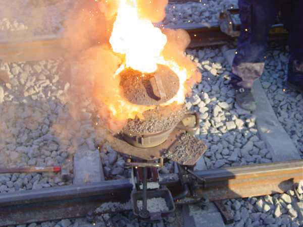

(sec:ch07:s04)=

# 7.4 Stoichiometry Calculations Using Enthalpy

```{note} Learning Objective

1. Perform stoichiometry calculations using energy changes from thermochemical equations.
```

In {ref}`Chapter 5 "Stoichiometry and the Mole" <ch:ch05>`, we related quantities of one substance to another in a chemical equation by performing calculations that used the balanced chemical equation; the balanced chemical equation provided equivalences that we used to construct conversion factors. For example, in the balanced chemical equation

$$
\text{2H2(g) + O2(g) }\rightarrow{}\text{ 2H2O(}\ell{}\text{)}
$$

we recognized the equivalences

$$
\text{2 mol H2 }\Leftrightarrow{}\text{ 1 mol O2 }\Leftrightarrow{}\text{ 2 mol H2O}
$$

where ⇔ is the mathematical symbol for “is equivalent to.” In our thermochemical equation, however, we have another quantity—energy change:

$$
\text{2H2(g) + O2(g) }\rightarrow{}\text{ 2H2O(}\ell{}\text{)     }\Delta{}\text{H = }-\text{570 kJ}
$$

This new quantity allows us to add another equivalence to our list:

$$
\text{2 mol H2 }\Leftrightarrow{}\text{ 1 mol O2 }\Leftrightarrow{}\text{ 2 mol H2O }\Leftrightarrow{}\text{ }-\text{570 kJ}
$$

That is, we can now add an energy amount to the equivalences—the enthalpy change of a balanced chemical reaction. This equivalence can also be used to construct conversion factors so that we can relate enthalpy change to amounts of substances reacted or produced.

Note that these equivalences address a concern. When an amount of energy is listed for a balanced chemical reaction, what amount(s) of reactants or products does it refer to? The answer is that relates to the number of moles of the substance as indicated by its coefficient in the balanced chemical reaction. Thus, 2 mol of H<sub>2</sub> are related to −570 kJ, while 1 mol of O<sub>2</sub> is related to −570 kJ. This is why the unit on the energy change is kJ, not kJ/mol.

For example, consider the thermochemical equation

$$
\text{H2(g) + Cl2(g) }\rightarrow{}\text{ 2HCl(g)     }\Delta{}\text{H = }-\text{184.6 kJ}
$$

The equivalences for this thermochemical equation are

$$
\text{1 mol H2 }\Leftrightarrow{}\text{ 1 mol Cl2 }\Leftrightarrow{}\text{ 2 mol HCl }\Leftrightarrow{}\text{ }-\text{184.6 kJ}
$$

Suppose we asked how much energy is given off when 8.22 mol of H<sub>2</sub> react. We would construct a conversion factor between the number of moles of H<sub>2</sub> and the energy given off, −184.6 kJ:

$$
\text{8}\text{.22}{\text{ mol H}}_{2}\times{}\frac{-\text{184}\text{.6 kJ}}{1{\text{ mol H}}_{2}}=-1{,}520\text{ kJ}
$$

The negative sign means that this much energy is given off.

```{exercise}
:label: ex:ball-ch07-s04-n02

**Example 8**

Given the thermochemical equation

$\text{N2(g) + 3H2(g) }\rightarrow{}\text{ 2NH3(g)     }\Delta{}\text{H = }-\text{91.8 kJ}$

how much energy is given off when 222.4 g of N<sub>2</sub> reacts?
```

```{solution} ex:ball-ch07-s04-n02
:label: sol:ball-ch07-s04-n02
:class: dropdown

The balanced thermochemical equation relates the energy change to moles, not grams, so we first convert the amount of N<sub>2</sub> to moles and then use the thermochemical equation to determine the energy change:

$$
\text{222}\text{.4}{\text{ g N}}_{2}\,\times{}\,\frac{\text{1}{\text{ mol N}}_{2}}{28.00{\text{ g N}}_{2}}\,\times{}\,\frac{-91.8\text{ kJ}}{\text{1}{\text{ mol N}}_{2}}=-729\text{ kJ}
$$
```

```{exercise}
:label: ex:ball-ch07-s04-n02-ty2

**Test Yourself**

Given the thermochemical equation

$\text{N2(g) + 3H2(g) }\rightarrow{}\text{ 2NH3(g)     }\Delta{}\text{H = }-\text{91.8 kJ}$

how much heat is given off when 1.00 g of H<sub>2</sub> reacts?
```

```{solution} ex:ball-ch07-s04-n02-ty2
:label: sol:ball-ch07-s04-n02-ty2
:class: dropdown

−15.1 kJ
```

Like any stoichiometric quantity, we can start with energy and determine an amount, rather than the other way around.

```{exercise}
:label: ex:ball-ch07-s04-n03

**Example 9**

Given the thermochemical equation

$\text{N2(g) + O2(g) }\rightarrow{}\text{ 2NO(g)     }\Delta{}\text{H = 180.6 kJ}$

if 558 kJ of energy are supplied, what mass of NO can be made?
```

```{solution} ex:ball-ch07-s04-n03
:label: sol:ball-ch07-s04-n03
:class: dropdown

This time, we start with an amount of energy:

$$
558\text{ kJ}\,\times{}\,\frac{\text{2}\text{ mol NO}}{\text{180}\text{.6}\text{ kJ}}\,\times{}\,\frac{\text{30}\text{.0 g NO}}{1\text{ mol NO}}=185\text{ g NO}
$$
```

```{exercise}
:label: ex:ball-ch07-s04-n03-ty2

**Test Yourself**

How many grams of N<sub>2</sub> will react if 100.0 kJ of energy are supplied?

$\text{N2(g) + O2(g) }\rightarrow{}\text{ 2NO(g)     }\Delta{}\text{H = 180.6 kJ}$
```

```{solution} ex:ball-ch07-s04-n03-ty2
:label: sol:ball-ch07-s04-n03-ty2
:class: dropdown

15.5 g
```

```{tip} Chemistry Is Everywhere: Welding with Chemical Reactions

One very energetic reaction is called the *thermite reaction*. Its classic reactants are aluminum metal and iron(III) oxide; the reaction produces iron metal and aluminum oxide:

$\text{2Al(s) + Fe2O3(s) }\rightarrow{}\text{ Al2O3(s) + 2Fe(s)     }\Delta{}\text{H = }-\text{850.2 kJ}$

When properly done, the reaction gives off so much energy that the iron product comes off as a *liquid*. (Iron normally melts at 1,536°C.) If carefully directed, the liquid iron can fill spaces between two or more metal parts and, after it quickly cools, can weld the metal parts together.

Thermite reactions are used for this purpose even today. For civilian purposes, they are used to reweld broken locomotive axles that cannot be easily removed for repair. They are used to weld railroad tracks together. Thermite reactions can also be used to separate thin pieces of metal if, for whatever reason, a torch doesn’t work.

(fig:ch07:s04:f01)=



*A small clay pot contains a thermite mixture. It is reacting at high temperature in the photo and will eventually produce molten metal to join the railroad tracks below it.*

Thermite reactions are also used for military purposes. Thermite mixtures are frequently used with additional components as incendiary devices—devices that start fires. Thermite reactions are also useful in disabling enemy weapons: a piece of artillery doesn’t work so well when it has a hole melted into its barrel because of a thermite reaction!
```

```{important} Key Takeaway

- The energy change of a chemical reaction can be used in stoichiometry calculations.
```

## Exercises

```{exercise}
:label: ex:ball-ch07-s04-qs01-qd01-qa01

**Exercise 1.**

Write the equivalences that this balanced thermochemical equation implies.

$\text{PCl3(g) + Cl2(g) }\rightarrow{}\text{ PCl5(g) }\Delta{}\text{H = }-\text{87.9 kJ}$
```

```{solution} ex:ball-ch07-s04-qs01-qd01-qa01
:label: sol:ball-ch07-s04-qs01-qd01-qa01
:class: dropdown

1 mol of PCl<sub>3</sub> ⇔ 1 mol of Cl<sub>2</sub> ⇔ 1 mol of PCl<sub>5</sub> ⇔ −87.9 kJ
```

```{exercise}
:label: ex:ball-ch07-s04-qs01-qd01-qa02

**Exercise 2.**

Write the equivalences that this balanced thermochemical equation implies.

$\text{2SO3(g) }\rightarrow{}\text{ 2SO2(g) + O2(g) }\Delta{}\text{H = 197.9 kJ}$
```

```{exercise}
:label: ex:ball-ch07-s04-qs01-qd01-qa03

**Exercise 3.**

How many kilojoules are given off when 17.8 mol of CH<sub>4</sub>(g) react?

$\text{CH4(g) + 2O2(g) }\rightarrow{}\text{ CO2(g) + 2H2O(}\ell{}\text{) }\Delta{}\text{H = }-\text{890.1 kJ}$
```

```{solution} ex:ball-ch07-s04-qs01-qd01-qa03
:label: sol:ball-ch07-s04-qs01-qd01-qa03
:class: dropdown

15,800 kJ
```

```{exercise}
:label: ex:ball-ch07-s04-qs01-qd01-qa04

**Exercise 4.**

How many kilojoules are absorbed when 0.772 mol of N<sub>2</sub>(g) reacts?

$\text{N2(g) + 2NO(g) }\rightarrow{}\text{ 2N2O(g) }\Delta{}\text{H = 73.8 kJ}$
```

```{exercise}
:label: ex:ball-ch07-s04-qs01-qd01-qa05

**Exercise 5.**

How many kilojoules are absorbed when 23.09 mol of C<sub>6</sub>H<sub>6</sub>(ℓ) are formed?

$\text{6C(s) + 3H2(g) }\rightarrow{}\text{ C6H6(}\ell{}\text{) }\Delta{}\text{H = 49.0 kJ}$
```

```{solution} ex:ball-ch07-s04-qs01-qd01-qa05
:label: sol:ball-ch07-s04-qs01-qd01-qa05
:class: dropdown

1,130 kJ
```

```{exercise}
:label: ex:ball-ch07-s04-qs01-qd01-qa06

**Exercise 6.**

How many kilojoules are given off when 8.32 mol of Mg react?

$\text{2Mg(s) + O2(g) }\rightarrow{}\text{ 2MgO(s) }\Delta{}\text{H = }-\text{1,213 kJ}$
```

```{exercise}
:label: ex:ball-ch07-s04-qs01-qd01-qa07

**Exercise 7.**

Glucose is the main fuel metabolized in animal cells:

$\text{C6H12O6 + 6O2 }\rightarrow{}\text{ 6CO2 + 6H2O }\Delta{}\text{H = }-\text{2,799 kJ}$

How much energy is given off when 100.0 g of C<sub>6</sub>H<sub>12</sub>O<sub>6</sub> react?
```

```{solution} ex:ball-ch07-s04-qs01-qd01-qa07
:label: sol:ball-ch07-s04-qs01-qd01-qa07
:class: dropdown

1,554 kJ
```

```{exercise}
:label: ex:ball-ch07-s04-qs01-qd01-qa08

**Exercise 8.**

Given the thermochemical equation

$\text{2Al(s) + Fe2O3(s) }\rightarrow{}\text{ Al2O3(s) + 2Fe(s) }\Delta{}\text{H = }-\text{850.2 kJ}$

how much energy is given off when 288 g of Fe are produced?
```

```{exercise}
:label: ex:ball-ch07-s04-qs01-qd01-qa09

**Exercise 9.**

Given the thermochemical equation

$\text{2CO2(g) }\rightarrow{}\text{ 2CO(g) + O2(g) }\Delta{}\text{H = 566 kJ}$

how much energy is absorbed when 85.2 g of CO<sub>2</sub> are reacted?
```

```{solution} ex:ball-ch07-s04-qs01-qd01-qa09
:label: sol:ball-ch07-s04-qs01-qd01-qa09
:class: dropdown

548 kJ
```

```{exercise}
:label: ex:ball-ch07-s04-qs01-qd01-qa10

**Exercise 10.**

Given the thermochemical equation

$\text{2Na+(aq) + SO42}-\text{(aq) }\rightarrow{}\text{ Na2SO4(s) }\Delta{}\text{H = 819.8 kJ}$

how much energy is absorbed when 55.9 g of Na<sup>+</sup>(aq) are reacted?
```

```{exercise}
:label: ex:ball-ch07-s04-qs01-qd01-qa11

**Exercise 11.**

NaHCO<sub>3</sub> decomposes when exposed to heat:

$\text{2NaHCO3(s) }\rightarrow{}\text{ Na2CO3(s) + CO2(g) + H2O(}\ell{}\text{) }\Delta{}\text{H = 91.5 kJ}$

What mass of NaHCO<sub>3</sub> is decomposed by 256 kJ?
```

```{solution} ex:ball-ch07-s04-qs01-qd01-qa11
:label: sol:ball-ch07-s04-qs01-qd01-qa11
:class: dropdown

470 g
```

```{exercise}
:label: ex:ball-ch07-s04-qs01-qd01-qa12

**Exercise 12.**

HgO decomposes when exposed to heat:

$\text{2HgO(s) }\rightarrow{}\text{ 2Hg(}\ell{}\text{) + O2(g) }\Delta{}\text{H = 181.6 kJ}$

What mass of O<sub>2</sub> can be made with 100.0 kJ?
```

```{exercise}
:label: ex:ball-ch07-s04-qs01-qd01-qa13

**Exercise 13.**

For the thermochemical equation

$\text{Fe2O3(s) + 3SO3(g) }\rightarrow{}\text{ Fe2(SO4)3 (s) }\Delta{}\text{H = }-\text{570.2 kJ}$

what mass of SO<sub>3</sub> is needed to generate 1,566 kJ?
```

```{solution} ex:ball-ch07-s04-qs01-qd01-qa13
:label: sol:ball-ch07-s04-qs01-qd01-qa13
:class: dropdown

6.60 × 10<sup>2</sup> g
```

```{exercise}
:label: ex:ball-ch07-s04-qs01-qd01-qa14

**Exercise 14.**

For the thermochemical equation

$\text{H2(g) + Br2(}\ell{}\text{) }\rightarrow{}\text{ 2HBr(g) }\Delta{}\text{H = }-\text{72.6 kJ}$

what mass of HBr will be formed when 553 kJ of energy are given off?
```
