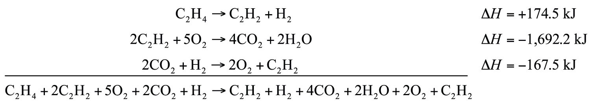

(sec:ch07:s05)=

# 7.5 Hess’s Law

```{note} Learning Objective

1. Learn how to combine chemical equations and their enthalpy changes.
```

Now that we understand that chemical reactions occur with a simultaneous change in energy, we can apply the concept more broadly. To start, remember that some chemical reactions are rather difficult to perform. For example, consider the combustion of carbon to make carbon monoxide:

$$
\text{2C(s) + O2(g) }\rightarrow{}\text{ 2CO(g)     }\Delta{}\text{H = ?}
$$

In reality, this is extremely difficult to do; given the opportunity, carbon will react to make another compound, carbon dioxide:

$$
\text{2C(s) + O2(g) }\rightarrow{}\text{ 2CO2(g)     }\Delta{}\text{H = }-\text{393.5 kJ}
$$

Is there a way around this? Yes. It comes from the understanding that chemical equations can be treated like algebraic equations, with the arrow acting like the equals sign. Like algebraic equations, chemical equations can be combined, and if the same substance appears on both sides of the arrow, it can be canceled out (much like a spectator ion in ionic equations). For example, consider these two reactions:

$$
\text{2C(s) + 2O2(g) }\rightarrow{}\text{ 2CO2(g)}
$$

$$
\text{2CO2(g) }\rightarrow{}\text{ 2CO(g) + O2(g)}
$$

If we added these two equations by combining all the reactants together and all the products together, we would get

$$
\text{2C(s) + 2O2(g) + 2CO2(g) }\rightarrow{}\text{ 2CO2(g) + 2CO(g) + O2(g)}
$$

We note that 2CO<sub>2</sub>(g) appears on both sides of the arrow, so they cancel:

$$
\text{2C(s)}+{\text{2O}}_{\text{2}}\text{(g)}+{\text{ 2CO}}_{\text{2}}\text{(g)}\rightarrow{}{\text{ 2CO}}_{\text{2}}\text{(g)}+\text{2CO(g)}+{\text{O}}_{\text{2}}\text{(g)}
$$

We also note that there are 2 mol of O<sub>2</sub> on the reactant side, and 1 mol of O<sub>2</sub> on the product side. We can cancel 1 mol of O<sub>2</sub> from both sides:

$$
\text{2C(s)}+\text{ 2}{\text{O}}_{\text{2}}\text{(g)}\rightarrow{}\text{2CO(g)}+{\text{ O}}_{\text{2}}\text{(g)}
$$

What do we have left?

$$
\text{2C(s) + O2(g) }\rightarrow{}\text{ 2CO(g)}
$$

This is the reaction we are looking for! So by algebraically combining chemical equations, we can generate new chemical equations that may not be feasible to perform.

What about the enthalpy changes? **Hess’s law** (*When chemical equations are combined algebraically, their enthalpies can be combined in exactly the same way.*) states that when chemical equations are combined algebraically, their enthalpies can be combined in exactly the same way. Two corollaries immediately present themselves:

1. If a chemical reaction is reversed, the sign on Δ*H* is changed.
2. If a multiple of a chemical reaction is taken, the same multiple of the Δ*H* is taken as well.

What are the equations being combined? The first chemical equation is the combustion of C, which produces CO<sub>2</sub>:

$$
\text{2C(s) + 2O2(g) }\rightarrow{}\text{ 2CO2(g)}
$$

This reaction is two times the reaction to make CO<sub>2</sub> from C(s) and O<sub>2</sub>(g), whose enthalpy change is known:

$$
\text{C(s) + O2(g) }\rightarrow{}\text{ CO2(g)     }\Delta{}\text{H = }-\text{393.5 kJ}
$$

According to the first corollary, the first reaction has an energy change of two times −393.5 kJ, or −787.0 kJ:

$$
\text{2C(s) + 2O2(g) }\rightarrow{}\text{ 2CO2(g)     }\Delta{}\text{H = }-\text{787.0 kJ}
$$

The second reaction in the combination is related to the combustion of CO(g):

$$
\text{2CO(g) + O2(g) }\rightarrow{}\text{ 2CO2(g)     }\Delta{}\text{H = }-\text{566.0 kJ}
$$

The second reaction in our combination is the *reverse* of the combustion of CO. When we reverse the reaction, we change the sign on the Δ*H*:

$$
\text{2CO2(g) }\rightarrow{}\text{ 2CO(g) + O2(g)     }\Delta{}\text{H = +566.0 kJ}
$$

Now that we have identified the enthalpy changes of the two component chemical equations, we can combine the Δ*H* values and add them:

```{figure} ../images/figures/b7d2e2506233d48301c23d2f7f747c3b.jpg
:label: fig:fwk:ball:eq07:001
:alt: "7.5 Hess’s Law"
:align: center
:width: 85%

7.5 Hess’s Law
```

Hess’s law is very powerful. It allows us to combine equations to generate new chemical reactions whose enthalpy changes can be calculated, rather than directly measured.

```{exercise}
:label: ex:ball-ch07-s05-n02

**Example 10**

Determine the enthalpy change of

$\text{C2H4 + 3O2 }\rightarrow{}\text{ 2CO2 + 2H2O     }\Delta{}\text{H = ?}$

from these reactions:

$\text{C2H2 + H2 }\rightarrow{}\text{ C2H4     }\Delta{}\text{H = }-\text{174.5 kJ}$

$\text{2C2H2 + 5O2 }\rightarrow{}\text{ 4CO2 + 2H2O     }\Delta{}\text{H = }-\text{1,692.2 kJ}$

$\text{2CO2 + H2 }\rightarrow{}\text{ 2O2 + C2H2     }\Delta{}\text{H = }-\text{167.5 kJ}$
```

```{solution} ex:ball-ch07-s05-n02
:label: sol:ball-ch07-s05-n02
:class: dropdown

We will start by writing chemical reactions that put the correct number of moles of the correct substance on the proper side. For example, our desired reaction has C<sub>2</sub>H<sub>4</sub> as a reactant, and only one reaction from our data has C<sub>2</sub>H<sub>4</sub>. However, it has C<sub>2</sub>H<sub>4</sub> as a product. To make it a reactant, we need to reverse the reaction, changing the sign on the Δ*H*:

$\text{C2H4 }\rightarrow{}\text{ C2H2 + H2     }\Delta{}\text{H = +174.5 kJ}$

We need CO<sub>2</sub> and H<sub>2</sub>O as products. The second reaction has them on the proper side, so let us include one of these reactions (with the hope that the coefficients will work out when all our reactions are added):

$\text{2C2H2 + 5O2 }\rightarrow{}\text{ 4CO2 + 2H2O     }\Delta{}\text{H = }-\text{1,692.2 kJ}$

We note that we now have 4 mol of CO<sub>2</sub> as products; we need to get rid of 2 mol of CO<sub>2</sub>. The last reaction has 2CO<sub>2</sub> as a reactant. Let us use it as written:

$\text{2CO2 + H2 }\rightarrow{}\text{ 2O2 + C2H2     }\Delta{}\text{H = }-\text{167.5 kJ}$

We combine these three reactions, modified as stated:

(fig:fwk:ball:eq07:002)=



*7.5 Hess’s Law*

What cancels? 2C<sub>2</sub>H<sub>2</sub>, H<sub>2</sub>, 2O<sub>2</sub>, and 2CO<sub>2</sub>. What is left is

$\text{C2H4 + 3O2 }\rightarrow{}\text{ 2CO2 + 2H2O}$

which is the reaction we are looking for. The Δ*H* of this reaction is the sum of the three Δ*H* values:

$\Delta{}\text{H = +174.5 }-\text{ 1,692.2 }-\text{ 167.5 = }-\text{1,685.2 kJ}$
```

```{exercise}
:label: ex:ball-ch07-s05-n02-ty2

**Test Yourself**

Given the thermochemical equations

$\text{Pb + Cl2 }\rightarrow{}\text{ PbCl2     }\Delta{}\text{H = }-\text{223 kJ}$

$\text{PbCl2 + Cl2 }\rightarrow{}\text{ PbCl4     }\Delta{}\text{H = }-\text{87 kJ}$

determine Δ*H* for

$\text{2PbCl2 }\rightarrow{}\text{ Pb + PbCl4}$
```

```{solution} ex:ball-ch07-s05-n02-ty2
:label: sol:ball-ch07-s05-n02-ty2
:class: dropdown

+136 kJ
```

```{important} Key Takeaway

- Hess’s law allows us to combine reactions algebraically and then combine their enthalpy changes the same way.
```

## Exercises

```{exercise}
:label: ex:ball-ch07-s05-qs01-qd01-qa01

**Exercise 1.**

Define *Hess’s law*.
```

```{solution} ex:ball-ch07-s05-qs01-qd01-qa01
:label: sol:ball-ch07-s05-qs01-qd01-qa01
:class: dropdown

If chemical equations are combined, their energy changes are also combined.
```

```{exercise}
:label: ex:ball-ch07-s05-qs01-qd01-qa02

**Exercise 2.**

What does Hess’s law require us to do to the Δ*H* of a thermochemical equation if we reverse the equation?
```

```{exercise}
:label: ex:ball-ch07-s05-qs01-qd01-qa03

**Exercise 3.**

If the Δ*H* for

$\text{C2H4 + H2 }\rightarrow{}\text{ C2H6}$

is −65.6 kJ, what is the Δ*H* for this reaction?

$\text{C2H6 }\rightarrow{}\text{ C2H4 + H2}$
```

```{solution} ex:ball-ch07-s05-qs01-qd01-qa03
:label: sol:ball-ch07-s05-qs01-qd01-qa03
:class: dropdown

Δ*H* = 65.6 kJ
```

```{exercise}
:label: ex:ball-ch07-s05-qs01-qd01-qa04

**Exercise 4.**

If the Δ*H* for

$\text{2Na + Cl2 }\rightarrow{}\text{ 2NaCl}$

is −772 kJ, what is the Δ*H* for this reaction:

$\text{2NaCl }\rightarrow{}\text{ 2Na + Cl2}$
```

```{exercise}
:label: ex:ball-ch07-s05-qs01-qd01-qa05

**Exercise 5.**

If the Δ*H* for

$\text{C2H4 + H2 }\rightarrow{}\text{ C2H6}$

is −65.6 kJ, what is the Δ*H* for this reaction?

$\text{2C2H4 + 2H2 }\rightarrow{}\text{ 2C2H6}$
```

```{solution} ex:ball-ch07-s05-qs01-qd01-qa05
:label: sol:ball-ch07-s05-qs01-qd01-qa05
:class: dropdown

Δ*H* = −131.2 kJ
```

```{exercise}
:label: ex:ball-ch07-s05-qs01-qd01-qa06

**Exercise 6.**

If the Δ*H* for

$\text{2C2H6 + 7O2 }\rightarrow{}\text{ 4CO2 + 6H2O}$

is −2,650 kJ, what is the Δ*H* for this reaction?

$\text{6C2H6 + 21O2 }\rightarrow{}\text{ 12CO2 + 18H2O}$
```

```{exercise}
:label: ex:ball-ch07-s05-qs01-qd01-qa07

**Exercise 7.**

The Δ*H* for

$\text{C2H4 + H2O }\rightarrow{}\text{ C2H5OH}$

is −44 kJ. What is the Δ*H* for this reaction?

$\text{2C2H5OH }\rightarrow{}\text{ 2C2H4 + 2H2O}$
```

```{solution} ex:ball-ch07-s05-qs01-qd01-qa07
:label: sol:ball-ch07-s05-qs01-qd01-qa07
:class: dropdown

Δ*H* = 88 kJ
```

```{exercise}
:label: ex:ball-ch07-s05-qs01-qd01-qa08

**Exercise 8.**

The Δ*H* for

$\text{N2 + O2 }\rightarrow{}\text{ 2NO}$

is 181 kJ. What is the Δ*H* for this reaction?

$\text{NO }\rightarrow{}\text{ 1/2N2 + 1/2O2}$
```

```{exercise}
:label: ex:ball-ch07-s05-qs01-qd01-qa09

**Exercise 9.**

Determine the Δ*H* for the reaction

$\text{Cu + Cl2 }\rightarrow{}\text{ CuCl2}$

given these data:

$\text{2Cu + Cl2 }\rightarrow{}\text{ 2CuCl }\Delta{}\text{H = }-\text{274 kJ}$ $\text{2CuCl + Cl2 }\rightarrow{}\text{ 2CuCl2 }\Delta{}\text{H = }-\text{166 kJ}$
```

```{solution} ex:ball-ch07-s05-qs01-qd01-qa09
:label: sol:ball-ch07-s05-qs01-qd01-qa09
:class: dropdown

Δ*H* = −220 kJ
```

```{exercise}
:label: ex:ball-ch07-s05-qs01-qd01-qa10

**Exercise 10.**

Determine Δ*H* for the reaction

$\text{2CH4 }\rightarrow{}\text{ 2H2 + C2H4}$

given these data:

$\text{CH4 + 2O2 }\rightarrow{}\text{ CO2 + 2H2O }\Delta{}\text{H = }-\text{891 kJ}$ $\text{C2H4 + 3O2 }\rightarrow{}\text{ 2CO2 + 2H2O }\Delta{}\text{H = }-\text{1,411 kJ}$ $\text{2H2 + O2 }\rightarrow{}\text{ 2H2O }\Delta{}\text{H = }-\text{571 kJ}$
```

```{exercise}
:label: ex:ball-ch07-s05-qs01-qd01-qa11

**Exercise 11.**

Determine Δ*H* for the reaction

$\text{Fe2(SO4)3 }\rightarrow{}\text{ Fe2O3 + 3SO3}$

given these data:

$\text{4Fe + 3O2 }\rightarrow{}\text{ 2Fe2O3 }\Delta{}\text{H = }-\text{1,650 kJ}$ $\text{2S + 3O2 }\rightarrow{}\text{ 2SO3 }\Delta{}\text{H = }-\text{792 kJ}$ $\text{2Fe + 3S + 6O2 }\rightarrow{}\text{ Fe2(SO4)3 }\Delta{}\text{H = }-\text{2,583 kJ}$
```

```{solution} ex:ball-ch07-s05-qs01-qd01-qa11
:label: sol:ball-ch07-s05-qs01-qd01-qa11
:class: dropdown

Δ*H* = 570 kJ
```

```{exercise}
:label: ex:ball-ch07-s05-qs01-qd01-qa12

**Exercise 12.**

Determine Δ*H* for the reaction

$\text{CaCO3 }\rightarrow{}\text{ CaO + CO2}$

given these data:

$\text{2Ca + 2C + 3O2 }\rightarrow{}\text{ 2CaCO3 }\Delta{}\text{H = }-\text{2,414 kJ}$ $\text{C + O2 }\rightarrow{}\text{ CO2 }\Delta{}\text{H = }-\text{393.5 kJ}$ $\text{2Ca + O2 }\rightarrow{}\text{ 2CaO }\Delta{}\text{H = }-\text{1,270 kJ}$
```
