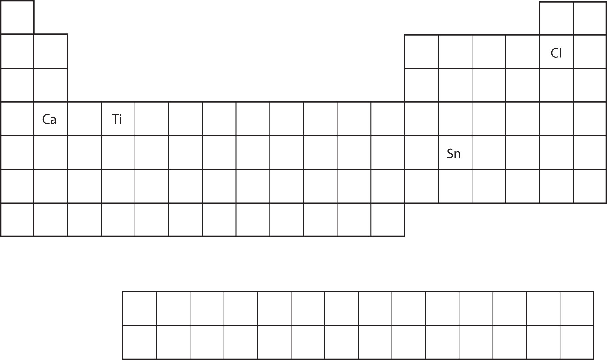
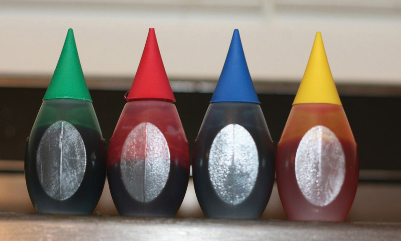

(sec:ch08:s04)=

# 8.4 Electronic Structure and the Periodic Table

```{note} Learning Objectives

1. Relate the electron configurations of the elements to the shape of the periodic table.
2. Determine the expected electron configuration of an element by its place on the periodic table.
```

In {ref}`Chapter 3 "Atoms, Molecules, and Ions" <ch:ch03>`, we introduced the periodic table as a tool for organizing the known chemical elements. A periodic table is shown in {ref}`Figure 8.8 "The Periodic Table" <fig:ch08:s04:f01>`. The elements are listed by atomic number (the number of protons in the nucleus), and elements with similar chemical properties are grouped together in columns.

```{figure} ../images/figures/fe644dce114e2a628ae27755aec9b182.jpg
:label: fig:ch08:s04:f01
:alt: "The Periodic Table"
:align: center
:width: 85%

The Periodic Table
```

Why does the periodic table have the structure it does? The answer is rather simple, if you understand electron configurations: *the shape of the periodic table mimics the filling of the subshells with electrons*.

Let us start with H and He. Their electron configurations are 1*s*<sup>1</sup> and 1*s*<sup>2</sup>, respectively; with He, the *n* = 1 shell is filled. These two elements make up the first row of the periodic table (see {ref}`Figure 8.9 "The 1" <fig:ch08:s04:f02>`).

```{figure} ../images/figures/ce8434dfc519dd7f2c534e101766a297.jpg
:label: fig:ch08:s04:f02
:alt: "The 1 s Subshell. H and He represent the filling of the 1*s* subshell."
:align: center
:width: 85%

The 1 s Subshell. H and He represent the filling of the 1*s* subshell.
```

The next two electrons, for Li and Be, would go into the 2*s* subshell. {ref}`Figure 8.10 "The 2" <fig:ch08:s04:f03>` shows that these two elements are adjacent on the periodic table.

```{figure} ../images/figures/d15a61b103de2933bf92d07374e023a5.jpg
:label: fig:ch08:s04:f03
:alt: "The 2 s Subshell. In Li and Be, the 2*s* subshell is being filled."
:align: center
:width: 85%

The 2 s Subshell. In Li and Be, the 2*s* subshell is being filled.
```

For the next six elements, the 2*p* subshell is being occupied with electrons. On the right side of the periodic table, these six elements (B through Ne) are grouped together ({ref}`Figure 8.11 "The 2" <fig:ch08:s04:f04>`).

```{figure} ../images/figures/c63f9945a6560928f4e2c9c54304d847.jpg
:label: fig:ch08:s04:f04
:alt: "The 2 p Subshell. For B through Ne, the 2*p* subshell is being occupied."
:align: center
:width: 85%

The 2 p Subshell. For B through Ne, the 2*p* subshell is being occupied.
```

The next subshell to be filled is the 3*s* subshell. The elements when this subshell is being filled, Na and Mg, are back on the left side of the periodic table ({ref}`Figure 8.12 "The 3" <fig:ch08:s04:f05>`).

```{figure} ../images/figures/14c6f86101f2d7722d58ffeb289a990f.jpg
:label: fig:ch08:s04:f05
:alt: "The 3 s Subshell. Now the 3*s* subshell is being occupied."
:align: center
:width: 85%

The 3 s Subshell. Now the 3*s* subshell is being occupied.
```

Next, the 3*p* subshell is filled with the next six elements ({ref}`Figure 8.13 "The 3" <fig:ch08:s04:f06>`).

```{figure} ../images/figures/5ff2b8f39b1a06f25d1d7e3dddd9a0e4.jpg
:label: fig:ch08:s04:f06
:alt: "The 3 p Subshell. Next, the 3*p* subshell is filled with electrons."
:align: center
:width: 85%

The 3 p Subshell. Next, the 3*p* subshell is filled with electrons.
```

Instead of filling the 3*d* subshell next, electrons go into the 4*s* subshell ({ref}`Figure 8.14 "The 4" <fig:ch08:s04:f07>`).

```{figure} ../images/figures/b808b6e6b835217c538d79d1ee54b695.jpg
:label: fig:ch08:s04:f07
:alt: "The 4 s Subshell. The 4*s* subshell is filled before the 3*d* subshell. This is reflected in the structure of the periodic table."
:align: center
:width: 85%

The 4 s Subshell. The 4*s* subshell is filled before the 3*d* subshell. This is reflected in the structure of the periodic table.
```

After the 4*s* subshell is filled, the 3*d* subshell is filled with up to 10 electrons. This explains the section of 10 elements in the middle of the periodic table ({ref}`Figure 8.15 "The 3" <fig:ch08:s04:f08>`).

```{figure} ../images/figures/aa1722932956e2a3dc6f88e60781fd44.jpg
:label: fig:ch08:s04:f08
:alt: "The 3 d Subshell. The 3*d* subshell is filled in the middle section of the periodic table."
:align: center
:width: 85%

The 3 d Subshell. The 3*d* subshell is filled in the middle section of the periodic table.
```

And so forth. As we go across the rows of the periodic table, the overall shape of the table outlines how the electrons are occupying the shells and subshells.

The first two columns on the left side of the periodic table are where the *s* subshells are being occupied. Because of this, the first two rows of the periodic table are labeled the ***s* block** (*The columns of the periodic table in which $s$ subshells are being occupied.*). Similarly, the ***p* block** (*The columns of the periodic table in which $p$ subshells are being occupied.*) are the right-most six columns of the periodic table, the ***d* block** (*The columns of the periodic table in which $d$ subshells are being occupied.*) is the middle 10 columns of the periodic table, while the ***f* block** (*The columns of the periodic table in which $f$ subshells are being occupied.*) is the 14-column section that is normally depicted as detached from the main body of the periodic table. It could be part of the main body, but then the periodic table would be rather long and cumbersome. {ref}`Figure 8.16 "Blocks on the Periodic Table" <fig:ch08:s04:f09>` shows the blocks of the periodic table.

```{figure} ../images/figures/3664f2b618a8b888a7447825efdcb6b1.jpg
:label: fig:ch08:s04:f09
:alt: "Blocks on the Periodic Table. The periodic table is separated into blocks depending on which subshell is being filled for the atoms that belong in that section."
:align: center
:width: 85%

Blocks on the Periodic Table. The periodic table is separated into blocks depending on which subshell is being filled for the atoms that belong in that section.
```

The electrons in the highest-numbered shell, plus any electrons in the last unfilled subshell, are called **valence electrons** (*The electrons in the highest-numbered shell, plus any electrons in the last unfilled subshell.*); the highest-numbered shell is called the **valence shell** (*The highest-numbered shell in an atom that contains electrons.*). (The inner electrons are called *core electrons*.) The valence electrons largely control the chemistry of an atom. If we look at just the valence shell’s electron configuration, we find that in each column, the valence shell’s electron configuration is the same. For example, take the elements in the first column of the periodic table: H, Li, Na, K, Rb, and Cs. Their electron configurations (abbreviated for the larger atoms) are as follows, with the valence shell electron configuration highlighted:

| H: | ***1s***<sup>**1**</sup> |
| --- | --- |
| Li: | 1*s*<sup>2</sup>***2s***<sup>**1**</sup> |
| Na: | [Ne]***3s***<sup>**1**</sup> |
| K: | [Ar]***4s***<sup>**1**</sup> |
| Rb: | [Kr]***5s***<sup>**1**</sup> |
| Cs: | [Xe]***6s***<sup>**1**</sup> |

They all have a similar electron configuration in their valence shells: a single *s* electron. Because much of the chemistry of an element is influenced by valence electrons, we would expect that these elements would have similar chemistry—*and they do*. The organization of electrons in atoms explains not only the shape of the periodic table but also the fact that elements in the same column of the periodic table have similar chemistry.

The same concept applies to the other columns of the periodic table. Elements in each column have the same valence shell electron configurations, and the elements have some similar chemical properties. This is strictly true for all elements in the *s* and *p* blocks. In the *d* and *f* blocks, because there are exceptions to the order of filling of subshells with electrons, similar valence shells are not absolute in these blocks. However, many similarities do exist in these blocks, so a similarity in chemical properties is expected.

Similarity of valence shell electron configuration implies that we can determine the electron configuration of an atom solely by its position on the periodic table. Consider Se, as shown in {ref}`Figure 8.17 "Selenium on the Periodic Table" <fig:ch08:s04:f10>`. It is in the fourth column of the *p* block. This means that its electron configuration should end in a *p*<sup>4</sup> electron configuration. Indeed, the electron configuration of Se is [Ar]4*s*<sup>2</sup>3*d*<sup>10</sup>4*p*<sup>4</sup>, as expected.

```{figure} ../images/figures/2567947a447a15600d37fb0df5ba51d8.jpg
:label: fig:ch08:s04:f10
:alt: "Selenium on the Periodic Table"
:align: center
:width: 85%

Selenium on the Periodic Table
```

```{exercise}
:label: ex:ball-ch08-s04-n02

**Example 8**

From the element’s position on the periodic table, predict the valence shell electron configuration for each atom. See {ref}`Figure 8.18 "Various Elements on the Periodic Table" <fig:ch08:s04:f11>`.

1. Ca
2. Sn
```

```{solution} ex:ball-ch08-s04-n02
:label: sol:ball-ch08-s04-n02
:class: dropdown

1. Ca is located in the second column of the *s* block. We would expect that its electron configuration should end with *s*<sup>2</sup>. Calcium’s electron configuration is [Ar]4*s*<sup>2</sup>.
2. Sn is located in the second column of the *p* block, so we expect that its electron configuration would end in *p*<sup>2</sup>. Tin’s electron configuration is [Kr]5*s*<sup>2</sup>4*d*<sup>10</sup>5*p*<sup>2</sup>.
```

```{exercise}
:label: ex:ball-ch08-s04-n02-ty2

**Test Yourself**

From the element’s position on the periodic table, predict the valence shell electron configuration for each atom. See {ref}`Figure 8.18 "Various Elements on the Periodic Table" <fig:ch08:s04:f11>`.

1. Ti
2. Cl
```

```{solution} ex:ball-ch08-s04-n02-ty2
:label: sol:ball-ch08-s04-n02-ty2
:class: dropdown

1. [Ar]4*s*<sup>2</sup>3*d*<sup>2</sup>
2. [Ne]3*s*<sup>2</sup>3*p*<sup>5</sup>

(fig:ch08:s04:f11)=



*Various Elements on the Periodic Table*
```

```{tip} Food and Drink App: Artificial Colors

The color of objects comes from a different mechanism than the colors of neon and other discharge lights. Although colored lights produce their colors, objects are colored because they preferentially reflect a certain color from the white light that shines on them. A red tomato, for example, is bright red because it reflects red light while absorbing all the other colors of the rainbow.

Many foods, such as tomatoes, are highly colored; in fact, the common statement “you eat with your eyes first” is an implicit recognition that the visual appeal of food is just as important as its taste. But what about processed foods?

Many processed foods have food colorings added to them. There are two types of food colorings: natural and artificial. Natural food colorings include caramelized sugar for brown; annatto, turmeric, and saffron for various shades of orange or yellow; betanin from beets for purple; and even carmine, a deep red dye that is extracted from the cochineal, a small insect that is a parasite on cacti in Central and South America. (That’s right: you may be eating bug juice!)

Some colorings are synthetic. The following dyes illustrate compounds that have been used as food colorings in the United States. Permitted uses differ by product category and can change over time:

1. FD&C Blue #1: Brilliant Blue FCF
2. FD&C Blue #2: Indigotine
3. FD&C Green #3: Fast Green FCF
4. FD&C Red #3: Erythrosine (subject to the phaseout described below)
5. FD&C Red #40: Allura Red AC
6. FD&C Yellow #5: Tartrazine
7. FD&C Yellow #6: Sunset Yellow FCF

These dyes are large molecules that strongly absorb certain wavelengths of visible light, making them useful at low concentrations. Their chemical properties and their regulatory status are separate questions. In January 2025, the [FDA issued an order revoking authorization for FD&C Red No. 3 in foods and ingested drugs](https://www.fda.gov/food/food-ingredients-packaging/fda-encourages-food-manufacturers-accelerate-phasing-out-use-fdc-red-no-3-foods-2027-deadline), with reformulation deadlines of January 15, 2027, for foods and January 18, 2028, for ingested drugs. Red No. 3 was already excluded from cosmetics and externally applied drugs. The [FDA’s discussion of color additive safety](https://www.fda.gov/consumers/consumer-updates/how-safe-are-color-additives) also describes evidence that some children may be sensitive to certain color additives. The examples below illustrate how dyes are used in products.

(fig:ch08:s04:f12)=



*Artificial food colorings are found in a variety of food products, such as processed foods, candies, and egg dyes. Even pet foods have artificial food coloring in them, although it’s likely that the animal doesn’t care!*
```

```{important} Key Takeaways

- The arrangement of electrons in atoms is responsible for the shape of the periodic table.
- Electron configurations can be predicted by the position of an atom on the periodic table.
```

## Exercises

```{exercise}
:label: ex:ball-ch08-s04-qs01-qd01-qa01

**Exercise 1.**

Where on the periodic table are *s* subshells being occupied by electrons?
```

```{solution} ex:ball-ch08-s04-qs01-qd01-qa01
:label: sol:ball-ch08-s04-qs01-qd01-qa01
:class: dropdown

the first two columns
```

```{exercise}
:label: ex:ball-ch08-s04-qs01-qd01-qa02

**Exercise 2.**

Where on the periodic table are *d* subshells being occupied by electrons?
```

```{exercise}
:label: ex:ball-ch08-s04-qs01-qd01-qa03

**Exercise 3.**

In what block is Ra found?
```

```{solution} ex:ball-ch08-s04-qs01-qd01-qa03
:label: sol:ball-ch08-s04-qs01-qd01-qa03
:class: dropdown

the *s* block
```

```{exercise}
:label: ex:ball-ch08-s04-qs01-qd01-qa04

**Exercise 4.**

In what block is Br found?
```

```{exercise}
:label: ex:ball-ch08-s04-qs01-qd01-qa05

**Exercise 5.**

What are the valence shell electron configurations of the elements in the second column of the periodic table?
```

```{solution} ex:ball-ch08-s04-qs01-qd01-qa05
:label: sol:ball-ch08-s04-qs01-qd01-qa05
:class: dropdown

*ns*<sup>2</sup>
```

```{exercise}
:label: ex:ball-ch08-s04-qs01-qd01-qa06

**Exercise 6.**

What are the valence shell electron configurations of the elements in the next-to-last column of the periodic table?
```

```{exercise}
:label: ex:ball-ch08-s04-qs01-qd01-qa07

**Exercise 7.**

What are the valence shell electron configurations of the elements in the first column of the *p* block?
```

```{solution} ex:ball-ch08-s04-qs01-qd01-qa07
:label: sol:ball-ch08-s04-qs01-qd01-qa07
:class: dropdown

*ns*<sup>2</sup>*np*<sup>1</sup>
```

```{exercise}
:label: ex:ball-ch08-s04-qs01-qd01-qa08

**Exercise 8.**

What are the valence shell electron configurations of the elements in the last column of the *p* block?
```

```{exercise}
:label: ex:ball-ch08-s04-qs01-qd01-qa09

**Exercise 9.**

From the element’s position on the periodic table, predict the electron configuration of each atom.

a. Sr
b. S
```

```{solution} ex:ball-ch08-s04-qs01-qd01-qa09
:label: sol:ball-ch08-s04-qs01-qd01-qa09
:class: dropdown

a. 1*s*<sup>2</sup>2*s*<sup>2</sup>2*p*<sup>6</sup>3*s*<sup>2</sup>3*p*<sup>6</sup>4*s*<sup>2</sup>3*d*<sup>10</sup>4*p*<sup>6</sup>5*s*<sup>2</sup>
b. 1*s*<sup>2</sup>2*s*<sup>2</sup>2*p*<sup>6</sup>3*s*<sup>2</sup>3*p*<sup>4</sup>
```

```{exercise}
:label: ex:ball-ch08-s04-qs01-qd01-qa10

**Exercise 10.**

From the element’s position on the periodic table, predict the electron configuration of each atom.

a. Fe
b. Ba
```

```{exercise}
:label: ex:ball-ch08-s04-qs01-qd01-qa11

**Exercise 11.**

From the element’s position on the periodic table, predict the electron configuration of each atom.

a. V
b. Ar
```

```{solution} ex:ball-ch08-s04-qs01-qd01-qa11
:label: sol:ball-ch08-s04-qs01-qd01-qa11
:class: dropdown

a. 1*s*<sup>2</sup>2*s*<sup>2</sup>2*p*<sup>6</sup>3*s*<sup>2</sup>3*p*<sup>6</sup>4*s*<sup>2</sup>3*d*<sup>3</sup>
b. 1*s*<sup>2</sup>2*s*<sup>2</sup>2*p*<sup>6</sup>3*s*<sup>2</sup>3*p*<sup>6</sup>
```

```{exercise}
:label: ex:ball-ch08-s04-qs01-qd01-qa12

**Exercise 12.**

From the element’s position on the periodic table, predict the electron configuration of each atom.

a. Cl
b. K
```

```{exercise}
:label: ex:ball-ch08-s04-qs01-qd01-qa13

**Exercise 13.**

From the element’s position on the periodic table, predict the electron configuration of each atom.

a. Ge
b. C
```

```{solution} ex:ball-ch08-s04-qs01-qd01-qa13
:label: sol:ball-ch08-s04-qs01-qd01-qa13
:class: dropdown

a. 1*s*<sup>2</sup>2*s*<sup>2</sup>2*p*<sup>6</sup>3*s*<sup>2</sup>3*p*<sup>6</sup>4*s*<sup>2</sup>3*d*<sup>10</sup>4*p*<sup>2</sup>
b. 1*s*<sup>2</sup>2*s*<sup>2</sup>2*p*<sup>2</sup>
```

```{exercise}
:label: ex:ball-ch08-s04-qs01-qd01-qa14

**Exercise 14.**

From the element’s position on the periodic table, predict the electron configuration of each atom.

a. Mg
b. I
```
