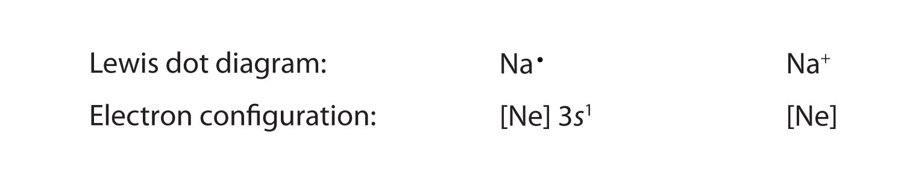
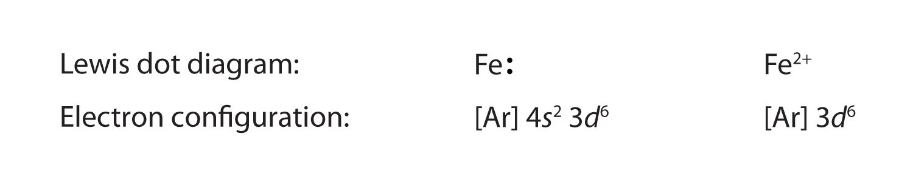
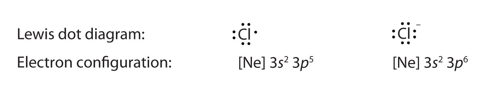

(sec:ch09:s01)=

# 9.1 Lewis Electron Dot Diagrams

```{note} Learning Objective

1. Draw a Lewis electron dot diagram for an atom or a monatomic ion.
```

In almost all cases, chemical bonds are formed by interactions of valence electrons in atoms. To facilitate our understanding of how valence electrons interact, a simple way of representing those valence electrons would be useful.

A **Lewis electron dot diagram** (*A representation of the valence electrons of an atom that uses dots around the symbol of the element.*) (or electron dot diagram or a Lewis diagram or a Lewis structure) is a representation of the valence electrons of an atom that uses dots around the symbol of the element. The number of dots equals the number of valence electrons in the atom. These dots are arranged to the right and left and above and below the symbol, with no more than two dots on a side. (It does not matter what order the positions are used.) For example, the Lewis electron dot diagram for hydrogen is simply


*9.1 Lewis Electron Dot Diagrams*

Because the side is not important, the Lewis electron dot diagram could also be drawn as follows:


*9.1 Lewis Electron Dot Diagrams*

The electron dot diagram for helium, with two valence electrons, is as follows:


*9.1 Lewis Electron Dot Diagrams*

By putting the two electrons together on the same side, we emphasize the fact that these two electrons are both in the 1*s* subshell; this is the common convention we will adopt, although there will be exceptions later. The next atom, lithium, has an electron configuration of 1*s*<sup>2</sup>2*s*<sup>1</sup>, so it has only one electron in its valence shell. Its electron dot diagram resembles that of hydrogen, except the symbol for lithium is used:


*9.1 Lewis Electron Dot Diagrams*

Beryllium has two valence electrons in its 2*s* shell, so its electron dot diagram is like that of helium:


*9.1 Lewis Electron Dot Diagrams*

The next atom is boron. Its valence electron shell is 2*s*<sup>2</sup>2*p*<sup>1</sup>, so it has three valence electrons. The third electron will go on another side of the symbol:


*9.1 Lewis Electron Dot Diagrams*

Again, it does not matter on which sides of the symbol the electron dots are positioned.

For carbon, there are four valence electrons, two in the 2*s* subshell and two in the 2*p* subshell. As usual, we will draw two dots together on one side, to represent the 2*s* electrons. However, conventionally, we draw the dots for the two *p* electrons on different sides. As such, the electron dot diagram for carbon is as follows:


*9.1 Lewis Electron Dot Diagrams*

With N, which has three *p* electrons, we put a single dot on each of the three remaining sides:


*9.1 Lewis Electron Dot Diagrams*

For oxygen, which has four *p* electrons, we now have to start doubling up on the dots on one other side of the symbol. When doubling up electrons, make sure that a side has no more than two electrons.


*9.1 Lewis Electron Dot Diagrams*

Fluorine and neon have seven and eight dots, respectively:


*9.1 Lewis Electron Dot Diagrams*

With the next element, sodium, the process starts over with a single electron because sodium has a single electron in its highest-numbered shell, the *n* = 3 shell. By going through the periodic table, we see that the Lewis electron dot diagrams of atoms will never have more than eight dots around the atomic symbol.

```{exercise}
:label: ex:ball-ch09-s01-n02

**Example 1**

What is the Lewis electron dot diagram for each element?

1. aluminum
2. selenium
```

```{solution} ex:ball-ch09-s01-n02
:label: sol:ball-ch09-s01-n02
:class: dropdown

1. The valence electron configuration for aluminum is 3*s*<sup>2</sup>3*p*<sup>1</sup>. So it would have three dots around the symbol for aluminum, two of them paired to represent the 3*s* electrons:

   

   *9.1 Lewis Electron Dot Diagrams*
2. The valence electron configuration for selenium is 4*s*<sup>2</sup>4*p*<sup>4</sup>. In the highest-numbered shell, the *n* = 4 shell, there are six electrons. Its electron dot diagram is as follows:

   

   *9.1 Lewis Electron Dot Diagrams*
```

```{exercise}
:label: ex:ball-ch09-s01-n02-ty2

**Test Yourself**

What is the Lewis electron dot diagram for each element?

1. phosphorus
2. argon
```

```{solution} ex:ball-ch09-s01-n02-ty2
:label: sol:ball-ch09-s01-n02-ty2
:class: dropdown


*9.1 Lewis Electron Dot Diagrams*
```

For atoms with partially filled *d* or *f* subshells, these electrons are typically omitted from Lewis electron dot diagrams. For example, the electron dot diagram for iron (valence shell configuration 4*s*<sup>2</sup>3*d*<sup>6</sup>) is as follows:


*9.1 Lewis Electron Dot Diagrams*

Elements in the same column of the periodic table have similar Lewis electron dot diagrams because they have the same valence shell electron configuration. Thus the electron dot diagrams for the first column of elements are as follows:


*9.1 Lewis Electron Dot Diagrams*

Monatomic ions are atoms that have either lost (for cations) or gained (for anions) electrons. Electron dot diagrams for ions are the same as for atoms, except that some electrons have been removed for cations, while some electrons have been added for anions. Thus in comparing the electron configurations and electron dot diagrams for the Na atom and the Na<sup>+</sup> ion, we note that the Na atom has a single valence electron in its Lewis diagram, while the Na<sup>+</sup> ion has lost that one valence electron:



*9.1 Lewis Electron Dot Diagrams*

Technically, the valence shell of the Na<sup>+</sup> ion is now the *n* = 2 shell, which has eight electrons in it. So why do we not put eight dots around Na<sup>+</sup>? Conventionally, when we show electron dot diagrams for ions, we show the original valence shell of the atom, which in this case is the *n* = 3 shell and empty in the Na<sup>+</sup> ion.

In making cations, electrons are first lost from the *highest numbered shell*, not necessarily the last subshell filled. For example, in going from the neutral Fe atom to the Fe<sup>2+</sup> ion, the Fe atom loses its two 4*s* electrons first, not its 3*d* electrons, despite the fact that the 3*d* subshell is the last subshell being filled. Thus we have



*9.1 Lewis Electron Dot Diagrams*

Anions have extra electrons when compared to the original atom. Here is a comparison of the Cl atom with the Cl<sup>−</sup> ion:



*9.1 Lewis Electron Dot Diagrams*

```{exercise}
:label: ex:ball-ch09-s01-n03

**Example 2**

What is the Lewis electron dot diagram for each ion?

1. Ca<sup>2+</sup>
2. O<sup>2−</sup>
```

```{solution} ex:ball-ch09-s01-n03
:label: sol:ball-ch09-s01-n03
:class: dropdown

1. Having lost its two original valence electrons, the Lewis electron dot diagram is just Ca<sup>2+</sup>.

   $\text{Ca2+}$
2. The O<sup>2−</sup> ion has gained two electrons in its valence shell, so its Lewis electron dot diagram is as follows:

   

   *9.1 Lewis Electron Dot Diagrams*
```

```{exercise}
:label: ex:ball-ch09-s01-n03-ty2

**Test Yourself**

The valence electron configuration of thallium, whose symbol is Tl, is 6*s*<sup>2</sup>5*d*<sup>10</sup>6*p*<sup>1</sup>. What is the Lewis electron dot diagram for the Tl<sup>+</sup> ion?
```

```{solution} ex:ball-ch09-s01-n03-ty2
:label: sol:ball-ch09-s01-n03-ty2
:class: dropdown


*9.1 Lewis Electron Dot Diagrams*
```

```{important} Key Takeaways

- Lewis electron dot diagrams use dots to represent valence electrons around an atomic symbol.
- Lewis electron dot diagrams for ions have less (for cations) or more (for anions) dots than the corresponding atom.
```

## Exercises

```{exercise}
:label: ex:ball-ch09-s01-qs01-qd01-qa01

**Exercise 1.**

Explain why the first two dots in a Lewis electron dot diagram are drawn on the same side of the atomic symbol.
```

```{solution} ex:ball-ch09-s01-qs01-qd01-qa01
:label: sol:ball-ch09-s01-qs01-qd01-qa01
:class: dropdown

The first two electrons in a valence shell are *s* electrons, which are paired.
```

```{exercise}
:label: ex:ball-ch09-s01-qs01-qd01-qa02

**Exercise 2.**

Is it necessary for the first dot around an atomic symbol to go on a particular side of the atomic symbol?
```

```{exercise}
:label: ex:ball-ch09-s01-qs01-qd01-qa03

**Exercise 3.**

What column of the periodic table has Lewis electron dot diagrams with two electrons?
```

```{solution} ex:ball-ch09-s01-qs01-qd01-qa03
:label: sol:ball-ch09-s01-qs01-qd01-qa03
:class: dropdown

the second column of the periodic table
```

```{exercise}
:label: ex:ball-ch09-s01-qs01-qd01-qa04

**Exercise 4.**

What column of the periodic table has Lewis electron dot diagrams that have six electrons in them?
```

```{exercise}
:label: ex:ball-ch09-s01-qs01-qd01-qa05

**Exercise 5.**

Draw the Lewis electron dot diagram for each element.

a. strontium
b. silicon
```

```{solution} ex:ball-ch09-s01-qs01-qd01-qa05
:label: sol:ball-ch09-s01-qs01-qd01-qa05
:class: dropdown

a. 

   *9.1 Lewis Electron Dot Diagrams*
b. 

   *9.1 Lewis Electron Dot Diagrams*
```

```{exercise}
:label: ex:ball-ch09-s01-qs01-qd01-qa06

**Exercise 6.**

Draw the Lewis electron dot diagram for each element.

a. krypton
b. sulfur
```

```{exercise}
:label: ex:ball-ch09-s01-qs01-qd01-qa07

**Exercise 7.**

Draw the Lewis electron dot diagram for each element.

a. titanium
b. phosphorus
```

```{solution} ex:ball-ch09-s01-qs01-qd01-qa07
:label: sol:ball-ch09-s01-qs01-qd01-qa07
:class: dropdown

a. 

   *9.1 Lewis Electron Dot Diagrams*
b. 

   *9.1 Lewis Electron Dot Diagrams*
```

```{exercise}
:label: ex:ball-ch09-s01-qs01-qd01-qa08

**Exercise 8.**

Draw the Lewis electron dot diagram for each element.

a. bromine
b. gallium
```

```{exercise}
:label: ex:ball-ch09-s01-qs01-qd01-qa09

**Exercise 9.**

Draw the Lewis electron dot diagram for each ion.

a. Mg<sup>2+</sup>
b. S<sup>2−</sup>
```

```{solution} ex:ball-ch09-s01-qs01-qd01-qa09
:label: sol:ball-ch09-s01-qs01-qd01-qa09
:class: dropdown

a. Mg<sup>2+</sup>
b. 

   *9.1 Lewis Electron Dot Diagrams*
```

```{exercise}
:label: ex:ball-ch09-s01-qs01-qd01-qa10

**Exercise 10.**

Draw the Lewis electron dot diagram for each ion.

a. In<sup>+</sup>
b. Br<sup>−</sup>
```

```{exercise}
:label: ex:ball-ch09-s01-qs01-qd01-qa11

**Exercise 11.**

Draw the Lewis electron dot diagram for each ion.

a. Fe<sup>2+</sup>
b. N<sup>3−</sup>
```

```{solution} ex:ball-ch09-s01-qs01-qd01-qa11
:label: sol:ball-ch09-s01-qs01-qd01-qa11
:class: dropdown

a. Fe<sup>2+</sup>
b. 

   *9.1 Lewis Electron Dot Diagrams*
```

```{exercise}
:label: ex:ball-ch09-s01-qs01-qd01-qa12

**Exercise 12.**

Draw the Lewis electron dot diagram for each ion.

a. H<sup>+</sup>
b. H<sup>−</sup>
```
