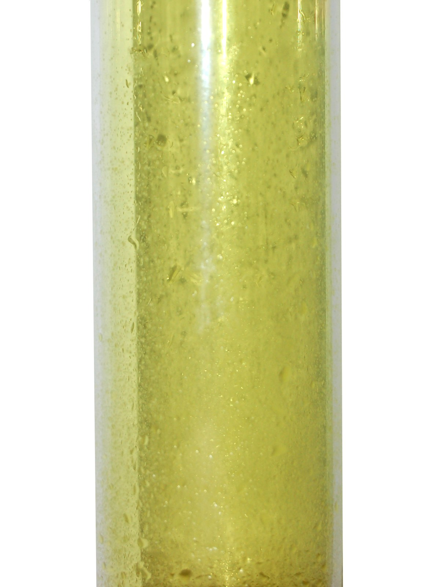
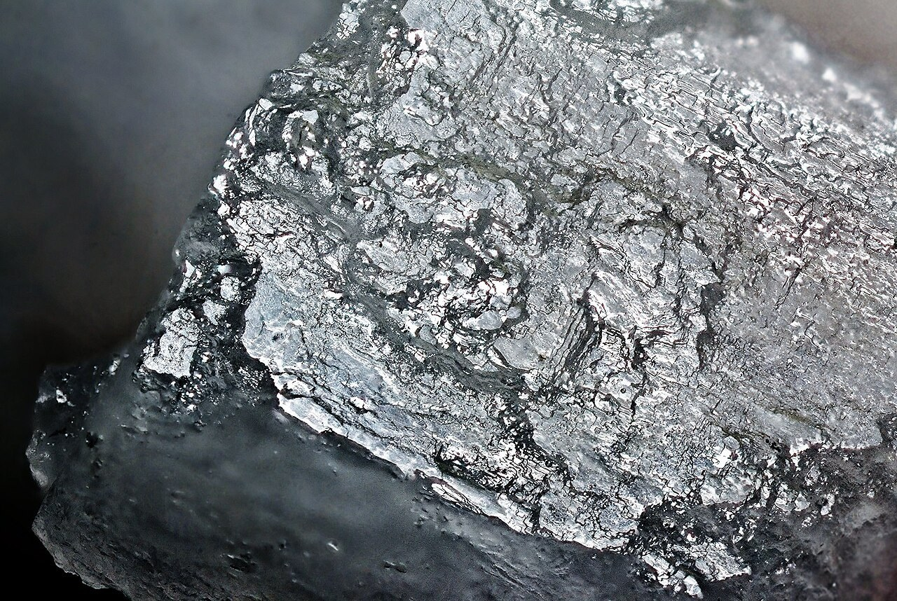
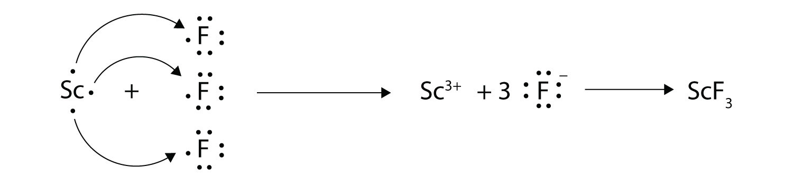

(sec:ch09:s02)=

# 9.2 Electron Transfer: Ionic Bonds

```{note} Learning Objectives

1. State the octet rule.
2. Define *ionic bond*.
3. Demonstrate electron transfer between atoms to form ionic bonds.
```

In {ref}`Section 9.1 "Lewis Electron Dot Diagrams" <sec:ch09:s01>`, we saw how ions are formed by losing electrons to make cations or by gaining electrons to form anions. The astute reader may have noticed something: Many of the ions that form have eight electrons in their valence shell. Either atoms gain enough electrons to have eight electrons in the valence shell and become the appropriately charged anion, or they lose the electrons in their original valence shell; the *lower* shell, now the valence shell, has eight electrons in it, so the atom becomes positively charged. For whatever reason, having eight electrons in a valence shell is a particularly energetically stable arrangement of electrons. The trend that atoms like to have eight electrons in their valence shell is called the **octet rule** (*The trend that atoms like to have eight electrons in their valence shell.*). When atoms form compounds, the octet rule is not always satisfied for all atoms at all times, but it is a very good rule of thumb for understanding the kinds of bonding arrangements that atoms can make.

It is not impossible to violate the octet rule. Consider sodium: in its elemental form, it has one valence electron and is stable. It is rather reactive, however, and does not require a lot of energy to remove that electron to make the Na<sup>+</sup> ion. We *could* remove another electron by adding even more energy to the ion, to make the Na<sup>2+</sup> ion. However, that requires much more energy than is normally available in chemical reactions, so sodium stops at a 1+ charge after losing a single electron. It turns out that the Na<sup>+</sup> ion has a complete octet in its new valence shell, the *n* = 2 shell, which satisfies the octet rule. The octet rule is a result of trends in energies and is useful in explaining why atoms form the ions that they do.

Now consider an Na atom in the presence of a Cl atom. The two atoms have these Lewis electron dot diagrams and electron configurations:


*9.2 Electron Transfer: Ionic Bonds*

For the Na atom to obtain an octet, it must lose an electron; for the Cl atom to gain an octet, it must gain an electron. An electron transfers from the Na atom to the Cl atom:


*9.2 Electron Transfer: Ionic Bonds*

resulting in two ions—the Na<sup>+</sup> ion and the Cl<sup>−</sup> ion:


*9.2 Electron Transfer: Ionic Bonds*

Both species now have complete octets, and the electron shells are energetically stable. From basic physics, we know that opposite charges attract. This is what happens to the Na<sup>+</sup> and Cl<sup>−</sup> ions:


*9.2 Electron Transfer: Ionic Bonds*

where we have written the final formula (the formula for sodium chloride) as per the convention for ionic compounds, without listing the charges explicitly. The attraction between oppositely charged ions is called an **ionic bond** (*The attraction between oppositely charged ions.*), and it is one of the main types of chemical bonds in chemistry. Ionic bonds are caused by electrons *transferring* from one atom to another.

In electron transfer, the number of electrons lost must equal the number of electrons gained. We saw this in the formation of NaCl. A similar process occurs between Mg atoms and O atoms, except in this case two electrons are transferred:


*9.2 Electron Transfer: Ionic Bonds*

The two ions each have octets as their valence shell, and the two oppositely charged particles attract, making an ionic bond:


*9.2 Electron Transfer: Ionic Bonds*

Remember, in the final formula for the ionic compound, we do not write the charges on the ions.

What about when an Na atom interacts with an O atom? The O atom needs two electrons to complete its valence octet, but the Na atom supplies only one electron:


*9.2 Electron Transfer: Ionic Bonds*

The O atom still does not have an octet of electrons. What we need is a second Na atom to donate a second electron to the O atom:


*9.2 Electron Transfer: Ionic Bonds*

These three ions attract each other to give an overall neutral-charged ionic compound, which we write as Na<sub>2</sub>O. The need for the number of electrons lost being equal to the number of electrons gained explains why ionic compounds have the ratio of cations to anions that they do. This is required by the law of conservation of matter as well.

```{exercise}
:label: ex:ball-ch09-s02-n02

**Example 3**

With arrows, illustrate the transfer of electrons to form calcium chloride from Ca atoms and Cl atoms.
```

```{solution} ex:ball-ch09-s02-n02
:label: sol:ball-ch09-s02-n02
:class: dropdown

A Ca atom has two valence electrons, while a Cl atom has seven electrons. A Cl atom needs only one more to complete its octet, while Ca atoms have two electrons to lose. Thus we need two Cl atoms to accept the two electrons from one Ca atom. The transfer process looks as follows:


*9.2 Electron Transfer: Ionic Bonds*

The oppositely charged ions attract each other to make CaCl<sub>2</sub>.
```

```{exercise}
:label: ex:ball-ch09-s02-n02-ty2

**Test Yourself**

With arrows, illustrate the transfer of electrons to form potassium sulfide from K atoms and S atoms.
```

```{solution} ex:ball-ch09-s02-n02-ty2
:label: sol:ball-ch09-s02-n02-ty2
:class: dropdown


*9.2 Electron Transfer: Ionic Bonds*
```

The strength of ionic bonding depends on two major characteristics: the magnitude of the charges and the size of the ion. The greater the magnitude of the charge, the stronger the ionic bond. The smaller the ion, the stronger the ionic bond (because a smaller ion size allows the ions to get closer together). The measured strength of ionic bonding is called the **lattice energy** (*The measured strength of ionic bonding.*). Some lattice energies are given in {ref}`Table 9.1 "Lattice Energies of Some Ionic Compounds" <tbl:ch09:s02:t01>`.

```{table} Lattice Energies of Some Ionic Compounds
:label: tbl:ch09:s02:t01

| Compound | Lattice Energy (kJ/mol) |
| --- | --- |
| LiF | 1,036 |
| LiCl | 853 |
| NaCl | 786 |
| NaBr | 747 |
| MgF<sub>2</sub> | 2,957 |
| Na<sub>2</sub>O | 2,481 |
| MgO | 3,791 |
```

```{tip} Chemistry Is Everywhere: Salt

The element sodium (part [a] in the accompanying figure) is a very reactive metal; given the opportunity, it will react with the sweat on your hands and form sodium hydroxide, which is a very corrosive substance. The element chlorine (part [b] in the accompanying figure) is a pale yellow, corrosive gas that should not be inhaled due to its poisonous nature. Bring these two hazardous substances together, however, and they react to make the ionic compound sodium chloride (part [c] in the accompanying figure), known simply as salt.

Salt is necessary for life. Na<sup>+</sup> ions are one of the main ions in the human body and are necessary to regulate the fluid balance in the body. Cl<sup>−</sup> ions are necessary for proper nerve function and respiration. Both of these ions are supplied by salt. The taste of salt is one of the fundamental tastes; salt is probably the most ancient flavoring known, and one of the few rocks we eat.

The health effects of too much salt are still under debate, although a 2010 report by the US Department of Agriculture concluded that “excessive sodium intake…raises blood pressure, a well-accepted and extraordinarily common risk factor for stroke, coronary heart disease, and kidney disease.”[^fwk-ball-fn09001] It is clear that most people ingest more salt than their bodies need, and most nutritionists recommend curbing salt intake. Curiously, people who suffer from low salt (called *hyponatria*) do so not because they ingest too little salt but because they drink too much water. Endurance athletes and others involved in extended strenuous exercise need to watch their water intake so their body’s salt content is not diluted to dangerous levels.
```

```{figure} ../images/restored/sodium.jpg
:label: fig:ch09:s02:f01
:enumerator: 9.1
:alt: Pieces of sodium metal stored under protective liquid in a sealed container.
:align: center
:width: 70%

**Sodium + Chlorine = Sodium Chloride.** (a) Sodium metal stored under a protective liquid. (b) Chlorine gas in a sealed vessel. (c) A sodium chloride crystal. The properties of the ionic compound differ greatly from those of its constituent elements.





Credits: [Sodium — Greenhorn1](https://commons.wikimedia.org/wiki/File:Sodium.jpg), [Public domain](https://creativecommons.org/publicdomain/mark/1.0/); [Chlorine-sample — Ben Mills (Benjah-bmm27)](https://commons.wikimedia.org/wiki/File:Chlorine-sample.jpg), [Public domain](https://creativecommons.org/publicdomain/mark/1.0/); [Table Salt (NaCl) Crystal — JJ Harrison ( https://www.jjharrison.com.au/ )](https://commons.wikimedia.org/wiki/File:Table_Salt_(NaCl)_Crystal.jpg), [CC BY-SA 3.0](https://creativecommons.org/licenses/by-sa/3.0). Images resized for the web.
```

```{important} Key Takeaways

- The tendency to form species that have eight electrons in the valence shell is called the octet rule.
- The attraction of oppositely charged ions caused by electron transfer is called an ionic bond.
- The strength of ionic bonding depends on the magnitude of the charges and the sizes of the ions.
```

## Exercises

```{exercise}
:label: ex:ball-ch09-s02-qs01-qd01-qa01

**Exercise 1.**

Comment on the possible formation of the K<sup>2+</sup> ion. Why is its formation unlikely?
```

```{solution} ex:ball-ch09-s02-qs01-qd01-qa01
:label: sol:ball-ch09-s02-qs01-qd01-qa01
:class: dropdown

The K<sup>2+</sup> ion is unlikely to form because the K<sup>+</sup> ion already satisfies the octet rule and is rather stable.
```

```{exercise}
:label: ex:ball-ch09-s02-qs01-qd01-qa02

**Exercise 2.**

Comment on the possible formation of the Cl<sup>2−</sup> ion. Why is its formation unlikely?
```

```{exercise}
:label: ex:ball-ch09-s02-qs01-qd01-qa03

**Exercise 3.**

How many electrons does a Ba atom have to lose to have a complete octet in its valence shell?
```

```{solution} ex:ball-ch09-s02-qs01-qd01-qa03
:label: sol:ball-ch09-s02-qs01-qd01-qa03
:class: dropdown

two
```

```{exercise}
:label: ex:ball-ch09-s02-qs01-qd01-qa04

**Exercise 4.**

How many electrons does a Pb atom have to lose to have a complete octet in its valence shell?
```

```{exercise}
:label: ex:ball-ch09-s02-qs01-qd01-qa05

**Exercise 5.**

How many electrons does an Se atom have to gain to have a complete octet in its valence shell?
```

```{solution} ex:ball-ch09-s02-qs01-qd01-qa05
:label: sol:ball-ch09-s02-qs01-qd01-qa05
:class: dropdown

two
```

```{exercise}
:label: ex:ball-ch09-s02-qs01-qd01-qa06

**Exercise 6.**

How many electrons does an N atom have to gain to have a complete octet in its valence shell?
```

```{exercise}
:label: ex:ball-ch09-s02-qs01-qd01-qa07

**Exercise 7.**

With arrows, illustrate the transfer of electrons to form potassium chloride from K atoms and Cl atoms.
```

```{solution} ex:ball-ch09-s02-qs01-qd01-qa07
:label: sol:ball-ch09-s02-qs01-qd01-qa07
:class: dropdown


*9.2 Electron Transfer: Ionic Bonds*
```

```{exercise}
:label: ex:ball-ch09-s02-qs01-qd01-qa08

**Exercise 8.**

With arrows, illustrate the transfer of electrons to form magnesium sulfide from Mg atoms and S atoms.
```

```{exercise}
:label: ex:ball-ch09-s02-qs01-qd01-qa09

**Exercise 9.**

With arrows, illustrate the transfer of electrons to form scandium fluoride from Sc atoms and F atoms.
```

```{solution} ex:ball-ch09-s02-qs01-qd01-qa09
:label: sol:ball-ch09-s02-qs01-qd01-qa09
:class: dropdown



*9.2 Electron Transfer: Ionic Bonds*
```

```{exercise}
:label: ex:ball-ch09-s02-qs01-qd01-qa10

**Exercise 10.**

With arrows, illustrate the transfer of electrons to form rubidium phosphide from Rb atoms and P atoms.
```

```{exercise}
:label: ex:ball-ch09-s02-qs01-qd01-qa11

**Exercise 11.**

Which ionic compound has the higher lattice energy—KI or MgO? Why?
```

```{solution} ex:ball-ch09-s02-qs01-qd01-qa11
:label: sol:ball-ch09-s02-qs01-qd01-qa11
:class: dropdown

MgO because the ions have a higher magnitude charge
```

```{exercise}
:label: ex:ball-ch09-s02-qs01-qd01-qa12

**Exercise 12.**

Which ionic compound has the higher lattice energy—KI or LiF? Why?
```

```{exercise}
:label: ex:ball-ch09-s02-qs01-qd01-qa13

**Exercise 13.**

Which ionic compound has the higher lattice energy—BaS or MgO? Why?
```

```{solution} ex:ball-ch09-s02-qs01-qd01-qa13
:label: sol:ball-ch09-s02-qs01-qd01-qa13
:class: dropdown

MgO because the ions are smaller
```

```{exercise}
:label: ex:ball-ch09-s02-qs01-qd01-qa14

**Exercise 14.**

Which ionic compound has the higher lattice energy—NaCl or NaI? Why?
```

[^fwk-ball-fn09001]: US Department of Agriculture Committee for Nutrition Policy and Promotion, “Report of the Dietary Guidelines Advisory Committee on the Dietary Guidelines for Americans,” accessed January 5, 2010, [http://www.cnpp.usda.gov/DGAs2010-DGACReport.htm](http://www.cnpp.usda.gov/DGAs2010-DGACReport.htm).
