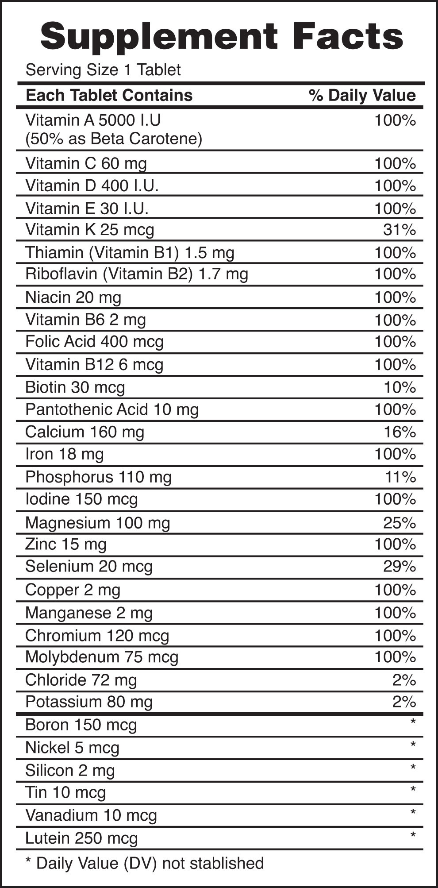
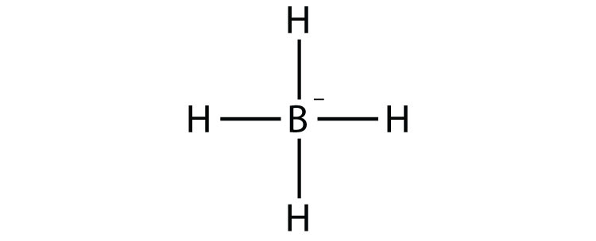
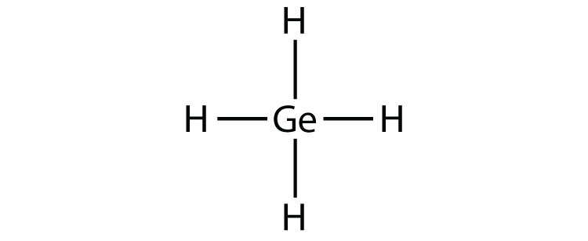
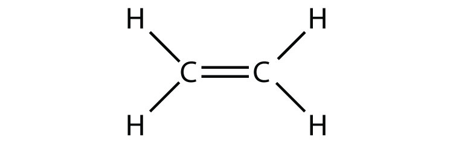
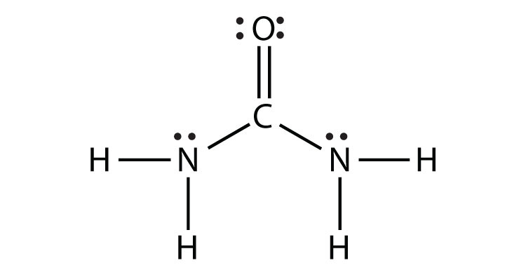

(sec:ch09:s03)=

# 9.3 Covalent Bonds

```{note} Learning Objectives

1. Define *covalent bond*.
2. Illustrate covalent bond formation with Lewis electron dot diagrams.
```

Ionic bonding typically occurs when it is easy for one atom to lose one or more electrons and another atom to gain one or more electrons. However, some atoms won’t give up or gain electrons easily. Yet they still participate in compound formation. How?

There is another mechanism for obtaining a complete valence shell: *sharing* electrons. When electrons are shared between two atoms, they make a bond called a **covalent bond** (*A chemical bond formed by two atoms sharing electrons.*).

Let us illustrate a covalent bond by using H atoms, with the understanding that H atoms need only two electrons to fill the 1*s* subshell. Each H atom starts with a single electron in its valence shell:


*9.3 Covalent Bonds*

The two H atoms can share their electrons:


*9.3 Covalent Bonds*

We can use circles to show that each H atom has two electrons around the nucleus, completely filling each atom’s valence shell:


*9.3 Covalent Bonds*

Because each H atom has a filled valence shell, this bond is stable, and we have made a diatomic hydrogen molecule. (This explains why hydrogen is one of the diatomic elements.) For simplicity’s sake, it is not unusual to represent the covalent bond with a dash, instead of with two dots:

$$
\text{H}-\text{H}
$$

Because two atoms are sharing one pair of electrons, this covalent bond is called a **single bond** (*A covalent bond composed of one pair of electrons.*).

As another example, consider fluorine. F atoms have seven electrons in their valence shell:


*9.3 Covalent Bonds*

These two atoms can do the same thing that the H atoms did; they share their unpaired electrons to make a covalent bond.


*9.3 Covalent Bonds*

Note that each F atom has a complete octet around it now:


*9.3 Covalent Bonds*

We can also write this using a dash to represent the shared electron pair:


*9.3 Covalent Bonds*

There are two different types of electrons in the fluorine diatomic molecule. The **bonding electron pair** (*A pair of electrons that makes a covalent bond.*) makes the covalent bond. Each F atom has three other pairs of electrons that do not participate in the bonding; they are called **lone electron pairs** (*A pair of electrons that does not make a covalent bond.*). Each F atom has one bonding pair and three lone pairs of electrons.

Covalent bonds can be made between different elements as well. One example is HF. Each atom starts out with an odd number of electrons in its valence shell:


*9.3 Covalent Bonds*

The two atoms can share their unpaired electrons to make a covalent bond:


*9.3 Covalent Bonds*

We note that the H atom has a full valence shell with two electrons, while the F atom has a complete octet of electrons.

```{exercise}
:label: ex:ball-ch09-s03-n02

**Example 4**

Use Lewis electron dot diagrams to illustrate the covalent bond formation in HBr.
```

```{solution} ex:ball-ch09-s03-n02
:label: sol:ball-ch09-s03-n02
:class: dropdown

HBr is very similar to HF, except that it has Br instead of F. The atoms are as follows:


*9.3 Covalent Bonds*

The two atoms can share their unpaired electron:


*9.3 Covalent Bonds*
```

```{exercise}
:label: ex:ball-ch09-s03-n02-ty2

**Test Yourself**

Use Lewis electron dot diagrams to illustrate the covalent bond formation in Cl<sub>2</sub>.
```

```{solution} ex:ball-ch09-s03-n02-ty2
:label: sol:ball-ch09-s03-n02-ty2
:class: dropdown


*9.3 Covalent Bonds*
```

More than two atoms can participate in covalent bonding, although any given covalent bond will be between two atoms only. Consider H and O atoms:


*9.3 Covalent Bonds*

The H and O atoms can share an electron to form a covalent bond:


*9.3 Covalent Bonds*

The H atom has a complete valence shell. However, the O atom has only seven electrons around it, which is not a complete octet. We fix this by including a second H atom, whose single electron will make a second covalent bond with the O atom:


*9.3 Covalent Bonds*

(It does not matter on what side the second H atom is positioned.) Now the O atom has a complete octet around it, and each H atom has two electrons, filling its valence shell. This is how a water molecule, H<sub>2</sub>O, is made.

```{exercise}
:label: ex:ball-ch09-s03-n03

**Example 5**

Use a Lewis electron dot diagram to show the covalent bonding in NH<sub>3</sub>.
```

```{solution} ex:ball-ch09-s03-n03
:label: sol:ball-ch09-s03-n03
:class: dropdown

The N atom has the following Lewis electron dot diagram:


*9.3 Covalent Bonds*

It has three unpaired electrons, each of which can make a covalent bond by sharing electrons with an H atom. The electron dot diagram of NH<sub>3</sub> is as follows:


*9.3 Covalent Bonds*
```

```{exercise}
:label: ex:ball-ch09-s03-n03-ty2

**Test Yourself**

Use a Lewis electron dot diagram to show the covalent bonding in PCl<sub>3</sub>.
```

```{solution} ex:ball-ch09-s03-n03-ty2
:label: sol:ball-ch09-s03-n03-ty2
:class: dropdown


*9.3 Covalent Bonds*
```

There is a simple set of steps for determining the Lewis electron dot diagram of a simple molecule. First, you must identify the central atom and the surrounding atoms. The **central atom** (*The atom in the center of a molecule.*) is the atom in the center of the molecule, while the **surrounding atoms** (*An atom that makes covalent bonds to the central atom(s).*) are the atoms making bonds to the central atom. The central atom is usually written first in the formula of the compound (H<sub>2</sub>O is the notable exception). After the central and surrounding atoms have been identified, follow these steps:

1. Count the total number of valence electrons. Add extra if the species has negative charges and remove some for every positive charge on the species.
2. Write the central atom and surround it with the surrounding atoms.
3. Put a pair of electrons between the central atom and each surrounding atom.
4. Complete the octets around the surrounding atoms (except for H).
5. Put remaining electrons, if any, around the central atom.
6. Check that every atom has a full valence shell.

Let us try these steps to determine the electron dot diagram for BF<sub>4</sub><sup>−</sup>. The B atom is the central atom, and the F atoms are the surrounding atoms. There is a negative sign on the species, so we have an extra electron to consider.

1. **Count the total number of electrons.** B has 3, each F has 7, and there is one extra electron: 3 + 7 + 7 + 7 + 7 + 1 = 32.

2. **Write the central atom surrounded by surrounding atoms.**


*9.3 Covalent Bonds*

3. **Put a pair of electrons between the central atom and each surrounding atom.** This uses up eight electrons, so we have 32 − 8 = 24 electrons left.


*9.3 Covalent Bonds*

4. **Complete the octets around the surrounding atoms (except for H).** This uses up 24 more electrons, leaving 24 − 24 = 0 electrons left.


*9.3 Covalent Bonds*

5. **Put remaining electrons, if any, around the central atom.** There are no additional electrons to add to the central atom.

6. **Check.** The B atom has eight electrons around it, as does each F atom. Each atom has a complete octet. This is a good Lewis electron dot diagram for BF<sub>4</sub><sup>−</sup>.

Sometimes, however, these steps don’t work. If we were to follow these steps for the compound formaldehyde (CH<sub>2</sub>O), we would get the following:


*9.3 Covalent Bonds*

The H and O atoms have the proper number of electrons, but the C atom has only six electrons around it, not the eight electrons for an octet. How do we fix this?

We fix this by recognizing that two atoms can share more than one pair of electrons. In the case of CH<sub>2</sub>O, the O and C atoms share two pairs of electrons, with the following Lewis electron dot diagram as a result:


*9.3 Covalent Bonds*

By circling the electrons around each atom, we can now see that the O and C atoms have octets, while each H atom has two electrons:


*9.3 Covalent Bonds*

Each valence shell is full, so this is an acceptable Lewis electron dot diagram. If we were to use lines to represent the bonds, we would use two lines between the C and O atoms:


*9.3 Covalent Bonds*

The bond between the C and O atoms is a **double bond** (*A covalent bond composed of two pairs of bonding electrons.*) and represents two bonding pairs of electrons between the atoms. If using the rules for drawing Lewis electron dot diagrams don’t work as written, a double bond may be required.

```{exercise}
:label: ex:ball-ch09-s03-n04

**Example 6**

What is the proper Lewis electron dot diagram for CO<sub>2</sub>?
```

```{solution} ex:ball-ch09-s03-n04
:label: sol:ball-ch09-s03-n04
:class: dropdown

The central atom is a C atom, with O atoms as surrounding atoms. We have a total of 4 + 6 + 6 = 16 valence electrons. Following the rules for Lewis electron dot diagrams for compounds gives us


*9.3 Covalent Bonds*

The O atoms have complete octets around them, but the C atom has only four electrons around it. The way to solve this dilemma is to make a double bond between carbon and *each* O atom:


*9.3 Covalent Bonds*

Each O atom still has eight electrons around it, but now the C atom also has a complete octet. This is an acceptable Lewis electron dot diagram for CO<sub>2</sub>.
```

```{exercise}
:label: ex:ball-ch09-s03-n04-ty2

**Test Yourself**

What is the proper Lewis electron dot diagram for carbonyl sulfide (COS)?
```

```{solution} ex:ball-ch09-s03-n04-ty2
:label: sol:ball-ch09-s03-n04-ty2
:class: dropdown


*9.3 Covalent Bonds*
```

It is also possible to have a **triple bond** (*A covalent bond composed of three pairs of bonding electrons.*), in which there are three pairs of electrons between two atoms. Good examples of this are elemental nitrogen (N<sub>2</sub>) and acetylene (C<sub>2</sub>H<sub>2</sub>):


*9.3 Covalent Bonds*

Acetylene is an interesting example of a molecule with two central atoms, which are both C atoms.

Polyatomic ions are bonded together with covalent bonds. Because they are ions, however, they participate in ionic bonding with other ions. So both major types of bonding can occur at the same time.

```{tip} Food and Drink App: Vitamins and Minerals

Vitamins are nutrients that our bodies need in small amounts but cannot synthesize; therefore, they must be obtained from the diet. The word *vitamin* comes from “vital amine” because it was once thought that all these compounds had an amine group (NH<sub>2</sub>) in it. This is not actually true, but the name stuck anyway.

All vitamins are covalently bonded molecules. Most of them are commonly named with a letter, although all of them also have formal chemical names. Thus vitamin A is also called retinol, vitamin C is called ascorbic acid, and vitamin E is called tocopherol. There is no single vitamin B; there is a group of substances called the *B complex vitamins* that are all water soluble and participate in cell metabolism. If a diet is lacking in a vitamin, diseases such as scurvy or rickets develop. Luckily, all vitamins are available as supplements, so any dietary deficiency in a vitamin can be easily corrected.

A mineral is any chemical element other than carbon, hydrogen, oxygen, or nitrogen that is needed by the body. Minerals that the body needs in quantity include sodium, potassium, magnesium, calcium, phosphorus, sulfur, and chlorine. Essential minerals that the body needs in tiny quantities (so-called *trace elements*) include manganese, iron, cobalt, nickel, copper, zinc, molybdenum, selenium, and iodine. Minerals are also obtained from the diet. Interestingly, most minerals are consumed in ionic form, rather than as elements or from covalent molecules. Like vitamins, most minerals are available in pill form, so any deficiency can be compensated for by taking supplements.

(fig:ch09:s03:f01)=



*Every entry down through pantothenic acid is a vitamin, and everything from calcium and below is a mineral.*
```

```{important} Key Takeaways

- Covalent bonds are formed when atoms share electrons.
- Lewis electron dot diagrams can be drawn to illustrate covalent bond formation.
- Double bonds or triple bonds between atoms may be necessary to properly illustrate the bonding in some molecules.
```

## Exercises

```{exercise}
:label: ex:ball-ch09-s03-qs01-qd01-qa01

**Exercise 1.**

How many electrons will be in the valence shell of H atoms when it makes a covalent bond?
```

```{solution} ex:ball-ch09-s03-qs01-qd01-qa01
:label: sol:ball-ch09-s03-qs01-qd01-qa01
:class: dropdown

two
```

```{exercise}
:label: ex:ball-ch09-s03-qs01-qd01-qa02

**Exercise 2.**

How many electrons will be in the valence shell of non-H atoms when they make covalent bonds?
```

```{exercise}
:label: ex:ball-ch09-s03-qs01-qd01-qa03

**Exercise 3.**

What is the Lewis electron dot diagram of I<sub>2</sub>? Circle the electrons around each atom to verify that each valence shell is filled.
```

```{solution} ex:ball-ch09-s03-qs01-qd01-qa03
:label: sol:ball-ch09-s03-qs01-qd01-qa03
:class: dropdown


*9.3 Covalent Bonds*
```

```{exercise}
:label: ex:ball-ch09-s03-qs01-qd01-qa04

**Exercise 4.**

What is the Lewis electron dot diagram of H<sub>2</sub>S? Circle the electrons around each atom to verify that each valence shell is filled.
```

```{exercise}
:label: ex:ball-ch09-s03-qs01-qd01-qa05

**Exercise 5.**

What is the Lewis electron dot diagram of NCl<sub>3</sub>? Circle the electrons around each atom to verify that each valence shell is filled.
```

```{solution} ex:ball-ch09-s03-qs01-qd01-qa05
:label: sol:ball-ch09-s03-qs01-qd01-qa05
:class: dropdown


*9.3 Covalent Bonds*
```

```{exercise}
:label: ex:ball-ch09-s03-qs01-qd01-qa06

**Exercise 6.**

What is the Lewis electron dot diagram of SiF<sub>4</sub>? Circle the electrons around each atom to verify that each valence shell is filled.
```

```{exercise}
:label: ex:ball-ch09-s03-qs01-qd01-qa07

**Exercise 7.**

Draw the Lewis electron dot diagram for each substance.

a. SF<sub>2</sub>
b. BH<sub>4</sub><sup>−</sup>
```

```{solution} ex:ball-ch09-s03-qs01-qd01-qa07
:label: sol:ball-ch09-s03-qs01-qd01-qa07
:class: dropdown

a. 

   *9.3 Covalent Bonds*
b. 

   *9.3 Covalent Bonds*
```

```{exercise}
:label: ex:ball-ch09-s03-qs01-qd01-qa08

**Exercise 8.**

Draw the Lewis electron dot diagram for each substance.

a. PI<sub>3</sub>
b. OH<sup>−</sup>
```

```{exercise}
:label: ex:ball-ch09-s03-qs01-qd01-qa09

**Exercise 9.**

Draw the Lewis electron dot diagram for each substance.

a. GeH<sub>4</sub>
b. ClF
```

```{solution} ex:ball-ch09-s03-qs01-qd01-qa09
:label: sol:ball-ch09-s03-qs01-qd01-qa09
:class: dropdown

a. 

   *9.3 Covalent Bonds*
b. 

   *9.3 Covalent Bonds*
```

```{exercise}
:label: ex:ball-ch09-s03-qs01-qd01-qa10

**Exercise 10.**

Draw the Lewis electron dot diagram for each substance.

a. AsF<sub>3</sub>
b. NH<sub>4</sub><sup>+</sup>
```

```{exercise}
:label: ex:ball-ch09-s03-qs01-qd01-qa11

**Exercise 11.**

Draw the Lewis electron dot diagram for each substance. Double or triple bonds may be needed.

a. SiO<sub>2</sub>
b. C<sub>2</sub>H<sub>4</sub> (assume two central atoms)
```

```{solution} ex:ball-ch09-s03-qs01-qd01-qa11
:label: sol:ball-ch09-s03-qs01-qd01-qa11
:class: dropdown

a. 

   *9.3 Covalent Bonds*
b. 

   *9.3 Covalent Bonds*
```

```{exercise}
:label: ex:ball-ch09-s03-qs01-qd01-qa12

**Exercise 12.**

Draw the Lewis electron dot diagram for each substance. Double or triple bonds may be needed.

a. CN<sup>−</sup>
b. C<sub>2</sub>Cl<sub>2</sub> (assume two central atoms)
```

```{exercise}
:label: ex:ball-ch09-s03-qs01-qd01-qa13

**Exercise 13.**

Draw the Lewis electron dot diagram for each substance. Double or triple bonds may be needed.

a. CS<sub>2</sub>
b. NH<sub>2</sub>CONH<sub>2</sub> (assume that the N and C atoms are the central atoms)
```

```{solution} ex:ball-ch09-s03-qs01-qd01-qa13
:label: sol:ball-ch09-s03-qs01-qd01-qa13
:class: dropdown

a. 

   *9.3 Covalent Bonds*
b. 

   *9.3 Covalent Bonds*
```

```{exercise}
:label: ex:ball-ch09-s03-qs01-qd01-qa14

**Exercise 14.**

Draw the Lewis electron dot diagram for each substance. Double or triple bonds may be needed.

a. POCl
b. HCOOH (assume that the C atom and one O atom are the central atoms)
```
