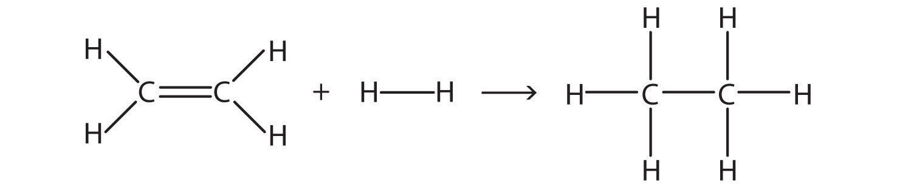

(sec:ch09:s04)=

# 9.4 Other Aspects of Covalent Bonds

```{note} Learning Objectives

1. Describe a nonpolar bond and a polar bond.
2. Use electronegativity to determine whether a bond between two elements will be nonpolar covalent, polar covalent, or ionic.
3. Describe the bond energy of a covalent bond.
```

Consider the H<sub>2</sub> molecule:


*9.4 Other Aspects of Covalent Bonds*

Because the nuclei of each H atom contain protons, the electrons in the bond are attracted to the nuclei (opposite charges attract). But because the two atoms involved in the covalent bond are both H atoms, each nucleus attracts the electrons by the same amount. Thus the electron pair is equally shared by the two atoms. The equal sharing of electrons in a covalent bond is called a **nonpolar covalent bond** (*The equal sharing of electrons in a covalent bond.*).

Now consider the HF molecule:


*9.4 Other Aspects of Covalent Bonds*

There are two different atoms involved in the covalent bond. The H atom has one proton in its nucleus that is attracting the bonding pair of electrons. However, the F atom has nine protons in its nucleus, with nine times the attraction of the H atom. The F atom attracts the electrons so much more strongly that the electrons remain closer to the F atom than to the H atom; the electrons are no longer equally balanced between the two nuclei. Instead of representing the HF molecule as


*9.4 Other Aspects of Covalent Bonds*

it may be more appropriate to draw the covalent bond as


*9.4 Other Aspects of Covalent Bonds*

with the electrons in the bond being nearer to the F atom than the H atom. Because the electrons in the bond are nearer to the F atom, this side of the molecule takes on a partial negative charge, which is represented by δ− (δ is the lowercase Greek letter delta). The other side of the molecule, the H atom, adopts a partial positive charge, which is represented by δ+:


*9.4 Other Aspects of Covalent Bonds*

A covalent bond between different atoms that attract the shared electrons by different amounts and cause an imbalance of electron distribution is called a **polar covalent bond** (*The unequal sharing of electrons in a covalent bond.*).

Technically, any covalent bond between two different elements is polar. However, the degree of polarity is important. A covalent bond between two different elements may be so slightly imbalanced that the bond is, essentially, nonpolar. A bond may be so polar that an electron actually transfers from one atom to another, forming a true ionic bond. How do we judge the degree of polarity?

Scientists have devised a scale called **electronegativity** (*A qualitative scale for judging how much atoms of any element attract electrons.*), a scale for judging how much atoms of any element attract electrons. Electronegativity is a unitless number; the higher the number, the more an atom attracts electrons. A common scale for electronegativity is shown in {ref}`Figure 9.2 "Electronegativities of the Elements" <fig:ch09:s04:f01>`.

```{figure} ../images/figures/86495288d4baa241709baaed0454b93a.jpg
:label: fig:ch09:s04:f01
:alt: "Electronegativities of the Elements. Electronegativities are used to determine the polarity of covalent bonds."
:align: center
:width: 85%

Electronegativities of the Elements. Electronegativities are used to determine the polarity of covalent bonds.
```

The polarity of a covalent bond can be judged by determining the *difference* of the electronegativities of the two atoms involved in the covalent bond, as summarized in the following table:

| Electronegativity Difference | Bond Type |
| --- | --- |
| 0 | nonpolar covalent |
| >0–0.4 | slightly polar covalent |
| >0.4–1.9 | definitely polar covalent |
| >1.9 | likely ionic |

A difference of 0.4 is slightly polar covalent. The cutoff at 1.9 is only a guide: a bond between a metal and a nonmetal is ionic even when the difference is smaller. Sodium and iodine differ by 1.6 on this scale, and sodium iodide is an ionic compound.

```{exercise}
:label: ex:ball-ch09-s04-n02

**Example 7**

What is the polarity of each bond?

1. C–H
2. O–H
```

```{solution} ex:ball-ch09-s04-n02
:label: sol:ball-ch09-s04-n02
:class: dropdown

Using {ref}`Figure 9.2 "Electronegativities of the Elements" <fig:ch09:s04:f01>`, we can calculate the difference of the electronegativities of the atoms involved in the bond.

1. For the C–H bond, the difference in the electronegativities is 2.5 − 2.1 = 0.4. Thus we predict that this bond will be slightly polar covalent.
2. For the O–H bond, the difference in electronegativities is 3.5 − 2.1 = 1.4, so we predict that this bond will be definitely polar covalent.
```

```{exercise}
:label: ex:ball-ch09-s04-n02-ty2

**Test Yourself**

What is the polarity of each bond?

1. Rb–F
2. P–Cl
```

```{solution} ex:ball-ch09-s04-n02-ty2
:label: sol:ball-ch09-s04-n02-ty2
:class: dropdown

1. likely ionic
2. polar covalent
```

The polarity of a covalent bond can have significant influence on the properties of the substance. If the overall molecule is polar, the substance may have a higher melting point and boiling point than expected; also, it may or may not be soluble in various other substances, such as water or hexane.

It should be obvious that covalent bonds are stable because molecules exist. However, they can be broken if enough energy is supplied to a molecule. For most covalent bonds between any two given atoms, a certain amount of energy must be supplied. Although the exact amount of energy depends on the molecule, the approximate amount of energy to be supplied is similar if the atoms in the bond are the same. The approximate amount of energy needed to break a covalent bond is called the **bond energy** (*The approximate amount of energy needed to bread a covalent bond.*) of the covalent bond. {ref}`Table 9.2 "Bond Energies of Covalent Bonds" <tbl:ch09:s04:t01>` lists the bond energies of some covalent bonds.

```{table} Bond Energies of Covalent Bonds
:label: tbl:ch09:s04:t01

| Bond | Energy (kJ/mol) |   | Bond | Energy (kJ/mol) |
| --- | --- | --- | --- | --- |
| C–C | 348 |   | N–N | 163 |
| C=C | 611 |   | N=N | 418 |
| C≡C | 837 |   | N≡N | 946 |
| C–O | 351 |   | N–H | 389 |
| C=O | 799 |   | O–O | 146 |
| C–Cl | 328 |   | O=O | 498 |
| C–H | 414 |   | O–H | 463 |
| F–F | 159 |   | S–H | 339 |
| H–Cl | 431 |   | S=O | 523 |
| H–F | 569 |   | Si–H | 293 |
| H–H | 436 |   | Si–O | 368 |
```

A few trends are obvious from {ref}`Table 9.2 "Bond Energies of Covalent Bonds" <tbl:ch09:s04:t01>`. For bonds that involve the same two elements, a double bond is stronger than a single bond, and a triple bond is stronger than a double bond. The energies of multiple bonds are not exact multiples of the single bond energy; for carbon-carbon bonds, the energy increases somewhat less than double or triple the C–C bond energy, while for nitrogen-nitrogen bonds the bond energy increases at a rate greater than the multiple of the N–N single bond energy. The bond energies in {ref}`Table 9.2 "Bond Energies of Covalent Bonds" <tbl:ch09:s04:t01>` are average values; the exact value of the covalent bond energy will vary slightly among molecules with these bonds but should be close to these values.

To be broken, covalent bonds always require energy; that is, covalent bond breaking is always an *endothermic* process. Thus the Δ*H* for this process is positive:

$$
\text{Molecule}-\text{O}-\text{H }\rightarrow{}\text{ Molecule}-\text{O + H     }\Delta{}H\text{ }\approx{}\text{ +463 kJ/mol}
$$

However, when making a covalent bond, energy is always given off; covalent bond making is always an *exothermic* process. Thus Δ*H* for this process is negative:

$$
\text{Molecule}-\text{S + H }\rightarrow{}\text{ Molecule}-\text{S}-\text{H     }\Delta{}H\text{ }\approx{}\text{ }-\text{339 kJ/mol}
$$

Bond energies can be used to estimate the energy change of a chemical reaction. When bonds are broken in the reactants, the energy change for this process is endothermic. When bonds are formed in the products, the energy change for this process is exothermic. We combine the positive energy change with the negative energy change to estimate the overall energy change of the reaction. For example, in

$$
\text{2H}_{2}\text{ + O}_{2}\text{ }\rightarrow{}\text{ 2H}_{2}\text{O}
$$

we can draw Lewis electron dot diagrams for each substance to see what bonds are broken and what bonds are formed:

```{figure} ../images/figures/72e9322c5bc19f9dfe4f29274b96e0c1.jpg
:label: fig:fwk:ball:eq09:001
:alt: "9.4 Other Aspects of Covalent Bonds"
:align: center
:width: 85%

9.4 Other Aspects of Covalent Bonds
```

(The lone electron pairs on the O atoms are omitted for clarity.) We are breaking two H–H bonds and one O–O double bond and forming four O–H single bonds. The energy required for breaking the bonds is as follows:

| 2 H–H bonds: | 2(+436 kJ/mol) |
| --- | --- |
| 1 O=O bond: | +498 kJ/mol |
| Total: | +1,370 kJ/mol |

The energy given off when the four O–H bonds are made is as follows:

| 4 O–H bonds: | 4(−463 kJ/mol) |
| --- | --- |
| Total: | −1,852 kJ/mol |

Combining these two numbers:

|   | +1,370 kJ/mol + (−1,852 kJ/mol) |
| --- | --- |
| Net Change: | −482 kJ/mol ≈ Δ*H* |

The actual Δ*H* is −572 kJ/mol; we are off by about 16%—although not ideal, a 16% difference is reasonable because we used estimated, not exact, bond energies.

```{exercise}
:label: ex:ball-ch09-s04-n03

**Example 8**

Estimate the energy change of this reaction.

(fig:fwk:ball:eq09:002)=



*9.4 Other Aspects of Covalent Bonds*
```

```{solution} ex:ball-ch09-s04-n03
:label: sol:ball-ch09-s04-n03
:class: dropdown

Here, we are breaking a C–C double bond and an H–H single bond and making a C–C single bond and two C–H single bonds. Bond breaking is endothermic, while bond making is exothermic. For the bond breaking:

| 1 C=C: | +611 kJ/mol |
| --- | --- |
| 1 H–H: | +436 kJ/mol |
| Total: | +1,047 kJ/mol |

For the bond making:

| 1 C–C: | −348 kJ/mol |
| --- | --- |
| 2 C–H: | 2(−414 kJ/mol) |
| Total | −1,176 kJ/mol |

Overall, the energy change is +1,047 + (−1,176) = −129 kJ/mol.
```

```{exercise}
:label: ex:ball-ch09-s04-n03-ty2

**Test Yourself**

Estimate the energy change of this reaction.

(fig:fwk:ball:eq09:003)=


*9.4 Other Aspects of Covalent Bonds*
```

```{solution} ex:ball-ch09-s04-n03-ty2
:label: sol:ball-ch09-s04-n03-ty2
:class: dropdown

−295 kJ/mol
```

```{important} Key Takeaways

- Covalent bonds can be nonpolar or polar, depending on the electronegativities of the atoms involved.
- Covalent bonds can be broken if energy is added to a molecule.
- The formation of covalent bonds is accompanied by energy given off.
- Covalent bond energies can be used to estimate the enthalpy changes of chemical reactions.
```

## Exercises

```{exercise}
:label: ex:ball-ch09-s04-qs01-qd01-qa01

**Exercise 1.**

Give an example of a nonpolar covalent bond. How do you know it is nonpolar?
```

```{solution} ex:ball-ch09-s04-qs01-qd01-qa01
:label: sol:ball-ch09-s04-qs01-qd01-qa01
:class: dropdown

H–H; it is nonpolar because the two atoms have the same electronegativities (answers will vary).
```

```{exercise}
:label: ex:ball-ch09-s04-qs01-qd01-qa02

**Exercise 2.**

Give an example of a polar covalent bond. How do you know it is polar?
```

```{exercise}
:label: ex:ball-ch09-s04-qs01-qd01-qa03

**Exercise 3.**

How do you know which side of a polar bond has the partial negative charge? Identify the negatively charged side of each polar bond.

a. H–Cl
b. H–S
```

```{solution} ex:ball-ch09-s04-qs01-qd01-qa03
:label: sol:ball-ch09-s04-qs01-qd01-qa03
:class: dropdown

a. Cl side
b. S side
```

```{exercise}
:label: ex:ball-ch09-s04-qs01-qd01-qa04

**Exercise 4.**

How do you know which side of a polar bond has the partial positive charge? Identify the positively charged side of each polar bond.

a. H–Cl
b. N-F
```

```{exercise}
:label: ex:ball-ch09-s04-qs01-qd01-qa05

**Exercise 5.**

Label the bond between the given atoms as nonpolar covalent, slightly polar covalent, definitely polar covalent, or likely ionic.

a. H and C
b. C and F
c. K and F
```

```{solution} ex:ball-ch09-s04-qs01-qd01-qa05
:label: sol:ball-ch09-s04-qs01-qd01-qa05
:class: dropdown

a. slightly polar covalent
b. definitely polar covalent
c. likely ionic
```

```{exercise}
:label: ex:ball-ch09-s04-qs01-qd01-qa06

**Exercise 6.**

Label the bond between the given atoms as nonpolar covalent, slightly polar covalent, definitely polar covalent, or likely ionic.

a. S and Cl
b. P and O
c. Cs and O
```

```{exercise}
:label: ex:ball-ch09-s04-qs01-qd01-qa07

**Exercise 7.**

Which covalent bond is stronger—a C–C bond or a C–H bond?
```

```{solution} ex:ball-ch09-s04-qs01-qd01-qa07
:label: sol:ball-ch09-s04-qs01-qd01-qa07
:class: dropdown

C–H bond
```

```{exercise}
:label: ex:ball-ch09-s04-qs01-qd01-qa08

**Exercise 8.**

Which covalent bond is stronger—an O–O double bond or an N–N double bond?
```

```{exercise}
:label: ex:ball-ch09-s04-qs01-qd01-qa09

**Exercise 9.**

Estimate the enthalpy change for this reaction. Start by drawing the Lewis electron dot diagrams for each substance.

$\text{N}_{2}\text{ + 3H}_{2}\text{ }\rightarrow{}\text{ 2NH}_{3}$
```

```{solution} ex:ball-ch09-s04-qs01-qd01-qa09
:label: sol:ball-ch09-s04-qs01-qd01-qa09
:class: dropdown

−80 kJ
```

```{exercise}
:label: ex:ball-ch09-s04-qs01-qd01-qa10

**Exercise 10.**

Estimate the enthalpy change for this reaction. Start by drawing the Lewis electron dot diagrams for each substance.

$\text{HN=NH + 2H}_{2}\text{ }\rightarrow{}\text{ 2NH}_{3}$
```

```{exercise}
:label: ex:ball-ch09-s04-qs01-qd01-qa11

**Exercise 11.**

Estimate the enthalpy change for this reaction. Start by drawing the Lewis electron dot diagrams for each substance.

$\text{CH}_{4}\text{ + 2O}_{2}\text{ }\rightarrow{}\text{ CO}_{2}\text{ + 2H}_{2}\text{O}$
```

```{solution} ex:ball-ch09-s04-qs01-qd01-qa11
:label: sol:ball-ch09-s04-qs01-qd01-qa11
:class: dropdown

−798 kJ
```

```{exercise}
:label: ex:ball-ch09-s04-qs01-qd01-qa12

**Exercise 12.**

Estimate the enthalpy change for this reaction. Start by drawing the Lewis electron dot diagrams for each substance.

$\text{4NH}_{3}\text{ + 3O}_{2}\text{ }\rightarrow{}\text{ 2N}_{2}\text{ + 6H}_{2}\text{O}$
```
