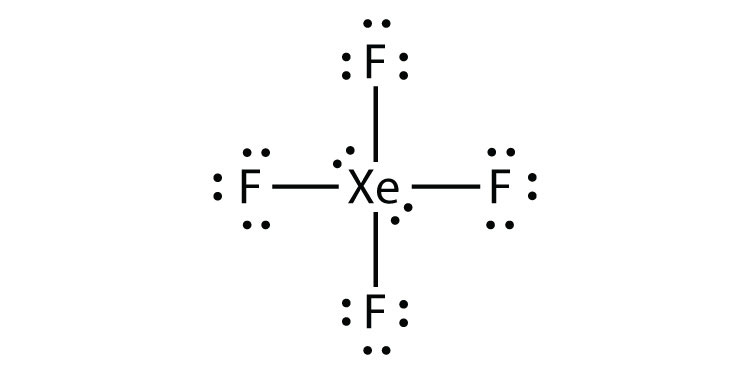
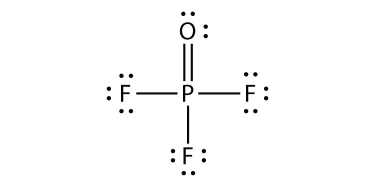
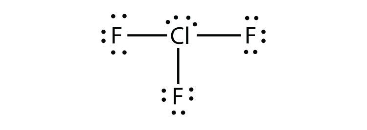

(sec:ch09:s05)=

# 9.5 Violations of the Octet Rule

```{note} Learning Objective

1. Recognize the three major types of violations of the octet rule.
```

As important and useful as the octet rule is in chemical bonding, there are some well-known violations. This does not mean that the octet rule is useless—quite the contrary. As with many rules, there are exceptions, or violations.

There are three violations to the octet rule. **Odd-electron molecules** (*A molecule with an odd number of electrons in the valence shell of an atom.*) represent the first violation to the octet rule. Although they are few, some stable compounds have an odd number of electrons in their valence shells. With an odd number of electrons, at least one atom in the molecule will have to violate the octet rule. Examples of stable odd-electron molecules are NO, NO<sub>2</sub>, and ClO<sub>2</sub>. The Lewis electron dot diagram for NO is as follows:


*9.5 Violations of the Octet Rule*

Although the O atom has an octet of electrons, the N atom has only seven electrons in its valence shell. Although NO is a stable compound, it is very chemically reactive, as are most other odd-electron compounds.

**Electron-deficient molecules** (*A molecule with less than eight electrons in the valence shell of an atom.*) represent the second violation to the octet rule. These stable compounds have less than eight electrons around an atom in the molecule. The most common examples are the covalent compounds of beryllium and boron. For example, beryllium can form two covalent bonds, resulting in only four electrons in its valence shell:


*9.5 Violations of the Octet Rule*

Boron commonly makes only three covalent bonds, resulting in only six valence electrons around the B atom. A well-known example is BF<sub>3</sub>:


*9.5 Violations of the Octet Rule*

The third violation to the octet rule is found in those compounds with more than eight electrons assigned to their valence shell. These are called **expanded valence shell molecules** (*A molecule with more than eight electrons in the valence shell of an atom.*). Such compounds are formed only by central atoms in the third row of the periodic table or beyond that have empty *d* orbitals in their valence shells that can participate in covalent bonding. One such compound is PF<sub>5</sub>. The only reasonable Lewis electron dot diagram for this compound has the P atom making five covalent bonds:


*9.5 Violations of the Octet Rule*

Formally, the P atom has 10 electrons in its valence shell.

```{exercise}
:label: ex:ball-ch09-s05-n02

**Example 9**

Identify each violation to the octet rule by drawing a Lewis electron dot diagram.

1. ClO
2. SF<sub>6</sub>
```

```{solution} ex:ball-ch09-s05-n02
:label: sol:ball-ch09-s05-n02
:class: dropdown

1. With one Cl atom and one O atom, this molecule has 6 + 7 = 13 valence electrons, so it is an odd-electron molecule. A Lewis electron dot diagram for this molecule is as follows:

   

   *9.5 Violations of the Octet Rule*
2. In SF<sub>6</sub>, the central S atom makes six covalent bonds to the six surrounding F atoms, so it is an expanded valence shell molecule. Its Lewis electron dot diagram is as follows:

   

   *9.5 Violations of the Octet Rule*
```

```{exercise}
:label: ex:ball-ch09-s05-n02-ty2

**Test Yourself**

Identify the violation to the octet rule in XeF<sub>2</sub> by drawing a Lewis electron dot diagram.
```

```{solution} ex:ball-ch09-s05-n02-ty2
:label: sol:ball-ch09-s05-n02-ty2
:class: dropdown


*9.5 Violations of the Octet Rule*

The Xe atom has an expanded valence shell with more than eight electrons around it.
```

```{important} Key Takeaway

- There are three violations to the octet rule: odd-electron molecules, electron-deficient molecules, and expanded valence shell molecules.
```

## Exercises

```{exercise}
:label: ex:ball-ch09-s05-qs01-qd01-qa01

**Exercise 1.**

Why can an odd-electron molecule not satisfy the octet rule?
```

```{solution} ex:ball-ch09-s05-qs01-qd01-qa01
:label: sol:ball-ch09-s05-qs01-qd01-qa01
:class: dropdown

There is no way all electrons can be paired if there are an odd number of them.
```

```{exercise}
:label: ex:ball-ch09-s05-qs01-qd01-qa02

**Exercise 2.**

Why can an atom in the second row of the periodic table not form expanded valence shell molecules?
```

```{exercise}
:label: ex:ball-ch09-s05-qs01-qd01-qa03

**Exercise 3.**

Draw an acceptable Lewis electron dot diagram for these molecules that violate the octet rule.

a. NO<sub>2</sub>
b. XeF<sub>4</sub>
```

```{solution} ex:ball-ch09-s05-qs01-qd01-qa03
:label: sol:ball-ch09-s05-qs01-qd01-qa03
:class: dropdown

a. 

   *9.5 Violations of the Octet Rule*
b. 

   *9.5 Violations of the Octet Rule*
```

```{exercise}
:label: ex:ball-ch09-s05-qs01-qd01-qa04

**Exercise 4.**

Draw an acceptable Lewis electron dot diagram for these molecules that violate the octet rule.

a. BCl<sub>3</sub>
b. ClO<sub>2</sub>
```

```{exercise}
:label: ex:ball-ch09-s05-qs01-qd01-qa05

**Exercise 5.**

Draw an acceptable Lewis electron dot diagram for these molecules that violate the octet rule.

a. POF<sub>3</sub>
b. ClF<sub>3</sub>
```

```{solution} ex:ball-ch09-s05-qs01-qd01-qa05
:label: sol:ball-ch09-s05-qs01-qd01-qa05
:class: dropdown

a. 

   *9.5 Violations of the Octet Rule*
b. 

   *9.5 Violations of the Octet Rule*
```

```{exercise}
:label: ex:ball-ch09-s05-qs01-qd01-qa06

**Exercise 6.**

Draw an acceptable Lewis electron dot diagram for these molecules that violate the octet rule.

a. SF<sub>4</sub>
b. BeH<sub>2</sub>
```
