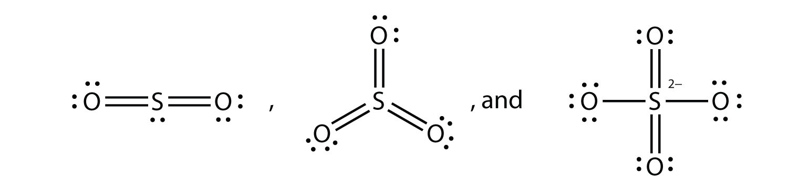

(sec:ch09:s07)=

# 9.7 End-of-Chapter Material

## Additional Exercises

```{exercise}
:label: ex:ball-ch09-s07-qs01-qd01-qa01

**Exercise 1.**

Explain why iron and copper have the same Lewis electron dot diagram when they have different numbers of electrons.
```

```{solution} ex:ball-ch09-s07-qs01-qd01-qa01
:label: sol:ball-ch09-s07-qs01-qd01-qa01
:class: dropdown

Iron has *d* electrons that typically are not shown on Lewis electron dot diagrams.
```

```{exercise}
:label: ex:ball-ch09-s07-qs01-qd01-qa02

**Exercise 2.**

Name two ions with the same Lewis electron dot diagram as the Cl<sup>−</sup> ion.
```

```{exercise}
:label: ex:ball-ch09-s07-qs01-qd01-qa03

**Exercise 3.**

Based on the known trends, what ionic compound from the first column of the periodic table and the next-to-last column of the periodic table should have the highest lattice energy?
```

```{solution} ex:ball-ch09-s07-qs01-qd01-qa03
:label: sol:ball-ch09-s07-qs01-qd01-qa03
:class: dropdown

LiF
```

```{exercise}
:label: ex:ball-ch09-s07-qs01-qd01-qa04

**Exercise 4.**

Based on the known trends, what ionic compound from the first column of the periodic table and the next-to-last column of the periodic table should have the lowest lattice energy?
```

```{exercise}
:label: ex:ball-ch09-s07-qs01-qd01-qa05

**Exercise 5.**

P<sub>2</sub> is not a stable form of phosphorus, but if it were, what would be its likely Lewis electron dot diagram?
```

```{solution} ex:ball-ch09-s07-qs01-qd01-qa05
:label: sol:ball-ch09-s07-qs01-qd01-qa05
:class: dropdown

It would be like N<sub>2</sub>:


*9.7 End-of-Chapter Material*
```

```{exercise}
:label: ex:ball-ch09-s07-qs01-qd01-qa06

**Exercise 6.**

Se<sub>2</sub> is not a stable form of selenium, but if it were, what would be its likely Lewis electron dot diagram?
```

```{exercise}
:label: ex:ball-ch09-s07-qs01-qd01-qa07

**Exercise 7.**

What are the Lewis electron dot diagrams of SO<sub>2</sub>, SO<sub>3</sub>, and SO<sub>4</sub><sup>2−</sup>?
```

```{solution} ex:ball-ch09-s07-qs01-qd01-qa07
:label: sol:ball-ch09-s07-qs01-qd01-qa07
:class: dropdown



*9.7 End-of-Chapter Material*
```

```{exercise}
:label: ex:ball-ch09-s07-qs01-qd01-qa08

**Exercise 8.**

What are the Lewis electron dot diagrams of PO<sub>3</sub><sup>3−</sup> and PO<sub>4</sub><sup>3−</sup>?
```

```{exercise}
:label: ex:ball-ch09-s07-qs01-qd01-qa09

**Exercise 9.**

Which bond do you expect to be more polar—an O–H bond or an N–H bond?
```

```{solution} ex:ball-ch09-s07-qs01-qd01-qa09
:label: sol:ball-ch09-s07-qs01-qd01-qa09
:class: dropdown

an O–H bond
```

```{exercise}
:label: ex:ball-ch09-s07-qs01-qd01-qa10

**Exercise 10.**

Which bond do you expect to be more polar—an O–F bond or an S–O bond?
```

```{exercise}
:label: ex:ball-ch09-s07-qs01-qd01-qa11

**Exercise 11.**

Use bond energies to estimate the energy change of this reaction.

$\text{C3H8 + 5O2 }\rightarrow{}\text{ 3CO2 + 4H2O}$
```

```{solution} ex:ball-ch09-s07-qs01-qd01-qa11
:label: sol:ball-ch09-s07-qs01-qd01-qa11
:class: dropdown

−2,000 kJ
```

```{exercise}
:label: ex:ball-ch09-s07-qs01-qd01-qa12

**Exercise 12.**

Use bond energies to estimate the energy change of this reaction.

$\text{N2H4 + O2 }\rightarrow{}\text{ N2 + 2H2O}$
```

```{exercise}
:label: ex:ball-ch09-s07-qs01-qd01-qa13

**Exercise 13.**

Ethylene (C<sub>2</sub>H<sub>4</sub>) has two central atoms. Determine the geometry around each central atom and the shape of the overall molecule.
```

```{solution} ex:ball-ch09-s07-qs01-qd01-qa13
:label: sol:ball-ch09-s07-qs01-qd01-qa13
:class: dropdown

trigonal planar about both central C atoms
```

```{exercise}
:label: ex:ball-ch09-s07-qs01-qd01-qa14

**Exercise 14.**

Hydrogen peroxide (H<sub>2</sub>O<sub>2</sub>) has two central atoms. Determine the geometry around each central atom and the shape of the overall molecule.
```
