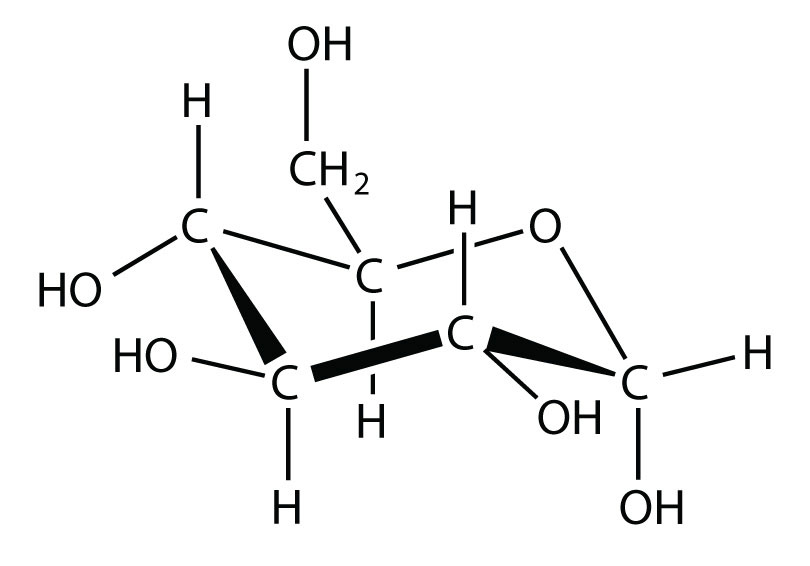

(sec:ch10:s01)=

# 10.1 Intermolecular Forces

```{note} Learning Objective

1. Relate phase to intermolecular forces.
```

Why does a substance have the phase it does? The preferred phase of a substance at a given set of conditions is a balance between the energy of the particles and intermolecular forces (or intermolecular interactions) between the particles. If the forces between particles are strong enough, the substance is a liquid or, if stronger, a solid. If the forces between particles are weak and sufficient energy is present, the particles separate from each other, so the gas phase is the preferred phase. The energy of the particles is mostly determined by temperature, so temperature is the main variable that determines what phase is stable at any given point.

What forces define intermolecular interactions? There are several. A force present in all substances with electrons is the **dispersion force** (*An intermolecular force caused by the instantaneous position of an electron in a molecule.*) (sometimes called the *London dispersion force*, after the physicist Fritz London, who first described this force in the early 1900s). This interaction is caused by the instantaneous position of an electron in a molecule, which temporarily makes that point of the molecule negatively charged and the rest of the molecule positively charged. In an instant, the electron is now somewhere else, but the fleeting imbalance of electric charge in the molecule allows molecules to interact with each other. As you might expect, the greater the number of electrons in a species, the stronger the dispersion force; this partially explains why smaller molecules are gases and larger molecules are liquids and solids at the same temperature. (Mass is a factor as well.)

Molecules with a permanent dipole moment experience **dipole-dipole interactions** (*An intermolecular force caused by molecules with a permanent dipole.*), which are generally stronger than dispersion forces if all other things are equal. The oppositely charged ends of a polar molecule, which have partial charges on them, attract each other ({ref}`Figure 10.1 "Dipole-Dipole Interactions" <fig:ch10:s01:f01>`). Thus a polar molecule such CH<sub>2</sub>Cl<sub>2</sub> has a significantly higher boiling point (313 K, or 40°C) than a nonpolar molecule like CF<sub>4</sub> (145 K, or −128°C), even though it has a lower molar mass (85 g/mol vs. 88 g/mol).

```{figure} ../images/figures/80cbd86b0f980c19c302cac2baf15a84.jpg
:label: fig:ch10:s01:f01
:alt: "Dipole-Dipole Interactions. Oppositely charged ends of polar molecules attract each other."
:align: center
:width: 85%

Dipole-Dipole Interactions. Oppositely charged ends of polar molecules attract each other.
```

An unusually strong form of dipole-dipole interaction is called **hydrogen bonding** (*The very strong interaction between molecules due to H atoms being bonded to N, O, or F atoms.*). Hydrogen bonding is found in molecules with an H atom bonded to an N atom, an O atom, or an F atom. Such covalent bonds are very polar, and the dipole-dipole interaction between these bonds in two or more molecules is strong enough to create a new category of intermolecular force. Hydrogen bonding is the reason water has unusual properties. For such a small molecule (its molar mass is only 18 g/mol), H<sub>2</sub>O has relatively high melting and boiling points. Its boiling point is 373 K (100°C), while the boiling point of a similar molecule, H<sub>2</sub>S, is 213 K (−60°C). This is because H<sub>2</sub>O molecules experience hydrogen bonding, while H<sub>2</sub>S molecules do not. This strong attraction between H<sub>2</sub>O molecules requires additional energy to separate the molecules in the condensed phase, so its boiling point is higher than would be expected. Hydrogen bonding is also responsible for water’s ability as a solvent, its high heat capacity, and its ability to expand when freezing; the molecules line up in such a way that there is extra space between the molecules, increasing its volume in the solid state ({ref}`Figure 10.2 "Hydrogen Bonding" <fig:ch10:s01:f02>`).

```{figure} ../images/figures/30e252771debb37fad7fc5cbc1c405ae.jpg
:label: fig:ch10:s01:f02
:alt: "Hydrogen Bonding. When water solidifies, hydrogen bonding between the molecules forces the molecules to line up in a way that creates empty space between the molecules, increasing the overall volume of the solid. This is why ice is less dense than liquid water."
:align: center
:width: 85%

Hydrogen Bonding. When water solidifies, hydrogen bonding between the molecules forces the molecules to line up in a way that creates empty space between the molecules, increasing the overall volume of the solid. This is why ice is less dense than liquid water.
```

```{exercise}
:label: ex:ball-ch10-s01-n02

**Example 1**

Identify the most significant intermolecular force in each substance.

1. C<sub>3</sub>H<sub>8</sub>
2. CH<sub>3</sub>OH
3. H<sub>2</sub>S
```

```{solution} ex:ball-ch10-s01-n02
:label: sol:ball-ch10-s01-n02
:class: dropdown

1. Although C–H bonds are polar, they are only minimally polar. The most significant intermolecular force for this substance would be dispersion forces.
2. This molecule has an H atom bonded to an O atom, so it will experience hydrogen bonding.
3. Although this molecule does not experience hydrogen bonding, the Lewis electron dot diagram and VSEPR indicate that it is bent, so it has a permanent dipole. The most significant force in this substance is dipole-dipole interaction.
```

```{exercise}
:label: ex:ball-ch10-s01-n02-ty2

**Test Yourself**

Identify the most significant intermolecular force in each substance.

1. HF
2. HCl
```

```{solution} ex:ball-ch10-s01-n02-ty2
:label: sol:ball-ch10-s01-n02-ty2
:class: dropdown

1. hydrogen bonding
2. dipole-dipole interactions
```

The preferred phase a substance adopts can change with temperature. At low temperatures, most substances are solids (only helium is predicted to be a liquid at absolute zero). As the temperature increases, those substances with very weak intermolecular forces become gases directly (in a process called *sublimation*, which will be discussed in {ref}`Section 10.2 "Phase Transitions: Melting, Boiling, and Subliming" <sec:ch10:s02>`). Substances with weak interactions can become liquids as the temperature increases. As the temperature increases even more, the individual particles will have so much energy that the intermolecular forces are overcome, so the particles separate from each other, and the substance becomes a gas (assuming that their chemical bonds are not so weak that the compound decomposes from the high temperature). Although is it difficult to predict the temperature ranges for which solid, liquid, or gas is the preferred phase for any random substance, all substances progress from solid to liquid to gas in that order as temperature increases.

```{important} Key Takeaways

- All substances experience dispersion forces between their particles.
- Substances that are polar experience dipole-dipole interactions.
- Substances with covalent bonds between an H atom and N, O, or F atoms experience hydrogen bonding.
- The preferred phase of a substance depends on the strength of the intermolecular force and the energy of the particles.
```

## Exercises

```{exercise}
:label: ex:ball-ch10-s01-qs01-qd01-qa01

**Exercise 1.**

What type of intermolecular force do all substances have?
```

```{solution} ex:ball-ch10-s01-qs01-qd01-qa01
:label: sol:ball-ch10-s01-qs01-qd01-qa01
:class: dropdown

dispersion force
```

```{exercise}
:label: ex:ball-ch10-s01-qs01-qd01-qa02

**Exercise 2.**

What is necessary for a molecule to experience dipole-dipole interactions?
```

```{exercise}
:label: ex:ball-ch10-s01-qs01-qd01-qa03

**Exercise 3.**

What is necessary for a molecule to experience hydrogen bonding?
```

```{solution} ex:ball-ch10-s01-qs01-qd01-qa03
:label: sol:ball-ch10-s01-qs01-qd01-qa03
:class: dropdown

An H atom must be bonded to an N, O, or F atom.
```

```{exercise}
:label: ex:ball-ch10-s01-qs01-qd01-qa04

**Exercise 4.**

How does varying the temperature change the preferred phase of a substance?
```

```{exercise}
:label: ex:ball-ch10-s01-qs01-qd01-qa05

**Exercise 5.**

Identify the strongest intermolecular force present in each substance.

a. He
b. CHCl<sub>3</sub>
c. HOF
```

```{solution} ex:ball-ch10-s01-qs01-qd01-qa05
:label: sol:ball-ch10-s01-qs01-qd01-qa05
:class: dropdown

a. dispersion forces
b. dipole-dipole interactions
c. hydrogen bonding
```

```{exercise}
:label: ex:ball-ch10-s01-qs01-qd01-qa06

**Exercise 6.**

Identify the strongest intermolecular force present in each substance.

a. CH<sub>3</sub>OH
b. (CH<sub>3</sub>)<sub>2</sub>CO
c. N<sub>2</sub>
```

```{exercise}
:label: ex:ball-ch10-s01-qs01-qd01-qa07

**Exercise 7.**

Identify the strongest intermolecular force present in each substance.

a. HBr
b. C<sub>6</sub>H<sub>5</sub>NH<sub>2</sub>
c. CH<sub>4</sub>
```

```{solution} ex:ball-ch10-s01-qs01-qd01-qa07
:label: sol:ball-ch10-s01-qs01-qd01-qa07
:class: dropdown

a. dipole-dipole interactions
b. hydrogen bonding
c. dispersion forces
```

```{exercise}
:label: ex:ball-ch10-s01-qs01-qd01-qa08

**Exercise 8.**

Identify the strongest intermolecular force present in each substance.

a. C<sub>10</sub>H<sub>22</sub>
b. HF
c. glucose



*10.1 Intermolecular Forces*
```
