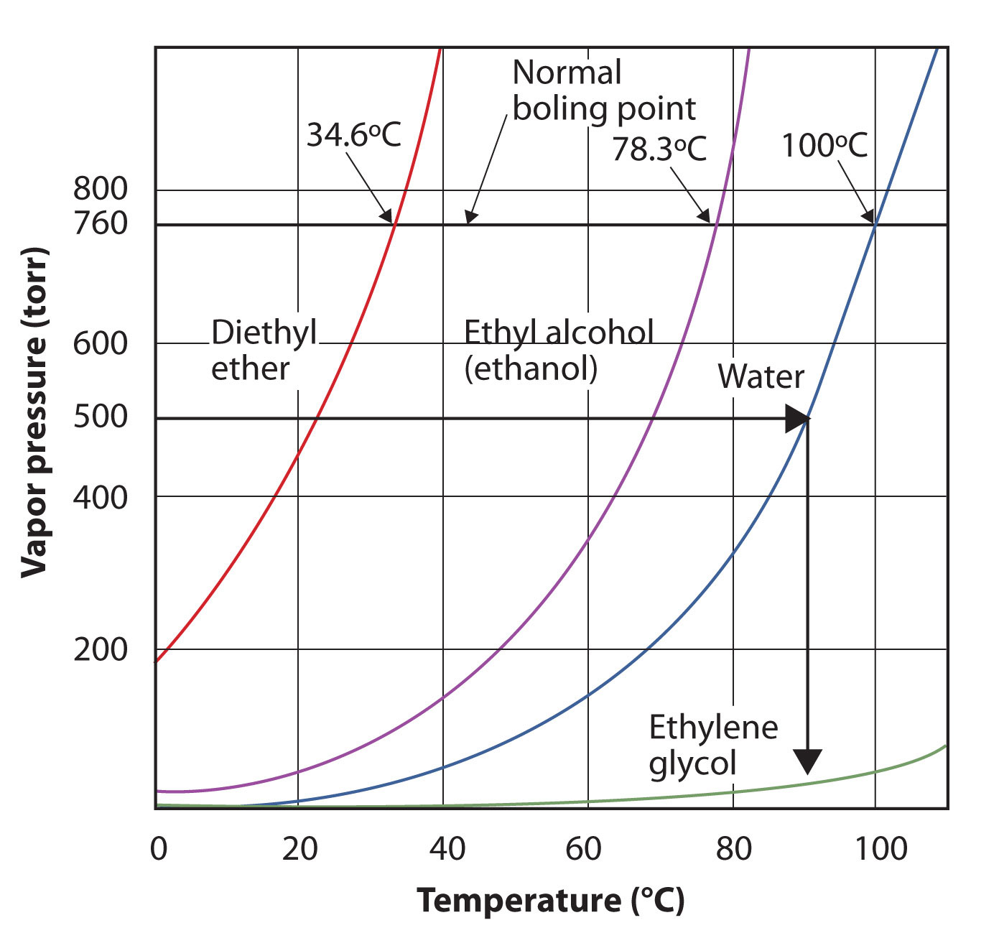

(sec:ch10:s03)=

# 10.3 Properties of Liquids

```{note} Learning Objectives

1. Define the vapor pressure of liquids.
2. Explain the origin of both surface tension and capillary action.
```

There are some properties that all liquids have. The liquid that we are most familiar with is probably water, and it has these properties. Other liquids have them as well, which is something to keep in mind.

All liquids have a certain portion of their particles having enough energy to enter the gas phase, and if these particles are at the surface of the liquid, they do so ({ref}`Figure 10.5 "Evaporation" <fig:ch10:s03:f01>`). The formation of a gas from a liquid at temperatures below the boiling point is called **evaporation** (*The formation of a gas phase from a liquid at temperatures below the boiling point.*). At these temperatures, the material in the gas phase is called **vapor** (*Material in the gas phase due to evaporation.*), rather than gas; the term *gas* is reserved for when the gas phase is the stable phase.

```{figure} ../images/figures/110332af0e42286a6cfb6dd15e006230.jpg
:label: fig:ch10:s03:f01
:alt: "Evaporation. Some particles of a liquid have enough energy to escape the liquid phase to become a vapor."
:align: center
:width: 85%

Evaporation. Some particles of a liquid have enough energy to escape the liquid phase to become a vapor.
```

If the available volume is large enough, eventually all the liquid will become vapor. But if the available volume is not enough, eventually some of the vapor particles will reenter the liquid phase ({ref}`Figure 10.6 "Equilibrium" <fig:ch10:s03:f02>`). At some point, the number of particles entering the vapor phase will equal the number of particles leaving the vapor phase, so there is no net change in the amount of vapor in the system. We say that the system is *at equilibrium*. The partial pressure of the vapor at equilibrium is called the *vapor pressure of the liquid*.

```{figure} ../images/figures/786dfee791f1c0bb5f1f81c24ae54066.jpg
:label: fig:ch10:s03:f02
:alt: "Equilibrium. At some point, the number of particles entering the vapor phase will be balanced by the number of particles returning to the liquid. This point is called equilibrium."
:align: center
:width: 85%

Equilibrium. At some point, the number of particles entering the vapor phase will be balanced by the number of particles returning to the liquid. This point is called equilibrium.
```

Understand that the liquid has not stopped evaporating. The reverse process—condensation—is occurring as fast as evaporation is, so there is no net change in the amount of vapor in the system. The term **dynamic equilibrium** (*A situation in which a process still occurs but the opposite process also occurs at the same rate so that there is no net change in the system.*) represents a situation in which a process still occurs, but the opposite process also occurs at the same rate so that there is no net change in the system.

The vapor pressure for a substance is dependent on the temperature of the substance; as the temperature increases, so does the vapor pressure. {ref}`Figure 10.7 "Plots of Vapor Pressure versus Temperature for Several Liquids" <fig:ch10:s03:f03>` is a plot of vapor pressure versus temperature for several liquids. Having defined vapor pressure, we can also redefine the *boiling point* of a liquid: the temperature at which the vapor pressure of a liquid equals the surrounding environmental pressure. The normal vapor pressure, then, is the temperature at which the vapor pressure is 760 torr, or exactly 1 atm. Thus boiling points vary with surrounding pressure, a fact that can have large implications on cooking foods at lower- or higher-than-normal elevations. Atmospheric pressure varies significantly with altitude.

```{figure} ../images/figures/6d3ad33c9ac18fe42b14713873328f50.jpg
:label: fig:ch10:s03:f03
:alt: "Plots of Vapor Pressure versus Temperature for Several Liquids. The vapor pressure of a liquid depends on the identity of the liquid and the temperature, as this plot shows."
:align: center
:width: 85%

Plots of Vapor Pressure versus Temperature for Several Liquids. The vapor pressure of a liquid depends on the identity of the liquid and the temperature, as this plot shows.
```

```{exercise}
:label: ex:ball-ch10-s03-n02

**Example 4**

Use {ref}`Figure 10.7 "Plots of Vapor Pressure versus Temperature for Several Liquids" <fig:ch10:s03:f03>` to estimate the boiling point of water at 500 torr, which is the approximate atmospheric pressure at the top of Mount Everest.
```

```{solution} ex:ball-ch10-s03-n02
:label: sol:ball-ch10-s03-n02
:class: dropdown

See the accompanying figure. Five hundred torr is between 400 and 600, so we extend a line from that point on the *y*-axis across to the curve for water and then drop it down to the *x*-axis to read the associated temperature. It looks like the point on the water vapor pressure curve corresponds to a temperature of about 90°C, so we conclude that the boiling point of water at 500 torr is 90°C.

(fig:ch10:s03:f04)=



*Using Figure 10.7 "Plots of Vapor Pressure versus Temperature for Several Liquids" to Answer Example 4. By reading the graph properly, you can estimate the boiling point of a liquid at different temperatures.*
```

```{exercise}
:label: ex:ball-ch10-s03-n02-ty2

**Test Yourself**

Use {ref}`Figure 10.7 "Plots of Vapor Pressure versus Temperature for Several Liquids" <fig:ch10:s03:f03>` to estimate the boiling point of ethanol at 400 torr.
```

```{solution} ex:ball-ch10-s03-n02-ty2
:label: sol:ball-ch10-s03-n02-ty2
:class: dropdown

about 65°C
```

The vapor pressure curve for water is not exactly zero at the melting point—0°C. Even ice has a vapor pressure; that is why it sublimes over time. However, the vapor pressures of solids are typically much lower than that of liquids. At −1°C, the vapor pressure of ice is 4.2 torr. At a freezer temperature of 0°F (−17°C), the vapor pressure of ice is only 1.0 torr; so-called deep freezers can get down to −23°C, where the vapor pressure of ice is only 0.6 torr.

All liquids share some other properties as well. **Surface tension** (*An effect caused by an imbalance of forces on the atoms at the surface of a liquid.*) is an effect caused by an imbalance of forces on the atoms at the surface of a liquid, as shown in {ref}`Figure 10.9 "Surface Tension" <fig:ch10:s03:f05>`. The blue particle in the bulk of the liquid experiences intermolecular forces from all around, as illustrated by the arrows. However, the yellow particle on the surface does not experience any forces above it because there are no particles above it. This leads to an imbalance of forces that we call surface tension.

```{figure} ../images/figures/c0aebd842489a117c57a4225efddc949.jpg
:label: fig:ch10:s03:f05
:alt: "Surface Tension. Surface tension comes from the fact that particles at the surface of a liquid do not experience interactions from all directions, leading to an imbalance of forces on the surface."
:align: center
:width: 85%

Surface Tension. Surface tension comes from the fact that particles at the surface of a liquid do not experience interactions from all directions, leading to an imbalance of forces on the surface.
```

Surface tension is responsible for several well-known behaviors of liquids, including water. Liquids with high surface tension tend to bead up when present in small amounts (Figure 10.10 "Effects of Surface Tension"). Surface tension causes liquids to form spheres in free fall or zero gravity (see Figure 10.3 "Liquids and Gravity": the “floating” water isn’t in the shape of a sphere by accident; it is the result of surface tension). Surface tension is also responsible for the fact that small insects can “walk” on water. Because of surface tension, it takes energy to break the surface of a liquid, and if an object (such as an insect) is light enough, there is not enough force due to gravity for the object to break through the surface, so the object stays on top of the water (Figure 10.11 "Walking on Water"). Carefully done, this phenomenon can also be illustrated with a thin razor blade or a paper clip.

The fact that small droplets of water bead up on surfaces does not mean that water—or any other liquid—does not interact with other substances. Sometimes the attraction can be very strong. **Adhesion** (*The tendency of a substance to interact with other substances because of intermolecular forces.*) is the tendency of a substance to interact with other substances because of intermolecular forces, while **cohesion** (*The tendency of a substance to interact with itself.*) is the tendency of a substance to interact with itself. If cohesive forces within a liquid are stronger than adhesive forces between a liquid and another substance, then the liquid tends to keep to itself; it will bead up. However, if adhesive forces between a liquid and another substance are stronger than cohesive forces, then the liquid will spread out over the other substance, trying to maximize the interface between the other substance and the liquid. We say that the liquid *wets* the other substance.

Adhesion and cohesion are important for other phenomena as well. In particular, if adhesive forces are strong, then when a liquid is introduced to a small-diameter tube of another substance, the liquid moves up or down in the tube, as if ignoring gravity. Because tiny tubes are called capillaries, this phenomenon is called **capillary action** (*The behavior of a liquid in narrow surfaces due to differences in adhesion and cohesion.*). For example, one type of capillary action—*capillary rise*—is seen when water or water-based liquids rise up in thin glass tubes (like the capillaries sometimes used in blood tests), forming an upwardly curved surface called a **meniscus** (*The curved surface a liquid makes as it approaches a solid barrier.*). Capillary action is also responsible for the “wicking” effect that towels and sponges use to dry wet objects; the matting of fibers forms tiny capillaries that have good adhesion with water. Cotton is a good material for this; polyester and other synthetic fabrics do not display similar capillary action, which is why you seldom find rayon bath towels. A similar effect is observed with liquid fuels or melted wax and their wicks. Capillary action is thought to be at least partially responsible for transporting water from the roots to the tops of trees, even tall ones.

On the other hand, some liquids have stronger cohesive forces than adhesive forces. In this case, in the presence of a capillary, the liquid is forced down from its surface; this is an example of a type of capillary action called *capillary depression*. In this case, the meniscus curves downward. Mercury has very strong cohesive forces; when a capillary is placed in a pool of mercury, the surface of the mercury liquid is depressed ({ref}`Figure 10.12 "Capillary Action" <fig:ch10:s03:f08>`).

```{figure} ../images/figures/201e06382648a98b327b42d16a953704.jpg
:label: fig:ch10:s03:f08
:alt: "Capillary Action. (a) Capillary rise is seen when adhesion is strong, such as with water in a thin glass tube. (b) Capillary depression is seen when cohesive forces are stronger than adhesive forces, such as with mercury and thin glass tubes."
:align: center
:width: 85%

Capillary Action. (a) Capillary rise is seen when adhesion is strong, such as with water in a thin glass tube. (b) Capillary depression is seen when cohesive forces are stronger than adhesive forces, such as with mercury and thin glass tubes.
```

```{tip} Chemistry Is Everywhere: Waxing a Car

Responsible car owners are encouraged to wax their cars regularly. In addition to making the car look nicer, it also helps protect the surface, especially if the surface is metal. Why?

The answer has to do with cohesion and adhesion (and, to a lesser extent, rust). Water is an important factor in the rusting of iron, sometimes used extensively in outer car bodies. Keeping water away from the metal is one way to minimize rusting. A coat of paint helps with this. However, dirty or scratched paint can attract water, and adhesive forces will allow the water to wet the surface, maximizing its contact with the metal and promoting rust.

Wax is composed of long hydrocarbon molecules that do not interact well with water. (Hydrocarbons are compounds with C and H atoms; for more information on hydrocarbons, see {ref}`Chapter 16 "Organic Chemistry" <ch:ch16>`.) That is, a thin layer of wax will not be wetted by water. A freshly waxed car has low adhesive forces with water, so water beads up on the surface, as a consequence of its cohesion and surface tension. This minimizes the contact between water and metal, thus minimizing rust.
```

```{important} Key Takeaways

- All liquids evaporate.
- If volume is limited, evaporation eventually reaches a dynamic equilibrium, and a constant vapor pressure is maintained.
- All liquids experience surface tension, an imbalance of forces at the surface of the liquid.
- All liquids experience capillary action, demonstrating either capillary rise or capillary depression in the presence of other substances.
```

## Exercises

```{exercise}
:label: ex:ball-ch10-s03-qs01-qd01-qa01

**Exercise 1.**

What is the difference between evaporation and boiling?
```

```{solution} ex:ball-ch10-s03-qs01-qd01-qa01
:label: sol:ball-ch10-s03-qs01-qd01-qa01
:class: dropdown

Evaporation occurs when a liquid becomes a gas at temperatures below that liquid’s boiling point, whereas boiling is the conversion of a liquid to a gas at the liquid’s boiling point.
```

```{exercise}
:label: ex:ball-ch10-s03-qs01-qd01-qa02

**Exercise 2.**

What is the difference between a gas and vapor?
```

```{exercise}
:label: ex:ball-ch10-s03-qs01-qd01-qa03

**Exercise 3.**

Define *normal boiling point* in terms of vapor pressure.
```

```{solution} ex:ball-ch10-s03-qs01-qd01-qa03
:label: sol:ball-ch10-s03-qs01-qd01-qa03
:class: dropdown

the temperature at which the vapor pressure of a liquid is 760 torr
```

```{exercise}
:label: ex:ball-ch10-s03-qs01-qd01-qa04

**Exercise 4.**

Is the boiling point higher or lower at higher environmental pressures? Explain your answer.
```

```{exercise}
:label: ex:ball-ch10-s03-qs01-qd01-qa05

**Exercise 5.**

Referring to {ref}`Figure 10.7 "Plots of Vapor Pressure versus Temperature for Several Liquids" <fig:ch10:s03:f03>`, if the pressure is 400 torr, which liquid boils at the lowest temperature?
```

```{solution} ex:ball-ch10-s03-qs01-qd01-qa05
:label: sol:ball-ch10-s03-qs01-qd01-qa05
:class: dropdown

diethyl ether
```

```{exercise}
:label: ex:ball-ch10-s03-qs01-qd01-qa06

**Exercise 6.**

Referring to {ref}`Figure 10.7 "Plots of Vapor Pressure versus Temperature for Several Liquids" <fig:ch10:s03:f03>`, if the pressure is 100 torr, which liquid boils at the highest temperature?
```

```{exercise}
:label: ex:ball-ch10-s03-qs01-qd01-qa07

**Exercise 7.**

Referring to {ref}`Figure 10.7 "Plots of Vapor Pressure versus Temperature for Several Liquids" <fig:ch10:s03:f03>`, estimate the boiling point of ethanol at 200 torr.
```

```{solution} ex:ball-ch10-s03-qs01-qd01-qa07
:label: sol:ball-ch10-s03-qs01-qd01-qa07
:class: dropdown

48°C
```

```{exercise}
:label: ex:ball-ch10-s03-qs01-qd01-qa08

**Exercise 8.**

Referring to {ref}`Figure 10.7 "Plots of Vapor Pressure versus Temperature for Several Liquids" <fig:ch10:s03:f03>`, at approximately what pressure is the boiling point of water 40°C?
```

```{exercise}
:label: ex:ball-ch10-s03-qs01-qd01-qa09

**Exercise 9.**

Explain how surface tension works.
```

```{solution} ex:ball-ch10-s03-qs01-qd01-qa09
:label: sol:ball-ch10-s03-qs01-qd01-qa09
:class: dropdown

Surface tension is an imbalance of attractive forces between liquid molecules at the surface of a liquid.
```

```{exercise}
:label: ex:ball-ch10-s03-qs01-qd01-qa10

**Exercise 10.**

From what you know of intermolecular forces, which substance do you think might have a higher surface tension—ethyl alcohol or mercury? Why?
```

```{exercise}
:label: ex:ball-ch10-s03-qs01-qd01-qa11

**Exercise 11.**

Under what conditions would a liquid demonstrate a capillary rise?
```

```{solution} ex:ball-ch10-s03-qs01-qd01-qa11
:label: sol:ball-ch10-s03-qs01-qd01-qa11
:class: dropdown

Adhesion must be greater than cohesion.
```

```{exercise}
:label: ex:ball-ch10-s03-qs01-qd01-qa12

**Exercise 12.**

Under what conditions would a liquid demonstrate a capillary depression?
```
