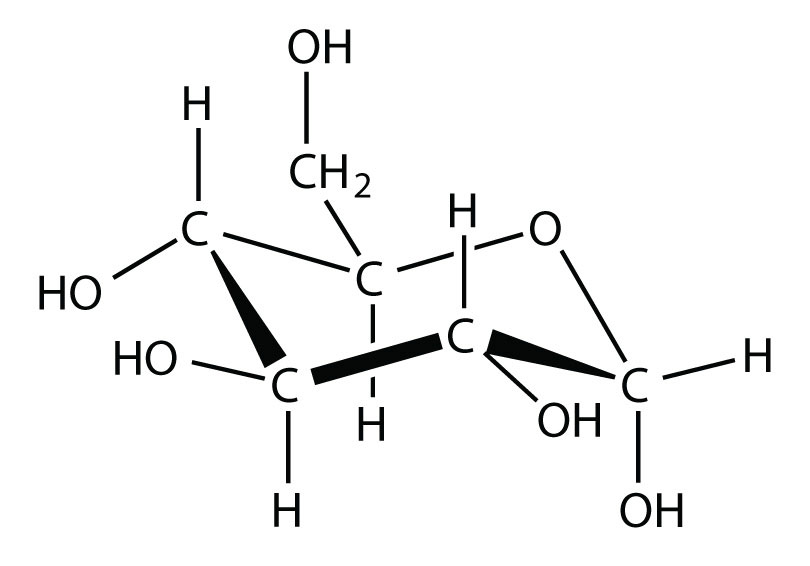

(sec:ch11:s01)=

# 11.1 Some Definitions

```{note} Learning Objectives

1. Learn some terminology involving solutions.
2. Recognize which terminology is qualitative and which terminology is quantitative.
3. Explain why certain substances dissolve in other substances.
```

The major component of a solution is called the **solvent** (*The major component of a solution.*). The minor component of a solution is called the **solute** (*The minor component of a solution.*). By major and minor we mean whichever component has the greater presence by mass or by moles. Sometimes this becomes confusing, especially with substances with very different molar masses. However, here we will confine the discussion to solutions for which the major component and the minor component are obvious.

Solutions exist for every possible phase of the solute and the solvent. Salt water, for example, is a solution of solid NaCl in liquid water; soda water is a solution of gaseous CO<sub>2</sub> in liquid water, while air is a solution of a gaseous solute (O<sub>2</sub>) in a gaseous solvent (N<sub>2</sub>). In all cases, however, the overall phase of the solution is the same phase as the solvent.

```{exercise}
:label: ex:ball-ch11-s01-n02

**Example 1**

A solution is made by dissolving 1.00 g of sucrose (C<sub>12</sub>H<sub>22</sub>O<sub>11</sub>) in 100.0 g of liquid water. Identify the solvent and solute in the resulting solution.
```

```{solution} ex:ball-ch11-s01-n02
:label: sol:ball-ch11-s01-n02
:class: dropdown

Either by mass or by moles, the obvious minor component is sucrose, so it is the solute. Water—the majority component—is the solvent. The fact that the resulting solution is the same phase as water also suggests that water is the solvent.
```

```{exercise}
:label: ex:ball-ch11-s01-n02-ty2

**Test Yourself**

A solution is made by dissolving 3.33 g of HCl(g) in 40.0 g of liquid methyl alcohol (CH<sub>3</sub>OH). Identify the solvent and solute in the resulting solution.
```

```{solution} ex:ball-ch11-s01-n02-ty2
:label: sol:ball-ch11-s01-n02-ty2
:class: dropdown

solute: HCl(g); solvent: CH<sub>3</sub>OH
```

One important concept of solutions is in defining how much solute is dissolved in a given amount of solvent. This concept is called **concentration** (*How much solute is dissolved in a given amount of solvent.*). Various words are used to describe the relative amounts of solute. **Dilute** (*A solution with very little solute.*) describes a solution that has very little solute, while **concentrated** (*A solution with a lot of solute.*) describes a solution that has a lot of solute. One problem is that these terms are qualitative; they describe more or less but not exactly how much.

In most cases, only a certain maximum amount of solute can be dissolved in a given amount of solvent. This maximum amount is called the **solubility** (*The maximum amount of a solute that can be dissolved in a given amount of a solvent.*) of the solute. It is usually expressed in terms of the amount of solute that can dissolve in 100 g of the solvent at a given temperature. {ref}`Table 11.2 "Solubilities of Some Ionic Compounds" <tbl:ch11:s01:t01>` lists the solubilities of some simple ionic compounds. These solubilities vary widely: NaCl can dissolve up to 36.1 g per 100 g of H<sub>2</sub>O, while AgCl can dissolve only 0.00019 g per 100 g of H<sub>2</sub>O.

```{table} Solubilities of Some Ionic Compounds
:label: tbl:ch11:s01:t01

| Solute | Solubility (g per 100 g of H<sub>2</sub>O at 25°C) |
| --- | --- |
| AgCl | 0.00019 |
| CaCO<sub>3</sub> | 0.0006 |
| KBr | 70.7 |
| NaCl | 36.1 |
| NaNO<sub>3</sub> | 94.6 |
```

When the maximum amount of solute has been dissolved in a given amount of solvent, we say that the solution is **saturated** (*A solution with the maximum amount of solute dissolved in it.*) with solute. When less than the maximum amount of solute is dissolved in a given amount of solvent, the solution is **unsaturated** (*A solution with less than the maximum amount of solute dissolved in it.*). These terms are also qualitative terms because each solute has its own solubility. A solution of 0.00019 g of AgCl per 100 g of H<sub>2</sub>O may be saturated, but with so little solute dissolved, it is also rather dilute. A solution of 36.1 g of NaCl in 100 g of H<sub>2</sub>O is also saturated but rather concentrated. Ideally, we need more precise ways of specifying the amount of solute in a solution. We will introduce such ways in {ref}`Section 11.2 "Quantitative Units of Concentration" <sec:ch11:s02>`.

In some circumstances, it is possible to dissolve more than the maximum amount of a solute in a solution. Usually, this happens by heating the solvent, dissolving more solute than would normally dissolve at regular temperatures, and letting the solution cool down slowly and carefully. Such solutions are called **supersaturated** (*An unstable solution with more than the normal maximum amount of solute in it.*) solutions and are not stable; given an opportunity (such as dropping a crystal of solute in the solution), the excess solute will precipitate from the solution.

It should be obvious that some solutes dissolve in certain solvents but not others. NaCl, for example, dissolves in water but not in vegetable oil. Beeswax dissolves in liquid hexane but not water. What is it that makes a solute soluble in some solvents but not others?

The answer is intermolecular interactions. The intermolecular interactions include London dispersion forces, dipole-dipole interactions, and hydrogen bonding (as described in {ref}`Chapter 10 "Solids and Liquids" <ch:ch10>`). From experimental studies, it has been determined that if molecules of a solute experience the same intermolecular forces that the solvent does, the solute will likely dissolve in that solvent. So, NaCl—a very polar substance because it is composed of ions—dissolves in water, which is very polar, but not in oil, which is generally nonpolar. Nonpolar wax dissolves in nonpolar hexane but not in polar water. This concept leads to the general rule that “like dissolves like” for predicting whether a solute is soluble in a given solvent. However, this is a general rule, not an absolute statement, so it must be applied with care.

```{exercise}
:label: ex:ball-ch11-s01-n03

**Example 2**

Would I<sub>2</sub> be more soluble in CCl<sub>4</sub> or H<sub>2</sub>O? Explain your answer.
```

```{solution} ex:ball-ch11-s01-n03
:label: sol:ball-ch11-s01-n03
:class: dropdown

I<sub>2</sub> is nonpolar. Of the two solvents, CCl<sub>4</sub> is nonpolar and H<sub>2</sub>O is polar, so I<sub>2</sub> would be expected to be more soluble in CCl<sub>4</sub>.
```

```{exercise}
:label: ex:ball-ch11-s01-n03-ty2

**Test Yourself**

Would C<sub>3</sub>H<sub>7</sub>OH be more soluble in CCl<sub>4</sub> or H<sub>2</sub>O? Explain your answer.
```

```{solution} ex:ball-ch11-s01-n03-ty2
:label: sol:ball-ch11-s01-n03-ty2
:class: dropdown

H<sub>2</sub>O because both experience hydrogen bonding
```

```{important} Key Takeaways

- Solutions are composed of a solvent (major component) and a solute (minor component).
- Concentration is the expression of the amount of solute in a given amount of solvent and can be described by several qualitative terms.
- Solubility is a specific amount of solute that can dissolve in a given amount of solvent.
- “Like dissolves like” is a useful rule for deciding if a solute will be soluble in a solvent.
```

## Exercises

```{exercise}
:label: ex:ball-ch11-s01-qs01-qd01-qa01

**Exercise 1.**

Define *solute* and *solvent*.
```

```{solution} ex:ball-ch11-s01-qs01-qd01-qa01
:label: sol:ball-ch11-s01-qs01-qd01-qa01
:class: dropdown

The solvent is the majority component of a solution, whereas the solute is the minority component of a solution.
```

```{exercise}
:label: ex:ball-ch11-s01-qs01-qd01-qa02

**Exercise 2.**

Define *saturated*, *unsaturated*, and *supersaturated*.
```

```{exercise}
:label: ex:ball-ch11-s01-qs01-qd01-qa03

**Exercise 3.**

A solution is prepared by combining 2.09 g of CO<sub>2</sub> and 35.5 g of H<sub>2</sub>O. Identify the solute and solvent.
```

```{solution} ex:ball-ch11-s01-qs01-qd01-qa03
:label: sol:ball-ch11-s01-qs01-qd01-qa03
:class: dropdown

solute: CO<sub>2</sub>; solvent: H<sub>2</sub>O
```

```{exercise}
:label: ex:ball-ch11-s01-qs01-qd01-qa04

**Exercise 4.**

A solution is prepared by combining 10.3 g of Hg(ℓ) and 45.0 g of Ag(s). Identify the solute and solvent.
```

```{exercise}
:label: ex:ball-ch11-s01-qs01-qd01-qa05

**Exercise 5.**

Use {ref}`Table 11.2 "Solubilities of Some Ionic Compounds" <tbl:ch11:s01:t01>` to decide if a solution containing 45.0 g of NaCl per 100 g of H<sub>2</sub>O is unsaturated, saturated, or supersaturated.
```

```{solution} ex:ball-ch11-s01-qs01-qd01-qa05
:label: sol:ball-ch11-s01-qs01-qd01-qa05
:class: dropdown

supersaturated
```

```{exercise}
:label: ex:ball-ch11-s01-qs01-qd01-qa06

**Exercise 6.**

Use {ref}`Table 11.2 "Solubilities of Some Ionic Compounds" <tbl:ch11:s01:t01>` to decide if a solution containing 0.000092 g of AgCl per 100 g of H<sub>2</sub>O is unsaturated, saturated, or supersaturated.
```

```{exercise}
:label: ex:ball-ch11-s01-qs01-qd01-qa07

**Exercise 7.**

Would the solution in Exercise 5 be described as dilute or concentrated? Explain your answer.
```

```{solution} ex:ball-ch11-s01-qs01-qd01-qa07
:label: sol:ball-ch11-s01-qs01-qd01-qa07
:class: dropdown

concentrated because there is a lot of solute
```

```{exercise}
:label: ex:ball-ch11-s01-qs01-qd01-qa08

**Exercise 8.**

Would the solution in Exercise 6 be described as dilute or concentrated? Explain your answer.
```

```{exercise}
:label: ex:ball-ch11-s01-qs01-qd01-qa09

**Exercise 9.**

Identify a solute from {ref}`Table 11.2 "Solubilities of Some Ionic Compounds" <tbl:ch11:s01:t01>` whose saturated solution can be described as dilute.
```

```{solution} ex:ball-ch11-s01-qs01-qd01-qa09
:label: sol:ball-ch11-s01-qs01-qd01-qa09
:class: dropdown

AgCl or CaCO<sub>3</sub>
```

```{exercise}
:label: ex:ball-ch11-s01-qs01-qd01-qa10

**Exercise 10.**

Identify a solute from {ref}`Table 11.2 "Solubilities of Some Ionic Compounds" <tbl:ch11:s01:t01>` whose saturated solution can be described as concentrated.
```

```{exercise}
:label: ex:ball-ch11-s01-qs01-qd01-qa11

**Exercise 11.**

Which solvent is Br<sub>2</sub> more likely soluble in—CH<sub>3</sub>OH or C<sub>6</sub>H<sub>6</sub>?
```

```{solution} ex:ball-ch11-s01-qs01-qd01-qa11
:label: sol:ball-ch11-s01-qs01-qd01-qa11
:class: dropdown

C<sub>6</sub>H<sub>6</sub>
```

```{exercise}
:label: ex:ball-ch11-s01-qs01-qd01-qa12

**Exercise 12.**

Which solvent is NaOH more likely soluble in—CH<sub>3</sub>OH or C<sub>6</sub>H<sub>6</sub>?
```

```{exercise}
:label: ex:ball-ch11-s01-qs01-qd01-qa13

**Exercise 13.**

Compounds with the formula C<sub>*n*</sub>H<sub>2</sub><sub>*n* + 1</sub>OH are soluble in H<sub>2</sub>O when *n* is small but not when *n* is large. Suggest an explanation for this phenomenon.
```

```{solution} ex:ball-ch11-s01-qs01-qd01-qa13
:label: sol:ball-ch11-s01-qs01-qd01-qa13
:class: dropdown

The nonpolar end dominates intermolecular forces when *n* is large.
```

```{exercise}
:label: ex:ball-ch11-s01-qs01-qd01-qa14

**Exercise 14.**

Glucose has the following structure:



*11.1 Some Definitions*

What parts of the molecule indicate that this substance is soluble in water?
```
