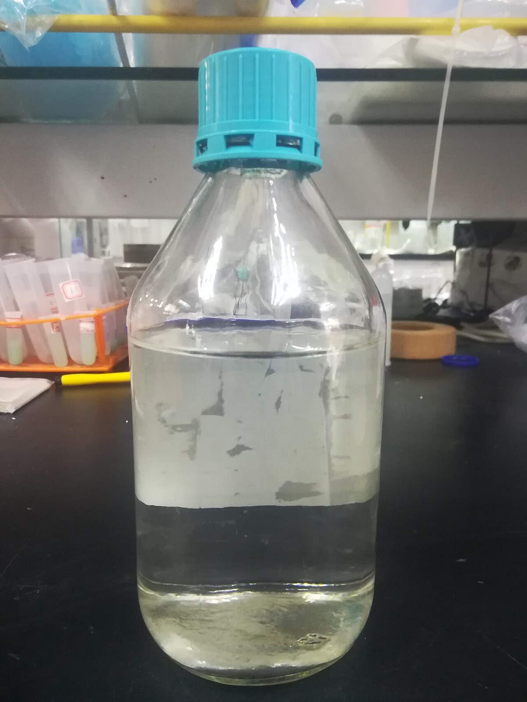

(ch:ch12)=

# Chapter 12 Acids and Bases

```{note} Opening Essay

Formerly there were rather campy science-fiction television shows in which the hero was always being threatened with death by being plunged into a vat of boiling acid: “Mwa ha ha, Buck Rogers [or whatever the hero’s name was], prepare to meet your doom by being dropped into a vat of boiling acid!” (The hero always escapes, of course.) This may have been interesting drama but not very good chemistry. If the villain knew his/her/its science, the hero would have been dropped into a vat of boiling base.

Recall that the active component of a classic acid is the H<sup>+</sup> ion, while the active part of a classic base is the OH<sup>−</sup> ion. Both ions are related to water in that all H<sup>+</sup> ion needs to become a water molecule is an OH<sup>−</sup> ion, while all an OH<sup>−</sup> ion needs to become water is an H<sup>+</sup> ion. Consider the relative masses involved: an ion of mass 1 needs an ion of mass 17 to make water, while an ion of mass 17 needs an ion of mass 1 to make water. Which process do you think will be easier?

In fact, bases are more potentially dangerous than acids because it is much easier for an OH<sup>−</sup> ion to rip off an H<sup>+</sup> ion from surrounding matter than it is for an H<sup>+</sup> ion to rip off an OH<sup>−</sup> ion. Certain household chemicals, such as some brands of cleanser, can be very concentrated bases, which makes them among the most potentially hazardous substances found around the home; if spilled on the skin, the strong caustic compound can immediately remove H<sup>+</sup> ions from the flesh, resulting in chemical burns. Compare that to the fact that we occasionally purposefully ingest substances such as citrus fruits, vinegar, and wine—all of which contain acids. (Of course, some parts of the body, such as the eyes, are extremely sensitive to acids as well as bases.) It seems that our bodies are more capable of dealing with acids than with bases.

So a note to all the villains out there: get your chemistry right if you want to be successful!
```

```{figure} ../images/restored/vinegar.jpg
:label: fig:ch12:acid-base-products
:enumerated: false
:alt: A bottle of white wine vinegar.
:align: center
:width: 70%

**Examples of Acids and Bases.** Vinegar contains acetic acid, while aqueous ammonia is basic. The ammonia shown is a concentrated laboratory reagent, rather than a household cleaner. Chemical hazards depend on concentration and the properties of the particular substance.



Credits: [White wine vinegar — Susan Slater](https://commons.wikimedia.org/wiki/File:White_wine_vinegar.jpg), [CC BY-SA 4.0](https://creativecommons.org/licenses/by-sa/4.0); [Ammonia solution (25-28%) — Leiem](https://commons.wikimedia.org/wiki/File:Ammonia_solution_(25-28%25).jpg), [CC BY-SA 4.0](https://creativecommons.org/licenses/by-sa/4.0). Images resized for the web.
```

Acids and bases are important classes of chemical compounds. They are part of the foods and beverages we ingest, they are present in medicines and other consumer products, and they are prevalent in the world around us. In this chapter, we will focus on acids and bases and their chemistry.
