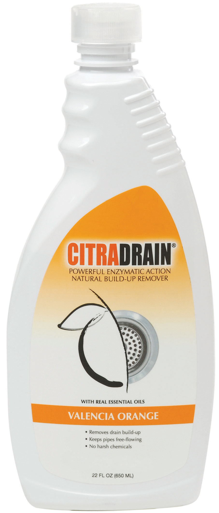

(sec:ch12:s02)=

# 12.2 Brønsted-Lowry Acids and Bases

```{note} Learning Objectives

1. Identify a Brønsted-Lowry acid and a Brønsted-Lowry base.
2. Identify conjugate acid-base pairs in an acid-base reaction.
```

The Arrhenius definition of acid and base is limited to aqueous (that is, water) solutions. Although this is useful because water is a common solvent, it is limited to the relationship between the H<sup>+</sup> ion and the OH<sup>−</sup> ion. What would be useful is a more general definition that would be more applicable to other chemical reactions and, importantly, independent of H<sub>2</sub>O.

In 1923, Danish chemist Johannes Brønsted and English chemist Thomas Lowry independently proposed new definitions for acids and bases, ones that focus on proton transfer. A **Brønsted-Lowry acid** (*Any species that can donate a proton to another molecule.*) is any species that can donate a proton (H<sup>+</sup>) to another molecule. A **Brønsted-Lowry base** (*Any species that can accept a proton from another molecule.*) is any species that can accept a proton from another molecule. In short, a Brønsted-Lowry acid is a proton donor (PD), while a Brønsted-Lowry base is a proton acceptor (PA).

It is easy to see that the Brønsted-Lowry definition covers the Arrhenius definition of acids and bases. Consider the prototypical Arrhenius acid-base reaction:

$$
\underset{\text{acid}}{{\text{H}}^{\text{+}}\text{(aq)}}+\underset{\text{base}}{{\text{OH}}^{-}\text{(aq)}}\,\rightarrow{}\,{\text{H}}_{\text{2}}\text{O(}\ell{}\text{)}
$$

The acid species and base species are marked. The proton, however, is (by definition) a proton donor (labeled PD), while the OH<sup>−</sup> ion is acting as the proton acceptor (labeled PA):

$$
\underset{\text{PD}}{{\text{H}}^{\text{+}}\text{(aq)}}+\underset{\text{PA}}{{\text{OH}}^{-}\text{(aq)}}\,\rightarrow{}\,{\text{H}}_{\text{2}}\text{O(}\ell{}\text{)}
$$

The proton donor is a Brønsted-Lowry acid, and the proton acceptor is the Brønsted-Lowry base:

$$
\underset{\text{BL acid}}{{\text{H}}^{\text{+}}\text{(aq)}}+\underset{\text{BL base}}{{\text{OH}}^{-}\text{(aq)}}\,\rightarrow{}\,{\text{H}}_{\text{2}}\text{O(}\ell{}\text{)}
$$

Thus H<sup>+</sup> is an acid by both definitions, and OH<sup>−</sup> is a base by both definitions.

Ammonia (NH<sub>3</sub>) is a base even though it does not contain OH<sup>−</sup> ions in its formula. Instead, it generates OH<sup>−</sup> ions as the product of a proton-transfer reaction with H<sub>2</sub>O molecules; NH<sub>3</sub> acts like a Brønsted-Lowry base, and H<sub>2</sub>O acts like a Brønsted-Lowry acid:

```{figure} ../images/figures/fe587563b5bf2cc22e014ffeb1c3ac8c.jpg
:label: fig:fwk:ball:eq12:001
:alt: "12.2 Brønsted-Lowry Acids and Bases"
:align: center
:width: 85%

12.2 Brønsted-Lowry Acids and Bases
```

A reaction with water is called **hydrolysis** (*A reaction with water.*); we say that NH<sub>3</sub> hydrolyzes to make NH<sub>4</sub><sup>+</sup> ions and OH<sup>−</sup> ions.

Even the dissolving of an Arrhenius acid in water can be considered a Brønsted-Lowry acid-base reaction. Consider the process of dissolving HCl(g) in water to make an aqueous solution of hydrochloric acid. The process can be written as follows:

$$
\text{HCl(g) + H2O(}\ell{}\text{) }\rightarrow{}\text{ H3O+(aq) + Cl}-\text{(aq)}
$$

HCl(g) is the proton donor and therefore a Brønsted-Lowry acid, while H<sub>2</sub>O is the proton acceptor and a Brønsted-Lowry base. These two examples show that H<sub>2</sub>O can act as both a proton donor and a proton acceptor, depending on what other substance is in the chemical reaction. A substance that can act as a proton donor or a proton acceptor is called **amphiprotic** (*A substance that can act as a proton donor or a proton acceptor.*). Water is probably the most common amphiprotic substance we will encounter, but other substances are also amphiprotic.

```{exercise}
:label: ex:ball-ch12-s02-n02

**Example 3**

Identify the Brønsted-Lowry acid and the Brønsted-Lowry base in this chemical equation.

$\text{C6H5OH + NH2}-\text{ }\rightarrow{}\text{ C6H5O}-\text{ + NH3}$
```

```{solution} ex:ball-ch12-s02-n02
:label: sol:ball-ch12-s02-n02
:class: dropdown

The C<sub>6</sub>H<sub>5</sub>OH molecule is losing an H<sup>+</sup>; it is the proton donor and the Brønsted-Lowry acid. The NH<sub>2</sub><sup>−</sup> ion (called the amide ion) is accepting the H<sup>+</sup> ion to become NH<sub>3</sub>, so it is the Brønsted-Lowry base.
```

```{exercise}
:label: ex:ball-ch12-s02-n02-ty2

**Test Yourself**

Identify the Brønsted-Lowry acid and the Brønsted-Lowry base in this chemical equation.

$\text{Al(H2O)63+ + H2O }\rightarrow{}\text{ Al(H2O)5(OH)2+ + H3O+}$
```

```{solution} ex:ball-ch12-s02-n02-ty2
:label: sol:ball-ch12-s02-n02-ty2
:class: dropdown

Brønsted-Lowry acid: Al(H<sub>2</sub>O)<sub>6</sub><sup>3+</sup>; Brønsted-Lowry base: H<sub>2</sub>O
```

In the reaction between NH<sub>3</sub> and H<sub>2</sub>O,

```{figure} ../images/figures/7331d1cf4d1fd47f1ce9323fcdfcb2f4.jpg
:label: fig:fwk:ball:eq12:002
:alt: "12.2 Brønsted-Lowry Acids and Bases"
:align: center
:width: 85%

12.2 Brønsted-Lowry Acids and Bases
```

the chemical reaction does not go to completion; rather, the reverse process occurs as well, and eventually the two processes cancel out any additional change. At this point, we say the chemical reaction is at *equilibrium*. Both processes still occur, but any net change by one process is countered by the same net change by the other process; it is a *dynamic*, rather than a *static*, equilibrium. Because both reactions are occurring, it makes sense to use a double arrow instead of a single arrow:

```{figure} ../images/figures/a17c44af6b17de2f54385c9a7486500c.jpg
:label: fig:fwk:ball:eq12:003
:alt: "12.2 Brønsted-Lowry Acids and Bases"
:align: center
:width: 85%

12.2 Brønsted-Lowry Acids and Bases
```

What do you notice about the reverse reaction? The NH<sub>4</sub><sup>+</sup> ion is donating a proton to the OH<sup>−</sup> ion, which is accepting it. This means that the NH<sub>4</sub><sup>+</sup> ion is acting as the proton donor, or Brønsted-Lowry acid, while OH<sup>−</sup> ion, the proton acceptor, is acting as a Brønsted-Lowry base. The reverse reaction is also a Brønsted-Lowry acid base reaction:

```{figure} ../images/figures/3765cabac9591a0fb3dd5878f56075e2.jpg
:label: fig:fwk:ball:eq12:004
:alt: "12.2 Brønsted-Lowry Acids and Bases"
:align: center
:width: 85%

12.2 Brønsted-Lowry Acids and Bases
```

This means that both reactions are acid-base reactions by the Brønsted-Lowry definition. If you consider the species in this chemical reaction, two sets of similar species exist on both sides. Within each set, the two species differ by a proton in their formulas, and one member of the set is a Brønsted-Lowry acid, while the other member is a Brønsted-Lowry base. These sets are marked here:

```{figure} ../images/figures/0e94b769adfd910bc0655f23121b0cf6.jpg
:label: fig:fwk:ball:eq12:005
:alt: "12.2 Brønsted-Lowry Acids and Bases"
:align: center
:width: 85%

12.2 Brønsted-Lowry Acids and Bases
```

The two sets—NH<sub>3</sub>/NH<sub>4</sub><sup>+</sup> and H<sub>2</sub>O/OH<sup>−</sup>—are called **conjugate acid-base pairs** (*Two species whose formulas differ by only a hydrogen ion.*). We say that NH<sub>4</sub><sup>+</sup> is the conjugate acid of NH<sub>3</sub>, OH<sup>−</sup> is the conjugate base of H<sub>2</sub>O, and so forth. Every Brønsted-Lowry acid-base reaction can be labeled with two conjugate acid-base pairs.

```{exercise}
:label: ex:ball-ch12-s02-n03

**Example 4**

Identify the conjugate acid-base pairs in this equilibrium.

$$
{{\text{(CH}}_{\text{3}}\text{)}}_{\text{3}}{\text{N + H}}_{\text{2}}\text{O}\rightleftarrows{}{{\text{(CH}}_{\text{3}}\text{)}}_{\text{3}}{\text{NH}}^{\text{+}}{\text{ + OH}}^{-}
$$
```

```{solution} ex:ball-ch12-s02-n03
:label: sol:ball-ch12-s02-n03
:class: dropdown

One pair is H<sub>2</sub>O and OH<sup>−</sup>, where H<sub>2</sub>O has one more H<sup>+</sup> and is the conjugate acid, while OH<sup>−</sup> has one less H<sup>+</sup> and is the conjugate base. The other pair consists of (CH<sub>3</sub>)<sub>3</sub>N and (CH<sub>3</sub>)<sub>3</sub>NH<sup>+</sup>, where (CH<sub>3</sub>)<sub>3</sub>NH<sup>+</sup> is the conjugate acid (it has an additional proton) and (CH<sub>3</sub>)<sub>3</sub>N is the conjugate base.
```

```{exercise}
:label: ex:ball-ch12-s02-n03-ty2

**Test Yourself**

Identify the conjugate acid-base pairs in this equilibrium.

$$
{\text{NH}}_{\text{2}}{}^{-}{\text{ + H}}_{\text{2}}\text{O}\rightleftarrows{}{\text{NH}}_{\text{3}}{\text{ + OH}}^{-}
$$
```

```{solution} ex:ball-ch12-s02-n03-ty2
:label: sol:ball-ch12-s02-n03-ty2
:class: dropdown

H<sub>2</sub>O (acid) and OH<sup>−</sup> (base); NH<sub>2</sub><sup>−</sup> (base) and NH<sub>3</sub> (acid)
```

```{tip} Chemistry Is Everywhere: Household Acids and Bases

Many household products are acids or bases. For example, the owner of a swimming pool may use muriatic acid to clean the pool. Muriatic acid is another name for HCl(aq). In {ref}`Chapter 4 "Chemical Reactions and Equations" <ch:ch04>`, {ref}`Section 4.5 "Neutralization Reactions" <sec:ch04:s05>`, vinegar was mentioned as a dilute solution of acetic acid [HC<sub>2</sub>H<sub>3</sub>O<sub>2</sub>(aq)]. In a medicine chest, one may find a bottle of vitamin C tablets; the chemical name of vitamin C is ascorbic acid (HC<sub>6</sub>H<sub>7</sub>O<sub>6</sub>).

One of the more familiar household bases is NH<sub>3</sub>, which is found in numerous cleaning products. NH<sub>3</sub> is a base because it increases the OH<sup>−</sup> ion concentration by reacting with H<sub>2</sub>O:

$\text{NH3(aq) + H2O(}\ell{}\text{) }\rightarrow{}\text{ NH4+(aq) + OH}-\text{(aq)}$

Many soaps are also slightly basic because they contain compounds that act as Brønsted-Lowry bases, accepting protons from H<sub>2</sub>O and forming excess OH<sup>−</sup> ions. This is one explanation for why soap solutions are slippery.

Perhaps the most dangerous household chemical is the lye-based drain cleaner. Lye is a common name for NaOH, although it is also used as a synonym for KOH. Lye is an extremely caustic chemical that can react with grease, hair, food particles, and other substances that may build up and clog a water pipe. Unfortunately, lye can also attack body tissues and other substances in our bodies. Thus when we use lye-based drain cleaners, we must be very careful not to touch any of the solid drain cleaner or spill the water it was poured into. Safer, nonlye drain cleaners (like the one in the accompanying figure) use peroxide compounds to react on the materials in the clog and clear the drain.



*Drain cleaners can be made from a reactive material that is less caustic than a base.*
```

```{important} Key Takeaways

- A Brønsted-Lowry acid is a proton donor; a Brønsted-Lowry base is a proton acceptor.
- Acid-base reactions include two sets of conjugate acid-base pairs.
```

## Exercises

```{exercise}
:label: ex:ball-ch12-s02-qs01-qd01-qa01

**Exercise 1.**

Define *Brønsted-Lowry acid*. How does it differ from an Arrhenius acid?
```

```{solution} ex:ball-ch12-s02-qs01-qd01-qa01
:label: sol:ball-ch12-s02-qs01-qd01-qa01
:class: dropdown

A Brønsted-Lowry acid is a proton donor. It does not necessarily increase the H<sup>+</sup> concentration in water.
```

```{exercise}
:label: ex:ball-ch12-s02-qs01-qd01-qa02

**Exercise 2.**

Define *Brønsted-Lowry base*. How does it differ from an Arrhenius base?
```

```{exercise}
:label: ex:ball-ch12-s02-qs01-qd01-qa03

**Exercise 3.**

Write the dissociation of hydrogen bromide in water as a Brønsted-Lowry acid-base reaction and identify the proton donor and proton acceptor.
```

```{solution} ex:ball-ch12-s02-qs01-qd01-qa03
:label: sol:ball-ch12-s02-qs01-qd01-qa03
:class: dropdown

HBr + H<sub>2</sub>O → H<sub>3</sub>O<sup>+</sup> + Br<sup>−</sup>; PD: HBr; PA: H<sub>2</sub>O
```

```{exercise}
:label: ex:ball-ch12-s02-qs01-qd01-qa04

**Exercise 4.**

Write the dissociation of nitric acid in water as a Brønsted-Lowry acid-base reaction and identify the proton donor and proton acceptor.
```

```{exercise}
:label: ex:ball-ch12-s02-qs01-qd01-qa05

**Exercise 5.**

Pyridine (C<sub>5</sub>H<sub>5</sub>N) acts as a Brønsted-Lowry base in water. Write the hydrolysis reaction for pyridine and identify the Brønsted-Lowry acid and Brønsted-Lowry base.
```

```{solution} ex:ball-ch12-s02-qs01-qd01-qa05
:label: sol:ball-ch12-s02-qs01-qd01-qa05
:class: dropdown

C<sub>5</sub>H<sub>5</sub>N + H<sub>2</sub>O → C<sub>5</sub>H<sub>5</sub>NH<sup>+</sup> + OH<sup>−</sup>; PD: H<sub>2</sub>O; PA: C<sub>5</sub>H<sub>5</sub>N
```

```{exercise}
:label: ex:ball-ch12-s02-qs01-qd01-qa06

**Exercise 6.**

The methoxide ion (CH<sub>3</sub>O<sup>−</sup>) acts as a Brønsted-Lowry base in water. Write the hydrolysis reaction for the methoxide ion and identify the Brønsted-Lowry acid and Brønsted-Lowry base.
```

```{exercise}
:label: ex:ball-ch12-s02-qs01-qd01-qa07

**Exercise 7.**

Identify the Brønsted-Lowry acid and Brønsted-Lowry base in this chemical equation.

$\text{H3PO4 + OH}-\text{ }\rightarrow{}\text{ H2PO4}-\text{ + H2O}$
```

```{solution} ex:ball-ch12-s02-qs01-qd01-qa07
:label: sol:ball-ch12-s02-qs01-qd01-qa07
:class: dropdown

BL acid: H<sub>3</sub>PO<sub>4</sub>; BL base: OH<sup>−</sup>
```

```{exercise}
:label: ex:ball-ch12-s02-qs01-qd01-qa08

**Exercise 8.**

Identify the Brønsted-Lowry acid and Brønsted-Lowry base in this chemical equation.

$\text{H2C2O4 + 2F}-\text{ }\rightarrow{}\text{ 2HF + C2O42}-$
```

```{exercise}
:label: ex:ball-ch12-s02-qs01-qd01-qa09

**Exercise 9.**

Predict the products of this reaction, assuming it undergoes a Brønsted-Lowry acid-base reaction.

$\text{HC2H3O2 + C5H5N }\rightarrow{}\text{ ?}$
```

```{solution} ex:ball-ch12-s02-qs01-qd01-qa09
:label: sol:ball-ch12-s02-qs01-qd01-qa09
:class: dropdown

C<sub>2</sub>H<sub>3</sub>O<sub>2</sub><sup>−</sup> and C<sub>5</sub>H<sub>5</sub>NH<sup>+</sup>
```

```{exercise}
:label: ex:ball-ch12-s02-qs01-qd01-qa10

**Exercise 10.**

Predict the products of this reaction, assuming it undergoes a Brønsted-Lowry acid-base reaction.

$\text{(C2H5)3N + H2O }\rightarrow{}\text{ ?}$
```

```{exercise}
:label: ex:ball-ch12-s02-qs01-qd01-qa11

**Exercise 11.**

What is the conjugate acid of H<sub>2</sub>O? of NH<sub>3</sub>?
```

```{solution} ex:ball-ch12-s02-qs01-qd01-qa11
:label: sol:ball-ch12-s02-qs01-qd01-qa11
:class: dropdown

H<sub>3</sub>O<sup>+</sup>; NH<sub>4</sub><sup>+</sup>
```

```{exercise}
:label: ex:ball-ch12-s02-qs01-qd01-qa12

**Exercise 12.**

What is the conjugate acid of H<sub>2</sub>PO<sub>4</sub><sup>−</sup>? of NO<sub>3</sub><sup>−</sup>?
```

```{exercise}
:label: ex:ball-ch12-s02-qs01-qd01-qa13

**Exercise 13.**

What is the conjugate base of HSO<sub>4</sub><sup>−</sup>? of H<sub>2</sub>O?
```

```{solution} ex:ball-ch12-s02-qs01-qd01-qa13
:label: sol:ball-ch12-s02-qs01-qd01-qa13
:class: dropdown

SO<sub>4</sub><sup>2−</sup>; OH<sup>−</sup>
```

```{exercise}
:label: ex:ball-ch12-s02-qs01-qd01-qa14

**Exercise 14.**

What is the conjugate base of H<sub>3</sub>O<sup>+</sup>? of H<sub>2</sub>SO<sub>4</sub>?
```

```{exercise}
:label: ex:ball-ch12-s02-qs01-qd01-qa15

**Exercise 15.**

Identify the conjugate acid-base pairs in this reaction.

$\text{HSO4}-\text{ + PO43}-\text{ }\rightarrow{}\text{ SO42}-\text{ + HPO42}-$
```

```{solution} ex:ball-ch12-s02-qs01-qd01-qa15
:label: sol:ball-ch12-s02-qs01-qd01-qa15
:class: dropdown

HSO<sub>4</sub><sup>−</sup> and SO<sub>4</sub><sup>2−</sup>; PO<sub>4</sub><sup>3−</sup> and HPO<sub>4</sub><sup>2−</sup>
```

```{exercise}
:label: ex:ball-ch12-s02-qs01-qd01-qa16

**Exercise 16.**

Identify the conjugate acid-base pairs in this reaction.

$\text{HClO3 + (C2H5)3N }\rightarrow{}\text{ ClO3}-\text{ + (C2H5)3NH+}$
```

```{exercise}
:label: ex:ball-ch12-s02-qs01-qd01-qa17

**Exercise 17.**

Identify the conjugate acid-base pairs in this reaction.

$\text{NH3 + C6H5O}-\text{ }\rightarrow{}\text{ C6H5OH + NH2}-$
```

```{solution} ex:ball-ch12-s02-qs01-qd01-qa17
:label: sol:ball-ch12-s02-qs01-qd01-qa17
:class: dropdown

NH<sub>3</sub> and NH<sub>2</sub><sup>−</sup>; C<sub>6</sub>H<sub>5</sub>O<sup>−</sup> and C<sub>6</sub>H<sub>5</sub>OH
```

```{exercise}
:label: ex:ball-ch12-s02-qs01-qd01-qa18

**Exercise 18.**

Identify the conjugate acid-base pairs in this reaction.

$\text{C5H5NH+ + C2O42}-\text{ }\rightarrow{}\text{ C5H5N + HC2O4}-$
```
