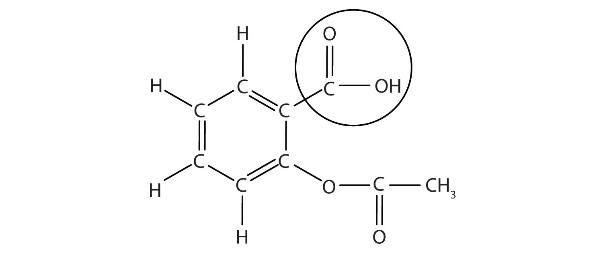

(sec:ch12:s07)=

# 12.7 Buffers

```{note} Learning Objectives

1. Define *buffer*.
2. Correctly identify the two components of a buffer.
```

As indicated in {ref}`Section 12.4 "Strong and Weak Acids and Bases and Their Salts" <sec:ch12:s04>`, weak acids are relatively common, even in the foods we eat. But we occasionally encounter a strong acid or base, such as stomach acid, which has a strongly acidic pH of 1.7. By definition, strong acids and bases can produce a relatively large amount of H<sup>+</sup> or OH<sup>−</sup> ions and consequently have marked chemical activities. In addition, very small amounts of strong acids and bases can change the pH of a solution very quickly. If 1 mL of stomach acid [approximated as 0.1 M HCl(aq)] were added to the bloodstream and no correcting mechanism were present, the pH of the blood would decrease from about 7.4 to about 4.7—a pH that is not conducive to continued living. Fortunately, the body has a mechanism for minimizing such dramatic pH changes.

The mechanism involves a **buffer** (*A solution that resists dramatic changes in pH.*), a solution that resists dramatic changes in pH. Buffers do so by being composed of certain pairs of solutes: either a weak acid plus a salt derived from that weak acid or a weak base plus a salt of that weak base. For example, a buffer can be composed of dissolved HC<sub>2</sub>H<sub>3</sub>O<sub>2</sub> (a weak acid) and NaC<sub>2</sub>H<sub>3</sub>O<sub>2</sub> (the salt derived from that weak acid). Another example of a buffer is a solution containing NH<sub>3</sub> (a weak base) and NH<sub>4</sub>Cl (a salt derived from that weak base).

Let us use an HC<sub>2</sub>H<sub>3</sub>O<sub>2</sub>/NaC<sub>2</sub>H<sub>3</sub>O<sub>2</sub> buffer to demonstrate how buffers work. If a strong base—a source of OH<sup>−</sup>(aq) ions—is added to the buffer solution, those OH<sup>−</sup> ions will react with the HC<sub>2</sub>H<sub>3</sub>O<sub>2</sub> in an acid-base reaction:

$$
\text{HC}_{2}\text{H}_{3}\text{O}_{2}\text{(aq) + OH}^{-}\text{(aq) }\rightarrow{}\text{ H}_{2}\text{O(}\ell{}\text{) + C}_{2}\text{H}_{3}\text{O}_{2}^{-}\text{(aq)}
$$

Rather than changing the pH dramatically by making the solution basic, the added OH<sup>−</sup> ions react to make H<sub>2</sub>O, so the pH does not change much.

If a strong acid—a source of H<sup>+</sup> ions—is added to the buffer solution, the H<sup>+</sup> ions will react with the anion from the salt. Because HC<sub>2</sub>H<sub>3</sub>O<sub>2</sub> is a weak acid, it is not ionized much. This means that if lots of H<sup>+</sup> ions and C<sub>2</sub>H<sub>3</sub>O<sub>2</sub><sup>−</sup> ions are present in the same solution, they will come together to make HC<sub>2</sub>H<sub>3</sub>O<sub>2</sub>:

$$
\text{H}^{+}\text{(aq) + C}_{2}\text{H}_{3}\text{O}_{2}^{-}\text{(aq) }\rightarrow{}\text{ HC}_{2}\text{H}_{3}\text{O}_{2}\text{(aq)}
$$

Rather than changing the pH dramatically and making the solution acidic, the added H<sup>+</sup> ions react to make molecules of a weak acid. {ref}`Figure 12.2 "The Actions of Buffers" <fig:ch12:s07:f01>` illustrates both actions of a buffer.

```{figure} ../images/figures/b4906b38ce48617dd31b42a4c0ba440c.jpg
:label: fig:ch12:s07:f01
:alt: "The Actions of Buffers. Buffers can react with both strong acids (top) and strong bases (side) to minimize large changes in pH."
:align: center
:width: 85%

The Actions of Buffers. Buffers can react with both strong acids (top) and strong bases (side) to minimize large changes in pH.
```

Buffers made from weak bases and salts of weak bases act similarly. For example, in a buffer containing NH<sub>3</sub> and NH<sub>4</sub>Cl, NH<sub>3</sub> molecules can react with any excess H<sup>+</sup> ions introduced by strong acids:

$$
\text{NH}_{3}\text{(aq) + H}^{+}\text{(aq) }\rightarrow{}\text{ NH}_{4}^{+}\text{(aq)}
$$

while the NH<sub>4</sub><sup>+</sup>(aq) ion can react with any OH<sup>−</sup> ions introduced by strong bases:

$$
\text{NH}_{4}^{+}\text{(aq) + OH}^{-}\text{(aq) }\rightarrow{}\text{ NH}_{3}\text{(aq) + H}_{2}\text{O(}\ell{}\text{)}
$$

```{exercise}
:label: ex:ball-ch12-s07-n02

**Example 15**

Which combinations of compounds can make a buffer solution?

1. HCHO<sub>2</sub> and NaCHO<sub>2</sub>
2. HCl and NaCl
3. CH<sub>3</sub>NH<sub>2</sub> and CH<sub>3</sub>NH<sub>3</sub>Cl
4. NH<sub>3</sub> and NaOH
```

```{solution} ex:ball-ch12-s07-n02
:label: sol:ball-ch12-s07-n02
:class: dropdown

1. HCHO<sub>2</sub> is formic acid, a weak acid, while NaCHO<sub>2</sub> is the salt made from the anion of the weak acid (the formate ion [CHO<sub>2</sub><sup>−</sup>]). The combination of these two solutes would make a buffer solution.
2. HCl is a strong acid, not a weak acid, so the combination of these two solutes would not make a buffer solution.
3. CH<sub>3</sub>NH<sub>2</sub> is methylamine, which is like NH<sub>3</sub> with one of its H atoms substituted with a CH<sub>3</sub> group. Because it is not listed in {ref}`Table 12.2 "Strong Acids and Bases" <tbl:ch12:s04:t01>`, we can assume that it is a weak base. The compound CH<sub>3</sub>NH<sub>3</sub>Cl is a salt made from that weak base, so the combination of these two solutes would make a buffer solution.
4. NH<sub>3</sub> is a weak base, but NaOH is a strong base. The combination of these two solutes would not make a buffer solution.
```

```{exercise}
:label: ex:ball-ch12-s07-n02-ty2

**Test Yourself**

Which combinations of compounds can make a buffer solution?

1. NaHCO<sub>3</sub> and NaCl
2. H<sub>3</sub>PO<sub>4</sub> and NaH<sub>2</sub>PO<sub>4</sub>
3. NH<sub>3</sub> and (NH<sub>4</sub>)<sub>3</sub>PO<sub>4</sub>
4. NaOH and NaCl
```

```{solution} ex:ball-ch12-s07-n02-ty2
:label: sol:ball-ch12-s07-n02-ty2
:class: dropdown

1. no
2. yes
3. yes
4. no
```

Buffers work well only for limited amounts of added strong acid or base. Once either solute is completely reacted, the solution is no longer a buffer, and rapid changes in pH may occur. We say that a buffer has a certain **capacity** (*The amount of strong acid or base a buffer can counteract.*). Buffers that have more solute dissolved in them to start with have larger capacities, as might be expected.

Human blood has a buffering system to minimize extreme changes in pH. One buffer in blood is based on the presence of HCO<sub>3</sub><sup>−</sup> and H<sub>2</sub>CO<sub>3</sub> [the second compound is another way to write CO<sub>2</sub>(aq)]. With this buffer present, even if some stomach acid were to find its way directly into the bloodstream, the change in the pH of blood would be minimal. Inside many of the body’s cells, there is a buffering system based on phosphate ions.

```{tip} Food and Drink App: The Acid That Eases Pain

Although medicines are not exactly “food and drink,” we do ingest them, so let’s take a look at an acid that is probably the most common medicine: acetylsalicylic acid, also known as aspirin. Aspirin is well known as a pain reliever and antipyretic (fever reducer).

The structure of aspirin is shown in the accompanying figure. The acid part is circled; it is the H atom in that part that can be donated as aspirin acts as a Brønsted-Lowry acid. Because it is not given in {ref}`Table 12.2 "Strong Acids and Bases" <tbl:ch12:s04:t01>`, acetylsalicylic acid is a weak acid. However, it is still an acid, and given that some people consume relatively large amounts of aspirin daily, its acidic nature can cause problems in the stomach lining, despite the stomach’s defenses against its own stomach acid.

(fig:ch12:s07:f02)=



*The Molecular Structure of Aspirin. The circled atoms are the acid part of the molecule.*

Because the acid properties of aspirin may be problematic, many aspirin brands offer a “buffered aspirin” form of the medicine. In these cases, the aspirin also contains a buffering agent—usually MgO—that regulates the acidity of the aspirin to minimize its acidic side effects.

As useful and common as aspirin is, it was formally marketed as a drug starting in 1899. The US Food and Drug Administration (FDA), the governmental agency charged with overseeing and approving drugs in the United States, wasn’t formed until 1906. Some have argued that if the FDA had been formed before aspirin was introduced, aspirin may never have gotten approval due to its potential for side effects—gastrointestinal bleeding, ringing in the ears, Reye’s syndrome (a liver problem), and some allergic reactions. However, recently aspirin has been touted for its effects in lessening heart attacks and strokes, so it is likely that aspirin is here to stay.
```

```{important} Key Takeaway

- A buffer is a solution that resists sudden changes in pH.
```

## Exercises

```{exercise}
:label: ex:ball-ch12-s07-qs01-qd01-qa01

**Exercise 1.**

Define *buffer*. What two related chemical components are required to make a buffer?
```

```{solution} ex:ball-ch12-s07-qs01-qd01-qa01
:label: sol:ball-ch12-s07-qs01-qd01-qa01
:class: dropdown

A buffer is the combination of a weak acid or base and a salt of that weak acid or base.
```

```{exercise}
:label: ex:ball-ch12-s07-qs01-qd01-qa02

**Exercise 2.**

Can a buffer be made by combining a strong acid with a strong base? Why or why not?
```

```{exercise}
:label: ex:ball-ch12-s07-qs01-qd01-qa03

**Exercise 3.**

Which combinations of compounds can make a buffer? Assume aqueous solutions.

a. HCl and NaCl
b. HNO<sub>2</sub> and NaNO<sub>2</sub>
c. NH<sub>4</sub>NO<sub>3</sub> and HNO<sub>3</sub>
d. NH<sub>4</sub>NO<sub>3</sub> and NH<sub>3</sub>
```

```{solution} ex:ball-ch12-s07-qs01-qd01-qa03
:label: sol:ball-ch12-s07-qs01-qd01-qa03
:class: dropdown

a. no
b. yes
c. no
d. yes
```

```{exercise}
:label: ex:ball-ch12-s07-qs01-qd01-qa04

**Exercise 4.**

Which combinations of compounds can make a buffer? Assume aqueous solutions.

a. H<sub>3</sub>PO<sub>4</sub> and Na<sub>3</sub>PO<sub>4</sub>
b. NaHCO<sub>3</sub> and Na<sub>2</sub>CO<sub>3</sub>
c. NaNO<sub>3</sub> and Ca(NO<sub>3</sub>)<sub>2</sub>
d. HN<sub>3</sub> and NH<sub>3</sub>
```

```{exercise}
:label: ex:ball-ch12-s07-qs01-qd01-qa05

**Exercise 5.**

For each combination in Exercise 3 that is a buffer, write the chemical equations for the reactions of the buffer components when a strong acid and a strong base is added.
```

```{solution} ex:ball-ch12-s07-qs01-qd01-qa05
:label: sol:ball-ch12-s07-qs01-qd01-qa05
:class: dropdown

3b: strong acid: NO<sub>2</sub><sup>−</sup> + H<sup>+</sup> → HNO<sub>2</sub>; strong base: HNO<sub>2</sub> + OH<sup>−</sup> → NO<sub>2</sub><sup>−</sup> + H<sub>2</sub>O; 3d: strong base: NH<sub>4</sub><sup>+</sup> + OH<sup>−</sup> → NH<sub>3</sub> + H<sub>2</sub>O; strong acid: NH<sub>3</sub> + H<sup>+</sup> → NH<sub>4</sub><sup>+</sup>
```

```{exercise}
:label: ex:ball-ch12-s07-qs01-qd01-qa06

**Exercise 6.**

For each combination in Exercise 4 that is a buffer, write the chemical equations for the reactions of the buffer components when a strong acid and a strong base is added.
```

```{exercise}
:label: ex:ball-ch12-s07-qs01-qd01-qa07

**Exercise 7.**

The complete phosphate buffer system is based on four substances: H<sub>3</sub>PO<sub>4</sub>, H<sub>2</sub>PO<sub>4</sub><sup>−</sup>, HPO<sub>4</sub><sup>2−</sup>, and PO<sub>4</sub><sup>3−</sup>. What different buffer solutions can be made from these substances?
```

```{solution} ex:ball-ch12-s07-qs01-qd01-qa07
:label: sol:ball-ch12-s07-qs01-qd01-qa07
:class: dropdown

Buffers can be made from three combinations: (1) H<sub>3</sub>PO<sub>4</sub> and H<sub>2</sub>PO<sub>4</sub><sup>−</sup>, (2) H<sub>2</sub>PO<sub>4</sub><sup>−</sup> and HPO<sub>4</sub><sup>2−</sup>, and (3) HPO<sub>4</sub><sup>2−</sup> and PO<sub>4</sub><sup>3−</sup>. (Technically, a buffer can be made from any two components.)
```

```{exercise}
:label: ex:ball-ch12-s07-qs01-qd01-qa08

**Exercise 8.**

Explain why NaBr cannot be a component in either an acidic or a basic buffer.
```

```{exercise}
:label: ex:ball-ch12-s07-qs01-qd01-qa09

**Exercise 9.**

Two solutions are made containing the same concentrations of solutes. One solution is composed of H<sub>3</sub>PO<sub>4</sub> and Na<sub>3</sub>PO<sub>4</sub>, while the other is composed of HCN and NaCN. Which solution should have the larger capacity as a buffer?
```

```{solution} ex:ball-ch12-s07-qs01-qd01-qa09
:label: sol:ball-ch12-s07-qs01-qd01-qa09
:class: dropdown

The phosphate buffer should have the larger capacity.
```

```{exercise}
:label: ex:ball-ch12-s07-qs01-qd01-qa10

**Exercise 10.**

Two solutions are made containing the same concentrations of solutes. One solution is composed of NH<sub>3</sub> and NH<sub>4</sub>NO<sub>3</sub>, while the other is composed of H<sub>2</sub>SO<sub>4</sub> and Na<sub>2</sub>SO<sub>4</sub>. Which solution should have the larger capacity as a buffer?
```
