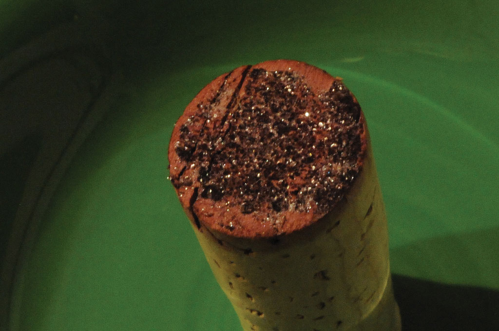

(sec:ch13:s05)=

# 13.5 Some Special Types of Equilibria

```{note} Learning Objective

1. Identify several special chemical equilibria and construct their *K*<sub>a</sub> expressions.
```

In one sense, all chemical equilibria are treated the same. However, there are several classes of reactions that are noteworthy because of either the identities of the reactants and products or the form of the *K*<sub>eq</sub> expression.

(sec:ch13:s05:s01)=

## Weak Acids and Bases

In {ref}`Chapter 12 "Acids and Bases" <ch:ch12>`, we noted how some acids and bases are strong and some are weak. If an acid or base is strong, it is ionized 100% in H<sub>2</sub>O. HCl(aq) is an example of a strong acid:

$$
\text{HCl(aq) }\xrightarrow{100\%}{\text{ H}}^{+}{\text{(aq)  +  Cl}}^{-}\text{(aq)}
$$

However, if an acid or base is weak, it may dissolve in H<sub>2</sub>O but does not ionize completely. This means that there is an equilibrium between the unionized acid or base and the ionized form. HC<sub>2</sub>H<sub>3</sub>O<sub>2</sub> is an example of a weak acid:

$$
{\text{HC}}_{\text{2}}{\text{H}}_{\text{3}}{\text{O}}_{\text{2}}\text{(aq)}\rightleftarrows{}{\text{H}}^{\text{+}}{\text{(aq) + C}}_{\text{2}}{\text{H}}_{\text{3}}{\text{O}}_{\text{2}}{}^{-}\text{(aq)}
$$

HC<sub>2</sub>H<sub>3</sub>O<sub>2</sub> is soluble in H<sub>2</sub>O (in fact, it is the acid in vinegar), so the reactant concentration will appear in the equilibrium constant expression. But not all the molecules separate into ions. This is the case for all weak acids and bases.

An **acid dissociation constant** (*The equilibrium constant for the dissociation of a weak acid into ions.*), *K*<sub>a</sub>, is the equilibrium constant for the dissociation of a weak acid into ions. Note the *a* subscript on the *K*; it implies that the substance is acting as an acid. The larger *K*<sub>a</sub> is, the stronger the acid is. {ref}`Table 13.1 "Acid Dissociation Constants for Some Weak Acids" <tbl:ch13:s05:s01:t01>` lists several acid dissociation constants. Keep in mind that they are just equilibrium constants.

```{table} Acid Dissociation Constants for Some Weak Acids
:label: tbl:ch13:s05:s01:t01

| Acid | *K*<sub>a</sub> |
| --- | --- |
| HC<sub>2</sub>H<sub>3</sub>O<sub>2</sub> | 1.8 × 10<sup>−5</sup> |
| HClO<sub>2</sub> | 1.1 × 10<sup>−2</sup> |
| H<sub>2</sub>PO<sub>4</sub><sup>−</sup> | 6.2 × 10<sup>−8</sup> |
| HCN | 6.2 × 10<sup>−10</sup> |
| HF | 6.3 × 10<sup>−4</sup> |
| HNO<sub>2</sub> | 5.6 × 10<sup>−4</sup> |
| H<sub>3</sub>PO<sub>4</sub> | 7.5 × 10<sup>−3</sup> |
```

Note also that the acid dissociation constant refers to *one* H<sup>+</sup> ion coming off the initial reactant. Thus the acid dissociation constant for H<sub>3</sub>PO<sub>4</sub> refers to this equilibrium:

$$
{\text{H}}_{\text{3}}{\text{PO}}_{\text{4}}\text{(aq)}\rightleftarrows{}{\text{H}}^{\text{+}}{\text{(aq) + H}}_{\text{2}}{\text{PO}}_{\text{4}}{}^{-}\text{(aq)    }{K}_{\text{a}}=7.5\times{}{10}^{-3}
$$

The H<sub>2</sub>PO<sub>4</sub><sup>−</sup> ion, called the dihydrogen phosphate ion, is also a weak acid with its own acid dissociation constant:

$$
{\text{H}}_{\text{2}}{\text{PO}}_{\text{4}}{}^{-}\text{(aq)}\rightleftarrows{}{\text{H}}^{\text{+}}{\text{(aq) + HPO}}_{\text{4}}{}^{\text{2}-}\text{(aq)    }{K}_{\text{a}}=6.2\times{}{10}^{-8}
$$

Thus for so-called *polyprotic* acids, each H<sup>+</sup> ion comes off in sequence, and each H<sup>+</sup> ion that ionizes does so with its own characteristic *K*<sub>a</sub>.

```{exercise}
:label: ex:ball-ch13-s05-s01-n01

**Example 10**

Write the equilibrium equation and the *K*<sub>a</sub> expression for HSO<sub>4</sub><sup>−</sup> acting as a weak acid.
```

```{solution} ex:ball-ch13-s05-s01-n01
:label: sol:ball-ch13-s05-s01-n01
:class: dropdown

HSO<sub>4</sub><sup>−</sup> acts as a weak acid by separating into an H<sup>+</sup> ion and an SO<sub>4</sub><sup>2−</sup> ion:

$$
{\text{HSO}}_{\text{4}}{}^{-}\text{(aq)}\rightleftarrows{}{\text{H}}^{\text{+}}{\text{(aq) + SO}}_{\text{4}}{}^{\text{2}-}\text{(aq)}
$$

The *K*<sub>a</sub> is written just like any other equilibrium constant, in terms of the concentrations of products divided by concentrations of reactants:

$$
{K}_{\text{a}}=\frac{[{\text{H}}^{+}][{\text{SO}}_{4}^{2-}]}{[{\text{HSO}}_{4}^{-}]}
$$
```

```{exercise}
:label: ex:ball-ch13-s05-s01-n01-ty2

**Test Yourself**

Write the equilibrium equation and the *K*<sub>a</sub> expression for HPO<sub>4</sub><sup>2−</sup> acting as a weak acid.
```

```{solution} ex:ball-ch13-s05-s01-n01-ty2
:label: sol:ball-ch13-s05-s01-n01-ty2
:class: dropdown

${\text{HPO}}_{\text{4}}{}^{\text{2}-}(\text{aq})\,\rightleftarrows{}\,{\text{H}}^{+}(\text{aq})\,+{\text{ PO}}_{\text{4}}{}^{\text{3}-}(\text{aq})\,\,\,\,\,\,\,\,\,\,{K}_{\text{a}}=\frac{[{\text{H}}^{+}][{\text{PO}}_{4}^{3-}]}{[{\text{HPO}}_{4}^{2-}]}$
```

The *K*<sub>a</sub> is used in equilibrium constant problems just like other equilibrium constants are. However, in some cases, we can simplify the mathematics if the numerical value of the *K*<sub>a</sub> is small, much smaller than the concentration of the acid itself. Example 11 illustrates this.

```{exercise}
:label: ex:ball-ch13-s05-s01-n02

**Example 11**

What is the pH of a 1.00 M solution of HC<sub>2</sub>H<sub>3</sub>O<sub>2</sub>? The *K*<sub>a</sub> of HC<sub>2</sub>H<sub>3</sub>O<sub>2</sub> is 1.8 × 10<sup>−5</sup>.
```

```{solution} ex:ball-ch13-s05-s01-n02
:label: sol:ball-ch13-s05-s01-n02
:class: dropdown

This is a two-part problem. We need to determine [H<sup>+</sup>] and then use the definition of pH to determine the pH of the solution. For the first part, we can use an ICE chart:

|   | HC<sub>2</sub>H<sub>3</sub>O<sub>2</sub>(aq) | $\rightleftarrows{}$ | H<sup>+</sup>(g) | + | C<sub>2</sub>H<sub>3</sub>O<sub>2</sub><sup>−</sup>(g) |
| --- | --- | --- | --- | --- | --- |
| I | 1.00 |   | 0 |   | 0 |
| C | −*x* |   | +*x* |   | +*x* |
| E | 1.00 − *x* |   | +*x* |   | +*x* |

We now construct the *K*<sub>a</sub> expression, substituting the concentrations from the equilibrium row in the ICE chart:

$$
{K}_{\text{a}}=\frac{[{\text{H}}^{+}][{\text{C}}_{\text{2}}{\text{H}}_{\text{3}}{\text{O}}_{\text{2}}{}^{-}\text{]}}{[{\text{HC}}_{\text{2}}{\text{H}}_{\text{3}}{\text{O}}_{\text{2}}]}=\frac{(x)(x)}{(1.00-x)}=1.8\times{}{10}^{-5}
$$

Here is where a useful approximation comes in: at 1.8 × 10<sup>−5</sup>, HC<sub>2</sub>H<sub>3</sub>O<sub>2</sub> will not ionize very much, so we expect that the value of *x* will be small. It should be so small that in the denominator of the fraction, the term (1.00 − *x*) will likely be very close to 1.00. As such, we would introduce very little error if we simply neglect the *x* in that term, making it equal to 1.00:

$\text{(1.00 }-\text{ }x\text{) }\approx{}\text{ 1.00 for small values of }x$

This simplifies the mathematical expression we need to solve:

$$
\frac{(x)(x)}{1.00}=1.8\times{}{10}^{-5}
$$

This is much easier to solve than a more complete quadratic equation. The new equation to solve becomes

$x^{2}\text{ = 1.8 }\times{}\text{ 10}^{-5}$

Taking the square root of both sides,

$x\text{ = 4.2 }\times{}\text{ 10}^{-3}$

Because *x* is the equilibrium concentrations of H<sup>+</sup> and C<sub>2</sub>H<sub>3</sub>O<sub>2</sub><sup>−</sup>, we thus have

$\text{[H}^{+}\text{] = 4.2 }\times{}\text{ 10}^{-3}\text{ M}$

Notice that we are justified by neglecting the *x* in the denominator; it truly is small compared to 1.00. Now we can determine the pH of the solution:

$\text{pH = }-\text{log[H}^{+}\text{] = }-\text{log(4.2 }\times{}\text{ 10}^{-3}\text{) = 2.38}$
```

```{exercise}
:label: ex:ball-ch13-s05-s01-n02-ty2

**Test Yourself**

What is the pH of a 0.500 M solution of HCN? The *K*<sub>a</sub> of HCN is 6.2 × 10<sup>−10</sup>.
```

```{solution} ex:ball-ch13-s05-s01-n02-ty2
:label: sol:ball-ch13-s05-s01-n02-ty2
:class: dropdown

4.75
```

Weak bases also have dissociation constants, labeled *K*<sub>b</sub> (the *b* subscript stands for base). However, values of *K*<sub>b</sub> are rarely tabulated because there is a simple relationship between the *K*<sub>b</sub> of a base and the *K*<sub>a</sub> of its conjugate acid:

$$
K_{\text{a}}\text{ }\times{}\text{ }K_{\text{b}}\text{ = 1.0 }\times{}\text{ 10}^{-14}
$$

Thus it is simple to calculate the *K*<sub>b</sub> of a base from the *K*<sub>a</sub> of its conjugate acid.

```{exercise}
:label: ex:ball-ch13-s05-s01-n03

**Example 12**

What is the value of *K*<sub>b</sub> for C<sub>2</sub>H<sub>3</sub>O<sub>2</sub><sup>−</sup>, which can accept a proton and act as a base?
```

```{solution} ex:ball-ch13-s05-s01-n03
:label: sol:ball-ch13-s05-s01-n03
:class: dropdown

To determine the *K*<sub>b</sub> for C<sub>2</sub>H<sub>3</sub>O<sub>2</sub><sup>−</sup>, we need to know the *K*<sub>a</sub> of its conjugate acid. The conjugate acid of C<sub>2</sub>H<sub>3</sub>O<sub>2</sub><sup>−</sup> is HC<sub>2</sub>H<sub>3</sub>O<sub>2</sub>. The *K*<sub>a</sub> for HC<sub>2</sub>H<sub>3</sub>O<sub>2</sub> is in {ref}`Table 13.1 "Acid Dissociation Constants for Some Weak Acids" <tbl:ch13:s05:s01:t01>` and is 1.8 × 10<sup>−5</sup>. Using the mathematical relationship between *K*<sub>a</sub> and *K*<sub>b</sub>:

$\text{(1.8 }\times{}\text{ 10}^{-5}\text{)}K_{\text{b}}\text{ = 1.0 }\times{}\text{ 10}^{-14}$

Solving,

$$
{K}_{\text{b}}=\frac{1.0\times{}{10}^{-14}}{1.8\times{}{10}^{-5}}=5.6\times{}{10}^{-10}
$$
```

```{exercise}
:label: ex:ball-ch13-s05-s01-n03-ty2

**Test Yourself**

What is the value of *K*<sub>b</sub> for PO<sub>4</sub><sup>3−</sup>, which can accept a proton and act as a base? The *K*<sub>a</sub> for HPO<sub>4</sub><sup>2−</sup> is 2.2 × 10<sup>−13</sup>.
```

```{solution} ex:ball-ch13-s05-s01-n03-ty2
:label: sol:ball-ch13-s05-s01-n03-ty2
:class: dropdown

4.5 × 10<sup>−2</sup>
```

(sec:ch13:s05:s02)=

## Autoionization of Water

In {ref}`Chapter 12 "Acids and Bases" <ch:ch12>`, we introduced the autoionization of water—the idea that water can act as a proton donor and proton acceptor simultaneously. Because water is not a strong acid ({ref}`Table 12.2 "Strong Acids and Bases" <tbl:ch12:s04:t01>`), it must be a weak acid, which means that its behavior as an acid must be described as an equilibrium. That equilibrium is as follows:

$$
{\text{H}}_{\text{2}}\text{O(}\ell{}{\text{) + H}}_{\text{2}}\text{O(}\ell{}\text{)}\rightleftarrows{}{\text{H}}_{\text{3}}{\text{O}}^{\text{+}}{\text{(aq) + OH}}^{-}\text{(aq)}
$$

The equilibrium constant includes [H<sub>3</sub>O<sup>+</sup>] and [OH<sup>−</sup>] but not [H<sub>2</sub>O(ℓ)] because it is a pure liquid. Hence the expression *does not have any terms in its denominator*:

$$
K\text{ = [H}_{3}\text{O}^{+}\text{][OH}^{-}\text{] }\equiv{}\text{ }K_{\text{w}}\text{ = 1.0 }\times{}\text{ 10}^{-14}
$$

This is the same *K*<sub>w</sub> that was introduced in {ref}`Chapter 12 "Acids and Bases" <ch:ch12>` and the same 1.0 × 10<sup>−14</sup> that appears in the relationship between the *K*<sub>a</sub> and the *K*<sub>b</sub> of a conjugate acid-base pair. In fact, we can rewrite this relationship as follows:

$$
K_{\text{a}}\text{ }\times{}\text{ }K_{\text{b}}\text{ = }K_{\text{w}}
$$

(sec:ch13:s05:s03)=

## Insoluble Compounds

In {ref}`Chapter 4 "Chemical Reactions and Equations" <ch:ch04>`, {ref}`Section 4.2 "Types of Chemical Reactions: Single- and Double-Displacement Reactions" <sec:ch04:s02>`, on chemical reactions, the concept of soluble and insoluble compounds was introduced. Solubility rules were presented that allow a person to predict whether certain simple ionic compounds will or will not dissolve.

Describing a substance as soluble or insoluble is a bit misleading because virtually all substances are soluble; they are just soluble to different extents. In particular for ionic compounds, what we typically describe as an *insoluble* compound can actually be ever so slightly soluble; an equilibrium is quickly established between the solid compound and the ions that do form in solution. Thus the hypothetical compound MX does in fact dissolve but only very slightly. That means we can write an equilibrium for it:

$$
\text{MX(s)}\rightleftarrows{}{\text{M}}^{\text{+}}{\text{(aq) + X}}^{-}\text{(aq)}
$$

The equilibrium constant for a compound normally considered insoluble is called a **solubility product constant** (*The equilibrium constant for a compound normally considered insoluble.*) and is labeled *K*<sub>sp</sub> (with the subscript *sp*, meaning “solubility product”). Because the reactant is a solid, its concentration does not appear in the *K*<sub>sp</sub> expression, so like *K*<sub>w</sub>, expressions for *K*<sub>sp</sub> do not have denominators. For example, the chemical equation and the expression for the *K*<sub>sp</sub> for AgCl, normally considered insoluble, are as follows:

$$
\text{AgCl(s)}\rightleftarrows{}{\text{Ag}}^{\text{+}}{\text{(aq) + Cl}}^{-}\text{(aq)    }{K}_{\text{sp}}=[{\text{Ag}}^{\text{+}}][{\text{Cl}}^{-}]
$$

{ref}`Table 13.2 "Solubility Product Constants for Slightly Soluble Ionic Compounds" <tbl:ch13:s05:s03:t01>` lists some values of the *K*<sub>sp</sub> for slightly soluble ionic compounds.

```{table} Solubility Product Constants for Slightly Soluble Ionic Compounds
:label: tbl:ch13:s05:s03:t01

| Compound | *K*<sub>sp</sub> |
| --- | --- |
| BaSO<sub>4</sub> | 1.1 × 10<sup>−10</sup> |
| Ca(OH)<sub>2</sub> | 5.0 × 10<sup>−6</sup> |
| Ca<sub>3</sub>(PO<sub>4</sub>)<sub>2</sub> | 2.1 × 10<sup>−33</sup> |
| Mg(OH)<sub>2</sub> | 5.6 × 10<sup>−12</sup> |
| HgI<sub>2</sub> | 2.9 × 10<sup>−29</sup> |
| AgCl | 1.8 × 10<sup>−10</sup> |
| AgI | 8.5 × 10<sup>−17</sup> |
| Ag<sub>2</sub>SO<sub>4</sub> | 1.5 × 10<sup>−5</sup> |
```

```{exercise}
:label: ex:ball-ch13-s05-s03-n01

**Example 13**

Write the *K*<sub>sp</sub> expression for Ca<sub>3</sub>(PO<sub>4</sub>)<sub>2</sub>.
```

```{solution} ex:ball-ch13-s05-s03-n01
:label: sol:ball-ch13-s05-s03-n01
:class: dropdown

Recall that when an ionic compound dissolves, it separates into its individual ions. For Ca<sub>3</sub>(PO<sub>4</sub>)<sub>2</sub>, the ionization reaction is as follows:

$$
{\text{Ca}}_{\text{3}}{{\text{(PO}}_{\text{4}}\text{)}}_{\text{2}}\text{(s)}\rightleftarrows{}{\text{3Ca}}^{\text{2+}}{\text{(aq) + 2PO}}_{\text{4}}{}^{\text{3}-}\text{(aq)}
$$

Hence the *K*<sub>sp</sub> expression is

$K_{\text{sp}}\text{ = [Ca}^{2+}\text{]}^{3}\text{[PO}_{4}^{3-}\text{]}^{2}$
```

```{exercise}
:label: ex:ball-ch13-s05-s03-n01-ty2

**Test Yourself**

Write the *K*<sub>sp</sub> expression Ag<sub>2</sub>SO<sub>4</sub>.
```

```{solution} ex:ball-ch13-s05-s03-n01-ty2
:label: sol:ball-ch13-s05-s03-n01-ty2
:class: dropdown

*K*<sub>sp</sub> = [Ag<sup>+</sup>]<sup>2</sup>[SO<sub>4</sub><sup>2−</sup>]
```

Equilibrium problems involving the *K*<sub>sp</sub> can also be done, and they are usually more straightforward than other equilibrium problems because there is no denominator in the *K*<sub>sp</sub> expression. Care must be taken, however, in completing the ICE chart and evaluating exponential expressions.

```{exercise}
:label: ex:ball-ch13-s05-s03-n02

**Example 14**

What are [Ag<sup>+</sup>] and [Cl<sup>−</sup>] in a saturated solution of AgCl? The *K*<sub>sp</sub> of AgCl is 1.8 × 10<sup>−10</sup>.
```

```{solution} ex:ball-ch13-s05-s03-n02
:label: sol:ball-ch13-s05-s03-n02
:class: dropdown

The chemical equation for the dissolving of AgCl is

$$
\text{AgCl(s)}\rightleftarrows{}{\text{Ag}}^{\text{+}}{\text{(aq) + Cl}}^{-}\text{(aq) }
$$

The *K*<sub>sp</sub> expression is as follows:

$K_{\text{sp}}\text{ = [Ag}^{+}\text{][Cl}^{-}\text{]}$

So the ICE chart for the equilibrium is as follows:

|   | AgCl(s) | $\rightleftarrows{}$ | Ag<sup>+</sup>(aq) | + | Cl<sup>−</sup>(aq) |
| --- | --- | --- | --- | --- | --- |
| I |   |   | 0 |   | 0 |
| C | −*x* |   | +*x* |   | +*x* |
| E |   |   | +*x* |   | +*x* |

Notice that we have little in the column under AgCl except the stoichiometry of the change; we do not need to know its initial or equilibrium concentrations because its concentration does not appear in the *K*<sub>sp</sub> expression. Substituting the equilibrium values into the expression:

$\text{(}x\text{)(}x\text{) = 1.8 }\times{}\text{ 10}^{-10}$

Solving,

$x^{2}\text{ = 1.8 }\times{}\text{ 10}^{-10}$

$x\text{ = 1.3 }\times{}\text{ 10}^{-5}$

Thus [Ag<sup>+</sup>] and [Cl<sup>−</sup>] are both 1.3 × 10<sup>−5</sup> M.
```

```{exercise}
:label: ex:ball-ch13-s05-s03-n02-ty2

**Test Yourself**

What are [Ba<sup>2+</sup>] and [SO<sub>4</sub><sup>2−</sup>] in a saturated solution of BaSO<sub>4</sub>? The *K*<sub>sp</sub> of BaSO<sub>4</sub> is 1.1 × 10<sup>−10</sup>.
```

```{solution} ex:ball-ch13-s05-s03-n02-ty2
:label: sol:ball-ch13-s05-s03-n02-ty2
:class: dropdown

1.0 × 10<sup>−5</sup> M
```

```{exercise}
:label: ex:ball-ch13-s05-s03-n03

**Example 15**

What are [Ca<sup>2+</sup>] and [PO<sub>4</sub><sup>3−</sup>] in a saturated solution of Ca<sub>3</sub>(PO<sub>4</sub>)<sub>2</sub>? The *K*<sub>sp</sub> of Ca<sub>3</sub>(PO<sub>4</sub>)<sub>2</sub> is 2.1 × 10<sup>−33</sup>.
```

```{solution} ex:ball-ch13-s05-s03-n03
:label: sol:ball-ch13-s05-s03-n03
:class: dropdown

This is similar to Example 14, but the ICE chart is much different because of the number of ions formed.

|   | Ca<sub>3</sub>(PO<sub>4</sub>)<sub>2</sub>(s) | $\rightleftarrows{}$ | 3Ca<sup>2+</sup>(aq) | + | 2PO<sub>4</sub><sup>3−</sup>(aq) |
| --- | --- | --- | --- | --- | --- |
| I |   |   | 0 |   | 0 |
| C | −*x* |   | +3*x* |   | +2*x* |
| E |   |   | +3*x* |   | +2*x* |

For every unit of Ca<sub>3</sub>(PO<sub>4</sub>)<sub>2</sub> that dissolves, three Ca<sup>2+</sup> ions and two PO<sub>4</sub><sup>3−</sup> ions are formed. The expression for the *K*<sub>sp</sub> is also different:

$K_{\text{sp}}\text{ = [Ca}^{2+}\text{]}^{3}\text{[PO}_{4}^{3-}\text{]}^{2}\text{ = 2.1 }\times{}\text{ 10}^{-33}$

Now when we substitute the unknown concentrations into the expression, we get

$\text{(3}x\text{)}^{3}\text{(2}x\text{)}^{2}\text{ = 2.1 }\times{}\text{ 10}^{-33}$

When we raise each expression inside parentheses to the proper power, remember that the power affects everything inside the parentheses, including the number. So

$\text{(27}x^{3}\text{)(4}x^{2}\text{) = 2.1 }\times{}\text{ 10}^{-33}$

Simplifying,

$\text{108}x^{5}\text{ = 2.1 }\times{}\text{ 10}^{-33}$

Dividing both sides of the equation by 108, we get

$x^{5}\text{ = 1.9 }\times{}\text{ 10}^{-35}$

Now we take the fifth root of both sides of the equation (be sure you know how to do this on your calculator):

$x\text{ = 1.1 }\times{}\text{ 10}^{-7}$

We are not done yet. We still need to determine the concentrations of the ions. According to the ICE chart, [Ca<sup>2+</sup>] is 3*x*, not *x*. So

$\text{[Ca}^{2+}\text{] = 3}x\text{ = 3 }\times{}\text{ 1.1 }\times{}\text{ 10}^{-7}\text{ = 3.3 }\times{}\text{ 10}^{-7}\text{ M}$

[PO<sub>4</sub><sup>3−</sup>] is 2*x*, so

$\text{[PO}_{4}^{3-}\text{] = 2}x\text{ = 2 }\times{}\text{ 1.1 }\times{}\text{ 10}^{-7}\text{ = 2.2 }\times{}\text{ 10}^{-7}\text{ M}$
```

```{exercise}
:label: ex:ball-ch13-s05-s03-n03-ty2

**Test Yourself**

What are [Mg<sup>2+</sup>] and [OH<sup>−</sup>] in a saturated solution of Mg(OH)<sub>2</sub>? The *K*<sub>sp</sub> of Mg(OH)<sub>2</sub> is 5.6 × 10<sup>−12</sup>.
```

```{solution} ex:ball-ch13-s05-s03-n03-ty2
:label: sol:ball-ch13-s05-s03-n03-ty2
:class: dropdown

[Mg<sup>2+</sup>] = 1.1 × 10<sup>−4</sup> M; [OH<sup>−</sup>] = 2.2 × 10<sup>−4</sup> M
```

```{tip} Food and Drink App: Solids in Your Wine Bottle

People who drink wine from bottles (as opposed to boxes) will occasionally notice some insoluble materials in the wine, either crusting the bottle, stuck to the cork, or suspended in the liquid wine itself. The accompanying figure shows a cork encrusted with colored crystals. What are these crystals?



*The red crystals on the top of the wine cork are from insoluble compounds that are not soluble in the wine.*

One of the acids in wine is tartaric acid (H<sub>2</sub>C<sub>4</sub>H<sub>4</sub>O<sub>6</sub>). Like the other acids in wine (citric and malic acids, among others), tartaric acid imparts a slight tartness to the wine. Tartaric acid is rather soluble in H<sub>2</sub>O, dissolving over 130 g of the acid in only 100 g of H<sub>2</sub>O. However, the potassium salt of singly ionized tartaric acid, potassium hydrogen tartrate (KHC<sub>4</sub>H<sub>4</sub>O<sub>6</sub>; also known as potassium bitartrate and better known in the kitchen as cream of tartar), has a solubility of only 6 g per 100 g of H<sub>2</sub>O. Thus, over time, wine stored at cool temperatures will slowly precipitate potassium hydrogen tartrate. The crystals precipitate in the wine or grow on the insides of the wine bottle and, if the bottle is stored on its side, on the bottom of the cork. The color of the crystals comes from pigments in the wine; pure potassium hydrogen tartrate is clear in its crystalline form, but in powder form it is white.

The crystals are harmless to ingest; indeed, cream of tartar is used as an ingredient in cooking. However, most wine drinkers don’t like to chew their wine, so if tartrate crystals are present in a wine, the wine is usually filtered or decanted to remove the crystals. Tartrate crystals are almost exclusively in red wines; white and rose wines do not have as much tartaric acid in them.
```

```{important} Key Takeaway

- Equilibrium constants exist for certain groups of equilibria, such as weak acids, weak bases, the autoionization of water, and slightly soluble salts.
```

## Exercises

```{exercise}
:label: ex:ball-ch13-s05-qs01-qd01-qa01

**Exercise 1.**

Explain the difference between the *K*<sub>eq</sub> and the *K*<sub>sp</sub>.
```

```{solution} ex:ball-ch13-s05-qs01-qd01-qa01
:label: sol:ball-ch13-s05-qs01-qd01-qa01
:class: dropdown

The *K*<sub>sp</sub> is a special type of the *K*<sub>eq</sub> and applies to compounds that are only slightly soluble.
```

```{exercise}
:label: ex:ball-ch13-s05-qs01-qd01-qa02

**Exercise 2.**

Explain the difference between the *K*<sub>a</sub> and the *K*<sub>b</sub>.
```

```{exercise}
:label: ex:ball-ch13-s05-qs01-qd01-qa03

**Exercise 3.**

Write the balanced chemical equation that represents the equilibrium between HF(aq) as reactants and H<sup>+</sup>(aq) and F<sup>−</sup>(aq) as products.
```

```{solution} ex:ball-ch13-s05-qs01-qd01-qa03
:label: sol:ball-ch13-s05-qs01-qd01-qa03
:class: dropdown

$\text{HF(aq)}\rightleftarrows{}{\text{H}}^{\text{+}}\text{(aq)}+{\text{F}}^{-}\text{(aq)}$
```

```{exercise}
:label: ex:ball-ch13-s05-qs01-qd01-qa04

**Exercise 4.**

Write the balanced chemical equation that represents the equilibrium between CaF<sub>2</sub>(s) as reactants and Ca<sup>2+</sup>(aq) and F<sup>−</sup>(aq) as products.
```

```{exercise}
:label: ex:ball-ch13-s05-qs01-qd01-qa05

**Exercise 5.**

Assuming that all species are dissolved in solution, write the *K*<sub>eq</sub> expression for the chemical equation in Exercise 3.
```

```{solution} ex:ball-ch13-s05-qs01-qd01-qa05
:label: sol:ball-ch13-s05-qs01-qd01-qa05
:class: dropdown

${K}_{\text{eq}}=\frac{[{\text{H}}^{\text{+}}{\text{][F}}^{-}\text{]}}{[\text{HF]}}$
```

```{exercise}
:label: ex:ball-ch13-s05-qs01-qd01-qa06

**Exercise 6.**

Noting the phase labels, write the *K*<sub>sp</sub> expression for the chemical equation in Exercise 4.
```

```{exercise}
:label: ex:ball-ch13-s05-qs01-qd01-qa07

**Exercise 7.**

Determine the concentrations of all species in the ionization of 0.100 M HClO<sub>2</sub> in H<sub>2</sub>O. The *K*<sub>a</sub> for HClO<sub>2</sub> is 1.1 × 10<sup>−2</sup>.
```

```{solution} ex:ball-ch13-s05-qs01-qd01-qa07
:label: sol:ball-ch13-s05-qs01-qd01-qa07
:class: dropdown

[HClO<sub>2</sub>] = 0.0719 M; [H<sup>+</sup>] = [ClO<sub>2</sub><sup>−</sup>] = 0.0281 M
```

```{exercise}
:label: ex:ball-ch13-s05-qs01-qd01-qa08

**Exercise 8.**

Determine the concentrations of all species in the ionization of 0.0800 M HCN in H<sub>2</sub>O. The *K*<sub>a</sub> for HCN is 6.2 × 10<sup>−10</sup>.
```

```{exercise}
:label: ex:ball-ch13-s05-qs01-qd01-qa09

**Exercise 9.**

Determine the pH of a 1.00 M solution of HNO<sub>2</sub>. The *K*<sub>a</sub> for HNO<sub>2</sub> is 5.6 × 10<sup>−4</sup>.
```

```{solution} ex:ball-ch13-s05-qs01-qd01-qa09
:label: sol:ball-ch13-s05-qs01-qd01-qa09
:class: dropdown

1.63
```

```{exercise}
:label: ex:ball-ch13-s05-qs01-qd01-qa10

**Exercise 10.**

Determine the pH of a 3.35 M solution of HC<sub>2</sub>H<sub>3</sub>O<sub>2</sub>. The *K*<sub>a</sub> for HC<sub>2</sub>H<sub>3</sub>O<sub>2</sub> is 1.8 × 10<sup>−5</sup>.
```

```{exercise}
:label: ex:ball-ch13-s05-qs01-qd01-qa11

**Exercise 11.**

Write the chemical equations and *K*<sub>a</sub> expressions for the stepwise dissociation of H<sub>3</sub>PO<sub>4</sub>.
```

```{solution} ex:ball-ch13-s05-qs01-qd01-qa11
:label: sol:ball-ch13-s05-qs01-qd01-qa11
:class: dropdown

${\text{H}}_{\text{3}}{\text{PO}}_{\text{4}}\text{(aq)}\rightleftarrows{}{\text{H}}^{\text{+}}{\text{(aq) + H}}_{\text{2}}{\text{PO}}_{\text{4}}{}^{-}\text{(aq); }{K}_{\text{a}}=\frac{{\text{[H}}^{\text{+}}{\text{][H}}_{\text{2}}{\text{PO}}_{\text{4}}{}^{-}\text{]}}{[{\text{H}}_{\text{3}}{\text{PO}}_{\text{4}}\text{]}}$

${\text{H}}_{\text{2}}{\text{PO}}_{\text{4}}{}^{-}\text{(aq)}\rightleftarrows{}{\text{H}}^{\text{+}}{\text{(aq) + HPO}}_{\text{4}}{}^{\text{2}-}\text{(aq); }{K}_{\text{a}}=\frac{{\text{[H}}^{\text{+}}{\text{][HPO}}_{\text{4}}{}^{\text{2}-}\text{]}}{[{\text{H}}_{\text{2}}{\text{PO}}_{\text{4}}{}^{-}\text{]}}$

${\text{HPO}}_{\text{4}}{}^{\text{2}-}\text{(aq)}\rightleftarrows{}{\text{H}}^{\text{+}}{\text{(aq) + PO}}_{\text{4}}{}^{\text{3}-}\text{(aq); }{K}_{\text{a}}=\frac{{\text{[H}}^{\text{+}}{\text{][PO}}_{\text{4}}{}^{\text{3}-}\text{]}}{[{\text{HPO}}_{\text{4}}{}^{\text{2}-}\text{]}}$
```

```{exercise}
:label: ex:ball-ch13-s05-qs01-qd01-qa12

**Exercise 12.**

Write the chemical equations and *K*<sub>a</sub> expressions for the stepwise dissociation of H<sub>3</sub>C<sub>6</sub>H<sub>5</sub>O<sub>7</sub>.
```

```{exercise}
:label: ex:ball-ch13-s05-qs01-qd01-qa13

**Exercise 13.**

If the *K*<sub>a</sub> for HNO<sub>2</sub> is 5.6 × 10<sup>−4</sup>, what is the *K*<sub>b</sub> for NO<sub>2</sub><sup>−</sup>(aq)?
```

```{solution} ex:ball-ch13-s05-qs01-qd01-qa13
:label: sol:ball-ch13-s05-qs01-qd01-qa13
:class: dropdown

1.8 × 10<sup>−11</sup>
```

```{exercise}
:label: ex:ball-ch13-s05-qs01-qd01-qa14

**Exercise 14.**

If the *K*<sub>a</sub> for HCN is 6.2 × 10<sup>−10</sup>, what is the *K*<sub>b</sub> for CN<sup>−</sup>(aq)?
```

```{exercise}
:label: ex:ball-ch13-s05-qs01-qd01-qa15

**Exercise 15.**

What is [OH<sup>−</sup>] in a solution whose [H<sup>+</sup>] is 3.23 × 10<sup>−6</sup> M?
```

```{solution} ex:ball-ch13-s05-qs01-qd01-qa15
:label: sol:ball-ch13-s05-qs01-qd01-qa15
:class: dropdown

3.10 × 10<sup>−9</sup> M
```

```{exercise}
:label: ex:ball-ch13-s05-qs01-qd01-qa16

**Exercise 16.**

What is [OH<sup>−</sup>] in a solution whose [H<sup>+</sup>] is 9.44 × 10<sup>−11</sup> M?
```

```{exercise}
:label: ex:ball-ch13-s05-qs01-qd01-qa17

**Exercise 17.**

What is [H<sup>+</sup>] in a solution whose [OH<sup>−</sup>] is 2.09 × 10<sup>−2</sup> M?
```

```{solution} ex:ball-ch13-s05-qs01-qd01-qa17
:label: sol:ball-ch13-s05-qs01-qd01-qa17
:class: dropdown

4.78 × 10<sup>−13</sup> M
```

```{exercise}
:label: ex:ball-ch13-s05-qs01-qd01-qa18

**Exercise 18.**

What is [H<sup>+</sup>] in a solution whose [OH<sup>−</sup>] is 4.07 × 10<sup>−7</sup> M?
```

```{exercise}
:label: ex:ball-ch13-s05-qs01-qd01-qa19

**Exercise 19.**

Write the balanced chemical equation and the *K*<sub>sp</sub> expression for the slight solubility of Mg(OH)<sub>2</sub>(s).
```

```{solution} ex:ball-ch13-s05-qs01-qd01-qa19
:label: sol:ball-ch13-s05-qs01-qd01-qa19
:class: dropdown

${\text{MgOH}}_{\text{2}}\text{(s)}\rightleftarrows{}{\text{Mg}}^{\text{2+}}{\text{(aq) + 2OH}}^{-}\text{(aq);}$ *K*<sub>sp</sub> = [Mg<sup>2+</sup>][OH<sup>−</sup>]<sup>2</sup>
```

```{exercise}
:label: ex:ball-ch13-s05-qs01-qd01-qa20

**Exercise 20.**

Write the balanced chemical equation and the *K*<sub>sp</sub> expression for the slight solubility of Fe<sub>2</sub>(SO<sub>4</sub>)<sub>3</sub>(s).
```

```{exercise}
:label: ex:ball-ch13-s05-qs01-qd01-qa21

**Exercise 21.**

What are [Sr<sup>2+</sup>] and [SO<sub>4</sub><sup>2−</sup>] in a saturated solution of SrSO<sub>4</sub>(s)? The *K*<sub>sp</sub> of SrSO<sub>4</sub>(s) is 3.8 × 10<sup>−4</sup>.
```

```{solution} ex:ball-ch13-s05-qs01-qd01-qa21
:label: sol:ball-ch13-s05-qs01-qd01-qa21
:class: dropdown

[Sr<sup>2+</sup>] = [SO<sub>4</sub><sup>2−</sup>] = 1.9 × 10<sup>−2</sup> M
```

```{exercise}
:label: ex:ball-ch13-s05-qs01-qd01-qa22

**Exercise 22.**

What are [Ba<sup>2+</sup>] and [F<sup>−</sup>] in a saturated solution of BaF<sub>2</sub>(s)? The *K*<sub>sp</sub> of BaF<sub>2</sub>(s) is 1.8 × 10<sup>−7</sup>.
```

```{exercise}
:label: ex:ball-ch13-s05-qs01-qd01-qa23

**Exercise 23.**

What are [Ca<sup>2+</sup>] and [OH<sup>−</sup>] in a saturated solution of Ca(OH)<sub>2</sub>(s)? The *K*<sub>sp</sub> of Ca(OH)<sub>2</sub>(s) is 5.0 × 10<sup>−6</sup>.
```

```{solution} ex:ball-ch13-s05-qs01-qd01-qa23
:label: sol:ball-ch13-s05-qs01-qd01-qa23
:class: dropdown

[Ca<sup>2+</sup>] = 0.011 M; [OH<sup>−</sup>] = 0.022 M
```

```{exercise}
:label: ex:ball-ch13-s05-qs01-qd01-qa24

**Exercise 24.**

What are [Pb<sup>2+</sup>] and [I<sup>−</sup>] in a saturated solution of PbI<sub>2</sub>? The *K*<sub>sp</sub> for PbI<sub>2</sub> is 9.8 × 10<sup>−9</sup>.
```
