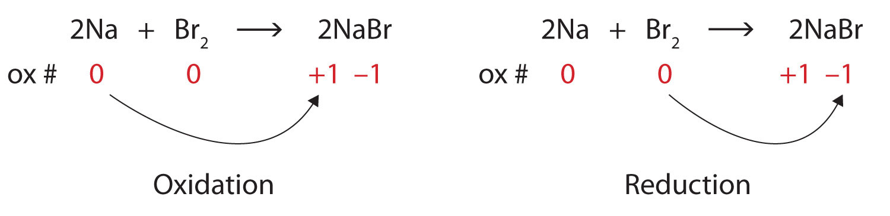
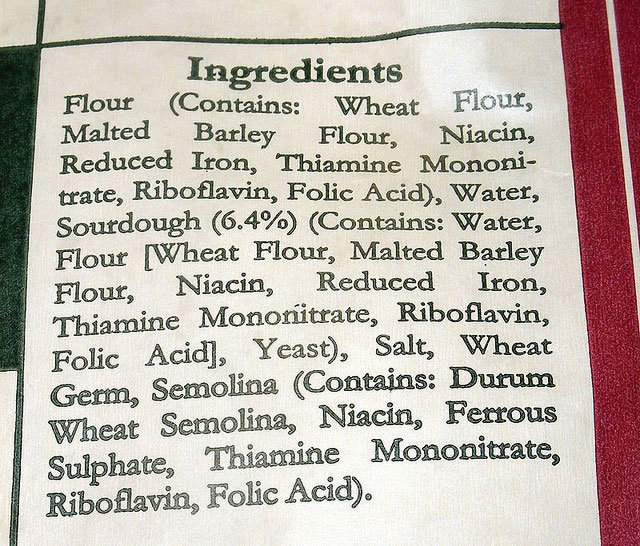

(sec:ch14:s01)=

# 14.1 Oxidation-Reduction Reactions

```{note} Learning Objectives

1. Define *oxidation* and *reduction*.
2. Assign oxidation numbers to atoms in simple compounds.
3. Recognize a reaction as an oxidation-reduction reaction.
```

Consider this chemical reaction:

$$
\text{Mg(s) + Cl}_{2}\text{(g) }\rightarrow{}\text{ MgCl}_{2}
$$

The reactants are two electrically neutral elements; they have the same number of electrons as protons. The product, however, is ionic; it is composed of Mg<sup>2+</sup> and Cl<sup>−</sup> ions. Somehow, the individual Mg atoms lose two electrons to make the Mg<sup>2+</sup> ion, while the Cl atoms gain an electron to become Cl<sup>−</sup> ions. This reaction involves the *transfer of electrons* between atoms.

The process of losing and gaining electrons occurs simultaneously. However, mentally we can separate the two processes. **Oxidation** (*The loss of one or more electrons by an atom; an increase in oxidation number.*) is defined as the loss of one or more electrons by an atom. **Reduction** (*The gain of one or more electrons by an atom; a decrease in oxidation number.*) is defined as the gain of one or more electrons by an atom. So oxidation and reduction always occur together; it is only mentally that we can separate them. Chemical reactions that involve the transfer of electrons are called **oxidation-reduction (or redox) reactions** (*A chemical reaction that involves the transfer of electrons.*).

Redox reactions require that we keep track of the electrons assigned to each atom in a chemical reaction. How do we do that? We use **oxidation numbers** (*A number assigned to an atom that helps keep track of the number of electrons on the atom.*) to keep track of electrons in atoms. Oxidation numbers are assigned to atoms based on four rules. Oxidation numbers are not necessarily equal to the charge on the atom (although sometimes they can be); we must keep the concepts of charge and oxidation numbers separate.

The rules for assigning oxidation numbers to atoms are as follows:

1. Atoms in their elemental state are assigned an oxidation number of 0.
2. Atoms in monatomic (i.e., one-atom) ions are assigned an oxidation number equal to their charge. Oxidation numbers are usually written with the sign first, then the magnitude, to differentiate them from charges.
3. In compounds, fluorine is assigned a −1 oxidation number; oxygen is usually assigned a −2 oxidation number [except in peroxide compounds (where it is −1) and in binary compounds with fluorine (where it is positive)]; and hydrogen is usually assigned a +1 oxidation number [except when it exists as the hydride ion (H<sup>−</sup>), in which case rule 2 prevails].
4. In compounds, all other atoms are assigned an oxidation number so that the sum of the oxidation numbers on all the atoms in the species equals the charge on the species (which is zero if the species is neutral).

Here are some examples for practice. In H<sub>2</sub>, both H atoms have an oxidation number of 0 by rule 1. In MgCl<sub>2</sub>, magnesium has an oxidation number of +2, while chlorine has an oxidation number of −1 by rule 2. In H<sub>2</sub>O, the H atoms each have an oxidation number of +1, while the O atom has an oxidation number of −2, even though hydrogen and oxygen do not exist as ions in this compound (rule 3). By contrast, by rule 3, each H atom in hydrogen peroxide (H<sub>2</sub>O<sub>2</sub>) has an oxidation number of +1, while each O atom has an oxidation number of −1. We can use rule 4 to determine oxidation numbers for the atoms in SO<sub>2</sub>. Each O atom has an oxidation number of −2; for the sum of the oxidation numbers to equal the charge on the species (which is zero), the S atom is assigned an oxidation number of +4. Does this mean that the sulfur atom has a 4+ charge on it? No, it means only that the S atom is assigned a +4 oxidation number by our rules of apportioning electrons among the atoms in a compound.

```{exercise}
:label: ex:ball-ch14-s01-n02

**Example 1**

Assign oxidation numbers to the atoms in each substance.

1. Cl<sub>2</sub>
2. GeO<sub>2</sub>
3. Ca(NO<sub>3</sub>)<sub>2</sub>
```

```{solution} ex:ball-ch14-s01-n02
:label: sol:ball-ch14-s01-n02
:class: dropdown

1. Cl<sub>2</sub> is the elemental form of chlorine. Rule 1 states each atom has an oxidation number of 0.
2. By rule 3, oxygen is normally assigned an oxidation number of −2. For the sum of the oxidation numbers to equal the charge on the species (zero), the Ge atom is assigned an oxidation number of +4.
3. Ca(NO<sub>3</sub>)<sub>2</sub> can be separated into two parts: the Ca<sup>2+</sup> ion and the NO<sub>3</sub><sup>−</sup> ion. Considering these separately, the Ca<sup>2+</sup> ion has an oxidation number of +2 by rule 2. Now consider the NO<sub>3</sub><sup>−</sup> ion. Oxygen is assigned an oxidation number of −2, and there are three of them. According to rule 4, the sum of the oxidation numbers on all atoms must equal the charge on the species, so we have the simple algebraic equation

   $x\text{ + 3(}-\text{2) = }-\text{1}$

   where *x* is the oxidation number of the N atom and the −1 represents the charge on the species. Evaluating for *x*,

   $x\text{ + (}-\text{6) = }-\text{1}$ $x\text{ = +5}$

   Thus the oxidation number on the N atom in the NO<sub>3</sub><sup>−</sup> ion is +5.
```

```{exercise}
:label: ex:ball-ch14-s01-n02-ty2

**Test Yourself**

Assign oxidation numbers to the atoms in H<sub>3</sub>PO<sub>4</sub>.
```

```{solution} ex:ball-ch14-s01-n02-ty2
:label: sol:ball-ch14-s01-n02-ty2
:class: dropdown

H: +1; O: −2; P: +5
```

All redox reactions occur with a simultaneous change in the oxidation numbers of some atoms. At least two elements must change their oxidation numbers. When an oxidation number of an atom is increased in the course of a redox reaction, that atom is being *oxidized*. When an oxidation number of an atom is decreased in the course of a redox reaction, that atom is being *reduced*. Thus oxidation and reduction can also be defined in terms of increasing or decreasing oxidation numbers, respectively.

```{exercise}
:label: ex:ball-ch14-s01-n03

**Example 2**

Identify what is being oxidized and reduced in this redox reaction.

$\text{2Na + Br}_{2}\text{ }\rightarrow{}\text{ 2NaBr}$
```

```{solution} ex:ball-ch14-s01-n03
:label: sol:ball-ch14-s01-n03
:class: dropdown

Both reactants are the elemental forms of their atoms, so the Na and Br atoms have oxidation numbers of 0. In the ionic product, the Na<sup>+</sup> ions have an oxidation number of +1, while the Br<sup>−</sup> ions have an oxidation number of −1.

$$
2\underset{0}{\text{Na}}+\underset{0}{{\text{Br}}_{2}}\,\rightarrow{}\,2\underset{+1\,}{\text{Na}}\underset{-1}{\text{Br}}
$$

Sodium is increasing its oxidation number from 0 to +1, so it is being oxidized; bromine is decreasing its oxidation number from 0 to −1, so it is being reduced:

(fig:fwk:ball:eq14:001)=



*14.1 Oxidation-Reduction Reactions*

Because oxidation numbers are changing, this is a redox reaction. The total number of electrons being lost by sodium (two, one lost from each Na atom) is gained by bromine (two, one gained for each Br atom).
```

```{exercise}
:label: ex:ball-ch14-s01-n03-ty2

**Test Yourself**

Identify what is being oxidized and reduced in this redox reaction.

$\text{C + O}_{2}\text{ }\rightarrow{}\text{ CO}_{2}$
```

```{solution} ex:ball-ch14-s01-n03-ty2
:label: sol:ball-ch14-s01-n03-ty2
:class: dropdown

C is being oxidized from 0 to +4; O is being reduced from 0 to −2.
```

Oxidation reactions can become quite complex, as attested by the following redox reaction:

$$
6{\text{H}}^{+}(\text{aq})+2\underset{+7}{\text{Mn}}{\text{O}}_{4}{}^{-}(\text{aq})+5{\text{H}}_{2}\underset{-1}{{\text{O}}_{2}}(\ell{})\,\rightarrow{}2\underset{+2}{{\text{Mn}}^{2+}}(\text{aq})+5\underset{0}{{\text{O}}_{2}}(\text{g})+8{\text{H}}_{2}\text{O}(\ell{})
$$

To demonstrate that this is a redox reaction, the oxidation numbers of the species being oxidized and reduced are listed; can you determine what is being oxidized and what is being reduced? This is also an example of a net ionic reaction; spectator ions that do not change oxidation numbers are not displayed in the equation. Eventually, we will need to learn techniques for writing correct (i.e., balanced) redox reactions.

```{tip} Food and Drink App: Fortifying Food with Iron

Iron is an essential mineral in our diet; iron-containing compounds like the heme protein in hemoglobin could not function without it. Most biological iron has the form of the Fe<sup>2+</sup> ion; iron with other oxidation numbers is almost inconsequential in human biology (although the body does contain an enzyme to reduce Fe<sup>3+</sup> to Fe<sup>2+</sup>, so Fe<sup>3+</sup> must have some biological significance, albeit minor). To ensure that we ingest enough iron, many foods are enriched with iron. Although Fe<sup>2+</sup> compounds are the most logical substances to use, some foods—bread and breakfast cereals are the most well-known examples—use “reduced iron” as an ingredient. Reduced iron is simply iron metal; iron is added as a fine metallic powder. The metallic iron is oxidized to Fe<sup>2+</sup> in the digestive system and then absorbed by the body, but the question remains: Why are we ingesting metallic iron? Why not just use Fe<sup>2+</sup> salts as an additive?



*Many prepared foods list reduced iron in their ingredients list.*

Although it is difficult to establish conclusive reasons, a search of scientific and medical literature suggests a few reasons. One reason is that fine iron filings do not affect the taste of the product. The size of the iron powder (several dozen micrometers) is not noticeable when chewing iron-supplemented foods, and the tongue does not detect any changes in flavor that can be detected when using Fe<sup>2+</sup> salts. Fe<sup>2+</sup> compounds can affect other properties of foodstuffs during preparation and cooking, like dough pliability, yeast growth, and color. Finally, of the common iron substances that might be used, metallic iron is the least expensive. These factors appear to be among the reasons why metallic iron is the supplement of choice in some foods.
```

```{important} Key Takeaways

- Oxidation-reduction (redox) reactions involve the transfer of electrons from one atom to another.
- Oxidation numbers are used to keep track of electrons in atoms.
- There are rules for assigning oxidation numbers to atoms.
- Oxidation is an increase in oxidation number (loss of electrons); reduction is a decrease in oxidation number (gain of electrons).
```

## Exercises

```{exercise}
:label: ex:ball-ch14-s01-qs01-qd01-qa01

**Exercise 1.**

Is this reaction a redox reaction? Explain your answer.

$\text{2K(s) + Br}_{2}\text{(}\ell{}\text{) }\rightarrow{}\text{ 2KBr(s)}$
```

```{solution} ex:ball-ch14-s01-qs01-qd01-qa01
:label: sol:ball-ch14-s01-qs01-qd01-qa01
:class: dropdown

yes because oxidation numbers are changing
```

```{exercise}
:label: ex:ball-ch14-s01-qs01-qd01-qa02

**Exercise 2.**

Is this reaction a redox reaction? Explain your answer.

$\text{2NaCl(aq) + Pb(NO}_{3}\text{)}_{2}\text{(aq) }\rightarrow{}\text{ 2NaNO}_{3}\text{(aq) + PbCl}_{2}\text{(s)}$
```

```{exercise}
:label: ex:ball-ch14-s01-qs01-qd01-qa03

**Exercise 3.**

Which substance loses electrons and which substance gains electrons in this reaction?

$\text{2Mg(s) + O}_{2}\text{(g) }\rightarrow{}\text{ 2MgO}$
```

```{solution} ex:ball-ch14-s01-qs01-qd01-qa03
:label: sol:ball-ch14-s01-qs01-qd01-qa03
:class: dropdown

lose: Mg; gain: O
```

```{exercise}
:label: ex:ball-ch14-s01-qs01-qd01-qa04

**Exercise 4.**

Which substance loses electrons and which substance gains electrons in this reaction?

$\text{16Fe(s) + 3S}_{8}\text{(s) }\rightarrow{}\text{ 8Fe}_{2}\text{S}_{3}\text{(s)}$
```

```{exercise}
:label: ex:ball-ch14-s01-qs01-qd01-qa05

**Exercise 5.**

Which substance is oxidized and which substance is reduced in this reaction?

$\text{2Li(s) + O}_{2}\text{(g) }\rightarrow{}\text{ Li}_{2}\text{O}_{2}\text{(s)}$
```

```{solution} ex:ball-ch14-s01-qs01-qd01-qa05
:label: sol:ball-ch14-s01-qs01-qd01-qa05
:class: dropdown

oxidized: Li; reduced: O
```

```{exercise}
:label: ex:ball-ch14-s01-qs01-qd01-qa06

**Exercise 6.**

Which substance is oxidized and which substance is reduced in this reaction?

$\text{2Fe(s) + 3I}_{2}\text{(s) }\rightarrow{}\text{ 2FeI}_{3}\text{(s)}$
```

```{exercise}
:label: ex:ball-ch14-s01-qs01-qd01-qa07

**Exercise 7.**

What are two different definitions of oxidation?
```

```{solution} ex:ball-ch14-s01-qs01-qd01-qa07
:label: sol:ball-ch14-s01-qs01-qd01-qa07
:class: dropdown

increase in oxidation number; loss of electrons
```

```{exercise}
:label: ex:ball-ch14-s01-qs01-qd01-qa08

**Exercise 8.**

What are two different definitions of reduction?
```

```{exercise}
:label: ex:ball-ch14-s01-qs01-qd01-qa09

**Exercise 9.**

Assign oxidation numbers to the atoms in each substance.

a. P<sub>4</sub>
b. SO<sub>3</sub>
c. SO<sub>3</sub><sup>2−</sup>
d. Ca<sub>3</sub>(PO<sub>3</sub>)<sub>2</sub>
```

```{solution} ex:ball-ch14-s01-qs01-qd01-qa09
:label: sol:ball-ch14-s01-qs01-qd01-qa09
:class: dropdown

a. P: 0
b. S: +6; O: −2
c. S: +4; O: −2
d. Ca: +2; P: +3; O: −2
```

```{exercise}
:label: ex:ball-ch14-s01-qs01-qd01-qa10

**Exercise 10.**

Assign oxidation numbers to the atoms in each substance.

a. PCl<sub>5</sub>
b. (NH<sub>4</sub>)<sub>2</sub>Se
c. Ag
d. Li<sub>2</sub>O<sub>2</sub>
```

```{exercise}
:label: ex:ball-ch14-s01-qs01-qd01-qa11

**Exercise 11.**

Assign oxidation numbers to the atoms in each substance.

a. NO
b. NO<sub>2</sub>
c. CrCl<sub>2</sub>
d. CrCl<sub>3</sub>
```

```{solution} ex:ball-ch14-s01-qs01-qd01-qa11
:label: sol:ball-ch14-s01-qs01-qd01-qa11
:class: dropdown

a. N: +2; O: −2
b. N: +4; O: −2
c. Cr: +2; Cl: −1
d. Cr: +3; Cl: −1
```

```{exercise}
:label: ex:ball-ch14-s01-qs01-qd01-qa12

**Exercise 12.**

Assign oxidation numbers to the atoms in each substance.

a. NaH
b. N<sub>2</sub>O<sub>3</sub>
c. NO<sub>2</sub><sup>−</sup>
d. CuNO<sub>3</sub>
```

```{exercise}
:label: ex:ball-ch14-s01-qs01-qd01-qa13

**Exercise 13.**

Assign oxidation numbers to the atoms in each substance.

a. CH<sub>2</sub>O
b. NH<sub>3</sub>
c. Rb<sub>2</sub>SO<sub>4</sub>
d. Zn(C<sub>2</sub>H<sub>3</sub>O<sub>2</sub>)<sub>2</sub>
```

```{solution} ex:ball-ch14-s01-qs01-qd01-qa13
:label: sol:ball-ch14-s01-qs01-qd01-qa13
:class: dropdown

a. C: 0; H: +1; O: −2
b. N: −3; H: +1
c. Rb: +1; S: +6; O: −2
d. Zn: +2; C: 0; H: +1; O: −2
```

```{exercise}
:label: ex:ball-ch14-s01-qs01-qd01-qa14

**Exercise 14.**

Assign oxidation numbers to the atoms in each substance.

a. C<sub>6</sub>H<sub>6</sub>
b. B(OH)<sub>3</sub>
c. Li<sub>2</sub>S
d. Au
```

```{exercise}
:label: ex:ball-ch14-s01-qs01-qd01-qa15

**Exercise 15.**

Identify what is being oxidized and reduced in this redox reaction by assigning oxidation numbers to the atoms.

$\text{2NO + Cl}_{2}\text{ }\rightarrow{}\text{ 2NOCl}$
```

```{solution} ex:ball-ch14-s01-qs01-qd01-qa15
:label: sol:ball-ch14-s01-qs01-qd01-qa15
:class: dropdown

oxidized: N; reduced: Cl
```

```{exercise}
:label: ex:ball-ch14-s01-qs01-qd01-qa16

**Exercise 16.**

Identify what is being oxidized and reduced in this redox reaction by assigning oxidation numbers to the atoms.

$\text{Sr + SO}_{3}\text{ }\rightarrow{}\text{ SrSO}_{3}$
```

```{exercise}
:label: ex:ball-ch14-s01-qs01-qd01-qa17

**Exercise 17.**

Identify what is being oxidized and reduced in this redox reaction by assigning oxidation numbers to the atoms.

$\text{2KrF}_{2}\text{ + 2H}_{2}\text{O }\rightarrow{}\text{ 2Kr + 4HF + O}_{2}$
```

```{solution} ex:ball-ch14-s01-qs01-qd01-qa17
:label: sol:ball-ch14-s01-qs01-qd01-qa17
:class: dropdown

oxidized: O; reduced: Kr
```

```{exercise}
:label: ex:ball-ch14-s01-qs01-qd01-qa18

**Exercise 18.**

Identify what is being oxidized and reduced in this redox reaction by assigning oxidation numbers to the atoms.

$\text{SO}_{3}\text{ + SCl}_{2}\text{ }\rightarrow{}\text{ SOCl}_{2}\text{ + SO}_{2}$
```

```{exercise}
:label: ex:ball-ch14-s01-qs01-qd01-qa19

**Exercise 19.**

Identify what is being oxidized and reduced in this redox reaction by assigning oxidation numbers to the atoms.

$\text{2Rb + MgCl}_{2}\text{ }\rightarrow{}\text{ 2RbCl + Mg}$
```

```{solution} ex:ball-ch14-s01-qs01-qd01-qa19
:label: sol:ball-ch14-s01-qs01-qd01-qa19
:class: dropdown

oxidized: Rb; reduced: Mg
```

```{exercise}
:label: ex:ball-ch14-s01-qs01-qd01-qa20

**Exercise 20.**

Identify what is being oxidized and reduced in this redox reaction by assigning oxidation numbers to the atoms.

$\text{2C}_{8}\text{H}_{18}\text{ + 25O}_{2}\text{ }\rightarrow{}\text{ 16CO}_{2}\text{ + 18H}_{2}\text{O}$
```
