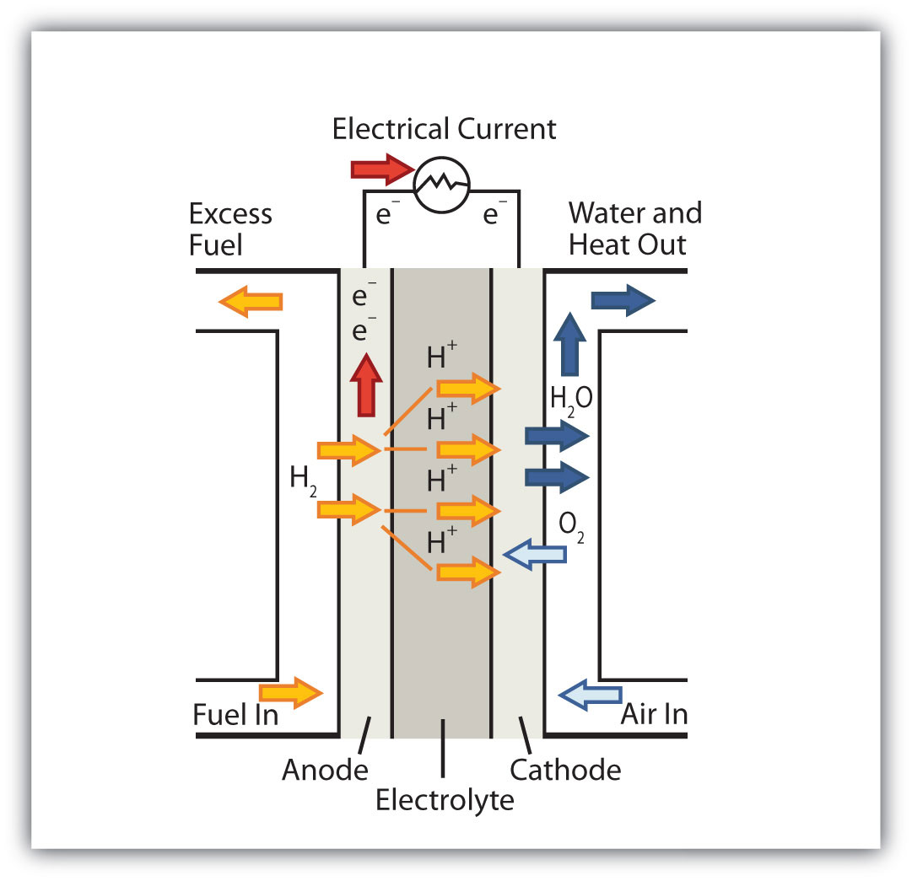
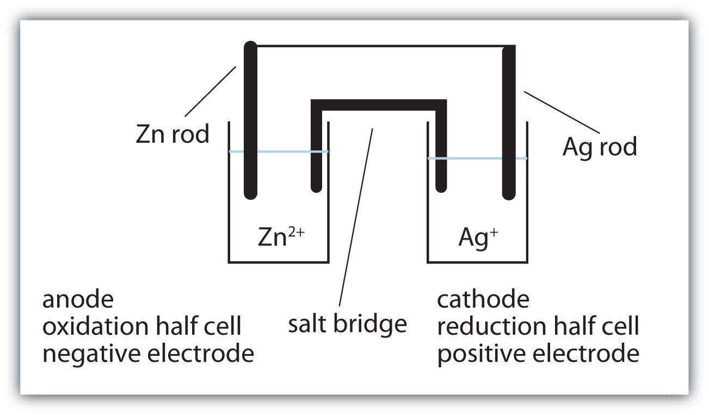

(sec:ch14:s03)=

# 14.3 Applications of Redox Reactions: Voltaic Cells

```{note} Learning Objectives

1. Learn the parts of a voltaic cell.
2. Combine half reactions to determine the voltage of a voltaic cell.
3. Understand how voltaic cells are used as batteries.
```

Consider this redox reaction:

$$
\text{Zn + Cu}^{2+}\text{ }\rightarrow{}\text{ Zn}^{2+}\text{ + Cu}
$$

If you were to mix zinc metal and copper ions in a container, this reaction would proceed by itself; we say that this reaction is *spontaneous*.

Suppose, however, we set up this reaction in a way depicted in {ref}`Figure 14.1 "A Redox Reaction in Which the Two Half Reactions Are Physically Separated" <fig:ch14:s03:f01>`. Zinc and zinc ions are on one side of the system, while copper and copper ions are on the other side of the system. The two parts are connected with a wire.

```{figure} ../images/figures/0f90af47ee6326fc3965267f4502e25a.jpg
:label: fig:ch14:s03:f01
:alt: "A Redox Reaction in Which the Two Half Reactions Are Physically Separated. One application of redox reactions requires that they be physically separated."
:align: center
:width: 85%

A Redox Reaction in Which the Two Half Reactions Are Physically Separated. One application of redox reactions requires that they be physically separated.
```

Even though the two half reactions are physically separated, a spontaneous redox reaction still occurs. However, in this case, the electrons transfer through the wire connecting the two half reactions; that is, this setup becomes a source of electricity. Useful work can be extracted from the electrons as they transfer from one side to the other—for example, a light bulb can be lit, or a motor can be operated. The apparatus as a whole, which allows useful electrical work to be extracted from a redox reaction, is called a **voltaic (galvanic) cell** (*An apparatus that allows for useful electrical work to be extracted from a redox reaction.*).

Each individual system that contains a half reaction is called a **half cell** (*A part of a voltaic cell that contains one half reaction.*). The half cell that contains the oxidation reaction is called the **anode** (*The half cell that contains the oxidation reaction.*), while the half cell that contains the reduction reaction is called the **cathode** (*The half cell that contains the reduction reaction.*). The cathode and anode collectively are the **electrodes** (*The cathode or anode of a voltaic cell.*) of the voltaic cell. Because electrons are coming from the anode, the anode is considered the *negative* electrode of the cell, while the cathode is considered the *positive* electrode of the cell. Finally, because electrons are moving from one half cell to the other, a charge imbalance builds up as the reaction proceeds. To counter that, a **salt bridge** (*A part of a voltaic cell that contains a solution of some ionic compound whose ions migrate to either side of the voltaic cell to maintain the charge balance.*) is used; the salt bridge contains a solution of some ionic compound whose ions migrate to either side of the voltaic cell to maintain the charge balance.

The tendency for electrons to go from one half cell to another is called the **voltage** (*The tendency for electrons to go from one half cell to another.*) of the voltaic cell, represented by *E*. Sometimes the term *potential* is used to represent the voltage of a cell. Voltage is expressed in volts (V). The voltage of a voltaic cell is determined by the *difference* in the tendencies of the individual half cells and is characteristic of a given redox reaction when concentrations are specific (1.0 M for dissolved species and 1.0 atm for gases). Because the voltage of a redox reaction is determined by the difference of the tendencies of the individual half reactions, absolute voltages are unnecessary; only relative voltages of each half reaction are needed. The relative voltage of each half cell is represented as *E*<sub>1/2</sub> and is based on the standard that the *E*<sub>1/2</sub> for the reaction

$$
\text{H}^{+}\text{ + e}^{-}\text{ }\rightarrow{}\text{ 1/2H}_{2}
$$

is assigned to be exactly 0.000 V under standard conditions of pressure and concentration. {ref}`Table 14.1 "Standard Reduction Potentials of Half Reactions" <tbl:ch14:s03:t01>` lists some relative *E*<sub>1/2</sub> values for some half reactions. Note that all half reactions are listed as reduction reactions, so these values are called the **standard reduction potentials** (*The voltage of a reduction half reaction relative to the hydrogen half reaction.*) of each half reaction.

```{table} Standard Reduction Potentials of Half Reactions
:label: tbl:ch14:s03:t01

| Reduction Half Reaction | *E*<sub>1/2</sub> (V) |
| --- | --- |
| F<sub>2</sub> + 2e<sup>−</sup> → 2F<sup>−</sup> | 2.87 |
| Ce<sup>4+</sup> + e<sup>−</sup> → Ce<sup>3+</sup> | 1.61 |
| MnO<sub>4</sub><sup>−</sup> + 8H<sup>+</sup> + 5e<sup>−</sup> → Mn<sup>2+</sup> + 4H<sub>2</sub>O | 1.51 |
| Cl<sub>2</sub> + 2e<sup>−</sup> → 2Cl<sup>−</sup> | 1.36 |
| O<sub>2</sub> + 4H<sup>+</sup> + 4e<sup>−</sup> → 2H<sub>2</sub>O | 1.23 |
| Br<sub>2</sub> + 2e<sup>−</sup> → 2Br<sup>−</sup> | 1.06 |
| NO<sub>3</sub><sup>−</sup> + 4H<sup>+</sup> + 3e<sup>−</sup> → NO + 2H<sub>2</sub>O | 0.96 |
| Ag<sup>+</sup> + e<sup>−</sup> → Ag | 0.80 |
| Fe<sup>3+</sup> + e<sup>−</sup> → Fe<sup>2+</sup> | 0.77 |
| I<sub>2</sub> + 2e<sup>−</sup> → 2I<sup>−</sup> | 0.54 |
| Cu<sup>2+</sup> + 2e<sup>−</sup> → Cu | 0.34 |
| AgCl + e<sup>−</sup> → Ag + Cl<sup>−</sup> | 0.222 |
| Sn<sup>4+</sup> + 2e<sup>−</sup> → Sn<sup>2+</sup> | 0.15 |
| 2H<sup>+</sup> + 2e<sup>−</sup> → H<sub>2</sub> | 0.000 |
| Pb<sup>2+</sup> + 2e<sup>−</sup> → Pb | −0.126 |
| Ni<sup>2+</sup> + 2e<sup>−</sup> → Ni | −0.25 |
| Cr<sup>3+</sup> + e<sup>−</sup> → Cr<sup>2+</sup> | −0.41 |
| Fe<sup>2+</sup> + 2e<sup>−</sup> → Fe | −0.44 |
| Cr<sup>3+</sup> + 3e<sup>−</sup> → Cr | −0.74 |
| Zn<sup>2+</sup> + 2e<sup>−</sup> → Zn | −0.76 |
| Cr<sup>2+</sup> + 2e<sup>−</sup> → Cr | −0.91 |
| Al<sup>3+</sup>+ 3e<sup>−</sup> → Al | −1.66 |
| Mg<sup>2+</sup> + 2e<sup>−</sup> → Mg | −2.37 |
| Na<sup>+</sup> + e<sup>−</sup> → Na | −2.714 |
| Ba<sup>2+</sup> + 2e<sup>−</sup> → Ba | −2.91 |
| Li<sup>+</sup> + e<sup>−</sup> → Li | −3.045 |
```

{ref}`Table 14.1 "Standard Reduction Potentials of Half Reactions" <tbl:ch14:s03:t01>` lists only reduction reactions, but a redox reaction has a reduction *and* an oxidation. To make the oxidation reaction, simply reverse the reduction reaction in {ref}`Table 14.1 "Standard Reduction Potentials of Half Reactions" <tbl:ch14:s03:t01>` and change the sign on the *E*<sub>1/2</sub> value. If the reduction potential is negative, make the voltage for the oxidation positive; if the reduction potential is positive, make the voltage for the oxidation negative.

```{exercise}
:label: ex:ball-ch14-s03-n02

**Example 6**

What is the value of *E*<sub>1/2</sub> for this half reaction?

$\text{Ag + Cl}^{-}\text{ }\rightarrow{}\text{ AgCl + e}^{-}$
```

```{solution} ex:ball-ch14-s03-n02
:label: sol:ball-ch14-s03-n02
:class: dropdown

The given reaction is the reverse of this reaction:

$\text{AgCl + e}^{-}\text{ }\rightarrow{}\text{ Ag + Cl}^{-}\text{ }E_{1/2}\text{ = 0.222 V}$

Therefore, the *E*<sub>1/2</sub> of the given reaction is −0.222 V.
```

```{exercise}
:label: ex:ball-ch14-s03-n02-ty2

**Test Yourself**

What is the value of *E*<sub>1/2</sub> for this half reaction?

$\text{Na }\rightarrow{}\text{ Na}^{+}\text{ + e}^{-}$
```

```{solution} ex:ball-ch14-s03-n02-ty2
:label: sol:ball-ch14-s03-n02-ty2
:class: dropdown

2.714 V
```

To determine the overall voltage of a particular voltaic cell, simply combine the voltages of the oxidation and reduction half reactions. Even if you need to take a multiple of a half reaction for the electrons to cancel, do not take the multiple of the *E*<sub>1/2</sub>. Use the values directly as is from {ref}`Table 14.1 "Standard Reduction Potentials of Half Reactions" <tbl:ch14:s03:t01>`.

Spontaneous redox reactions have positive overall voltages. If the voltage of the reaction as written is negative, it is not spontaneous in that direction. Rather, the reverse reaction is the spontaneous redox reaction.

```{exercise}
:label: ex:ball-ch14-s03-n03

**Example 7**

What is the voltage of a voltaic cell based on this reaction? Is the reaction spontaneous as written?

$\text{2NO}_{3}^{-}\text{ + 8H}^{+}\text{ + 3Cu }\rightarrow{}\text{ 2NO + 4H}_{2}\text{O + 3Cu}^{2+}$
```

```{solution} ex:ball-ch14-s03-n03
:label: sol:ball-ch14-s03-n03
:class: dropdown

The overall redox reaction is formed from these two half reactions:

$\text{NO}_{3}^{-}\text{ + 4H}^{+}\text{ + 3e}^{-}\text{ }\rightarrow{}\text{ NO + 2H}_{2}\text{O     }E_{1/2}\text{ = 0.96 V}$

$\text{Cu}^{2+}\text{ + 2 e}^{-}\text{ }\rightarrow{}\text{ Cu     }E_{1/2}\text{ = 0.34 V}$

The second reaction is reversed in the overall redox reaction, so its voltage changes sign from the reduction reaction:

$\text{Cu }\rightarrow{}\text{ Cu}^{2+}\text{ + 2 e}^{-}\text{ }E_{1/2}\text{ = }-\text{0.34 V}$

To obtain the voltage of the voltaic cell based on the overall reaction, we simply combine the two voltages of the half reactions:

$E\text{ = 0.96 + (}-\text{0.34) = 0.62 V}$

Because the overall voltage is positive, the reaction is spontaneous as written.
```

```{exercise}
:label: ex:ball-ch14-s03-n03-ty2

**Test Yourself**

What is the voltage of a voltaic cell based on this reaction? Is the reaction spontaneous as written?

$\text{5Ni + 2MnO}_{4}^{-}\text{ + 16H}^{+}\text{ }\rightarrow{}\text{ 3Mn}^{2+}\text{ + 8H}_{2}\text{O + 5Ni}^{2+}$
```

```{solution} ex:ball-ch14-s03-n03-ty2
:label: sol:ball-ch14-s03-n03-ty2
:class: dropdown

1.76 V; spontaneous
```

Technically, any redox reaction can be set up to make a voltaic cell. In modern society, however, only certain redox reactions are put to practical use. A portable voltaic cell that generates electricity to power devices for our convenience is called a **battery** (*A portable voltaic cell that generates electricity to power devices for our convenience.*). All batteries are based on redox reactions.

The first battery (called a “voltaic pile”) was constructed by the Italian scientist Alessandro Volta in 1800 and was based on the copper/zinc reaction depicted in {ref}`Figure 14.1 "A Redox Reaction in Which the Two Half Reactions Are Physically Separated" <fig:ch14:s03:f01>`. Unfortunately, it was messy, requiring quantities of copper and zinc salts dissolved in water. In 1866, the French scientist Georges Leclanché invented the **dry cell** (*A modern battery that does not contain large amounts of aqueous solution.*), a precursor to today’s modern battery. A schematic of a dry cell is shown in {ref}`Figure 14.2 "Dry Cells" <fig:ch14:s03:f02>`. The zinc case and the central carbon rod serve as the anode and cathode, respectively. The other reactants are combined into a moist paste that minimizes free liquid, so the battery is less messy (hence the name *dry cell*). The actual redox reaction is complex but can be represented by the following redox reaction:

$$
\text{Zn + 2MnO}_{2}\text{ + 2NH}_{4}^{+}\text{ }\rightarrow{}\text{ Zn}^{2+}\text{ + Mn}_{2}\text{O}_{3}\text{ + 2NH}_{3}\text{ + H}_{2}\text{O}
$$

A dry cell has a voltage of about 1.56 V. While common and useful, dry cells have relatively short lifetimes and contain acidic components. They also cannot be recharged, so they are one-use only. Batteries that can be used only once are called **primary batteries** (*A battery that cannot be recharged.*).

```{figure} ../images/figures/95c32065c787dc1d744e5603d3c89e4d.jpg
:label: fig:ch14:s03:f02
:alt: "Dry Cells. The Leclanché dry cell is a common type of battery."
:align: center
:width: 85%

Dry Cells. The Leclanché dry cell is a common type of battery.
```

In the late 1950s, Lewis Urry of the Eveready Battery Company in Ohio invented the **alkaline battery** (*A type of dry cell that contains an alkaline (i.e., basic) moist paste, rather than an acidic paste.*) (still marketed today under the trade name *Energizer*). Alkaline batteries are similar to dry cells, but they use a basic moist paste rather than an acidic one. Moreover, the net amount of base does not change during the course of the redox reaction. The overall redox reaction is as follows:

$$
\text{Zn + 2MnO}_{2}\text{ }\rightarrow{}\text{ ZnO + Mn}_{2}\text{O}_{3}
$$

Alkaline batteries have the advantage of being longer lasting and holding their voltage better—about 1.54 V—throughout their lifetime.

A common type of battery, especially with the increased popularity of personal electronic devices, is the button battery ({ref}`Figure 14.3 "Button Batteries" <fig:ch14:s03:f03>`). A button battery is a small battery that can power small electronic devices; the batteries can be as small as 5 mm across. Two popular redox reactions used for button batteries are the alkaline dry-cell reaction and a silver oxide-based reaction:

```{figure} ../images/restored/fig-14-3.jpg
:label: fig:ch14:s03:f03
:enumerator: 14.3
:alt: Several round button-cell batteries of different diameters.
:align: center
:width: 70%

**Button Batteries.** Button cells supply electrical energy to small electronic devices. Their compact form comes in several sizes and chemistries.

Credits: [Coin-cells — Gerhard H Wrodnigg](https://commons.wikimedia.org/wiki/File:Coin-cells.jpg), [CC BY-SA 2.5](https://creativecommons.org/licenses/by-sa/2.5). Images resized for the web.
```

$$
\text{Zn + Ag}_{2}\text{O }\rightarrow{}\text{ ZnO + 2Ag}
$$

Some button batteries use a lithium-based redox reaction, typified by this anode reaction:

$$
\text{Li }\rightarrow{}\text{ Li}^{+}\text{ + e}^{-}\text{ }E_{1/2}\text{ = 3.045 V}
$$

The actual redox reaction depends on the composition of the cathode and is variable depending on voltage. Lithium batteries can also be used for applications that require more energy, such as portable computers and electric vehicles. Some lithium-based batteries are rechargeable and can be used over and over again; such batteries are called **secondary batteries** (*A battery that can be recharged.*).

An important secondary battery is the lead storage battery, shown in {ref}`Figure 14.4 "Lead Storage Batteries" <fig:ch14:s03:f04>`. The lead storage battery is based on this redox reaction:

```{figure} ../images/restored/fig-14-4.jpg
:label: fig:ch14:s03:f04
:enumerator: 14.4
:alt: A labeled cutaway of an automotive lead-acid battery showing plates, separators, and connections.
:align: center
:width: 70%

**Lead Storage Batteries.** A cutaway view of an automotive lead-acid battery shows its positive and negative plates, separators, and connections. Multiple cells connected in series provide the voltage needed to start an engine.

Credits: [Cutaway view of a 1953 automotive lead-acid battery — National Institute of Standards and Technology Digital Collections, Gaithersburg, MD 20899](https://commons.wikimedia.org/wiki/File:Cutaway_view_of_a_1953_automotive_lead-acid_battery.jpg), [Public domain](https://creativecommons.org/publicdomain/mark/1.0/). Images resized for the web.
```

$$
\text{Pb + PbO}_{2}\text{ + 4H}^{+}\text{ + 2SO}_{4}^{2-}\text{ }\rightarrow{}\text{ 2PbSO}_{4}\text{ + 2H}_{2}\text{O}
$$

The redox reaction produces about 2 V, but it is typical to tie several individual batteries together to generate a larger voltage. The lead storage battery has the distinction that the product of both half reactions is PbSO<sub>4</sub>, which as a solid accumulates on the many plates within each cell ({ref}`Figure 14.4 "Lead Storage Batteries" <fig:ch14:s03:f04>`). The lead storage battery is a secondary battery, as it can be recharged and reused many times. Because it is based on lead, these batteries are rather heavy. They should also be recycled when replaced so that potentially dangerous lead does not escape into the environment. Because of their characteristics, lead storage batteries are used to start large engines in automobiles, boats, and airplanes.

```{tip} Chemistry Is Everywhere: Fuel Cells

A *fuel cell* is a type of battery in which reactants flow continuously into a specialized reaction chamber, and products flow out continuously while electrons are extracted from the reaction. Because all reactions in a fuel cell consist of a fuel and an oxidizer undergoing a redox reaction, an introduction of fuel cells is at home in a discussion of redox chemistry.



*This fuel cell uses H<sub>2</sub> as the fuel and O<sub>2</sub> as the oxidizer.*

By far the most common fuel cell reaction is based on hydrogen and oxygen:

$\text{2H}_{2}\text{ + O}_{2}\text{ }\rightarrow{}\text{ 2H}_{2}\text{O     }E\text{ = 1.23 V under standard conditions}$

However, fuel cells typically do not work under standard nor even optimal conditions, so they typically generate about 0.6–0.7 V. In this fuel cell, the only two products are water and electricity, so the fuel cell not only does not create pollution but also makes a by-product that in some environments is a valuable commodity (water). Other fuels can be used besides hydrogen; fuel cells have been developed that work on methane, methyl alcohol, ethyl alcohol, carbon-rich materials, and even magnesium metal.

Hydrogen-based fuel cells were and are used to provide electricity for manned space vehicles, partly because their only chemical product is water, which could be used for drinking. However, there has been a recent resurgence in interest in fuel cells because of their potential use in electric cars. Most electric cars run on conventional batteries, which can be very heavy and expensive to replace. It is thought that fuel cells, rather than conventional batteries, might be better sources of electricity for automobiles.

Several current barriers to fuel cell use in electric cars include capacity, cost, and overall energy efficiency. The 2008 Honda FCX, the first production model of a vehicle powered with a fuel cell, can hold 4.1 kg (just under 9 lb) of highly pressured H<sub>2</sub> gas and has a range of 450 km (280 mi). It costs about \$120,000–\$140,000 to build, making the vehicle beyond the ability of most people to own. Finally, it always requires more energy to produce elemental hydrogen as a fuel than can be extracted from hydrogen as a fuel. As such, hydrogen is described as an energy carrier (like electricity) rather than an energy source (like oil and gas). This distinction points out a fundamental argument against fuel cells as a “better” power source.


*The 2008 Honda FCX was the first production car to use a fuel cell as a power source. Nonetheless, the car is in very limited service because of its need for relatively large quantities of elemental hydrogen as fuel.*

The limitations notwithstanding, there is a lot of interest in fuel cell research. If ways can be found to circumvent their current limitations, fuel cells may become more and more common as power sources.
```

```{important} Key Takeaways

- A voltaic cell produces electricity as a redox reaction occurs.
- The voltage of a voltaic cell can be determined by the reduction potentials of the half reactions.
- Voltaic cells are fashioned into batteries, which are a convenient source of electricity.
```

## Exercises

```{exercise}
:label: ex:ball-ch14-s03-qs01-qd01-qa01

**Exercise 1.**

Draw the voltaic cell represented by this reaction and label the cathode, the anode, the salt bridge, the oxidation half cell, the reduction half cell, the positive electrode, and the negative electrode. Use {ref}`Figure 14.1 "A Redox Reaction in Which the Two Half Reactions Are Physically Separated" <fig:ch14:s03:f01>` as a guide.

$\text{Zn + 2Ag}^{+}\text{ }\rightarrow{}\text{ Zn}^{2+}\text{ + 2Ag}$
```

```{solution} ex:ball-ch14-s03-qs01-qd01-qa01
:label: sol:ball-ch14-s03-qs01-qd01-qa01
:class: dropdown



*14.3 Applications of Redox Reactions: Voltaic Cells*
```

```{exercise}
:label: ex:ball-ch14-s03-qs01-qd01-qa02

**Exercise 2.**

Draw the voltaic cell represented by this reaction and label the cathode, the anode, the salt bridge, the oxidation half cell, the reduction half cell, the positive electrode, and the negative electrode. Use {ref}`Figure 14.1 "A Redox Reaction in Which the Two Half Reactions Are Physically Separated" <fig:ch14:s03:f01>` as a guide.

$\text{3Mg + 2Cr}^{3+}\text{ }\rightarrow{}\text{ 3Mg}^{2+}\text{ + 2Cr}$
```

```{exercise}
:label: ex:ball-ch14-s03-qs01-qd01-qa03

**Exercise 3.**

What is the voltage of this half reaction?

$\text{2F}^{-}\text{ }\rightarrow{}\text{ F}_{2}\text{ + 2e}^{-}$
```

```{solution} ex:ball-ch14-s03-qs01-qd01-qa03
:label: sol:ball-ch14-s03-qs01-qd01-qa03
:class: dropdown

−2.87 V
```

```{exercise}
:label: ex:ball-ch14-s03-qs01-qd01-qa04

**Exercise 4.**

What is the voltage of this half reaction?

$\text{Na }\rightarrow{}\text{ Na}^{+}\text{ + e}^{-}$
```

```{exercise}
:label: ex:ball-ch14-s03-qs01-qd01-qa05

**Exercise 5.**

What is the voltage of the voltaic cell in Exercise 1? Consult {ref}`Table 14.1 "Standard Reduction Potentials of Half Reactions" <tbl:ch14:s03:t01>` for data.
```

```{solution} ex:ball-ch14-s03-qs01-qd01-qa05
:label: sol:ball-ch14-s03-qs01-qd01-qa05
:class: dropdown

1.56 V
```

```{exercise}
:label: ex:ball-ch14-s03-qs01-qd01-qa06

**Exercise 6.**

What is the voltage of the voltaic cell in Exercise 2? Consult {ref}`Table 14.1 "Standard Reduction Potentials of Half Reactions" <tbl:ch14:s03:t01>` for data.
```

```{exercise}
:label: ex:ball-ch14-s03-qs01-qd01-qa07

**Exercise 7.**

Balance this redox reaction and determine its voltage. Is it spontaneous?

$\text{Li}^{+}\text{ + Al }\rightarrow{}\text{ Li + Al}^{3+}$
```

```{solution} ex:ball-ch14-s03-qs01-qd01-qa07
:label: sol:ball-ch14-s03-qs01-qd01-qa07
:class: dropdown

3Li<sup>+</sup> + Al → 3Li + Al<sup>3+</sup>; −1.39 V; not spontaneous
```

```{exercise}
:label: ex:ball-ch14-s03-qs01-qd01-qa08

**Exercise 8.**

Balance this redox reaction and determine its voltage. Is it spontaneous?

$\text{Pb}^{2+}\text{ + Ni }\rightarrow{}\text{ Pb + Ni}^{2+}$
```

```{exercise}
:label: ex:ball-ch14-s03-qs01-qd01-qa09

**Exercise 9.**

Balance this redox reaction and determine its voltage. Is it spontaneous?

$\text{Cu}^{2+}\text{ + Ag + Cl}^{-}\text{ }\rightarrow{}\text{ Cu + AgCl}$
```

```{solution} ex:ball-ch14-s03-qs01-qd01-qa09
:label: sol:ball-ch14-s03-qs01-qd01-qa09
:class: dropdown

Cu<sup>2+</sup> + 2Ag + 2Cl<sup>−</sup> → Cu + 2AgCl; 0.12 V; spontaneous
```

```{exercise}
:label: ex:ball-ch14-s03-qs01-qd01-qa10

**Exercise 10.**

Balance this redox reaction and determine its voltage. Is it spontaneous?

$\text{Mn}^{2+}\text{ + Br}_{2}\text{ }\rightarrow{}\text{ MnO}_{4}^{-}\text{ + Br}^{-}$
```

```{exercise}
:label: ex:ball-ch14-s03-qs01-qd01-qa11

**Exercise 11.**

Which reaction represents the cathode reaction in Exercise 7? The anode reaction?
```

```{solution} ex:ball-ch14-s03-qs01-qd01-qa11
:label: sol:ball-ch14-s03-qs01-qd01-qa11
:class: dropdown

cathode reaction: Li<sup>+</sup> + e<sup>−</sup> → Li; anode reaction: Al → Al<sup>3+</sup> + 3e<sup>−</sup>
```

```{exercise}
:label: ex:ball-ch14-s03-qs01-qd01-qa12

**Exercise 12.**

Which reaction represents the cathode reaction in Exercise 8? The anode reaction?
```

```{exercise}
:label: ex:ball-ch14-s03-qs01-qd01-qa13

**Exercise 13.**

Which reaction represents the cathode reaction in Exercise 9? The anode reaction?
```

```{solution} ex:ball-ch14-s03-qs01-qd01-qa13
:label: sol:ball-ch14-s03-qs01-qd01-qa13
:class: dropdown

cathode reaction: Cu<sup>2+</sup> + 2e<sup>−</sup> → Cu; anode reaction: Ag + Cl<sup>−</sup> → AgCl + e<sup>−</sup>
```

```{exercise}
:label: ex:ball-ch14-s03-qs01-qd01-qa14

**Exercise 14.**

Which reaction represents the cathode reaction in Exercise 10? The anode reaction?
```

```{exercise}
:label: ex:ball-ch14-s03-qs01-qd01-qa15

**Exercise 15.**

A voltaic cell is based on this reaction:

$\text{Ni + 2Au}^{+}\text{ }\rightarrow{}\text{ Ni}^{2+}\text{ + 2Au}$

If the voltage of the cell is 0.33 V, what is the standard reduction potential of the Au<sup>+</sup> + e<sup>−</sup> → Au half reaction?
```

```{solution} ex:ball-ch14-s03-qs01-qd01-qa15
:label: sol:ball-ch14-s03-qs01-qd01-qa15
:class: dropdown

0.08 V
```

```{exercise}
:label: ex:ball-ch14-s03-qs01-qd01-qa16

**Exercise 16.**

A voltaic cell is based on this reaction:

$\text{3Pb + 2V}^{3+}\text{ }\rightarrow{}\text{ 3Pb}^{2+}\text{ + 2V}$

If the voltage of the cell is −0.72 V, what is the standard reduction potential of the V<sup>3+</sup> + 3e<sup>−</sup> → V half reaction?
```

```{exercise}
:label: ex:ball-ch14-s03-qs01-qd01-qa17

**Exercise 17.**

What species is being oxidized and what species is being reduced in a dry cell?
```

```{solution} ex:ball-ch14-s03-qs01-qd01-qa17
:label: sol:ball-ch14-s03-qs01-qd01-qa17
:class: dropdown

oxidized: Zn; reduced: Mn
```

```{exercise}
:label: ex:ball-ch14-s03-qs01-qd01-qa18

**Exercise 18.**

What species is being oxidized and what species is being reduced in an alkaline battery?
```

```{exercise}
:label: ex:ball-ch14-s03-qs01-qd01-qa19

**Exercise 19.**

What species is being oxidized and what species is being reduced in a silver oxide button battery?
```

```{solution} ex:ball-ch14-s03-qs01-qd01-qa19
:label: sol:ball-ch14-s03-qs01-qd01-qa19
:class: dropdown

oxidized: Zn; reduced: Ag
```

```{exercise}
:label: ex:ball-ch14-s03-qs01-qd01-qa20

**Exercise 20.**

What species is being oxidized and what species is being reduced in a lead storage battery?
```

```{exercise}
:label: ex:ball-ch14-s03-qs01-qd01-qa21

**Exercise 21.**

Based on the data in {ref}`Table 14.1 "Standard Reduction Potentials of Half Reactions" <tbl:ch14:s03:t01>`, what is the highest voltage battery you can construct?
```

```{solution} ex:ball-ch14-s03-qs01-qd01-qa21
:label: sol:ball-ch14-s03-qs01-qd01-qa21
:class: dropdown

5.92 V from the reaction of F<sub>2</sub> and Li
```

```{exercise}
:label: ex:ball-ch14-s03-qs01-qd01-qa22

**Exercise 22.**

Based on the data in {ref}`Table 14.1 "Standard Reduction Potentials of Half Reactions" <tbl:ch14:s03:t01>`, what is the lowest voltage battery you can construct? (This may be more challenging to answer than Exercise 21.)
```
