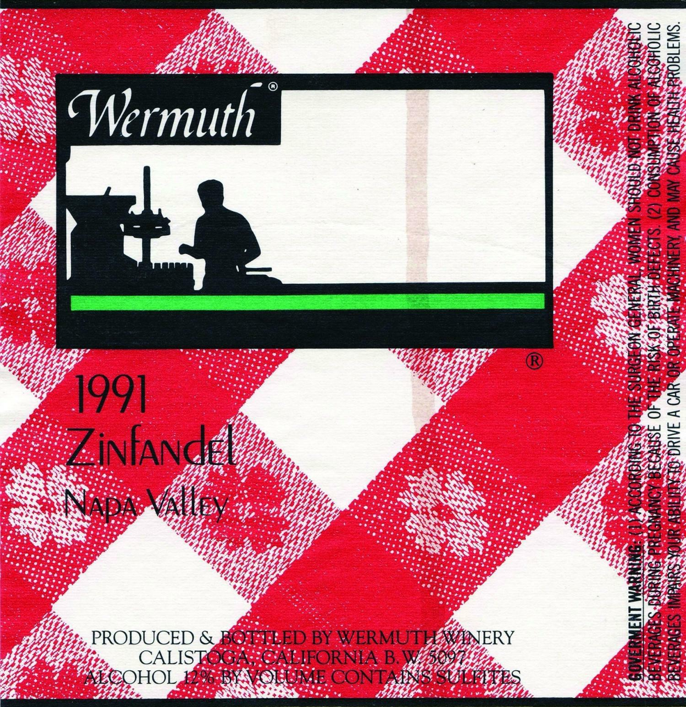

(sec:ch15:s04)=

# 15.4 Uses of Radioactive Isotopes

```{note} Learning Objective

1. Learn some applications of radioactivity.
```

Radioactive isotopes have a variety of applications. Generally, however, they are useful because either we can detect their radioactivity or we can use the energy they release.

Radioactive isotopes are effective tracers because their radioactivity is easy to detect. A **tracer** (*A substance that can be used to follow the pathway of that substance through a structure.*) is a substance that can be used to follow the pathway of that substance through some structure. For instance, leaks in underground water pipes can be discovered by running some tritium-containing water through the pipes and then using a Geiger counter to locate any radioactive tritium subsequently present in the ground around the pipes. (Recall that tritium is a radioactive isotope of hydrogen.)

Tracers can also be used to follow the steps of a complex chemical reaction. After incorporating radioactive atoms into reactant molecules, scientists can track where the atoms go by following their radioactivity. One excellent example of this is the use of carbon-14 to determine the steps involved in photosynthesis in plants. We know these steps because researchers followed the progress of carbon-14 throughout the process.

(sec:ch15:s04:s01)=

## Radioactive Dating

Radioactive isotopes are useful for establishing the ages of various objects. The half-life of radioactive isotopes is unaffected by any environmental factors, so the isotope acts like an internal clock. For example, if a rock is analyzed and is found to contain a certain amount of uranium-235 and a certain amount of its daughter isotope, we can conclude that a certain fraction of the original uranium-235 has radioactively decayed. If half of the uranium has decayed, then the rock has an age of one half-life of uranium-235, or about 7.0 × 10<sup>8</sup> y. Many analyses like this, using a wide variety of isotopes, have indicated that age of the earth itself is over 4 × 10<sup>9</sup> y. In another interesting example of radioactive dating, hydrogen-3 dating has been used to verify the stated vintages of some old fine wines.

One isotope, carbon-14, is particularly useful in determining the age of once-living artifacts. A tiny amount of carbon-14 is produced naturally in the upper reaches of the atmosphere, and living things incorporate some of it into their tissues, building up to a constant, albeit very low, level. Once a living thing dies, it no longer acquires carbon-14; as time passes the carbon-14 that was in the tissues decays. (The half-life of carbon-14 is 5,730 y.) If a once-living artifact is discovered and analyzed many years after its death and the remaining carbon-14 is compared to the known constant level, an approximate age of the artifact can be determined. Using such methods, scientists determined that the age of the Shroud of Turin ({ref}`Figure 15.3 "Shroud of Turin" <fig:ch15:s04:s01:f01>`; purported by some to be the burial cloth of Jesus Christ and composed of flax fibers, a type of plant) is about 600–700 y, not 2,000 y as claimed by some. Scientists were also able to use radiocarbon dating to show that the age of a mummified body found in the ice of the Alps was 5,300 y.

```{figure} ../images/figures/3ff2ce6f48a6daf926b31bb062b7db53.jpg
:label: fig:ch15:s04:s01:f01
:alt: "Shroud of Turin. In 1989, several groups of scientists used carbon-14 dating to demonstrate that the Shroud of Turin was only 600–700 y. Many people still cling to a different notion, despite the scientific evidence."
:align: center
:width: 85%

Shroud of Turin. In 1989, several groups of scientists used carbon-14 dating to demonstrate that the Shroud of Turin was only 600–700 y. Many people still cling to a different notion, despite the scientific evidence.
```

(sec:ch15:s04:s02)=

## Irradiation of Food

The radiation emitted by some radioactive substances can be used to kill microorganisms on a variety of foodstuffs, extending the shelf life of these products. Produce such as tomatoes, mushrooms, sprouts, and berries are irradiated with the emissions from cobalt-60 or cesium-137. This exposure kills a lot of the bacteria that cause spoilage, so the produce stays fresh longer. Eggs and some meat, such as beef, pork, and poultry, can also be irradiated. Contrary to the belief of some people, irradiation of food *does not* make the food itself radioactive.

(sec:ch15:s04:s03)=

## Medical Applications

Radioactive isotopes have numerous medical applications—diagnosing and treating illness and diseases. One example of a diagnostic application is using radioactive iodine-131 to test for thyroid activity ({ref}`Figure 15.4 "Medical Diagnostics" <fig:ch15:s04:s03:f01>`). The thyroid gland in the neck is one of the few places in the body with a significant concentration of iodine. To evaluate thyroid activity, a measured dose of <sup>131</sup>I is administered to a patient, and the next day a scanner is used to measure the amount of radioactivity in the thyroid gland. The amount of radioactive iodine that collects there is directly related to the activity of the thyroid, allowing trained physicians to diagnose both hyperthyroidism and hypothyroidism. Iodine-131 has a half-life of only 8 d, so the potential for damage due to exposure is minimal. Technetium-99 can also be used to test thyroid function. Bones, the heart, the brain, the liver, the lungs, and many other organs can be imaged in similar ways by using the appropriate radioactive isotope.

```{figure} ../images/figures/ff3cfa54fe37a7472170f1cc7868691e.jpg
:label: fig:ch15:s04:s03:f01
:alt: "Medical Diagnostics. Radioactive iodine can be used to image the thyroid gland for diagnostic purposes."
:align: center
:width: 85%

Medical Diagnostics. Radioactive iodine can be used to image the thyroid gland for diagnostic purposes.
```

Very little radioactive material is needed in these diagnostic techniques because the radiation emitted is so easy to detect. However, therapeutic applications usually require much larger doses because their purpose is to preferentially kill diseased tissues. For example, if a thyroid tumor were detected, a much larger infusion (thousands of rem, as opposed to a diagnostic dose of less than 40 rem) of iodine-131 could help destroy the tumor cells. Similarly, radioactive strontium is used to not only detect but also ease the pain of bone cancers. {ref}`Table 15.5 "Some Radioactive Isotopes with Medical Applications" <tbl:ch15:s04:s03:t01>` lists several radioactive isotopes and their medical uses.

```{table} Some Radioactive Isotopes with Medical Applications
:label: tbl:ch15:s04:s03:t01

| Isotope | Use |
| --- | --- |
| <sup>32</sup>P | cancer detection and treatment, especially in eyes and skin |
| <sup>59</sup>Fe | anemia diagnosis |
| <sup>60</sup>Co | gamma ray irradiation of tumors |
| <sup>99m</sup>Tc\* | brain, thyroid, liver, bone marrow, lung, heart, and intestinal scanning; blood volume determination |
| <sup>131</sup>I | diagnosis and treatment of thyroid function |
| <sup>133</sup>Xe | lung imaging |
| <sup>198</sup>Au | liver disease diagnosis |

\*The “m” means that it is a metastable form of this isotope of technetium.
```

In addition to the direct application of radioactive isotopes to diseased tissue, the gamma ray emissions of some isotopes can be directed toward the tissue to be destroyed. Cobalt-60 is a useful isotope for this kind of procedure.

```{tip} Food and Drink App: Radioactivity in Wines

Wine lovers put some stock in *vintages*, or the years in which the wine grapes were grown before they were turned into wine. Wine can differ in quality depending on the vintage. Some wine lovers willingly pay much more for a bottle of wine with a certain vintage. But how does one verify that a bottle of wine was in fact part of a certain vintage? Is the label a fake? Is that stash of wine found in the basement of a French chateau really from the 1940s, or was it made in 2009?



*This wine label from a bottle of wine claims a vintage of 1991. Is the wine really from this vintage, or is it a fake? Radioactivity can help determine the answer.*

Cesium-137 is a radioactive isotope that has a half-life of 30.1 y. It was introduced into the atmosphere in the 1940s and 1950s by the atmospheric testing of nuclear weapons by several countries after World War II. A significant amount of cesium-137 was released during the Chernobyl nuclear disaster in 1986. As a result of this atmospheric contamination, scientists have precise measurements of the amount of cesium-137 available in the environment since 1950. Some of the isotope of cesium is taken up by living plants, including grape vines. Using known vintages, oenologists (wine scientists) can construct a detailed analysis of the cesium-137 of various wines through the years.

The verification of a wine’s vintage requires the measurement of the activity of cesium-137 in the wine. By measuring the current activity of cesium-137 in a sample of wine (the gamma rays from the radioactive decay pass through glass wine bottles easily, so there’s no need to open the bottle), comparing it to the known amount of cesium-137 from the vintage, and taking into account the passage of time, researchers can collect evidence for or against a claimed wine vintage.

Before about 1950, the amount of cesium-137 in the environment was negligible, so if a wine dated before 1950 shows any measurable cesium-137 activity, it is almost surely a fake, so don’t shell out lots of money for it! It may be a good wine, but it is almost definitely not over 60 years old.
```

```{important} Key Takeaway

- Radioactivity has several practical applications, including tracers, medical applications, dating once-living objects, and preservation of food.
```

## Exercises

```{exercise}
:label: ex:ball-ch15-s04-qs01-qd01-qa01

**Exercise 1.**

Define *tracer* and give an example of how tracers work.
```

```{solution} ex:ball-ch15-s04-qs01-qd01-qa01
:label: sol:ball-ch15-s04-qs01-qd01-qa01
:class: dropdown

A tracer is a radioactive isotope that can be detected far from its original source to trace the path of certain chemicals. Hydrogen-3 can be used to trace the path of water underground.
```

```{exercise}
:label: ex:ball-ch15-s04-qs01-qd01-qa02

**Exercise 2.**

Name two isotopes that have been used as tracers.
```

```{exercise}
:label: ex:ball-ch15-s04-qs01-qd01-qa03

**Exercise 3.**

Explain how radioactive dating works.
```

```{solution} ex:ball-ch15-s04-qs01-qd01-qa03
:label: sol:ball-ch15-s04-qs01-qd01-qa03
:class: dropdown

If the initial amount of a radioactive isotope is known, then by measuring the amount of the isotope remaining, a person can calculate how old that object is since it took up the isotope.
```

```{exercise}
:label: ex:ball-ch15-s04-qs01-qd01-qa04

**Exercise 4.**

Name two isotopes that have been used in radioactive dating.
```

```{exercise}
:label: ex:ball-ch15-s04-qs01-qd01-qa05

**Exercise 5.**

The current disintegration rate for carbon-14 is 14.0 Bq. A sample of burnt wood discovered in an archeological excavation is found to have a carbon-14 disintegration rate of 3.5 Bq. If the half-life of carbon-14 is 5,730 y, approximately how old is the wood sample?
```

```{solution} ex:ball-ch15-s04-qs01-qd01-qa05
:label: sol:ball-ch15-s04-qs01-qd01-qa05
:class: dropdown

11,500 y
```

```{exercise}
:label: ex:ball-ch15-s04-qs01-qd01-qa06

**Exercise 6.**

A small asteroid crashes to Earth. After chemical analysis, it is found to contain 1 g of technetium-99 to every 3 g of ruthenium-99, its daughter isotope. If the half-life of technetium-99 is 210,000 y, approximately how old is the asteroid?
```

```{exercise}
:label: ex:ball-ch15-s04-qs01-qd01-qa07

**Exercise 7.**

What is a positive aspect of the irradiation of food?
```

```{solution} ex:ball-ch15-s04-qs01-qd01-qa07
:label: sol:ball-ch15-s04-qs01-qd01-qa07
:class: dropdown

increased shelf life (answers will vary)
```

```{exercise}
:label: ex:ball-ch15-s04-qs01-qd01-qa08

**Exercise 8.**

What is a negative aspect of the irradiation of food?
```

```{exercise}
:label: ex:ball-ch15-s04-qs01-qd01-qa09

**Exercise 9.**

Describe how iodine-131 is used to both diagnose and treat thyroid problems.
```

```{solution} ex:ball-ch15-s04-qs01-qd01-qa09
:label: sol:ball-ch15-s04-qs01-qd01-qa09
:class: dropdown

The thyroid gland absorbs most of the iodine, allowing it to be imaged for diagnostic purposes or preferentially irradiated for treatment purposes.
```

```{exercise}
:label: ex:ball-ch15-s04-qs01-qd01-qa10

**Exercise 10.**

List at least five organs that can be imaged using radioactive isotopes.
```

```{exercise}
:label: ex:ball-ch15-s04-qs01-qd01-qa11

**Exercise 11.**

Which radioactive emissions can be used therapeutically?
```

```{solution} ex:ball-ch15-s04-qs01-qd01-qa11
:label: sol:ball-ch15-s04-qs01-qd01-qa11
:class: dropdown

gamma rays
```

```{exercise}
:label: ex:ball-ch15-s04-qs01-qd01-qa12

**Exercise 12.**

Which isotope is used in therapeutics primarily for its gamma ray emissions?
```
