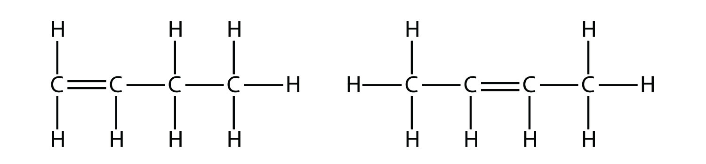
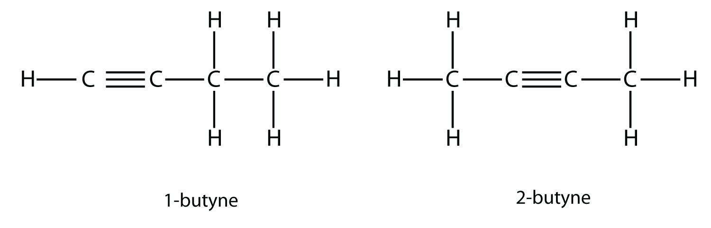
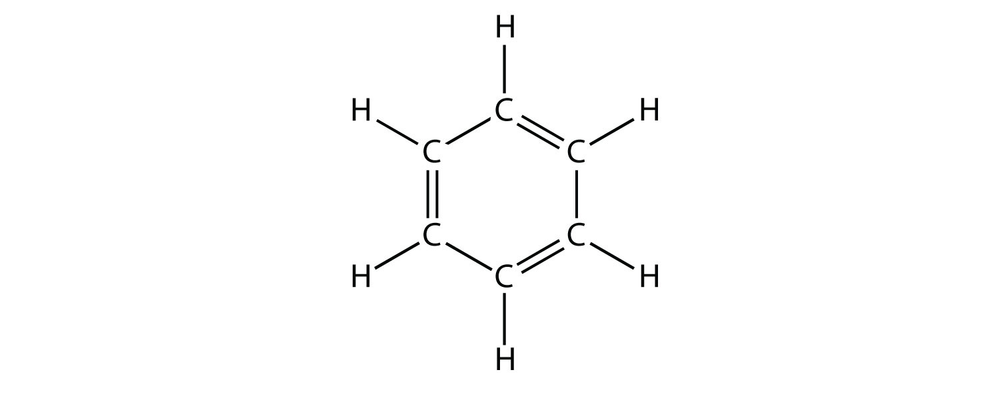
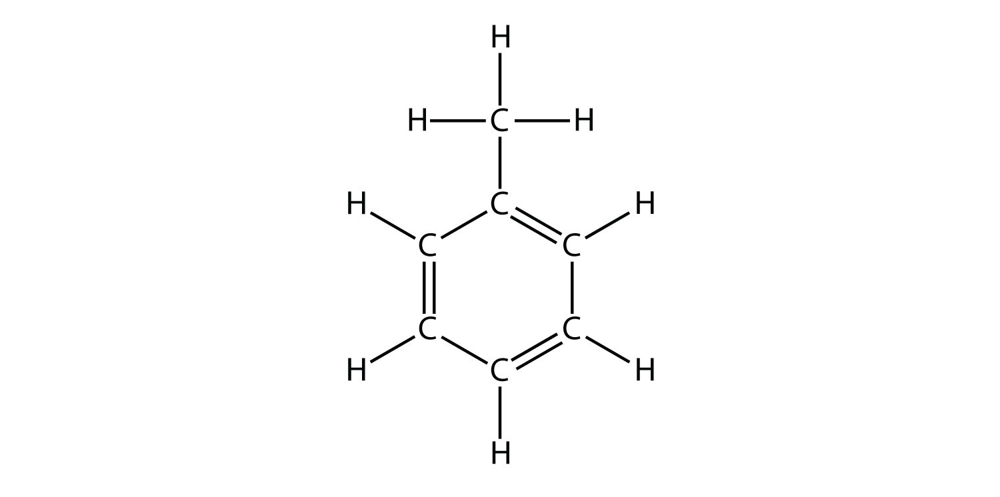
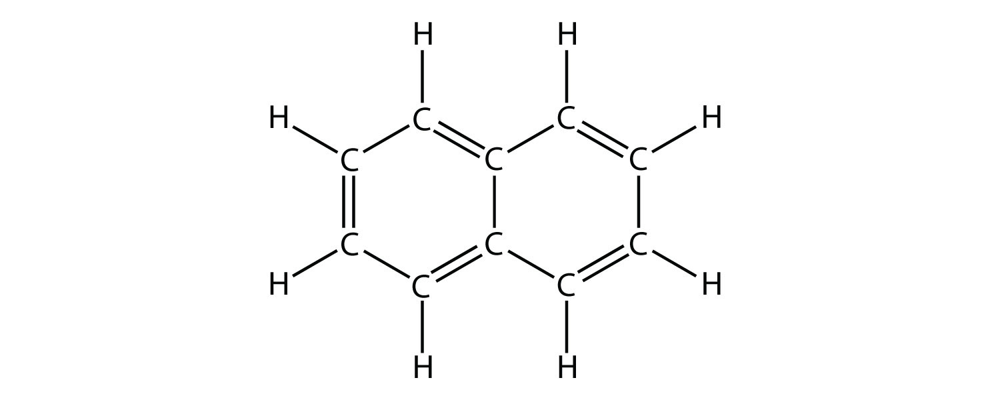
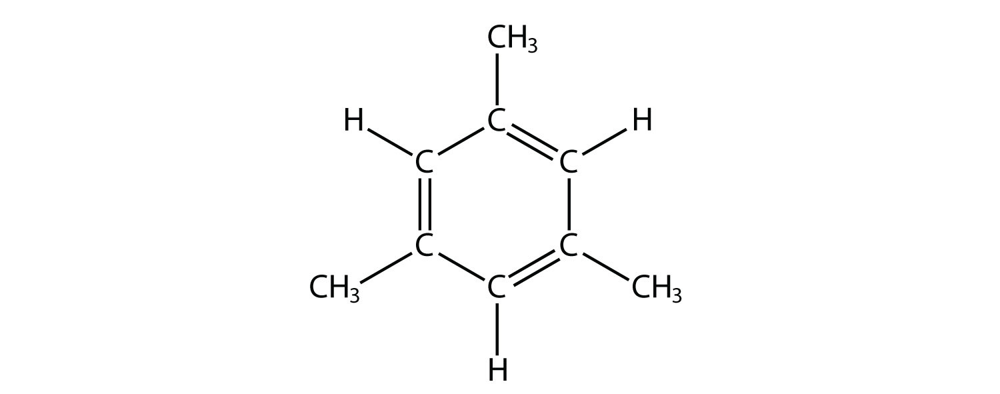
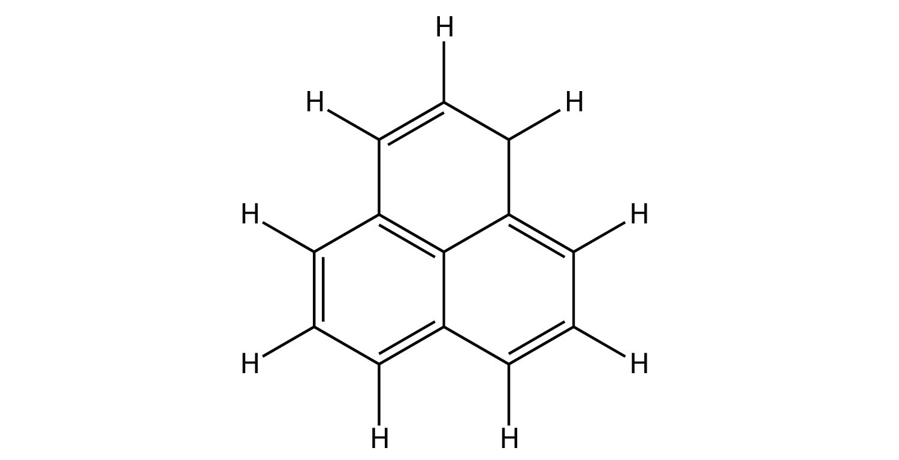
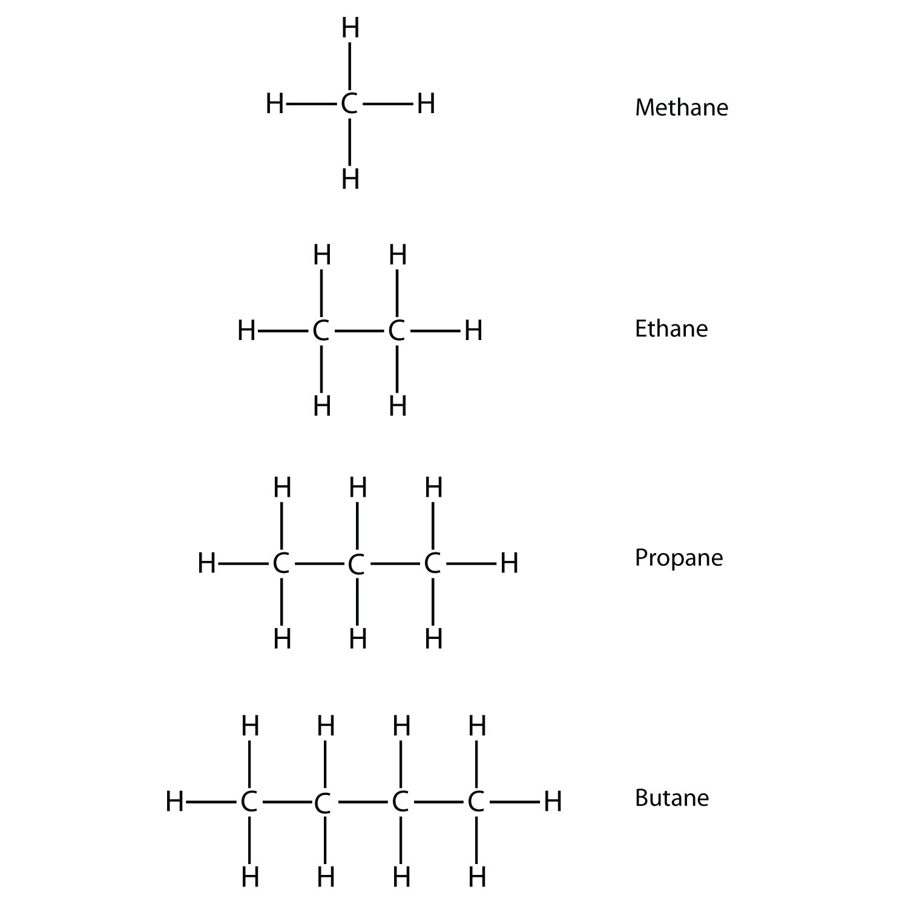
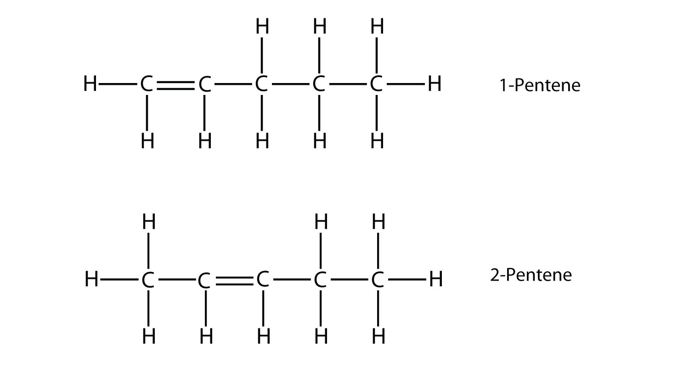

(sec:ch16:s01)=

# 16.1 Hydrocarbons

```{note} Learning Objectives

1. Identify alkanes, alkenes, alkynes, and aromatic compounds.
2. List some properties of hydrocarbons.
```

The simplest organic compounds are those composed of only two elements: carbon and hydrogen. These compounds are called **hydrocarbons** (*An organic compound composed of carbon and hydrogen.*). Hydrocarbons themselves are separated into two types: aliphatic hydrocarbons and aromatic hydrocarbons. **Aliphatic hydrocarbons** (*A hydrocarbon based on chains of C atoms.*) are hydrocarbons based on chains of C atoms. There are three types of aliphatic hydrocarbons. **Alkanes** (*An aliphatic hydrocarbon with only single covalent bonds.*) are aliphatic hydrocarbons with only single covalent bonds. **Alkenes** (*An aliphatic hydrocarbon that contains a C–C double bond.*) are hydrocarbons that contain at least one C–C double bond, and **alkynes** (*An aliphatic hydrocarbon that contains a C–C triple bond.*) are hydrocarbons that contain a C–C triple bond. Occasionally, we find an aliphatic hydrocarbon with a ring of C atoms; these hydrocarbons are called *cycloalkanes* (or *cycloalkenes* or *cycloalkynes*).

**Aromatic hydrocarbons** (*A hydrocarbon that contains a benzene ring.*) have a special six-carbon ring called a *benzene* ring. Electrons in the benzene ring have special energetic properties that give benzene physical and chemical properties that are markedly different from alkanes. Originally, the term *aromatic* was used to describe this class of compounds because they were particularly fragrant. However, in modern chemistry the term *aromatic* denotes the presence of a six-membered ring that imparts different and unique properties to a molecule.

The simplest alkanes have their C atoms bonded in a straight chain; these are called *normal* alkanes. They are named according to the number of C atoms in the chain. The smallest alkane is methane:


*16.1 Hydrocarbons*

To make four covalent bonds, the C atom bonds to four H atoms, making the molecular formula for methane CH<sub>4</sub>. The diagram for methane is misleading, however; the four covalent bonds that the C atom makes are oriented three dimensionally toward the corners of a tetrahedron. A better representation of the methane molecule is shown in Figure 16.1 "Three-Dimensional Representation of Methane".

The next-largest alkane has two C atoms that are covalently bonded to each other. For each C atom to make four covalent bonds, each C atom must be bonded to three H atoms. The resulting molecule, whose formula is C<sub>2</sub>H<sub>6</sub>, is ethane:


*16.1 Hydrocarbons*

Propane has a backbone of three C atoms surrounded by H atoms. You should be able to verify that the molecular formula for propane is C<sub>3</sub>H<sub>8</sub>:


*16.1 Hydrocarbons*

The diagrams representing alkanes are called **structural formulas** (*A diagram that represents how the atoms in a molecule are bonded.*) because they show the structure of the molecule. As molecules get larger, structural formulas become more and more complex. One way around this is to use a **condensed structural formula** (*A listing of the atoms bonded to each C atom in a chain.*), which lists the formula of each C atom in the backbone of the molecule. For example, the condensed structural formula for ethane is CH<sub>3</sub>CH<sub>3</sub>, while for propane it is CH<sub>3</sub>CH<sub>2</sub>CH<sub>3</sub>. {ref}`Table 16.1 "The First 10 Alkanes" <tbl:ch16:s01:t01>` gives the molecular formulas, the condensed structural formulas, and the names of the first 10 alkanes.

```{table} The First 10 Alkanes
:label: tbl:ch16:s01:t01

| Molecular Formula | Condensed Structural Formula | Name |
| --- | --- | --- |
| CH<sub>4</sub> | CH<sub>4</sub> | methane |
| C<sub>2</sub>H<sub>6</sub> | CH<sub>3</sub>CH<sub>3</sub> | ethane |
| C<sub>3</sub>H<sub>8</sub> | CH<sub>3</sub>CH<sub>2</sub>CH<sub>3</sub> | propane |
| C<sub>4</sub>H<sub>10</sub> | CH<sub>3</sub>CH<sub>2</sub>CH<sub>2</sub>CH<sub>3</sub> | butane |
| C<sub>5</sub>H<sub>12</sub> | CH<sub>3</sub>CH<sub>2</sub>CH<sub>2</sub>CH<sub>2</sub>CH<sub>3</sub> | pentane |
| C<sub>6</sub>H<sub>14</sub> | CH<sub>3</sub>(CH<sub>2</sub>)<sub>4</sub>CH<sub>3</sub> | hexane |
| C<sub>7</sub>H<sub>16</sub> | CH<sub>3</sub>(CH<sub>2</sub>)<sub>5</sub>CH<sub>3</sub> | heptane |
| C<sub>8</sub>H<sub>18</sub> | CH<sub>3</sub>(CH<sub>2</sub>)<sub>6</sub>CH<sub>3</sub> | octane |
| C<sub>9</sub>H<sub>20</sub> | CH<sub>3</sub>(CH<sub>2</sub>)<sub>7</sub>CH<sub>3</sub> | nonane |
| C<sub>10</sub>H<sub>22</sub> | CH<sub>3</sub>(CH<sub>2</sub>)<sub>8</sub>CH<sub>3</sub> | decane |
```

Because alkanes have the maximum number of H atoms possible according to the rules of covalent bonds, alkanes are also referred to as **saturated hydrocarbons** (*A carbon compound with the maximum possible number of H atoms in its formula.*).

Alkenes have a C–C double bond. Because they have less than the maximum number of H atoms possible, they are called **unsaturated hydrocarbons** (*A carbon compound with less than the maximum possible number of H atoms in its formula.*). The smallest alkene—ethene—has two C atoms and is also known by its common name ethylene:


*16.1 Hydrocarbons*

The next largest alkene—propene—has three C atoms with a C–C double bond between two of the C atoms. It is also known as propylene:


*16.1 Hydrocarbons*

What do you notice about the names of alkanes and alkenes? The names of alkenes are the same as their corresponding alkanes except that the ending is -*ene*, rather than -*ane*. Using a stem to indicate the number of C atoms in a molecule and an ending to represent the type of organic compound is common in organic chemistry, as we shall see.

With the introduction of the next alkene, butene, we begin to see a major issue with organic molecules: choices. With four C atoms, the C–C double bond can go between the first and second C atoms or between the second and third C atoms:



*16.1 Hydrocarbons*

(A double bond between the third and fourth C atoms is the same as having it between the first and second C atoms, only flipped over.) The rules of naming in organic chemistry require that these two substances have different names. The first molecule is named *1-butene*, while the second molecule is named *2-butene*. The number at the beginning of the name indicates where the double bond originates. The lowest possible number is used to number a feature in a molecule; hence, calling the second molecule 3-butene would be incorrect. Numbers are common parts of organic chemical names because they indicate which C atom in a chain contains a distinguishing feature.

The compounds 1-butene and 2-butene have different physical and chemical properties, even though they have the same molecular formula—C<sub>4</sub>H<sub>8</sub>. Different molecules with the same molecular formula are called **isomers** (*A molecule with the same molecular formula as another molecule but a different structure.*). Isomers are common in organic chemistry and contribute to its complexity.

```{exercise}
:label: ex:ball-ch16-s01-n02

**Example 1**

Based on the names for the butene molecules, propose a name for this molecule.


*16.1 Hydrocarbons*
```

```{solution} ex:ball-ch16-s01-n02
:label: sol:ball-ch16-s01-n02
:class: dropdown

With five C atoms, we will use the *pent*- stem, and with a C–C double bond, this is an alkene, so this molecule is a pentene. In numbering the C atoms, we use the number *2* because it is the lower possible label. So this molecule is named 2-pentene.
```

```{exercise}
:label: ex:ball-ch16-s01-n02-ty2

**Test Yourself**

Based on the names for the butene molecules, propose a name for this molecule.


*16.1 Hydrocarbons*
```

```{solution} ex:ball-ch16-s01-n02-ty2
:label: sol:ball-ch16-s01-n02-ty2
:class: dropdown

3-hexene
```

Alkynes, with a C–C triple bond, are named similarly to alkenes except their names end in -*yne*. The smallest alkyne is ethyne, which is also known as acetylene:


*16.1 Hydrocarbons*

Propyne has the structure


*16.1 Hydrocarbons*

With butyne, we need to start numbering the position of the triple bond, just as we did with alkenes:



*16.1 Hydrocarbons*

Aromatic compounds contain the benzene unit. Benzene itself is composed of six C atoms in a ring, with alternating single and double C–C bonds:



*16.1 Hydrocarbons*

The alternating single and double C–C bonds give the benzene ring a special stability, and it does not react like an alkene as might be suspected. Benzene has the molecular formula C<sub>6</sub>H<sub>6</sub>; in larger aromatic compounds, a different atom replaces one or more of the H atoms.

As fundamental as hydrocarbons are to organic chemistry, their properties and chemical reactions are rather mundane. Most hydrocarbons are nonpolar because of the close electronegativities of the C and H atoms. As such, they dissolve only sparingly in H<sub>2</sub>O and other polar solvents. Small hydrocarbons, such as methane and ethane, are gases at room temperature, while larger hydrocarbons, such as hexane and octane, are liquids. Even larger hydrocarbons are solids at room temperature and have a soft, waxy consistency.

Hydrocarbons are rather unreactive, but they do participate in some classic chemical reactions. One common reaction is substitution with a halogen atom by combining a hydrocarbon with an elemental halogen. Light is sometimes used to promote the reaction, such as this one between methane and chlorine:

$$
{\text{CH}}_{\text{4}}+{\text{Cl}}_{\text{2}}\xrightarrow{\text{light}}{\text{ CH}}_{\text{3}}\text{Cl}+\text{HCl}
$$

Halogens can also react with alkenes and alkynes, but the reaction is different. In these cases, the halogen reacts with the C–C double or triple bond and inserts itself onto each C atom involved in the multiple bonds. This reaction is called an **addition reaction** (*The reaction of a halogen molecule across a C–C double or triple bond.*). One example is

```{figure} ../images/figures/d2dc69b0a0aa0262e6d38f9bae75aa02.jpg
:label: fig:fwk:ball:eq16:001
:alt: "16.1 Hydrocarbons"
:align: center
:width: 85%

16.1 Hydrocarbons
```

The reaction conditions are usually mild; in many cases, the halogen reacts spontaneously with an alkene or an alkyne.

Hydrogen can also be added across a multiple bond; this reaction is called a **hydrogenation reaction** (*The reaction of hydrogen across a C–C double or triple bond, usually in the presence of a catalyst.*). In this case, however, the reaction conditions may not be mild; high pressures of H<sub>2</sub> gas may be necessary. A platinum or palladium catalyst is usually employed to get the reaction to proceed at a reasonable pace:

$$
{\text{CH}}_{\text{2}}{\text{=CH}}_{\text{2}}+{\text{H}}_{\text{2}}\xrightarrow{\text{metal catalyst}}{\text{ CH}}_{\text{3}}{\text{CH}}_{\text{3}}
$$

By far the most common reaction of hydrocarbons is combustion, which is the combination of a hydrocarbon with O<sub>2</sub> to make CO<sub>2</sub> and H<sub>2</sub>O. The combustion of hydrocarbons is accompanied by a release of energy and is a primary source of energy production in our society (Figure 16.2 "Combustion"). The combustion reaction for gasoline, for example, which can be represented by C<sub>8</sub>H<sub>18</sub>, is as follows:

$$
\text{2C}_{8}\text{H}_{18}\text{ + 25O}_{2}\text{ }\rightarrow{}\text{ 16CO}_{2}\text{ + 18H}_{2}\text{O + \textasciitilde{}5060 kJ}
$$

```{important} Key Takeaways

- The simplest organic compounds are hydrocarbons and are composed of carbon and hydrogen.
- Hydrocarbons can be aliphatic or aromatic; aliphatic hydrocarbons are divided into alkanes, alkenes, and alkynes.
- The combustion of hydrocarbons is a primary source of energy for our society.
```

## Exercises

```{exercise}
:label: ex:ball-ch16-s01-qs01-qd01-qa01

**Exercise 1.**

Define *hydrocarbon*. What are the two general types of hydrocarbons?
```

```{solution} ex:ball-ch16-s01-qs01-qd01-qa01
:label: sol:ball-ch16-s01-qs01-qd01-qa01
:class: dropdown

an organic compound composed of only carbon and hydrogen; aliphatic hydrocarbons and aromatic hydrocarbons
```

```{exercise}
:label: ex:ball-ch16-s01-qs01-qd01-qa02

**Exercise 2.**

What are the three different types of aliphatic hydrocarbons? How are they defined?
```

```{exercise}
:label: ex:ball-ch16-s01-qs01-qd01-qa03

**Exercise 3.**

Indicate whether each molecule is an aliphatic or an aromatic hydrocarbon; if aliphatic, identify the molecule as an alkane, an alkene, or an alkyne.

a. 

   *16.1 Hydrocarbons*
b. 

   *16.1 Hydrocarbons*
c. 

   *16.1 Hydrocarbons*
```

```{solution} ex:ball-ch16-s01-qs01-qd01-qa03
:label: sol:ball-ch16-s01-qs01-qd01-qa03
:class: dropdown

a. aliphatic; alkane
b. aromatic
c. aliphatic; alkene
```

```{exercise}
:label: ex:ball-ch16-s01-qs01-qd01-qa04

**Exercise 4.**

Indicate whether each molecule is an aliphatic or an aromatic hydrocarbon; if aliphatic, identify the molecule as an alkane, an alkene, or an alkyne.

a. 

   *16.1 Hydrocarbons*
b. 

   *16.1 Hydrocarbons*
c. 

   *16.1 Hydrocarbons*
```

```{exercise}
:label: ex:ball-ch16-s01-qs01-qd01-qa05

**Exercise 5.**

Indicate whether each molecule is an aliphatic or an aromatic hydrocarbon; if aliphatic, identify the molecule as an alkane, an alkene, or an alkyne.

a. 

   *16.1 Hydrocarbons*
b. 

   *16.1 Hydrocarbons*
c. 

   *16.1 Hydrocarbons*
```

```{solution} ex:ball-ch16-s01-qs01-qd01-qa05
:label: sol:ball-ch16-s01-qs01-qd01-qa05
:class: dropdown

a. aliphatic; alkane
b. aliphatic; alkene
c. aromatic
```

```{exercise}
:label: ex:ball-ch16-s01-qs01-qd01-qa06

**Exercise 6.**

Indicate whether each molecule is an aliphatic or an aromatic hydrocarbon; if aliphatic, identify the molecule as an alkane, an alkene, or an alkyne.

a. 

   *16.1 Hydrocarbons*
b. 

   *16.1 Hydrocarbons*
c. 

   *16.1 Hydrocarbons*
```

```{exercise}
:label: ex:ball-ch16-s01-qs01-qd01-qa07

**Exercise 7.**

Name and draw the structural formulas for the four smallest alkanes.
```

```{solution} ex:ball-ch16-s01-qs01-qd01-qa07
:label: sol:ball-ch16-s01-qs01-qd01-qa07
:class: dropdown



*16.1 Hydrocarbons*
```

```{exercise}
:label: ex:ball-ch16-s01-qs01-qd01-qa08

**Exercise 8.**

Name and draw the structural formulas for the four smallest alkenes.
```

```{exercise}
:label: ex:ball-ch16-s01-qs01-qd01-qa09

**Exercise 9.**

What does the term *aromatic* imply about an organic molecule?
```

```{solution} ex:ball-ch16-s01-qs01-qd01-qa09
:label: sol:ball-ch16-s01-qs01-qd01-qa09
:class: dropdown

Aromatic means that the molecule has a benzene ring.
```

```{exercise}
:label: ex:ball-ch16-s01-qs01-qd01-qa10

**Exercise 10.**

What does the term *normal* imply when used for alkanes?
```

```{exercise}
:label: ex:ball-ch16-s01-qs01-qd01-qa11

**Exercise 11.**

Explain why the name *1-propene* is incorrect. What is the proper name for this molecule?
```

```{solution} ex:ball-ch16-s01-qs01-qd01-qa11
:label: sol:ball-ch16-s01-qs01-qd01-qa11
:class: dropdown

The 1 is not necessary. The name of the compound is simply *propene*.
```

```{exercise}
:label: ex:ball-ch16-s01-qs01-qd01-qa12

**Exercise 12.**

Explain why the name *3-butene* is incorrect. What is the proper name for this molecule?
```

```{exercise}
:label: ex:ball-ch16-s01-qs01-qd01-qa13

**Exercise 13.**

Name and draw the structural formula of each isomer of pentene.
```

```{solution} ex:ball-ch16-s01-qs01-qd01-qa13
:label: sol:ball-ch16-s01-qs01-qd01-qa13
:class: dropdown



*16.1 Hydrocarbons*
```

```{exercise}
:label: ex:ball-ch16-s01-qs01-qd01-qa14

**Exercise 14.**

Name and draw the structural formula of each isomer of hexyne.
```

```{exercise}
:label: ex:ball-ch16-s01-qs01-qd01-qa15

**Exercise 15.**

Write a chemical equation for the reaction between methane and bromine.
```

```{solution} ex:ball-ch16-s01-qs01-qd01-qa15
:label: sol:ball-ch16-s01-qs01-qd01-qa15
:class: dropdown

CH<sub>4</sub> + Br<sub>2</sub> → CH<sub>3</sub>Br + HBr
```

```{exercise}
:label: ex:ball-ch16-s01-qs01-qd01-qa16

**Exercise 16.**

Write a chemical equation for the reaction between ethane and chlorine.
```

```{exercise}
:label: ex:ball-ch16-s01-qs01-qd01-qa17

**Exercise 17.**

Draw the structure of the product of the reaction of bromine with propene.
```

```{solution} ex:ball-ch16-s01-qs01-qd01-qa17
:label: sol:ball-ch16-s01-qs01-qd01-qa17
:class: dropdown


*16.1 Hydrocarbons*
```

```{exercise}
:label: ex:ball-ch16-s01-qs01-qd01-qa18

**Exercise 18.**

Draw the structure of the product of the reaction of chlorine with 2-butene.
```

```{exercise}
:label: ex:ball-ch16-s01-qs01-qd01-qa19

**Exercise 19.**

Draw the structure of the product of the reaction of hydrogen with 1-butene.
```

```{solution} ex:ball-ch16-s01-qs01-qd01-qa19
:label: sol:ball-ch16-s01-qs01-qd01-qa19
:class: dropdown


*16.1 Hydrocarbons*
```

```{exercise}
:label: ex:ball-ch16-s01-qs01-qd01-qa20

**Exercise 20.**

Draw the structure of the product of the reaction of hydrogen with 2-pentene.
```

```{exercise}
:label: ex:ball-ch16-s01-qs01-qd01-qa21

**Exercise 21.**

Write the balanced chemical equation for the combustion of heptane.
```

```{solution} ex:ball-ch16-s01-qs01-qd01-qa21
:label: sol:ball-ch16-s01-qs01-qd01-qa21
:class: dropdown

C<sub>7</sub>H<sub>16</sub> + 11O<sub>2</sub> → 7CO<sub>2</sub> + 8H<sub>2</sub>O
```

```{exercise}
:label: ex:ball-ch16-s01-qs01-qd01-qa22

**Exercise 22.**

Write the balanced chemical equation for the combustion of nonane.
```
