(sec:ch16:s02)=

# 16.2 Branched Hydrocarbons

```{note} Learning Objectives

1. Name a branched hydrocarbon from its structure.
2. Draw the structural formula of a branched hydrocarbon from its name.
```

Not all hydrocarbons are straight chains. Many hydrocarbons have branches of C atoms attached to a chain. These branched alkanes are isomers of straight-chain alkanes having the same number of C atoms. However, they are different compounds with different physical and chemical properties. As such, they need different names. How do we name **branched hydrocarbons** (*A carbon compound that is not a straight chain but has branches attached to the longest chain.*)?

There are a series of rules for naming branched alkanes (and, ultimately, for all organic compounds). These rules make up the system of **nomenclature** (*The rules of naming in organic chemistry.*) for naming organic molecules. Worldwide, the International Union of Pure and Applied Chemistry (IUPAC) has developed the system of nomenclature for organic compounds. So these rules are sometimes called the *IUPAC rules of nomenclature*. By learning and applying these rules, you can name any organic compound when given its structure or determine the unique structure of a molecule from its name. You have already learned the basics of nomenclature—the names of the first 10 normal hydrocarbons. Here, we will add some steps to the procedure so you can name branched hydrocarbons.

First, given the structure of an alkane, identify the longest continuous chain of C atoms. Note that the longest chain may not be drawn in a straight line. The longest chain determines the parent name of the hydrocarbon. For example, in the molecule

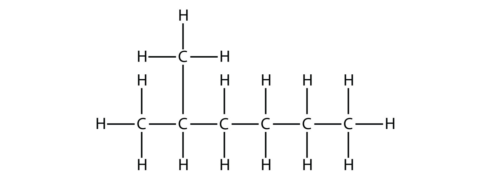

*16.2 Branched Hydrocarbons*

the longest chain of carbons has six C atoms. Therefore, it will be named as a hexane. However, in the molecule

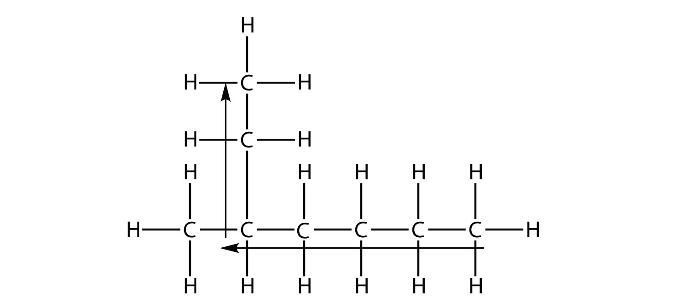

*16.2 Branched Hydrocarbons*

the longest chain of C atoms is not six, but seven, as shown. So this molecule will be named as a heptane.

The next step is to identify the branches, or **substituents** (*A branch off a main chain in a hydrocarbon.*), on the main chain. The names of the substituents, or *alkyl groups*, are derived from the names of the parent hydrocarbons; however, rather than having the ending -*ane*, the substituent name has the ending -*yl*. {ref}`Table 16.2 "Substituent Names" <tbl:ch16:s02:t01>` lists the substituent names for the five smallest substituents.

```{table} Substituent Names
:label: tbl:ch16:s02:t01

| Substituent Formula | Number of C Atoms | Name of Substituent |
| --- | --- | --- |
| CH<sub>3</sub> | 1 | *methyl*- |
| CH<sub>3</sub>CH<sub>2</sub> | 2 | *ethyl*- |
| CH<sub>3</sub>CH<sub>2</sub>CH<sub>2</sub> | 3 | *propyl*- |
| CH<sub>3</sub>CH<sub>2</sub>CH<sub>2</sub>CH<sub>2</sub> | 4 | *butyl*- |
| CH<sub>3</sub>CH<sub>2</sub>CH<sub>2</sub>CH<sub>2</sub>CH<sub>2</sub> | 5 | *pentyl*- |
| and so forth | and so forth | and so forth |
```

In naming the branched hydrocarbon, the name of the substituent is combined with the parent name of the hydrocarbon without spaces. However, there is likely one more step. The longest chain of the hydrocarbon must be numbered, and the numerical position of the substituent must be included to account for possible isomers. As with double and triple bonds, the main chain is numbered to give the substituent the lowest possible number. For example, in this alkane

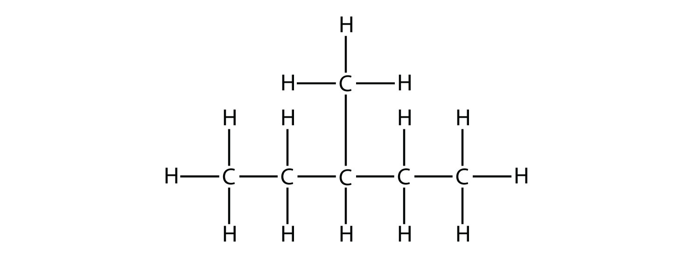

*16.2 Branched Hydrocarbons*

the longest chain is five C atoms long, so it is a pentane. There is a one-carbon substituent on the third C atom, so there is a methyl group at position 3. We indicate the position using the number, which is followed by a hyphen, the substituent name, and the parent hydrocarbon name—in this case, 3-methylpentane. That name is specific to that particular hydrocarbon and no other molecule. Organic chemistry nomenclature is very specific!

It is common to write the structural formula of a hydrocarbon without the H atoms, for clarity. So we can also represent 3-methylpentane as


*16.2 Branched Hydrocarbons*

where it is understood that any unwritten covalent bonds are bonds with H atoms. With this understanding, we recognize that the structural formula for 3-methylpentane refers to a molecule with the formula of C<sub>6</sub>H<sub>14</sub>.

```{exercise}
:label: ex:ball-ch16-s02-n02

**Example 2**

Name this molecule.


*16.2 Branched Hydrocarbons*
```

```{solution} ex:ball-ch16-s02-n02
:label: sol:ball-ch16-s02-n02
:class: dropdown

The longest continuous carbon chain has seven C atoms, so this molecule will be named as a heptane. There is a two-carbon substituent on the main chain, which is an ethyl group. To give the substituent the lowest numbering, we number the chain from the *right* side and see that the substituent is on the third C atom. So this hydrocarbon is 3-ethylheptane.
```

```{exercise}
:label: ex:ball-ch16-s02-n02-ty2

**Test Yourself**

Name this molecule.


*16.2 Branched Hydrocarbons*
```

```{solution} ex:ball-ch16-s02-n02-ty2
:label: sol:ball-ch16-s02-n02-ty2
:class: dropdown

2-methylpentane
```

Branched hydrocarbons may have more than one substituent. If the substituents are different, then give each substituent a number (using the smallest possible numbers) and list the substituents in alphabetical order, with the numbers separated by hyphens and with no spaces in the name. So the molecule


*16.2 Branched Hydrocarbons*

is 3-ethyl-2-methylpentane.

If the substituents are the same, then use the name of the substituent only once, but use more than one number, separated by a comma. Also, put a numerical prefix before the substituent name that indicates the number of substituents of that type. The numerical prefixes are listed in {ref}`Table 16.3 "Numerical Prefixes to Use for Multiple Substituents" <tbl:ch16:s02:t02>`. The number of the position values must agree with the numerical prefix before the substituent.

```{table} Numerical Prefixes to Use for Multiple Substituents
:label: tbl:ch16:s02:t02

| Number of Same Substituent | Numerical Prefix |
| --- | --- |
| 2 | *di*- |
| 3 | *tri-* |
| 4 | *tetra*- |
| 5 | *penta*- |
| and so forth | and so forth |
```

Consider this molecule:


*16.2 Branched Hydrocarbons*

The longest chain has four C atoms, so it is a butane. There are two substituents, each of which consists of a single C atom; they are methyl groups. The methyl groups are on the second and third C atoms in the chain (no matter which end the numbering starts from), so we would name this molecule 2,3-dimethylbutane. Note the comma between the numbers, the hyphen between the numbers and the substituent name, and the presence of the prefix *di*- before the *methyl*. Other molecules—even with larger numbers of substituents—can be named similarly.

```{exercise}
:label: ex:ball-ch16-s02-n03

**Example 3**

Name this molecule.

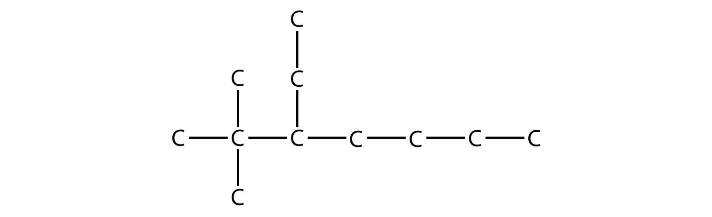

*16.2 Branched Hydrocarbons*
```

```{solution} ex:ball-ch16-s02-n03
:label: sol:ball-ch16-s02-n03
:class: dropdown

The longest chain has seven C atoms, so we name this molecule as a heptane. We find two one-carbon substituents on the second C atom and a two-carbon substituent on the third C atom. So this molecule is named 3-ethyl-2,2-dimethylheptane.
```

```{exercise}
:label: ex:ball-ch16-s02-n03-ty2

**Test Yourself**

Name this molecule.

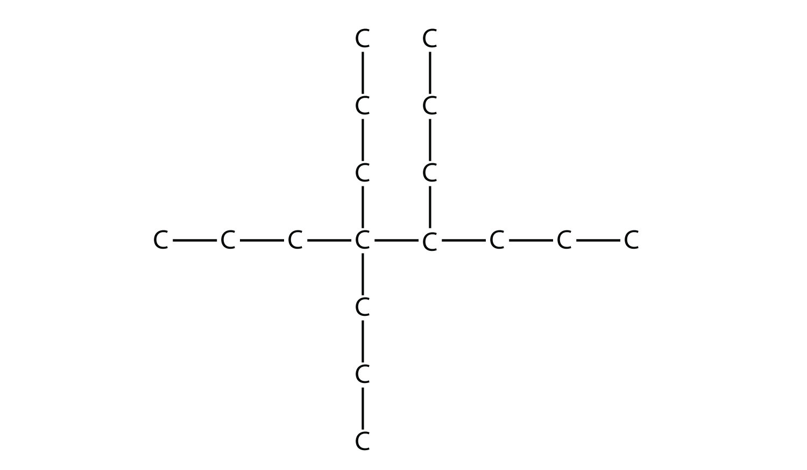

*16.2 Branched Hydrocarbons*
```

```{solution} ex:ball-ch16-s02-n03-ty2
:label: sol:ball-ch16-s02-n03-ty2
:class: dropdown

4,4,5-tripropyloctane
```

Alkenes and alkynes are named in a similar fashion. The biggest difference is that when identifying the longest carbon chain, it *must* contain the C–C double or triple bond. Furthermore, when numbering the main chain, the double or triple bond gets the lowest possible number. This means that there may be longer or higher-numbered substituents than may be allowed if the molecule were an alkane. For example, this molecule


*16.2 Branched Hydrocarbons*

is 2,4-dimethyl-3-heptene (note the number and the hyphens that indicate the position of the double bond).

```{exercise}
:label: ex:ball-ch16-s02-n04

**Example 4**

Name this molecule.


*16.2 Branched Hydrocarbons*
```

```{solution} ex:ball-ch16-s02-n04
:label: sol:ball-ch16-s02-n04
:class: dropdown

The longest chain that contains the C–C triple bond has six C atoms, so this is a hexyne molecule. The triple bond starts at the third C atom, so this is a 3-hexyne. Finally, there are two methyl groups on the chain; to give them the lowest possible number, we number the chain from the left side, giving the methyl groups the second position. So the name of this molecule is 2,2-dimethyl-3-hexyne.
```

```{exercise}
:label: ex:ball-ch16-s02-n04-ty2

**Test Yourself**

Name this molecule.


*16.2 Branched Hydrocarbons*
```

```{solution} ex:ball-ch16-s02-n04-ty2
:label: sol:ball-ch16-s02-n04-ty2
:class: dropdown

2,3,4-trimethyl-2-pentene
```

Once you master naming hydrocarbons from their given structures, it is rather easy to draw a structure from a given name. Just draw the parent chain with the correct number of C atoms (putting the double or triple bond in the right position, as necessary) and add the substituents in the proper positions. If you start by drawing the C atom backbone, you can go back and complete the structure by adding H atoms to give each C atom four covalent bonds. From the name 2,3-dimethyl-4-propyl-2-heptene, we start by drawing the seven-carbon parent chain with a double bond starting at the third carbon:


*16.2 Branched Hydrocarbons*

We add to this structure two one-carbon substituents on the second and third C atoms:


*16.2 Branched Hydrocarbons*

We finish the carbon backbone by adding a three-carbon propyl group to the fourth C atom in the parent chain:

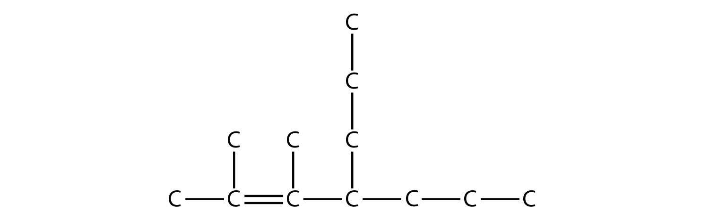

*16.2 Branched Hydrocarbons*

If we so choose, we can add H atoms to each C atom to give each carbon four covalent bonds, being careful to note that the C atoms in the double bond already have an additional covalent bond. (How many H atoms do you think are required?[^fwk-ball-fn16001])

```{exercise}
:label: ex:ball-ch16-s02-n05

**Example 5**

Draw the carbon backbone for 2,3,4-trimethylpentane.
```

```{solution} ex:ball-ch16-s02-n05
:label: sol:ball-ch16-s02-n05
:class: dropdown

First, we draw the five-carbon backbone that represents the pentane chain:


*16.2 Branched Hydrocarbons*

According to the name, there are three one-carbon methyl groups attached to the second, the third, and the fourth C atoms in the chain. We finish the carbon backbone by putting the three methyl groups on the pentane main chain:


*16.2 Branched Hydrocarbons*
```

```{exercise}
:label: ex:ball-ch16-s02-n05-ty2

**Test Yourself**

Draw the carbon backbone for 3-ethyl-6,7-dimethyl-2-octene.
```

```{solution} ex:ball-ch16-s02-n05-ty2
:label: sol:ball-ch16-s02-n05-ty2
:class: dropdown

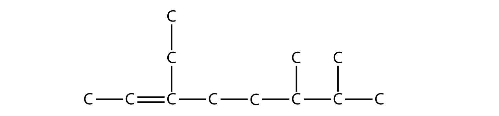

*16.2 Branched Hydrocarbons*
```

Naming substituted benzene molecules is straightforward. If there is only one substituent, the substituent is named as a side chain on a benzene molecule, like this:

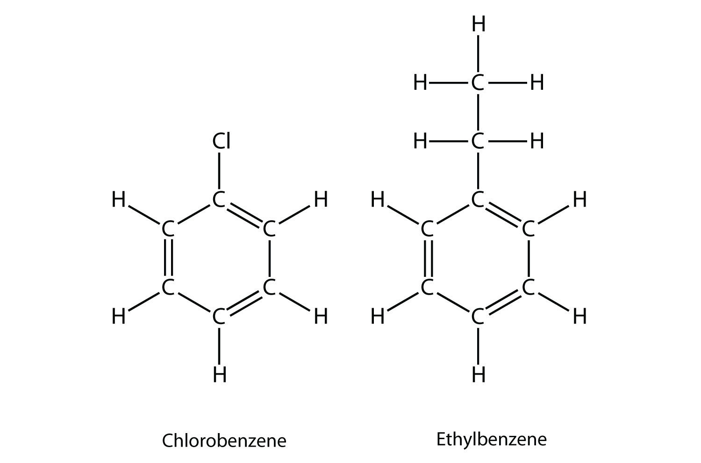

*16.2 Branched Hydrocarbons*

If there are two or more substituents on a benzene molecule, the relative positions must be numbered, just as an aliphatic chain of C atoms is numbered. The substituent that is first alphabetically is assigned position 1, and the ring is numbered in a circle to give the other substituents the lowest possible number(s).

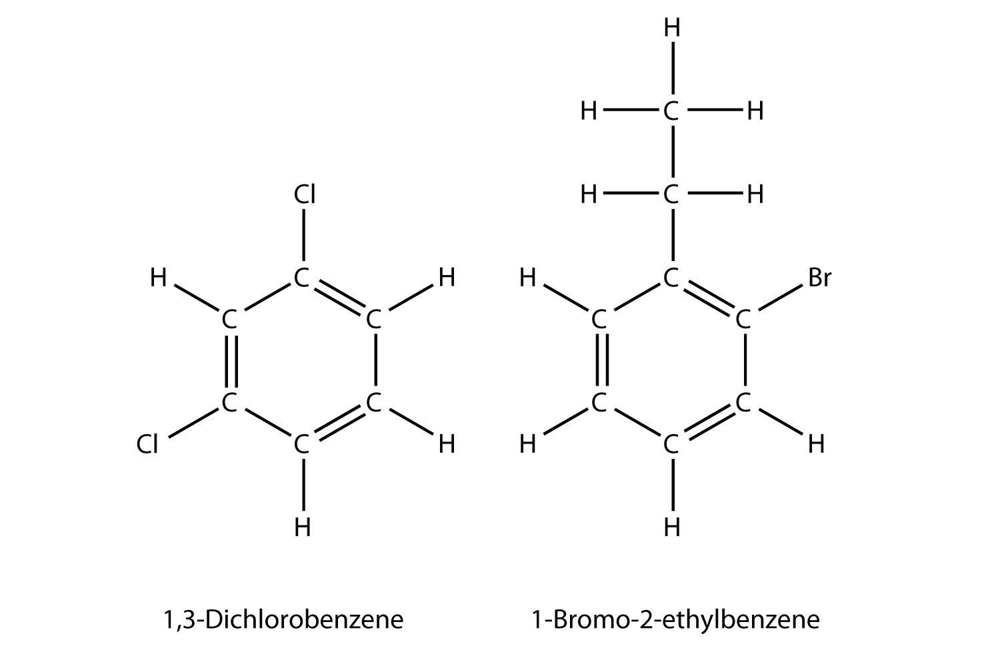

*16.2 Branched Hydrocarbons*

If a benzene ring is treated as a substituent, it is given the name *phenyl*-. The following molecule is 3-phenylpentane:


*16.2 Branched Hydrocarbons*

where the H atoms have been omitted for clarity.

```{important} Key Takeaways

- A unique name can be given to branched hydrocarbons.
- A unique structure can be drawn for the name of a hydrocarbon.
```

## Exercises

```{exercise}
:label: ex:ball-ch16-s02-qs01-qd01-qa01

**Exercise 1.**

How does a branched hydrocarbon differ from a normal hydrocarbon?
```

```{solution} ex:ball-ch16-s02-qs01-qd01-qa01
:label: sol:ball-ch16-s02-qs01-qd01-qa01
:class: dropdown

A branched hydrocarbon does not have all of its C atoms in a single row.
```

```{exercise}
:label: ex:ball-ch16-s02-qs01-qd01-qa02

**Exercise 2.**

How does a substituent get its unique name?
```

```{exercise}
:label: ex:ball-ch16-s02-qs01-qd01-qa03

**Exercise 3.**

Name this molecule.


*16.2 Branched Hydrocarbons*
```

```{solution} ex:ball-ch16-s02-qs01-qd01-qa03
:label: sol:ball-ch16-s02-qs01-qd01-qa03
:class: dropdown

3-methyl-2-hexene
```

```{exercise}
:label: ex:ball-ch16-s02-qs01-qd01-qa04

**Exercise 4.**

Name this molecule.


*16.2 Branched Hydrocarbons*
```

```{exercise}
:label: ex:ball-ch16-s02-qs01-qd01-qa05

**Exercise 5.**

Name this molecule.


*16.2 Branched Hydrocarbons*
```

```{solution} ex:ball-ch16-s02-qs01-qd01-qa05
:label: sol:ball-ch16-s02-qs01-qd01-qa05
:class: dropdown

4,4-dimethyl-1-pentene
```

```{exercise}
:label: ex:ball-ch16-s02-qs01-qd01-qa06

**Exercise 6.**

Name this molecule.

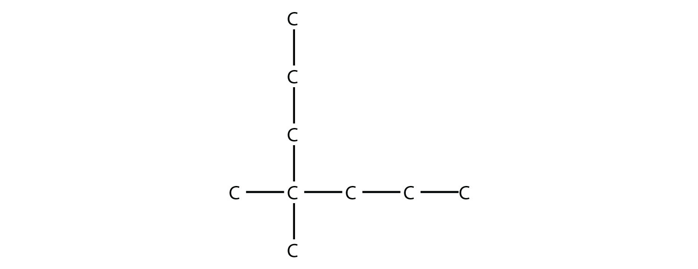

*16.2 Branched Hydrocarbons*
```

```{exercise}
:label: ex:ball-ch16-s02-qs01-qd01-qa07

**Exercise 7.**

Name this molecule.


*16.2 Branched Hydrocarbons*
```

```{solution} ex:ball-ch16-s02-qs01-qd01-qa07
:label: sol:ball-ch16-s02-qs01-qd01-qa07
:class: dropdown

2,4-dimethyl-2-pentene
```

```{exercise}
:label: ex:ball-ch16-s02-qs01-qd01-qa08

**Exercise 8.**

Name this molecule.


*16.2 Branched Hydrocarbons*
```

```{exercise}
:label: ex:ball-ch16-s02-qs01-qd01-qa09

**Exercise 9.**

Name this molecule.

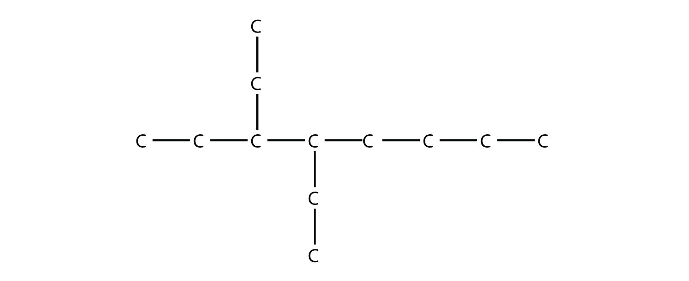

*16.2 Branched Hydrocarbons*
```

```{solution} ex:ball-ch16-s02-qs01-qd01-qa09
:label: sol:ball-ch16-s02-qs01-qd01-qa09
:class: dropdown

3,4-diethyloctane
```

```{exercise}
:label: ex:ball-ch16-s02-qs01-qd01-qa10

**Exercise 10.**

Name this molecule.


*16.2 Branched Hydrocarbons*
```

```{exercise}
:label: ex:ball-ch16-s02-qs01-qd01-qa11

**Exercise 11.**

Name this molecule.

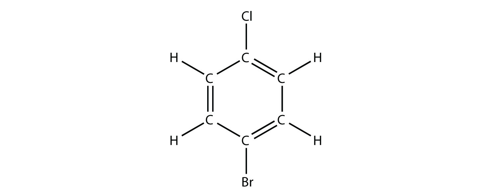

*16.2 Branched Hydrocarbons*
```

```{solution} ex:ball-ch16-s02-qs01-qd01-qa11
:label: sol:ball-ch16-s02-qs01-qd01-qa11
:class: dropdown

1-bromo-4-chlorobenzene
```

```{exercise}
:label: ex:ball-ch16-s02-qs01-qd01-qa12

**Exercise 12.**

Name this molecule.

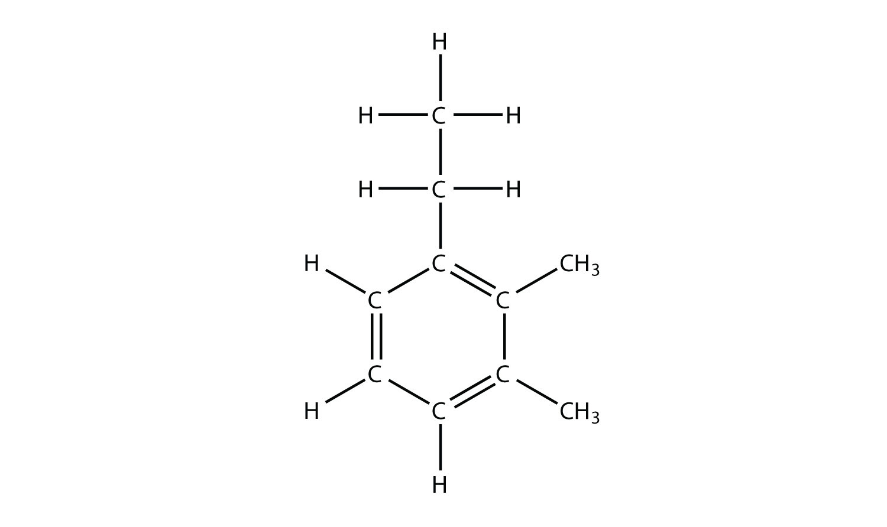

*16.2 Branched Hydrocarbons*
```

```{exercise}
:label: ex:ball-ch16-s02-qs01-qd01-qa13

**Exercise 13.**

Draw the carbon backbone for each molecule.

a. 3,4-diethyloctane
b. 2,2-dimethyl-4-propylnonane
```

```{solution} ex:ball-ch16-s02-qs01-qd01-qa13
:label: sol:ball-ch16-s02-qs01-qd01-qa13
:class: dropdown

a. 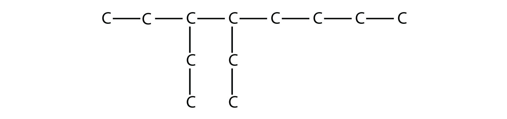

   *16.2 Branched Hydrocarbons*
b. 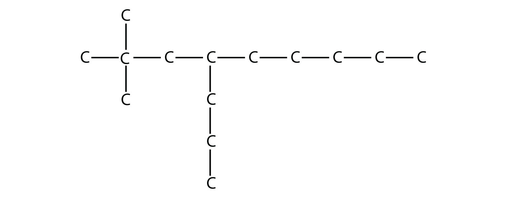

   *16.2 Branched Hydrocarbons*
```

```{exercise}
:label: ex:ball-ch16-s02-qs01-qd01-qa14

**Exercise 14.**

Draw the carbon backbone for each molecule.

a. 3-ethyl-4-methyl-3-heptene
b. 3,3-diethyl-1-pentyne
```

```{exercise}
:label: ex:ball-ch16-s02-qs01-qd01-qa15

**Exercise 15.**

Draw the carbon backbone for each molecule.

a. 4-ethyl-4-propyl-2-octyne
b. 5-butyl-2,2-dimethyldecane
```

```{solution} ex:ball-ch16-s02-qs01-qd01-qa15
:label: sol:ball-ch16-s02-qs01-qd01-qa15
:class: dropdown

a. 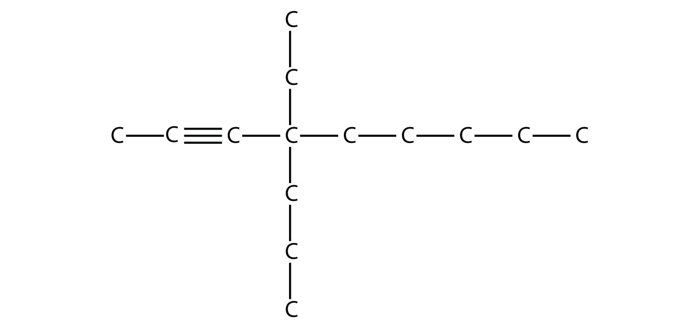

   *16.2 Branched Hydrocarbons*
b. 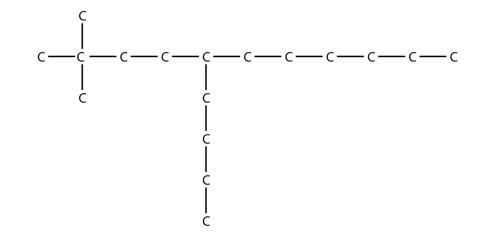

   *16.2 Branched Hydrocarbons*
```

```{exercise}
:label: ex:ball-ch16-s02-qs01-qd01-qa16

**Exercise 16.**

Draw the carbon backbone for each molecule.

a. 3,4-diethyl-1-hexyne
b. 4-propyl-3-ethyl-2-methyloctane
```

```{exercise}
:label: ex:ball-ch16-s02-qs01-qd01-qa17

**Exercise 17.**

The name 2-ethylhexane is incorrect. Draw the carbon backbone and write the correct name for this molecule.
```

```{solution} ex:ball-ch16-s02-qs01-qd01-qa17
:label: sol:ball-ch16-s02-qs01-qd01-qa17
:class: dropdown


*16.2 Branched Hydrocarbons*
```

```{exercise}
:label: ex:ball-ch16-s02-qs01-qd01-qa18

**Exercise 18.**

The name 3-butyl-7-methyloctane is incorrect. Draw the carbon backbone and write the correct name for this molecule.
```

[^fwk-ball-fn16001]: There will need to be 24 H atoms to complete the molecule.
