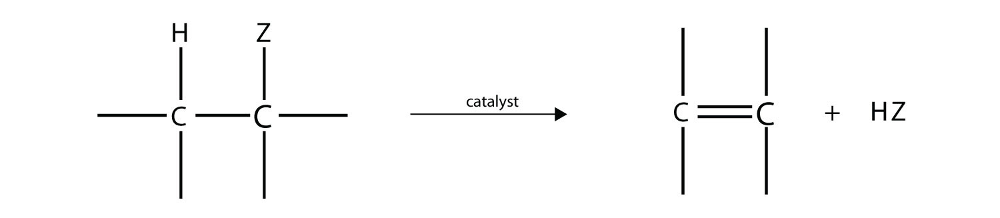
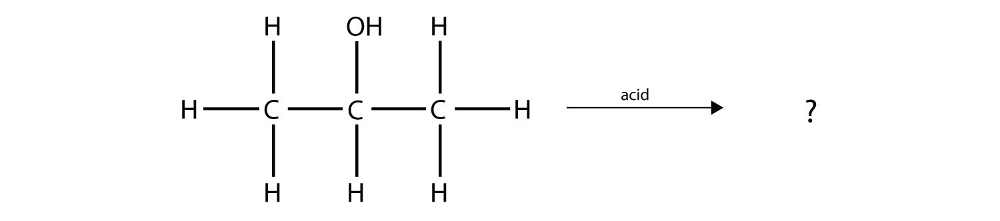
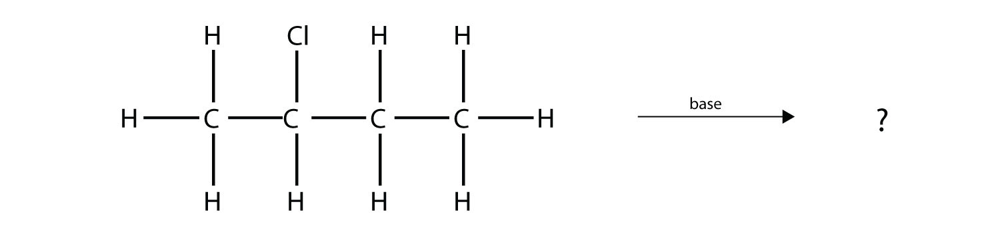
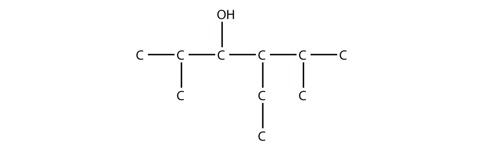
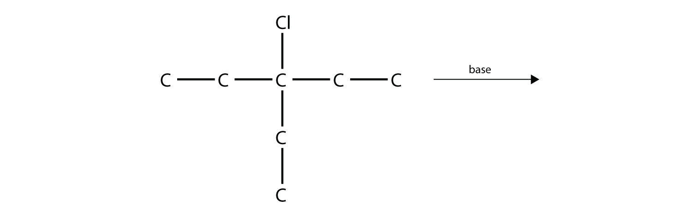
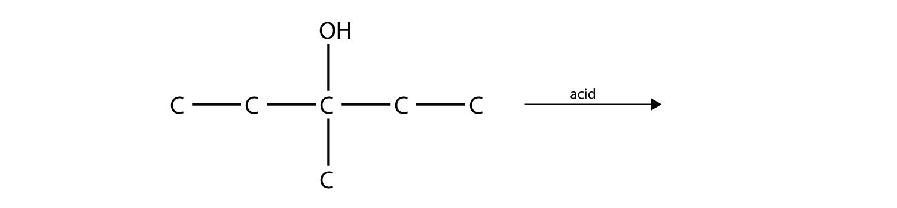

(sec:ch16:s03)=

# 16.3 Alkyl Halides and Alcohols

```{note} Learning Objectives

1. Define *functional group*.
2. Identify and name a simple alkyl halide.
3. Identify and name a simple alcohol.
4. Predict the product(s) of an elimination reaction of an alkyl halide or an alcohol.
```

A **functional group** (*A collection of atoms or bonds with certain characteristic reactions.*) is any collection of atoms and/or bonds with certain characteristic chemical reactions. We have already seen two functional groups: the C–C double bond and the C–C triple bond. They undergo certain characteristic chemical reactions—for example, the addition of a halogen across the multiple bond.

The presence of a halogen atom (F, Cl, Br, or I; also, X is used to represent any halogen atom) is one of the simplest functional groups. Organic compounds that contain a halogen atom are called **alkyl halides** (*An organic compound that contains a halogen atom.*). We have already seen some examples of alkyl halides when the addition of halogens across double and triple bonds was introduced in {ref}`Chapter 16 "Organic Chemistry" <ch:ch16>`, {ref}`Section 16.2 "Branched Hydrocarbons" <sec:ch16:s02>`; the products of these reactions were alkyl halides.

A simple alkyl halide can be named like an ionic salt, first by stating the name of the parent alkane as a substituent group (with the -*yl* suffix) and then the name of the halogen as if it were the anion. So CH<sub>3</sub>Cl has the common name of methyl chloride, while CH<sub>3</sub>CH<sub>2</sub>Br is ethyl bromide and CH<sub>3</sub>CH<sub>2</sub>CH<sub>2</sub>I is propyl iodide. However, this system is not ideal for more complicated alkyl halides.

The systematic way of naming alkyl halides is to name the halogen as a substituent, just like an alkyl group, and use numbers to indicate the position of the halogen atom on the main chain. The name of the halogen as a substituent comes from the stem of the element’s name plus the ending -*o*, so the substituent names are *fluoro*-, *chloro*-, *bromo*- and *iodo*-. If there is more than one of a certain halogen, we use numerical prefixes to indicate the number of each kind, just as with alkyl groups. For example, this molecule


*16.3 Alkyl Halides and Alcohols*

is 2-bromobutane, while this molecule


*16.3 Alkyl Halides and Alcohols*

is 2,3-dichloropentane. If alkyl groups are present, the substituents are listed alphabetically. Numerical prefixes are ignored when determining the alphabetical ordering of substituent groups.

```{exercise}
:label: ex:ball-ch16-s03-n02

**Example 6**

Name this molecule.


*16.3 Alkyl Halides and Alcohols*
```

```{solution} ex:ball-ch16-s03-n02
:label: sol:ball-ch16-s03-n02
:class: dropdown

The longest carbon chain has five C atoms, so the molecule is a pentane. There are two chlorine substituents located on the second and third C atoms, with a one-carbon methyl group on the third C atom as well. The correct name for this molecule is 2,3-dichloro-3-methylpentane.
```

```{exercise}
:label: ex:ball-ch16-s03-n02-ty2

**Test Yourself**

Name this molecule.


*16.3 Alkyl Halides and Alcohols*
```

```{solution} ex:ball-ch16-s03-n02-ty2
:label: sol:ball-ch16-s03-n02-ty2
:class: dropdown

1,1,2-tribromopropane
```

Another simple functional group is the covalently bonded OH group. This is the **alcohol** (*An organic compound that contains an OH functional group.*) functional group. It is not the hydroxide ion; rather than being present as a negatively charged species, in organic chemistry it is a covalently bonded functional group.

Like alkyl halides, alcohols have a common naming system and a more formal system. The common system is similar to that of alkyl halides: name the alkyl group attached to the OH group, ending with the suffix -*yl*, and add the word *alcohol* as a second word. So CH<sub>3</sub>OH is methyl alcohol; CH<sub>3</sub>CH<sub>2</sub>OH is ethyl alcohol, and CH<sub>3</sub>CH<sub>2</sub>CH<sub>2</sub>OH is propyl alcohol.

As with alkyl halides, though, this system is limited (although for smaller alcohols, it is very common in everyday usage). The formal system of naming uses the name of the hydrocarbon containing the OH group and having the correct number of C atoms, dropping the final -*e* of the name and appending the suffix -*ol*. Thus CH<sub>3</sub>OH is methanol and CH<sub>3</sub>CH<sub>2</sub>OH is ethanol. For larger alcohol molecules, we use a number to indicate the position of the OH group on the longest carbon chain, similar to the number needed for alkenes and alkynes. Again, the carbon chain is numbered to give the OH group the lowest number, no matter how large the other numbers are. So CH<sub>3</sub>CH<sub>2</sub>CH<sub>2</sub>OH is 1-propanol, while CH<sub>3</sub>CHOHCH<sub>3</sub> is 2-propanol. (A common component in many medicine cabinets, 2‑propanol is also known as isopropanol or isopropyl alcohol [{ref}`Figure 16.3 "Isopropyl Alcohol" <fig:ch16:s03:f01>`]).

```{figure} ../images/figures/d3049a7cae5987a989f9edfbc5c3ee2e.jpg
:label: fig:ch16:s03:f01
:alt: "Isopropyl Alcohol. What you find labeled *isopropyl alcohol* in a medicine cabinet is more formally called 2-propanol."
:align: center
:width: 45%

Isopropyl Alcohol. What you find labeled *isopropyl alcohol* in a medicine cabinet is more formally called 2-propanol.
```

Another acceptable way of naming an alcohol—especially a more complicated molecule—is to name the OH group as the hydroxy substituent and give it a numerical position like an alkyl group or a halogen atom. Thus 2-propanol would be called 2-hydroxypropane by this convention.

```{exercise}
:label: ex:ball-ch16-s03-n03

**Example 7**

Name this molecule as an alcohol and as a substituted alkane.


*16.3 Alkyl Halides and Alcohols*
```

```{solution} ex:ball-ch16-s03-n03
:label: sol:ball-ch16-s03-n03
:class: dropdown

The longest carbon chain containing the OH group has four C atoms, so the parent hydrocarbon is butane. Because the OH group is on the first C atom, it is 1-butanol. There is a methyl group on the second C atom, as well as a Cl atom, so the formal name for this alcohol is 2-chloro-2-methyl-1-butanol. If naming the alcohol group as a substituent, it would be 2-chloro-1-hydroxy-2-methylbutane.
```

```{exercise}
:label: ex:ball-ch16-s03-n03-ty2

**Test Yourself**

Name this molecule as an alcohol and as a substituted alkane.


*16.3 Alkyl Halides and Alcohols*
```

```{solution} ex:ball-ch16-s03-n03-ty2
:label: sol:ball-ch16-s03-n03-ty2
:class: dropdown

2,2,2-trichloroethanol; 2,2,2-trichloro-1-hydroxyethane
```

Most alkyl halides are insoluble in H<sub>2</sub>O. Smaller alcohols, however, are very soluble in H<sub>2</sub>O because these molecules can engage in hydrogen bonding with H<sub>2</sub>O molecules. For larger molecules, however, the polar OH group is overwhelmed by the nonpolar alkyl part of the molecule. While methanol is soluble in H<sub>2</sub>O in all proportions, only about 2.6 g of pentanol will dissolve in 100 g of H<sub>2</sub>O. Larger alcohols have an even lower solubility in H<sub>2</sub>O.

One reaction common to alcohols and alkyl halides is **elimination** (*The removal of an HZ (Z = halogen, OH) from an alkyl halide or an alcohol.*), the removal of the functional group (either X or OH) and an H atom from an adjacent carbon. The general reaction can be written as follows:



*16.3 Alkyl Halides and Alcohols*

where Z represents either the X or the OH group. The biggest difference between elimination in alkyl halides and elimination in alcohols is the identity of the catalyst: for alkyl halides, the catalyst is a strong base; for alcohols, the catalyst is a strong acid. For compounds in which there are H atoms on more than one adjacent carbon, a mixture of products results.

```{exercise}
:label: ex:ball-ch16-s03-n04

**Example 8**

Predict the organic product(s) of this reaction.



*16.3 Alkyl Halides and Alcohols*
```

```{solution} ex:ball-ch16-s03-n04
:label: sol:ball-ch16-s03-n04
:class: dropdown

Under these conditions, an HOH (otherwise known as H<sub>2</sub>O) molecule will be eliminated, and an alkene will be formed. It does not matter which adjacent carbon loses the H atom; in either case the product will be


*16.3 Alkyl Halides and Alcohols*

which is propene.
```

```{exercise}
:label: ex:ball-ch16-s03-n04-ty2

**Test Yourself**

Predict the organic product(s) of this reaction.



*16.3 Alkyl Halides and Alcohols*
```

```{solution} ex:ball-ch16-s03-n04-ty2
:label: sol:ball-ch16-s03-n04-ty2
:class: dropdown

1-butene and 2-butene
```

```{important} Key Takeaways

- Alkyl halides have a halogen atom as a functional group.
- Alcohols have an OH group as a functional group.
- Nomenclature rules allow us to name alkyl halides and alcohols.
- In an elimination reaction, a double bond is formed as an HX or an HOH molecule is removed.
```

## Exercises

```{exercise}
:label: ex:ball-ch16-s03-qs01-qd01-qa01

**Exercise 1.**

Define *functional group* and give two examples.
```

```{solution} ex:ball-ch16-s03-qs01-qd01-qa01
:label: sol:ball-ch16-s03-qs01-qd01-qa01
:class: dropdown

a group of atoms with a certain reactivity; halogen atoms and alcohol groups (answers will vary).
```

```{exercise}
:label: ex:ball-ch16-s03-qs01-qd01-qa02

**Exercise 2.**

What is elimination? How does it differ for alkyl halides and alcohols?
```

```{exercise}
:label: ex:ball-ch16-s03-qs01-qd01-qa03

**Exercise 3.**

Name this molecule.


*16.3 Alkyl Halides and Alcohols*
```

```{solution} ex:ball-ch16-s03-qs01-qd01-qa03
:label: sol:ball-ch16-s03-qs01-qd01-qa03
:class: dropdown

2-bromobutane
```

```{exercise}
:label: ex:ball-ch16-s03-qs01-qd01-qa04

**Exercise 4.**

Name this molecule.


*16.3 Alkyl Halides and Alcohols*
```

```{exercise}
:label: ex:ball-ch16-s03-qs01-qd01-qa05

**Exercise 5.**

Name this molecule.


*16.3 Alkyl Halides and Alcohols*
```

```{solution} ex:ball-ch16-s03-qs01-qd01-qa05
:label: sol:ball-ch16-s03-qs01-qd01-qa05
:class: dropdown

2-chloro-3-fluoro-4-methylheptane
```

```{exercise}
:label: ex:ball-ch16-s03-qs01-qd01-qa06

**Exercise 6.**

Name this molecule.


*16.3 Alkyl Halides and Alcohols*
```

```{exercise}
:label: ex:ball-ch16-s03-qs01-qd01-qa07

**Exercise 7.**

Name this molecule.


*16.3 Alkyl Halides and Alcohols*
```

```{solution} ex:ball-ch16-s03-qs01-qd01-qa07
:label: sol:ball-ch16-s03-qs01-qd01-qa07
:class: dropdown

2-methyl-2-propanol
```

```{exercise}
:label: ex:ball-ch16-s03-qs01-qd01-qa08

**Exercise 8.**

Name this molecule.


*16.3 Alkyl Halides and Alcohols*
```

```{exercise}
:label: ex:ball-ch16-s03-qs01-qd01-qa09

**Exercise 9.**

Name this molecule.


*16.3 Alkyl Halides and Alcohols*
```

```{solution} ex:ball-ch16-s03-qs01-qd01-qa09
:label: sol:ball-ch16-s03-qs01-qd01-qa09
:class: dropdown

4-octanol
```

```{exercise}
:label: ex:ball-ch16-s03-qs01-qd01-qa10

**Exercise 10.**

Name this molecule.



*16.3 Alkyl Halides and Alcohols*
```

```{exercise}
:label: ex:ball-ch16-s03-qs01-qd01-qa11

**Exercise 11.**

Predict the product(s) of this elimination reaction.


*16.3 Alkyl Halides and Alcohols*
```

```{solution} ex:ball-ch16-s03-qs01-qd01-qa11
:label: sol:ball-ch16-s03-qs01-qd01-qa11
:class: dropdown

2-pentene
```

```{exercise}
:label: ex:ball-ch16-s03-qs01-qd01-qa12

**Exercise 12.**

Predict the product(s) of this elimination reaction.



*16.3 Alkyl Halides and Alcohols*
```

```{exercise}
:label: ex:ball-ch16-s03-qs01-qd01-qa13

**Exercise 13.**

Predict the product(s) of this elimination reaction.


*16.3 Alkyl Halides and Alcohols*
```

```{solution} ex:ball-ch16-s03-qs01-qd01-qa13
:label: sol:ball-ch16-s03-qs01-qd01-qa13
:class: dropdown

2-hexene and 3-hexene
```

```{exercise}
:label: ex:ball-ch16-s03-qs01-qd01-qa14

**Exercise 14.**

Predict the product(s) of this elimination reaction.



*16.3 Alkyl Halides and Alcohols*
```
