(sec:ch16:s04)=

# 16.4 Other Oxygen-Containing Functional Groups

```{note} Learning Objective

1. Identify the aldehyde, ketone, acid, ester, and ether functional groups.
```

There are other functional groups that contain O atoms. Before we introduce them, we define the **carbonyl group** (*A functional group formed when an O atom and a C atom are joined with a double bond.*), which is formed when an O atom and a C atom are joined by a double bond:


*16.4 Other Oxygen-Containing Functional Groups*

The other two bonds on the C atom are attached to other atoms. It is the identities of these other atoms that define what specific type of compound an organic molecule is.

If one bond of the carbonyl group is made to an H atom, then the molecule is classified as an **aldehyde** (*A compound that has a carbonyl functional group at the end of a chain of C atoms.*). (If there are two H atoms, there is only 1 C atom.) When naming aldehydes, the main chain of C atoms must include the carbon in the carbonyl group, which is numbered as position 1 in the carbon chain. The parent name of the hydrocarbon is used, but the suffix -*al* is appended. (Do not confuse -*al* with -*ol*, which is the suffix used for alcohols.) So we have

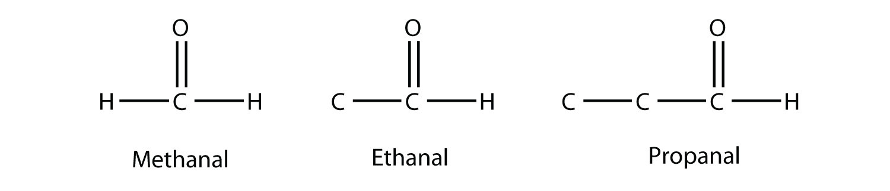

*16.4 Other Oxygen-Containing Functional Groups*

Methanal has a common name with which you may be familiar: formaldehyde. The main thing to note about aldehydes is that the carbonyl group is at the *end* of a carbon chain.

A carbonyl group in the middle of a carbon chain implies that both remaining bonds of the carbonyl group are made to C atoms. This type of molecule is called a **ketone** (*A compound that has a carbonyl group in the middle of a carbon chain.*). Despite the fact that aldehydes and ketones have the same carbonyl group, they have different chemical and physical properties and are properly grouped as two different types of compounds. The smallest ketone has three C atoms in it. When naming a ketone, we take the name of the parent hydrocarbon and change the suffix to -*one*:


*16.4 Other Oxygen-Containing Functional Groups*

The common name for propanone is acetone. With larger ketones, we must use a number to indicate the position of the carbonyl group, much like a number is used with alkenes and alkynes:


*16.4 Other Oxygen-Containing Functional Groups*

There is another way to name ketones: name the alkyl groups that are attached to the carbonyl group and add the word *ketone* to the name. So propanone can also be called dimethyl ketone, while 2-butanone is called methyl ethyl ketone.

```{exercise}
:label: ex:ball-ch16-s04-n02

**Example 9**

Draw the structure of 2-pentanone.
```

```{solution} ex:ball-ch16-s04-n02
:label: sol:ball-ch16-s04-n02
:class: dropdown

This molecule has five C atoms in a chain, with the carbonyl group on the second C atom. Its structure is as follows:


*16.4 Other Oxygen-Containing Functional Groups*
```

```{exercise}
:label: ex:ball-ch16-s04-n02-ty2

**Test Yourself**

Draw the structure of methyl butyl ketone.
```

```{solution} ex:ball-ch16-s04-n02-ty2
:label: sol:ball-ch16-s04-n02-ty2
:class: dropdown


*16.4 Other Oxygen-Containing Functional Groups*
```

The combination of a carbonyl functional group and an OH group makes the **carboxyl group** (*A functional group composed of a carbonyl group and an OH group.*).


*16.4 Other Oxygen-Containing Functional Groups*

Molecules with a carboxyl group are called **carboxylic acids** (*A molecule with a carboxyl group.*). As with aldehydes, the functional group in carboxylic acids is at the end of a carbon chain. Also as with aldehydes, the C atom in the functional group is counted as one of the C atoms that defines the parent hydrocarbon name. To name carboxylic acids, the parent name of the hydrocarbon is used, but the suffix -*oic acid* is added:

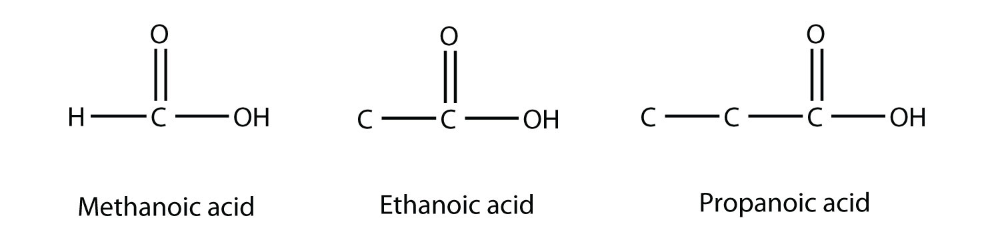

*16.4 Other Oxygen-Containing Functional Groups*

Methanoic acid and ethanoic acid are also called formic acid and acetic acid, respectively. Formic acid is the compound that makes certain ant bites sting, while acetic acid is the active substance in vinegar.

How acidic are carboxylic acids? It turns out that they are not very acidic. No carboxylic acid is on the list of strong acids ({ref}`Table 12.2 "Strong Acids and Bases" <tbl:ch12:s04:t01>`). (For more information about strong acids, see {ref}`Chapter 12 "Acids and Bases" <ch:ch12>`, {ref}`Section 12.4 "Strong and Weak Acids and Bases and Their Salts" <sec:ch12:s04>`.) This means that all carboxylic acids are weak acids. A 1 M solution of formic acid is only about 1.3% dissociated into H<sup>+</sup> ions and formate ions, while a similar solution of acetic acid is ionized by about only 0.4%. Some carboxylic acids are stronger—for example, trichloroacetic acid is about 45% dissociated in aqueous solution. But no carboxylic acid approaches the 100% dissociation amount required by the definition of a strong acid.

As their name suggests, however, carboxylic acids do act like acids in the presence of bases. The H atom in the carboxyl group comes off as the H<sup>+</sup> ion, leaving a **carboxylate** (*A negatively charged ion derived from a carboxylic acid.*) anion:

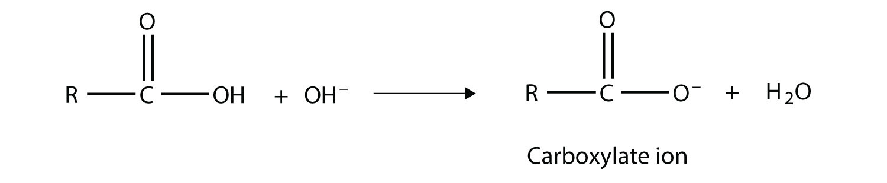

*16.4 Other Oxygen-Containing Functional Groups*

Carboxylate ions are named from the acid name: the -*oic acid* is replaced with -*oate* to name the ion.

```{exercise}
:label: ex:ball-ch16-s04-n03

**Example 10**

Complete the chemical reaction. Can you name the carboxylate ion formed?

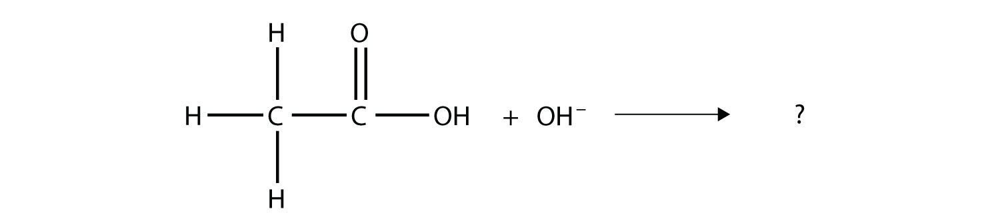

*16.4 Other Oxygen-Containing Functional Groups*
```

```{solution} ex:ball-ch16-s04-n03
:label: sol:ball-ch16-s04-n03
:class: dropdown

The OH<sup>–</sup> ion removes the H atom that is part of the carboxyl group:

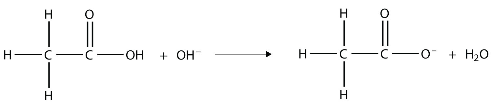

*16.4 Other Oxygen-Containing Functional Groups*

The carboxylate ion, which has the condensed structural formula CH<sub>3</sub>CO<sub>2</sub><sup>−</sup>, is the ethanoate ion, but it is commonly called the acetate ion.
```

```{exercise}
:label: ex:ball-ch16-s04-n03-ty2

**Test Yourself**

Complete the chemical reaction. Can you name the carboxylate ion formed?


*16.4 Other Oxygen-Containing Functional Groups*
```

```{solution} ex:ball-ch16-s04-n03-ty2
:label: sol:ball-ch16-s04-n03-ty2
:class: dropdown

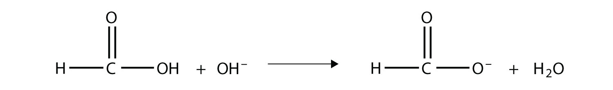

*16.4 Other Oxygen-Containing Functional Groups*

The anion is the methanoate ion, which is commonly called the formate ion.
```

One reaction to consider is that of a carboxylic acid and an alcohol. When combined under the proper conditions, a water molecule will be removed, and the remaining pieces will combine to form a new functional group—the **ester** (*A functional group made by combining a carboxylic acid with an alcohol.*) functional group:

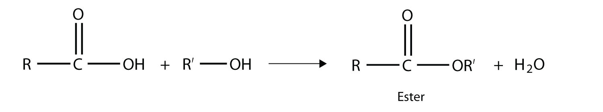

*16.4 Other Oxygen-Containing Functional Groups*

Note how the acid molecule contributes one alkyl side (represented by R), while the alcohol contributes the other side (represented by R′). Esters are named using the alkyl group name from the alcohol plus the carboxylate name from the acid—for example, the molecule


*16.4 Other Oxygen-Containing Functional Groups*

is called methyl propanoate.

```{tip} Chemistry Is Everywhere: Esters, Fragrances, and Flavorings

Esters are very interesting compounds, in part because many have very pleasant odors and flavors. (Remember, never taste anything in the chemistry lab!) Many esters occur naturally and contribute to the odor of flowers and the taste of fruits. Other esters are synthesized industrially and are added to food products to improve their smell or taste; it is likely that if you eat a product whose ingredients include artificial flavorings, those flavorings are esters. Here are some esters and their uses, thanks to their odors, flavors, or both:

| Ester | Tastes/Smells Like |   | Ester | Tastes/Smells Like |
| --- | --- | --- | --- | --- |
| allyl hexanoate | pineapple |   | isobutyl formate | raspberry |
| benzyl acetate | pear |   | isobutyl acetate | pear |
| butyl butanoate | pineapple |   | methyl phenylacetate | honey |
| ethyl butanoate | banana |   | nonyl caprylate | orange |
| ethyl hexanoate | pineapple |   | pentyl acetate | apple |
| ethyl heptanoate | apricot |   | propyl ethanoate | pear |
| ethyl pentanoate | apple |   | propyl isobutyrate | rum |
```

Finally, the **ether** (*A functional group that has an O atom attached to two organic groups.*) functional group is an O atom that is bonded to two organic groups:

$$
\text{R}---\text{O}---\text{R}'
$$

The two R groups may be the same or different. Naming ethers is like the alternate way of naming ketones. In this case, the R groups are named sequentially, and the word *ether* is appended. The molecule

$$
\text{CH3OCH3}
$$

is dimethyl ether, while

$$
\text{CH3OCH2CH3}
$$

is methyl ethyl ether. Diethyl ether, another ether, was once used as an anesthetic, but its flammability and toxicity caused it to fall out of favor. Smaller ether molecules that are liquids at room temperature are common solvents for organic chemical reactions.

```{important} Key Takeaway

- Aldehydes, ketones, carboxylic acids, esters, and ethers have oxygen-containing functional groups.
```

## Exercises

```{exercise}
:label: ex:ball-ch16-s04-qs01-qd01-qa01

**Exercise 1.**

Name a similarity between the functional groups found in aldehydes and ketones. Can you name a difference between them?
```

```{solution} ex:ball-ch16-s04-qs01-qd01-qa01
:label: sol:ball-ch16-s04-qs01-qd01-qa01
:class: dropdown

They both have a carbonyl group, but an aldehyde has the carbonyl group at the end of a carbon chain, and a ketone has the carbonyl group in the middle.
```

```{exercise}
:label: ex:ball-ch16-s04-qs01-qd01-qa02

**Exercise 2.**

Explain how a carboxylic acid is used to make an ester.
```

```{exercise}
:label: ex:ball-ch16-s04-qs01-qd01-qa03

**Exercise 3.**

Name each molecule.

a. 

   *16.4 Other Oxygen-Containing Functional Groups*
b. 

   *16.4 Other Oxygen-Containing Functional Groups*
```

```{solution} ex:ball-ch16-s04-qs01-qd01-qa03
:label: sol:ball-ch16-s04-qs01-qd01-qa03
:class: dropdown

a. propanal
b. 2-butanone
```

```{exercise}
:label: ex:ball-ch16-s04-qs01-qd01-qa04

**Exercise 4.**

Name each molecule.

a. 

   *16.4 Other Oxygen-Containing Functional Groups*
b. 

   *16.4 Other Oxygen-Containing Functional Groups*
```

```{exercise}
:label: ex:ball-ch16-s04-qs01-qd01-qa05

**Exercise 5.**

Name each molecule.

a. 

   *16.4 Other Oxygen-Containing Functional Groups*
b. 

   *16.4 Other Oxygen-Containing Functional Groups*
```

```{solution} ex:ball-ch16-s04-qs01-qd01-qa05
:label: sol:ball-ch16-s04-qs01-qd01-qa05
:class: dropdown

a. 3-methylbutanoic acid
b. ethyl propionate
```

```{exercise}
:label: ex:ball-ch16-s04-qs01-qd01-qa06

**Exercise 6.**

Name each molecule.

a. 

   *16.4 Other Oxygen-Containing Functional Groups*
b. 

   *16.4 Other Oxygen-Containing Functional Groups*
```

```{exercise}
:label: ex:ball-ch16-s04-qs01-qd01-qa07

**Exercise 7.**

Name this molecule.


*16.4 Other Oxygen-Containing Functional Groups*
```

```{solution} ex:ball-ch16-s04-qs01-qd01-qa07
:label: sol:ball-ch16-s04-qs01-qd01-qa07
:class: dropdown

ethyl propyl ether
```

```{exercise}
:label: ex:ball-ch16-s04-qs01-qd01-qa08

**Exercise 8.**

Name this molecule.


*16.4 Other Oxygen-Containing Functional Groups*
```

```{exercise}
:label: ex:ball-ch16-s04-qs01-qd01-qa09

**Exercise 9.**

Give an alternate but acceptable name to the molecule in Exercise 3b.
```

```{solution} ex:ball-ch16-s04-qs01-qd01-qa09
:label: sol:ball-ch16-s04-qs01-qd01-qa09
:class: dropdown

ethyl methyl ketone
```

```{exercise}
:label: ex:ball-ch16-s04-qs01-qd01-qa10

**Exercise 10.**

Give an alternate but acceptable name to the molecule in Exercise 4b.
```

```{exercise}
:label: ex:ball-ch16-s04-qs01-qd01-qa11

**Exercise 11.**

Complete this chemical reaction.


*16.4 Other Oxygen-Containing Functional Groups*
```

```{solution} ex:ball-ch16-s04-qs01-qd01-qa11
:label: sol:ball-ch16-s04-qs01-qd01-qa11
:class: dropdown

H<sub>2</sub>O + KCH<sub>3</sub>CH<sub>2</sub>CO<sub>2</sub>
```

```{exercise}
:label: ex:ball-ch16-s04-qs01-qd01-qa12

**Exercise 12.**

Complete this chemical reaction.

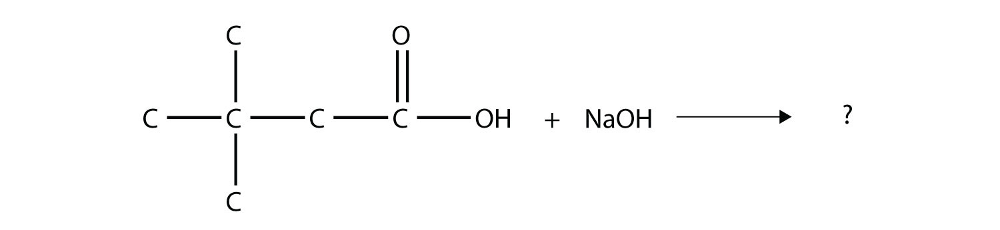

*16.4 Other Oxygen-Containing Functional Groups*
```

```{exercise}
:label: ex:ball-ch16-s04-qs01-qd01-qa13

**Exercise 13.**

The drug known as aspirin has this molecular structure:

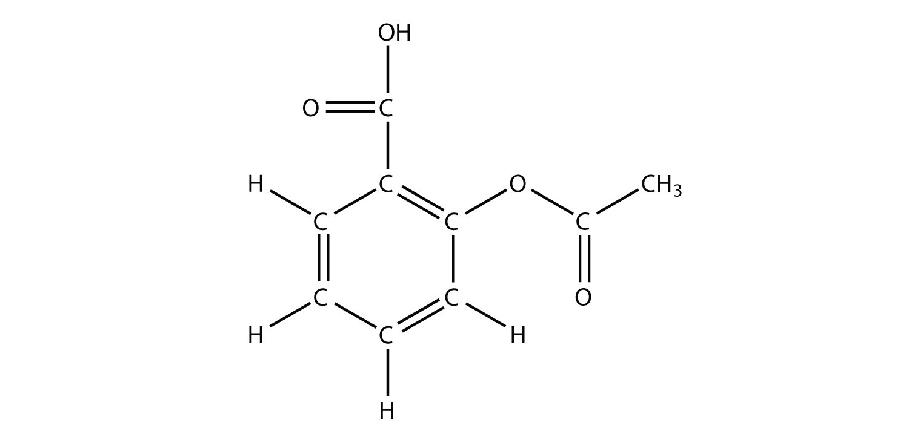

*16.4 Other Oxygen-Containing Functional Groups*

Identify the functional group(s) in this molecule.
```

```{solution} ex:ball-ch16-s04-qs01-qd01-qa13
:label: sol:ball-ch16-s04-qs01-qd01-qa13
:class: dropdown

acid, ester, and aromatic (benzene ring)
```

```{exercise}
:label: ex:ball-ch16-s04-qs01-qd01-qa14

**Exercise 14.**

The drug known as naproxen sodium is the sodium salt of this molecule:

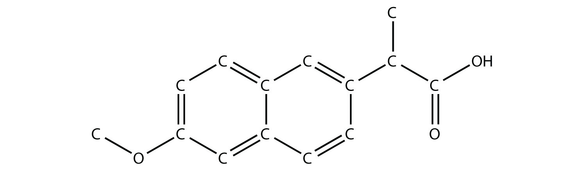

*16.4 Other Oxygen-Containing Functional Groups*

(The extra H atoms are omitted for clarity.) Identify the functional group(s) in this molecule.
```

```{exercise}
:label: ex:ball-ch16-s04-qs01-qd01-qa15

**Exercise 15.**

Identify the ester made by reacting these molecules.

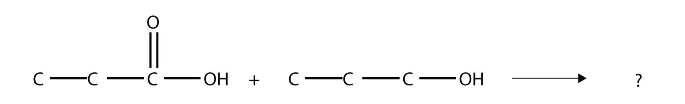

*16.4 Other Oxygen-Containing Functional Groups*
```

```{solution} ex:ball-ch16-s04-qs01-qd01-qa15
:label: sol:ball-ch16-s04-qs01-qd01-qa15
:class: dropdown

propyl propionate
```

```{exercise}
:label: ex:ball-ch16-s04-qs01-qd01-qa16

**Exercise 16.**

Identify the ester made by reacting these molecules.

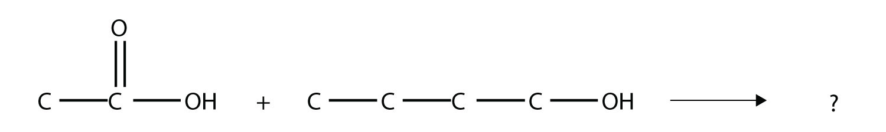

*16.4 Other Oxygen-Containing Functional Groups*
```
