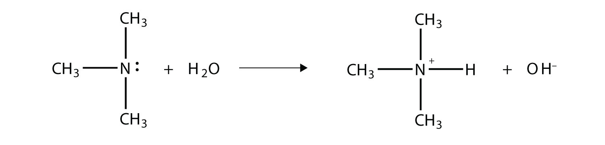
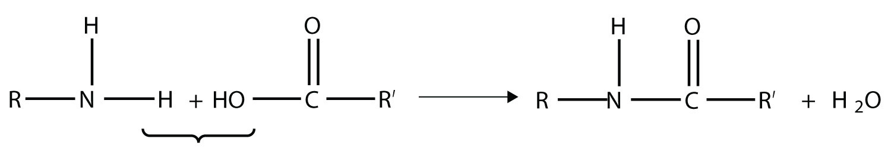
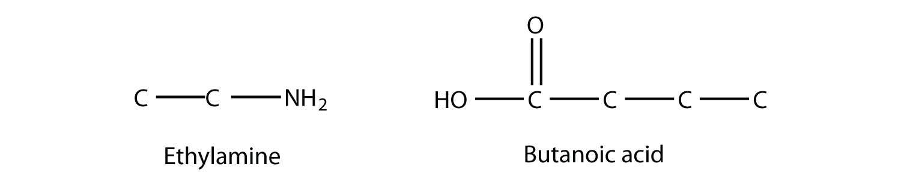
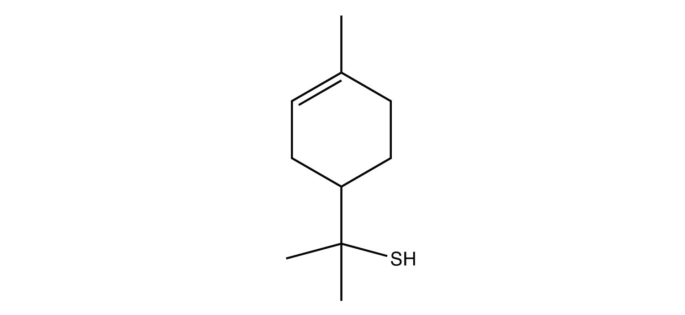
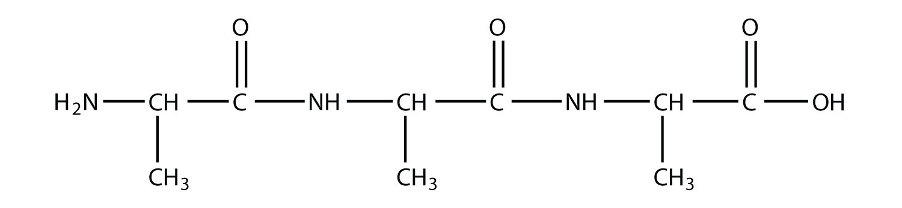
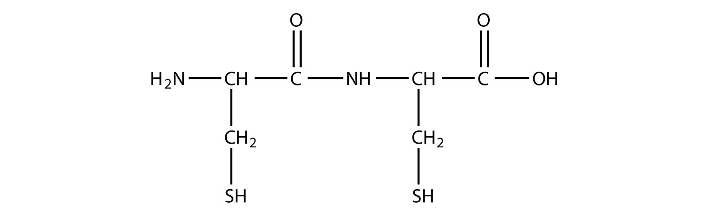

(sec:ch16:s05)=

# 16.5 Other Functional Groups

```{note} Learning Objective

1. Identify the amine, amide, and thiol functional groups.
```

There are some common—and important—functional groups that contain elements other than oxygen. In this section, we will consider three of them.

(sec:ch16:s05:s01)=

## Nitrogen-Containing Compounds

An **amine** (*An organic derivative of ammonia.*) is an organic derivative of ammonia (NH<sub>3</sub>). In amines, one or more of the H atoms in NH<sub>3</sub> is substituted with an organic group. A *primary* amine has one H atom substituted with an R group:


*16.5 Other Functional Groups*

A *secondary* amine has two H atoms substituted with R groups:


*16.5 Other Functional Groups*

A *tertiary* amine has all three H atoms substituted with R group:


*16.5 Other Functional Groups*

Naming simple amines is straightforward: name the R groups as substituents and then add the suffix -*amine*, using numerical suffixes on the substituent names as necessary. This amine


*16.5 Other Functional Groups*

is diethylamine (the H atoms on the C atoms are omitted for clarity), while this amine


*16.5 Other Functional Groups*

is ethyldipropylamine.

```{exercise}
:label: ex:ball-ch16-s05-s01-n01

**Example 11**

Name this amine.


*16.5 Other Functional Groups*
```

```{solution} ex:ball-ch16-s05-s01-n01
:label: sol:ball-ch16-s05-s01-n01
:class: dropdown

This amine has a methyl group, an ethyl group, and a propyl group. Listing the names in alphabetical order, this amine is ethylmethylpropylamine.
```

```{exercise}
:label: ex:ball-ch16-s05-s01-n01-ty2

**Test Yourself**

Name this amine.


*16.5 Other Functional Groups*
```

```{solution} ex:ball-ch16-s05-s01-n01-ty2
:label: sol:ball-ch16-s05-s01-n01-ty2
:class: dropdown

triethylamine
```

As with NH<sub>3</sub>, the N atom in amines can accept a proton onto the lone electron pair on the N atom. That is, amines act as Brønsted-Lowry bases (i.e., proton acceptors):



*16.5 Other Functional Groups*

(For more information on Brønsted-Lowry bases, see {ref}`Chapter 12 "Acids and Bases" <ch:ch12>`, {ref}`Section 12.2 "Brønsted-Lowry Acids and Bases" <sec:ch12:s02>`.) The amine becomes an ion, the organic counterpart of the ammonium (NH<sub>4</sub><sup>+</sup>) ion.

Because no amine is presented in {ref}`Table 12.2 "Strong Acids and Bases" <tbl:ch12:s04:t01>`, all amines are weak bases. The weakness of amines is about as the same as that for carboxylic acids. N-containing organic compounds are very common in nature, and they all act as weak bases. Some of these compounds have rather complicated structures. {ref}`Figure 16.4 "Some Naturally Occurring N-Containing Compounds" <fig:ch16:s05:s01:f01>` shows some N-containing substances that you may recognize.

```{figure} ../images/figures/132b9426635c7730e64bfee28b5eae2a.jpg
:label: fig:ch16:s05:s01:f01
:alt: "Some Naturally Occurring N-Containing Compounds. Nitrogen-containing compounds occur frequently in nature. Here are some that you might encounter in the course of your everyday life."
:align: center
:width: 85%

Some Naturally Occurring N-Containing Compounds. Nitrogen-containing compounds occur frequently in nature. Here are some that you might encounter in the course of your everyday life.
```

An **amide** (*A functional group that is the combination of the amine and carbonyl functional groups.*) functional group is a combination of an amine group and a carbonyl group:


*16.5 Other Functional Groups*

Amides are actually formed by bringing together an amine-containing molecule and a carboxylic acid-containing molecule. A molecule of H<sub>2</sub>O is lost, much like when an ester forms:



*16.5 Other Functional Groups*

The bond between the N of the amine group and the C of the carbonyl group is called an **amide bond** (*The bond between the N atom and the C atom in an amide.*). Amide bonds are particularly important in biological molecules called proteins, which are composed of strings of amino acids—molecules that have an amine group and a carboxylic acid group in them. The amine group on one amino acid reacts with the carboxylic acid group of another amino acid, making a chain held together by amide bonds. We will consider proteins later in this chapter.

```{exercise}
:label: ex:ball-ch16-s05-s01-n02

**Example 12**

Draw the structure of the amide formed by the combination of ethylamine and butanoic acid.
```

```{solution} ex:ball-ch16-s05-s01-n02
:label: sol:ball-ch16-s05-s01-n02
:class: dropdown

The structures of ethylamine and butanoic acid are as follows:



*16.5 Other Functional Groups*

When they come together to make an amide, an H<sub>2</sub>O molecule is lost, and the N of the amine group bonds to the C of the carboxyl group. The resulting molecule is as follows:


*16.5 Other Functional Groups*
```

```{exercise}
:label: ex:ball-ch16-s05-s01-n02-ty2

**Test Yourself**

Draw the structure of the amide formed by the combination of methylamine and formic acid.
```

```{solution} ex:ball-ch16-s05-s01-n02-ty2
:label: sol:ball-ch16-s05-s01-n02-ty2
:class: dropdown


*16.5 Other Functional Groups*
```

(sec:ch16:s05:s02)=

## Sulfur-Containing Compounds

Sulfur is below oxygen on the periodic table, and it occasionally shows some similar chemistry. One similarity is that an S atom can take the place of an O atom in an alcohol, to make a molecule that looks like this:

$$
\text{R}-\text{SH}
$$

The sulfur analog of an alcohol is called a **thiol** (*The sulfur analog of an alcohol.*). The formal way of naming a thiol is similar to that of alcohols, except that instead of using the suffix -*ol*, you use -*thiol* as the suffix. The following illustrates thiol nomenclature:


*16.5 Other Functional Groups*

An older system uses the word *mercaptan* in naming simple thiols, much like the word *alcohol* is used with small alcohols. These thiols can also be named like this:


*16.5 Other Functional Groups*

Many thiols have strong, objectionable odors; indeed, the spray from skunks is composed of thiols and is detectable by the human nose at concentrations less than 10 ppb. Because natural gas is odorless, thiols are intentionally added to natural gas—at very low levels, of course—so that gas leaks can be more easily detected. Not all thiols have objectionable odors; this thiol is responsible for the odor of grapefruit:



*16.5 Other Functional Groups*

One amino acid that is a thiol is cysteine:


*16.5 Other Functional Groups*

Cysteine plays an important role in protein structure. If two cysteine amino acids in a protein chain approach each other, they can be oxidized, and a S–S bond (also known as a *disulfide bond*) is formed:

$$
\text{R}-\text{SH + HS}-\text{R }\rightarrow{}\text{ R}-\text{S}-\text{S}-\text{R}
$$

where the R group is the rest of the cysteine molecule. The disulfide bond is strong enough to fix the position of the two cysteine groups, thus imposing a structure on the protein. Hair is composed of about 5% cysteine, and the breaking and remaking of disulfide bonds between cysteine units is the primary mechanism behind straightening and curling hair (hair “perms”).

```{tip} Food and Drink App: Amino Acids—Essential and Otherwise

The text mentioned cysteine, an amino acid. Amino acids are the fundamental building blocks of proteins, a major biological component. Proteins are a necessary part of the diet; meat, eggs, and certain vegetables such as beans and soy are good sources of protein and amino acids.

All life on Earth—from the lowliest single-celled organism to humans to blue whales—relies on proteins for life, so all life on Earth is dependent on amino acids. The human body contains 20 different amino acids (curiously, other organisms may have a different number of amino acids). However, not all of them must be obtained from the diet. The body can synthesize 12 amino acids. The other 8 *must* be obtained from the diet. These 8 amino acids are called the *essential amino acids*. Daily requirements range from 4 mg per kilogram of body weight for tryptophan to 40 mg per kilogram of body weight for leucine. Infants and children need a greater mass per kg of body weight to support their growing bodies; also, the number of amino acids that are considered essential for infants and children is greater than for adults due to the greater protein synthesis associated with growth.

Because of the existence of essential amino acids, a diet that is properly balanced in protein is necessary. Rice and beans, a very popular food dish in Latin cuisines, actually provides all the essential amino acids in one dish; without one component, the dish would be nutritionally incomplete. Corn (maize) is the most-grown grain crop in the world, but an overreliance on it as a primary food source deprives people of lysine and tryptophan, which are two essential amino acids. (Indeed, it is now widely accepted that the disappearance of certain native American groups was largely due to the overuse of corn as the staple food.) People on restricted diets—whether out of necessity or by choice (e.g., vegetarians)—may be missing the proper amount of an essential amino acid, so it is important to vary the diet when possible to ensure ingestion of a wide range of protein sources.
```

```{important} Key Takeaway

- Other functional groups include amine, amide, and thiol functional groups.
```

## Exercises

```{exercise}
:label: ex:ball-ch16-s05-qs01-qd01-qa01

**Exercise 1.**

What are the structure and name of the smallest amine?
```

```{solution} ex:ball-ch16-s05-qs01-qd01-qa01
:label: sol:ball-ch16-s05-qs01-qd01-qa01
:class: dropdown

CH<sub>3</sub>NH<sub>2</sub>; methylamine
```

```{exercise}
:label: ex:ball-ch16-s05-qs01-qd01-qa02

**Exercise 2.**

What are the structure and name of the smallest thiol?
```

```{exercise}
:label: ex:ball-ch16-s05-qs01-qd01-qa03

**Exercise 3.**

Identify each compound as a primary, secondary, or tertiary amine.

a. 

   *16.5 Other Functional Groups*
b. 

   *16.5 Other Functional Groups*
c. 

   *16.5 Other Functional Groups*
```

```{solution} ex:ball-ch16-s05-qs01-qd01-qa03
:label: sol:ball-ch16-s05-qs01-qd01-qa03
:class: dropdown

a. primary
b. tertiary
c. secondary
```

```{exercise}
:label: ex:ball-ch16-s05-qs01-qd01-qa04

**Exercise 4.**

Identify each compound as a primary, secondary, or tertiary amine.

a. 

   *16.5 Other Functional Groups*
b. 

   *16.5 Other Functional Groups*
c. 

   *16.5 Other Functional Groups*
```

```{exercise}
:label: ex:ball-ch16-s05-qs01-qd01-qa05

**Exercise 5.**

Write the chemical reaction between each amine in Exercise 3 and HCl.
```

```{solution} ex:ball-ch16-s05-qs01-qd01-qa05
:label: sol:ball-ch16-s05-qs01-qd01-qa05
:class: dropdown

a. C<sub>3</sub>H<sub>3</sub>CO<sub>2</sub>HSHNH<sub>2</sub> + HCl → C<sub>3</sub>H<sub>3</sub>CO<sub>2</sub>HSHNH<sub>3</sub>Cl
b. (C<sub>6</sub>H<sub>11</sub>)(C<sub>2</sub>H<sub>5</sub>)(CH<sub>3</sub>)N + HCl → (C<sub>6</sub>H<sub>11</sub>)(C<sub>2</sub>H<sub>5</sub>)(CH<sub>3</sub>)NHCl
c. (C<sub>2</sub>H<sub>5</sub>)(CH<sub>3</sub>)NH + HCl → (C<sub>2</sub>H<sub>5</sub>)(CH<sub>3</sub>)NH<sub>2</sub>Cl
```

```{exercise}
:label: ex:ball-ch16-s05-qs01-qd01-qa06

**Exercise 6.**

Write the chemical reaction between each amine in Exercise 4 and HNO<sub>3</sub>.
```

```{exercise}
:label: ex:ball-ch16-s05-qs01-qd01-qa07

**Exercise 7.**

Name each amine.

a. 

   *16.5 Other Functional Groups*
b. 

   *16.5 Other Functional Groups*
```

```{solution} ex:ball-ch16-s05-qs01-qd01-qa07
:label: sol:ball-ch16-s05-qs01-qd01-qa07
:class: dropdown

a. ethylmethylamine
b. phenylamine
```

```{exercise}
:label: ex:ball-ch16-s05-qs01-qd01-qa08

**Exercise 8.**

Name each amine.

a. 

   *16.5 Other Functional Groups*
b. 

   *16.5 Other Functional Groups*
```

```{exercise}
:label: ex:ball-ch16-s05-qs01-qd01-qa09

**Exercise 9.**

A *peptide* is a short chain of amino acids connected by amide bonds. How many amide bonds are present in this peptide?



*16.5 Other Functional Groups*
```

```{solution} ex:ball-ch16-s05-qs01-qd01-qa09
:label: sol:ball-ch16-s05-qs01-qd01-qa09
:class: dropdown

two
```

```{exercise}
:label: ex:ball-ch16-s05-qs01-qd01-qa10

**Exercise 10.**

How many amide bonds are present in this peptide? (See Exercise 9 for the definition of a peptide.)



*16.5 Other Functional Groups*
```

```{exercise}
:label: ex:ball-ch16-s05-qs01-qd01-qa11

**Exercise 11.**

Draw the backbone structure of the amide formed by reacting propylamine with propanoic acid.
```

```{solution} ex:ball-ch16-s05-qs01-qd01-qa11
:label: sol:ball-ch16-s05-qs01-qd01-qa11
:class: dropdown


*16.5 Other Functional Groups*
```

```{exercise}
:label: ex:ball-ch16-s05-qs01-qd01-qa12

**Exercise 12.**

Draw the backbone structure of the amide formed by reacting hexylamine with ethanoic acid.
```

```{exercise}
:label: ex:ball-ch16-s05-qs01-qd01-qa13

**Exercise 13.**

Name each thiol using the -*thiol* suffix.

a. 

   *16.5 Other Functional Groups*
b. C<sub>4</sub>H<sub>9</sub>–SH
```

```{solution} ex:ball-ch16-s05-qs01-qd01-qa13
:label: sol:ball-ch16-s05-qs01-qd01-qa13
:class: dropdown

a. cyclohexanethiol
b. butanethiol
```

```{exercise}
:label: ex:ball-ch16-s05-qs01-qd01-qa14

**Exercise 14.**

Name each thiol in Exercise 13 with the mercaptan label.
```

```{exercise}
:label: ex:ball-ch16-s05-qs01-qd01-qa15

**Exercise 15.**

One component of skunk spray is 3-methyl-1-butanethiol. Draw its structure. (The 1 indicates the position of the S atom.)
```

```{solution} ex:ball-ch16-s05-qs01-qd01-qa15
:label: sol:ball-ch16-s05-qs01-qd01-qa15
:class: dropdown


*16.5 Other Functional Groups*
```

```{exercise}
:label: ex:ball-ch16-s05-qs01-qd01-qa16

**Exercise 16.**

An S–S bond can be fairly easily broken into proteins, yielding two lone cysteine units in a protein chain. Is this process an oxidation or a reduction? Explain your answer.
```
