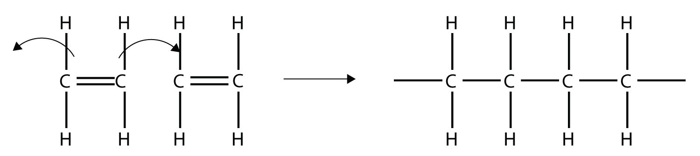
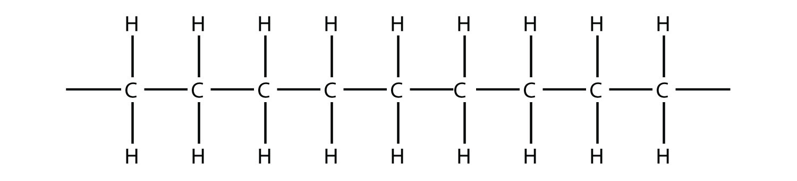
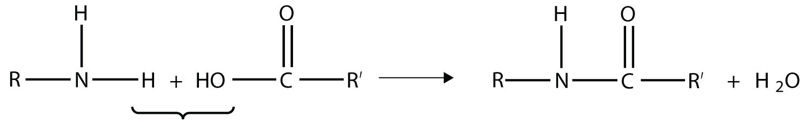
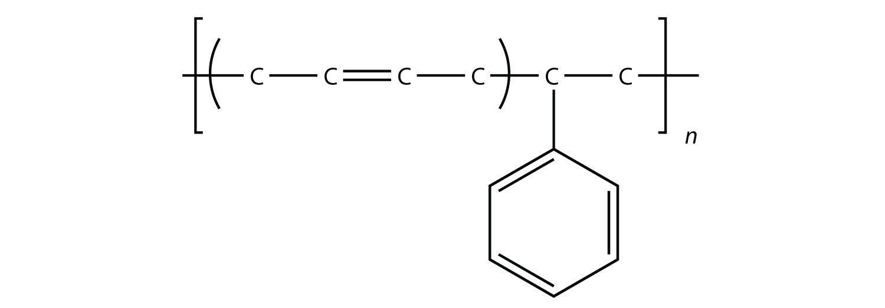
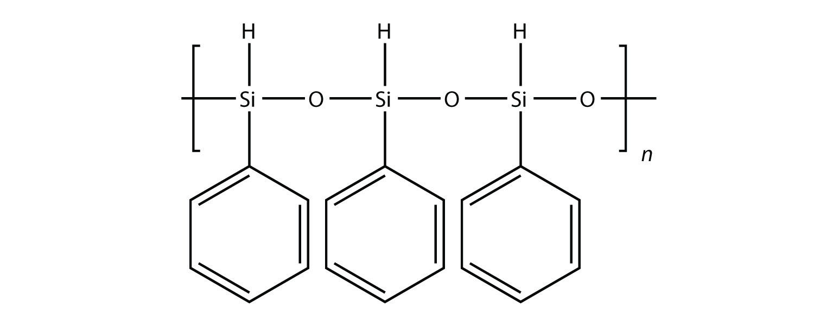
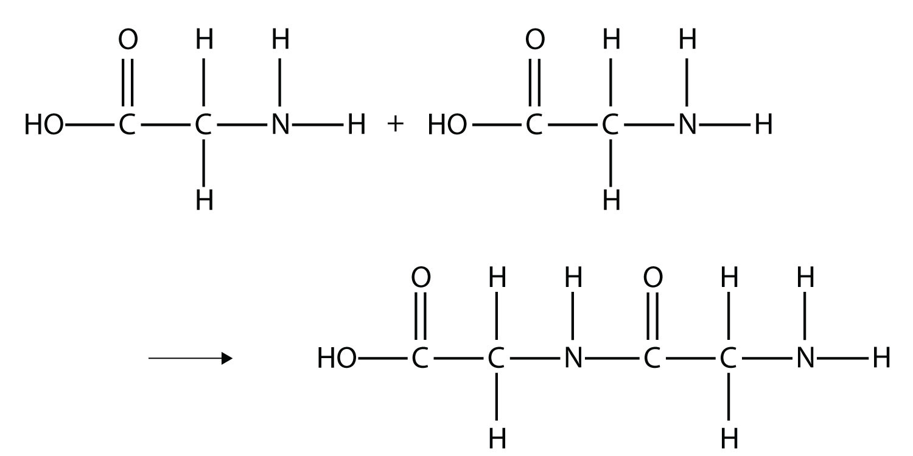
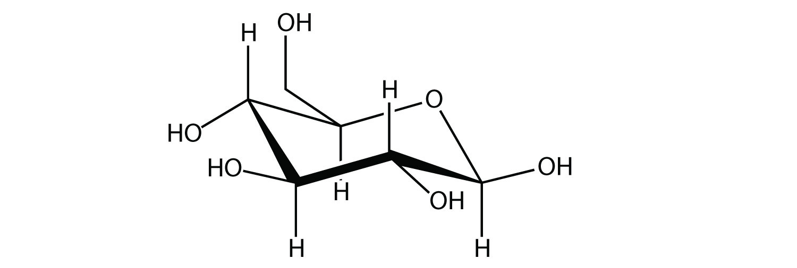
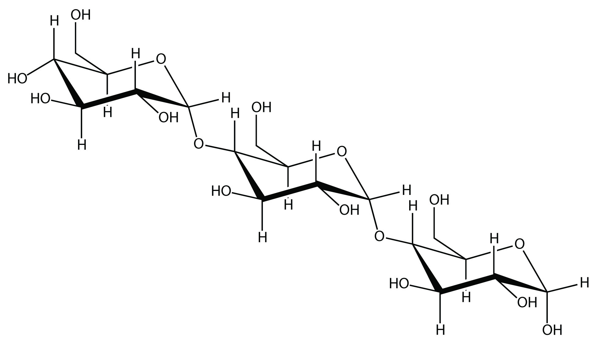
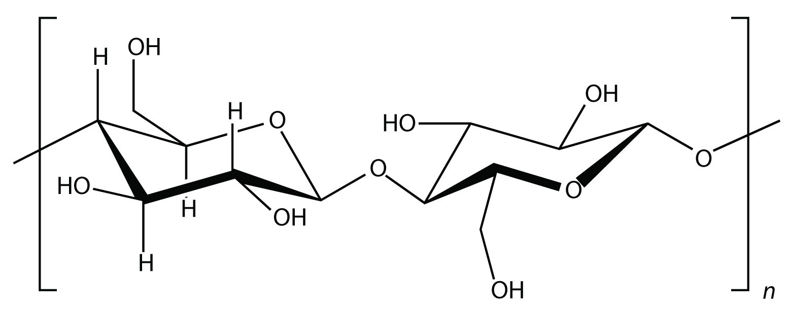

(sec:ch16:s06)=

# 16.6 Polymers

```{note} Learning Objectives

1. Define the terms *monomer* and *polymer*.
2. Draw the structure of a polymer from its monomer.
```

Among other applications, organic chemistry has had a huge impact on the development of modern materials called polymers. Many objects in daily life are composed of polymers; curiously, so are several important biological materials.

Consider a molecule with a double bond, such as ethylene:


*16.6 Polymers*

Imagine the bond between the carbons opening up and attacking another ethylene molecule:



*16.6 Polymers*

Now imagine further that the second ethylene molecule’s double bond opens up and attacks a third ethylene molecule, which also opens up its double bond and attacks a fourth ethylene molecule, and so forth. The end result is long, virtually endless molecule:



*16.6 Polymers*

This long, almost nonstop molecule is called a **polymer** (*A long molecule made of hundreds or thousands of repeating units.*) (from the Greek meaning “many parts”). The original part—ethylene—is called the **monomer** (*The repeated unit of a polymer.*) (meaning “one part”). The process of making a polymer is called **polymerization** (*The process of making a polymer.*). A polymer is an example of a *macromolecule*, the name given to a large molecule.

Simple polymers are named after their monomers; the ethylene polymer is formally called poly(ethylene), although in common use, the names are used without parentheses: polyethylene. Because adding one monomer to another forms this polymer, polyethylene is an example of a type of polymer called *addition polymers*. {ref}`Figure 16.5 "Some Monomers and Their Addition Polymers" <fig:ch16:s06:f01>` lists some addition polymers and their monomers. One of them, poly(ethylene oxide), results not from the opening of a double bond but the opening of a ring in the monomer; the concept of bonding with other monomers, however, is the same.

```{figure} ../images/figures/4e1bf4492c1bab44aaa486fd7c72a745.jpg
:label: fig:ch16:s06:f01
:alt: "Some Monomers and Their Addition Polymers"
:align: center
:width: 85%

Some Monomers and Their Addition Polymers
```

```{exercise}
:label: ex:ball-ch16-s06-n02

**Example 13**

Draw the polymer that results from the polymerization of tetrafluoroethylene.


*16.6 Polymers*
```

```{solution} ex:ball-ch16-s06-n02
:label: sol:ball-ch16-s06-n02
:class: dropdown

In the case of this monomer, the double bond opens up and joins to other monomers, just as with ethylene. The polymer that is made has this structure:


*16.6 Polymers*
```

```{exercise}
:label: ex:ball-ch16-s06-n02-ty2

**Test Yourself**

Draw the polymer that results from the polymerization of vinyl chloride.


*16.6 Polymers*
```

```{solution} ex:ball-ch16-s06-n02-ty2
:label: sol:ball-ch16-s06-n02-ty2
:class: dropdown


*16.6 Polymers*
```

Another type of polymer is the *condensation polymer*, which is a polymer made when two different monomers react together and release some other small molecule as a product. We have already seen an example of this, in the formation of an amide bond:



*16.6 Polymers*

Here, H<sub>2</sub>O is released when the ends of the molecules react to form a polymer.

Related to condensation polymers are the *copolymers*, polymers made from more than one type of monomer. For example, ethylene and propylene can be combined into a polymer that is a mixture of the two monomers. A common form of synthetic rubber called styrene butadiene rubber (SBR) is made from two monomers: styrene and butadiene:



*16.6 Polymers*

The physical and chemical properties of polymers vary widely, based on their monomers, structures, and additives. Among the other properties that can be modified based on these factors include solubility in H<sub>2</sub>O and other solvents, melting point, flammability, color, hardness, transparency, film thickness, wetability, surface friction, moldability, and particle size—the list goes on.

The uses of polymers are almost too numerous to consider. Anything that you might describe as “plastic” is likely a polymer. Polymers are used to make everything from toothbrushes to computer cases to automobile parts. Many epoxy-based adhesives are condensation polymers that adhere strongly to other surfaces. Polyurethane paints and coatings are polymers, as are the polyester fabrics used to make clothing. Nylon, Dacron, and Mylar are polymers (in fact, both Dacron and Mylar are forms of polyethylene terephthalate [PET]). The product known as Saran Wrap was originally constructed from Saran, a name for poly(vinylidene chloride), which was relatively impervious to oxygen and could be used as a barrier to help keep food fresh. (It has since been replaced with polyethylene, which is not as impervious to atmospheric oxygen.) Poly(vinyl chloride) is the third-most produced polymer [after poly(ethylene) and poly(propylene)] and is used to make everything from plastic tubing to automobile engine parts, water pipes to toys, flooring to waterbeds and pools.

All the polymers we have considered so far are based on a backbone of (largely) carbon. There is another class of polymers based on a backbone of Si and O atoms; these polymers are called **silicones** (*A polymer based on a silicon and oxygen backbone.*). The Si atoms have organic groups attached to them, so these polymers are still organic. One example of a silicone is as follows:



*16.6 Polymers*

Silicones are used to make oils and lubricants; they are used as sealants for glass objects (such as aquariums) and films for waterproofing objects. Solid silicones are heat resistant and rubbery and are used to make cookware and electrical insulation.

Some very important biological materials are polymers. Of the three major food groups, polymers are represented in two: proteins and carbohydrates. Proteins are polymers of amino acids, which are monomers that have an amine functional group and a carboxylic acid functional group. These two groups react to make a condensation polymer, forming an amide bond:



*16.6 Polymers*

Proteins are formed when hundreds or even thousands of amino acids form amide bonds to make polymers. Proteins play a crucial role in living organisms.

A *carbohydrate* is a compound that has the general formula C<sub>*n*</sub>(H<sub>2</sub>O)<sub>*n*</sub>. Many carbohydrates are relatively small molecules, such as glucose:



*16.6 Polymers*

Linking hundreds of glucose molecules together makes a relatively common material known as *starch*:



*16.6 Polymers*

Starch is an important source of energy in the human diet. Note how individual glucose units are joined together. They can also be joined together in another way, like this:



*16.6 Polymers*

This polymer is known as *cellulose*. Cellulose is a major component in the cell walls of plants. Curiously, despite the similarity in the building blocks, some animals (such as humans) cannot digest cellulose; those animals that can digest cellulose typically rely on symbiotic bacteria in the digestive tract for the actual digestion. Animals do not have the proper enzymes to break apart the glucose units in cellulose, so it passes through the digestive tract and is considered *dietary fiber*.

*Deoxyribonucleic acid* (*DNA*) and *ribonucleic acid* (*RNA*) are also polymers, composed of long, three-part chains consisting of phosphate groups, sugars with 5 C atoms (ribose or deoxyribose), and N-containing rings referred to as bases. Each combination of the three parts is called a nucleotide; DNA and RNA are essentially polymers of nucleotides that have rather complicated but intriguing structures ({ref}`Figure 16.6 "Nucleotides" <fig:ch16:s06:f02>`). DNA is the fundamental material in chromosomes and is directly responsible for heredity, while RNA is an essential substance in protein synthesis.

```{figure} ../images/restored/fig-16-6.png
:label: fig:ch16:s06:f02
:enumerator: 16.6
:alt: Diagram labeling the base, pentose sugar, and phosphate groups of a nucleotide; ribose has OH at the 2-prime position and deoxyribose has H.
:align: center
:width: 70%

**Nucleotides.** A nucleotide contains a nitrogen-containing base, a five-carbon sugar, and one or more phosphate groups. The diagram distinguishes the sugar-base nucleoside from its mono-, di-, and triphosphate nucleotides. DNA and RNA chains contain nucleotide residues linked through phosphate groups.

Credits: [Nucleotide nucleoside general — Yikrazuul](https://commons.wikimedia.org/wiki/File:Nucleotide_nucleoside_general.svg), [CC BY-SA 3.0](https://creativecommons.org/licenses/by-sa/3.0). Images resized for the web.
```

```{important} Key Takeaways

- Polymers are long molecules composed of chains of units called monomers.
- Several important biological polymers include proteins, starch, cellulose, and DNA.
```

## Exercises

```{exercise}
:label: ex:ball-ch16-s06-qs01-qd01-qa01

**Exercise 1.**

Explain the relationship between a monomer and a polymer.
```

```{solution} ex:ball-ch16-s06-qs01-qd01-qa01
:label: sol:ball-ch16-s06-qs01-qd01-qa01
:class: dropdown

A polymer is many monomers bonded together.
```

```{exercise}
:label: ex:ball-ch16-s06-qs01-qd01-qa02

**Exercise 2.**

Must a monomer have a double bond to make a polymer? Give an example to illustrate your answer.
```

```{exercise}
:label: ex:ball-ch16-s06-qs01-qd01-qa03

**Exercise 3.**

Draw the polymer made from this monomer.


*16.6 Polymers*
```

```{solution} ex:ball-ch16-s06-qs01-qd01-qa03
:label: sol:ball-ch16-s06-qs01-qd01-qa03
:class: dropdown


*16.6 Polymers*
```

```{exercise}
:label: ex:ball-ch16-s06-qs01-qd01-qa04

**Exercise 4.**

Draw the polymer made from this monomer.


*16.6 Polymers*
```

```{exercise}
:label: ex:ball-ch16-s06-qs01-qd01-qa05

**Exercise 5.**

What is the difference between an addition polymer and a condensation polymer?
```

```{solution} ex:ball-ch16-s06-qs01-qd01-qa05
:label: sol:ball-ch16-s06-qs01-qd01-qa05
:class: dropdown

In an addition polymer, no small molecule is given off as a product, whereas in a condensation polymer, small parts of each monomer come off as a small molecule.
```

```{exercise}
:label: ex:ball-ch16-s06-qs01-qd01-qa06

**Exercise 6.**

What is the difference between a condensation polymer and a copolymer?
```

```{exercise}
:label: ex:ball-ch16-s06-qs01-qd01-qa07

**Exercise 7.**

List three properties of polymers that vary widely with composition.
```

```{solution} ex:ball-ch16-s06-qs01-qd01-qa07
:label: sol:ball-ch16-s06-qs01-qd01-qa07
:class: dropdown

solubility in H<sub>2</sub>O and other solvents, melting point, flammability, color, hardness, transparency, film thickness, wetability, surface friction, moldability, and particle size (answers will vary)
```

```{exercise}
:label: ex:ball-ch16-s06-qs01-qd01-qa08

**Exercise 8.**

List three uses of polymers.
```

```{exercise}
:label: ex:ball-ch16-s06-qs01-qd01-qa09

**Exercise 9.**

Draw the silicone made from this monomer.


*16.6 Polymers*
```

```{solution} ex:ball-ch16-s06-qs01-qd01-qa09
:label: sol:ball-ch16-s06-qs01-qd01-qa09
:class: dropdown


*16.6 Polymers*
```

```{exercise}
:label: ex:ball-ch16-s06-qs01-qd01-qa10

**Exercise 10.**

Draw the silicone made from this monomer.


*16.6 Polymers*
```

```{exercise}
:label: ex:ball-ch16-s06-qs01-qd01-qa11

**Exercise 11.**

Explain how starch is a polymer.
```

```{solution} ex:ball-ch16-s06-qs01-qd01-qa11
:label: sol:ball-ch16-s06-qs01-qd01-qa11
:class: dropdown

Starch is composed of many glucose monomer units.
```

```{exercise}
:label: ex:ball-ch16-s06-qs01-qd01-qa12

**Exercise 12.**

What is the difference between starch and cellulose?
```

```{exercise}
:label: ex:ball-ch16-s06-qs01-qd01-qa13

**Exercise 13.**

Explain how protein is a polymer.
```

```{solution} ex:ball-ch16-s06-qs01-qd01-qa13
:label: sol:ball-ch16-s06-qs01-qd01-qa13
:class: dropdown

Proteins are polymers of amino acids, which act as the monomers.
```

```{exercise}
:label: ex:ball-ch16-s06-qs01-qd01-qa14

**Exercise 14.**

What are the parts that compose DNA?
```
