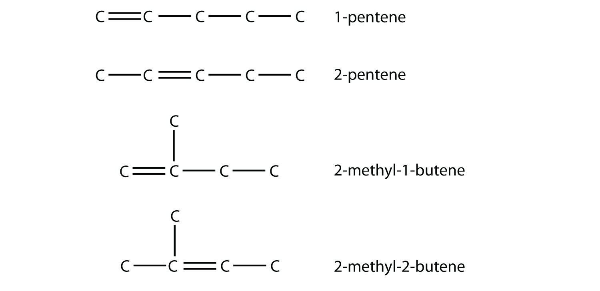
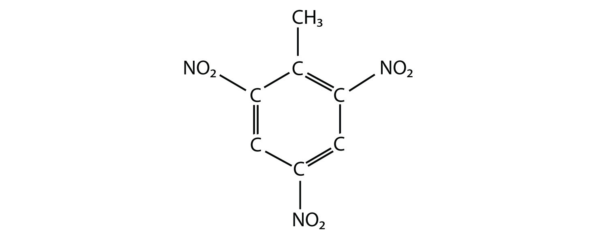
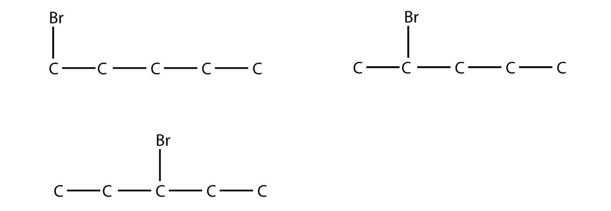
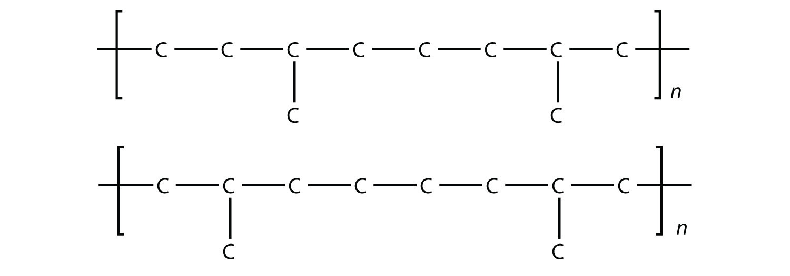
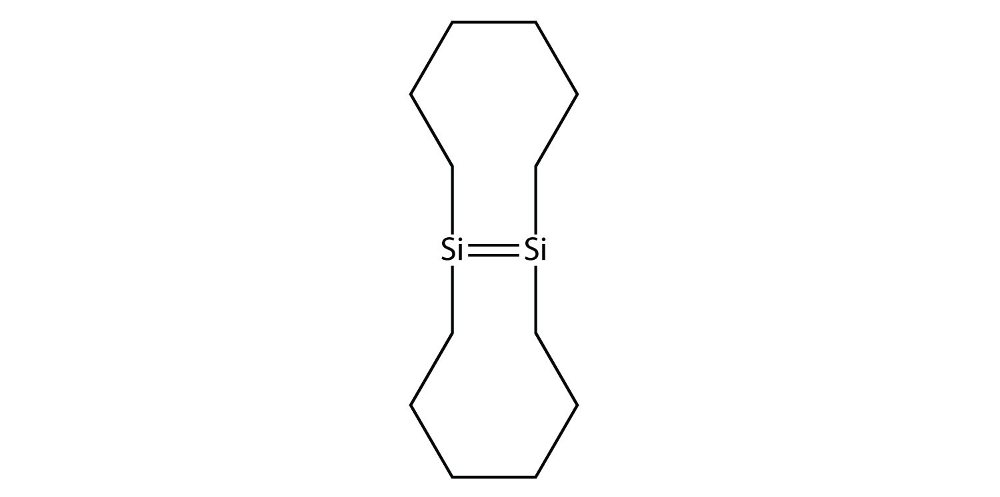
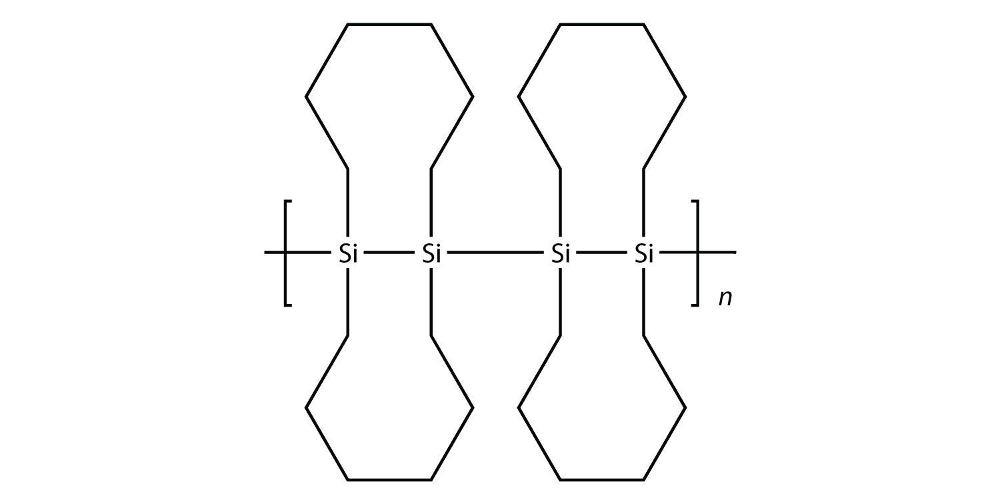

(sec:ch16:s07)=

# 16.7 End-of-Chapter Material

## Additional Exercises

```{exercise}
:label: ex:ball-ch16-s07-qs01-qd01-qa01

**Exercise 1.**

Cycloalkanes are named based on the number of C atoms in them, just like regular alkanes, but with the prefix *cyclo*- on the name. What are the names of the three smallest cycloalkanes?
```

```{solution} ex:ball-ch16-s07-qs01-qd01-qa01
:label: sol:ball-ch16-s07-qs01-qd01-qa01
:class: dropdown

cyclopropane, cyclobutane, and cyclopentane
```

```{exercise}
:label: ex:ball-ch16-s07-qs01-qd01-qa02

**Exercise 2.**

Cycloalkenes are named similarly to cycloalkanes (see Exercise 1). What are the names of the cycloalkenes with five, six, and seven C atoms?
```

```{exercise}
:label: ex:ball-ch16-s07-qs01-qd01-qa03

**Exercise 3.**

Draw the carbon backbone of all noncyclic alkanes with only four C atoms.
```

```{solution} ex:ball-ch16-s07-qs01-qd01-qa03
:label: sol:ball-ch16-s07-qs01-qd01-qa03
:class: dropdown


*16.7 End-of-Chapter Material*
```

```{exercise}
:label: ex:ball-ch16-s07-qs01-qd01-qa04

**Exercise 4.**

Draw the carbon backbone of all noncyclic alkanes with only five C atoms.
```

```{exercise}
:label: ex:ball-ch16-s07-qs01-qd01-qa05

**Exercise 5.**

Cyclic alkanes can also have substituent groups on the ring. Draw the carbon backbone of all cyclic alkanes with only four C atoms.
```

```{solution} ex:ball-ch16-s07-qs01-qd01-qa05
:label: sol:ball-ch16-s07-qs01-qd01-qa05
:class: dropdown


*16.7 End-of-Chapter Material*
```

```{exercise}
:label: ex:ball-ch16-s07-qs01-qd01-qa06

**Exercise 6.**

Cyclic alkanes can also have substituent groups on the ring. Draw the carbon backbone of all cyclic alkanes with only five C atoms.
```

```{exercise}
:label: ex:ball-ch16-s07-qs01-qd01-qa07

**Exercise 7.**

Draw and name all possible isomers of pentene.
```

```{solution} ex:ball-ch16-s07-qs01-qd01-qa07
:label: sol:ball-ch16-s07-qs01-qd01-qa07
:class: dropdown



*16.7 End-of-Chapter Material*
```

```{exercise}
:label: ex:ball-ch16-s07-qs01-qd01-qa08

**Exercise 8.**

Draw and name all possible normal (that is, straight-chain) isomers of heptyne.
```

```{exercise}
:label: ex:ball-ch16-s07-qs01-qd01-qa09

**Exercise 9.**

Polyunsaturated alkenes have more than one C–C double bond. Draw the carbon backbone of all possible noncyclic polyunsaturated alkenes with four C atoms and two double bonds. What are the complete molecular formulas for each possible molecule?
```

```{solution} ex:ball-ch16-s07-qs01-qd01-qa09
:label: sol:ball-ch16-s07-qs01-qd01-qa09
:class: dropdown


*16.7 End-of-Chapter Material*

Both molecular formulas are C<sub>4</sub>H<sub>6</sub>.
```

```{exercise}
:label: ex:ball-ch16-s07-qs01-qd01-qa10

**Exercise 10.**

Draw the carbon backbone of all possible five-carbon cyclic alkenes with two double bonds, assuming no substituents on the ring.
```

```{exercise}
:label: ex:ball-ch16-s07-qs01-qd01-qa11

**Exercise 11.**

If a hydrocarbon is combined with enough halogen, all the H atoms will eventually be substituted with that halogen atom. Write the balanced chemical reaction between ethane and excess chlorine.
```

```{solution} ex:ball-ch16-s07-qs01-qd01-qa11
:label: sol:ball-ch16-s07-qs01-qd01-qa11
:class: dropdown

C<sub>2</sub>H<sub>6</sub> + 6Cl<sub>2</sub> → C<sub>2</sub>Cl<sub>6</sub> + 6HCl
```

```{exercise}
:label: ex:ball-ch16-s07-qs01-qd01-qa12

**Exercise 12.**

If a hydrocarbon is combined with enough halogen, all the H atoms will eventually be substituted with that halogen atom. Write the balanced chemical reaction between butane and excess bromine.
```

```{exercise}
:label: ex:ball-ch16-s07-qs01-qd01-qa13

**Exercise 13.**

Molecules with multiple double bonds can also participate in addition reactions. Draw the structure of the product when butadiene, CH<sub>2</sub>=CH–CH=CH<sub>2</sub>, reacts with chlorine.
```

```{solution} ex:ball-ch16-s07-qs01-qd01-qa13
:label: sol:ball-ch16-s07-qs01-qd01-qa13
:class: dropdown


*16.7 End-of-Chapter Material*
```

```{exercise}
:label: ex:ball-ch16-s07-qs01-qd01-qa14

**Exercise 14.**

Molecules with multiple double bonds can also participate in addition reactions. Draw the structure of the product when allene, CH<sub>2</sub>=C=CH<sub>2</sub>, reacts with bromine.
```

```{exercise}
:label: ex:ball-ch16-s07-qs01-qd01-qa15

**Exercise 15.**

What is the maximum number of methyl groups that can be on a propane backbone before the molecule cannot be named as a propane compound?
```

```{solution} ex:ball-ch16-s07-qs01-qd01-qa15
:label: sol:ball-ch16-s07-qs01-qd01-qa15
:class: dropdown

two
```

```{exercise}
:label: ex:ball-ch16-s07-qs01-qd01-qa16

**Exercise 16.**

Explain why cycloethane cannot exist as a real molecule.
```

```{exercise}
:label: ex:ball-ch16-s07-qs01-qd01-qa17

**Exercise 17.**

In the gasoline industry, what is called *isooctane* is actually 2,2,4-trimethylpentane. Draw the structure of isooctane.
```

```{solution} ex:ball-ch16-s07-qs01-qd01-qa17
:label: sol:ball-ch16-s07-qs01-qd01-qa17
:class: dropdown


*16.7 End-of-Chapter Material*
```

```{exercise}
:label: ex:ball-ch16-s07-qs01-qd01-qa18

**Exercise 18.**

Isooctane (see Exercise 17) is an isomer of what straight-chain alkane?
```

```{exercise}
:label: ex:ball-ch16-s07-qs01-qd01-qa19

**Exercise 19.**

The actual name for the explosive TNT is 2,4,6-trinitrotoluene. If the structure of TNT is



*16.7 End-of-Chapter Material*

propose the structure of the parent compound toluene.
```

```{solution} ex:ball-ch16-s07-qs01-qd01-qa19
:label: sol:ball-ch16-s07-qs01-qd01-qa19
:class: dropdown


*16.7 End-of-Chapter Material*
```

```{exercise}
:label: ex:ball-ch16-s07-qs01-qd01-qa20

**Exercise 20.**

Phenol is hydroxybenzene, the simplest aromatic alcohol. Picric acid is an explosive derivative of phenol whose formal name is 2,4,6-trinitrophenol. With reference to Exercise 19, draw the structure of picric acid.
```

```{exercise}
:label: ex:ball-ch16-s07-qs01-qd01-qa21

**Exercise 21.**

Draw the structures of all possible straight-chain isomers of bromopentane.
```

```{solution} ex:ball-ch16-s07-qs01-qd01-qa21
:label: sol:ball-ch16-s07-qs01-qd01-qa21
:class: dropdown



*16.7 End-of-Chapter Material*
```

```{exercise}
:label: ex:ball-ch16-s07-qs01-qd01-qa22

**Exercise 22.**

Draw the structures of all the possible isomers of butanol. Include branched isomers.
```

```{exercise}
:label: ex:ball-ch16-s07-qs01-qd01-qa23

**Exercise 23.**

What is the final product of the *double* elimination of HCl from 1,1-dichloroethane?
```

```{solution} ex:ball-ch16-s07-qs01-qd01-qa23
:label: sol:ball-ch16-s07-qs01-qd01-qa23
:class: dropdown

ethyne
```

```{exercise}
:label: ex:ball-ch16-s07-qs01-qd01-qa24

**Exercise 24.**

Draw the structure of the final product of the *double* elimination of 1,3-dibromopropane.
```

```{exercise}
:label: ex:ball-ch16-s07-qs01-qd01-qa25

**Exercise 25.**

Draw the structure and name of the alcohol whose double elimination would yield the same product as in Exercise 23. Name the molecule as a hydroxyl-substituted compound.
```

```{solution} ex:ball-ch16-s07-qs01-qd01-qa25
:label: sol:ball-ch16-s07-qs01-qd01-qa25
:class: dropdown


*The names are 1,2-dihydroxyethane and 1,1-dihydroxyethane, respectively.*
```

```{exercise}
:label: ex:ball-ch16-s07-qs01-qd01-qa26

**Exercise 26.**

Draw the structure and name of the alcohol whose double elimination would yield the same product as in Exercise 24. Name the molecule as a hydroxyl-substituted compound.
```

```{exercise}
:label: ex:ball-ch16-s07-qs01-qd01-qa27

**Exercise 27.**

Draw the smallest molecule that can have a separate aldehyde and carboxylic acid group.
```

```{solution} ex:ball-ch16-s07-qs01-qd01-qa27
:label: sol:ball-ch16-s07-qs01-qd01-qa27
:class: dropdown


*16.7 End-of-Chapter Material*
```

```{exercise}
:label: ex:ball-ch16-s07-qs01-qd01-qa28

**Exercise 28.**

Name the functional group(s) in urea, a molecule with the following structure:


*16.7 End-of-Chapter Material*
```

```{exercise}
:label: ex:ball-ch16-s07-qs01-qd01-qa29

**Exercise 29.**

Ethyl acetate is a common ingredient in nail-polish remover because it is a good solvent. Draw the structure of ethyl acetate.
```

```{solution} ex:ball-ch16-s07-qs01-qd01-qa29
:label: sol:ball-ch16-s07-qs01-qd01-qa29
:class: dropdown


*16.7 End-of-Chapter Material*
```

```{exercise}
:label: ex:ball-ch16-s07-qs01-qd01-qa30

**Exercise 30.**

A lactone is an ester that has its ester functional group in a ring. Draw the structure of the smallest possible lactone (which is called acetolactone, which might give you a hint about its structure).
```

```{exercise}
:label: ex:ball-ch16-s07-qs01-qd01-qa31

**Exercise 31.**

Draw the structure of diethyl ether, once used as an anesthetic.
```

```{solution} ex:ball-ch16-s07-qs01-qd01-qa31
:label: sol:ball-ch16-s07-qs01-qd01-qa31
:class: dropdown


*16.7 End-of-Chapter Material*
```

```{exercise}
:label: ex:ball-ch16-s07-qs01-qd01-qa32

**Exercise 32.**

The smallest cyclic ether is called an epoxide. Draw its structure.
```

```{exercise}
:label: ex:ball-ch16-s07-qs01-qd01-qa33

**Exercise 33.**

The odor of fish is caused by the release of small amine molecules, which vaporize easily and are detected by the nose. Lemon juice contains acids that react with the amines and make them not as easily vaporized, which is one reason why adding lemon juice to seafood is so popular. Write the chemical reaction of HCl with trimethylamine, an amine that is given off by seafood.
```

```{solution} ex:ball-ch16-s07-qs01-qd01-qa33
:label: sol:ball-ch16-s07-qs01-qd01-qa33
:class: dropdown

(CH<sub>3</sub>)<sub>3</sub>N + HCl → (CH<sub>3</sub>)<sub>3</sub>NHCl
```

```{exercise}
:label: ex:ball-ch16-s07-qs01-qd01-qa34

**Exercise 34.**

Putrescine and cadaverine are molecules with two amine groups on the opposite ends of a butane backbone and a pentane backbone, respectively. They are both emitted by rotting corpses. Draw their structures and determine their molecular formulas.
```

```{exercise}
:label: ex:ball-ch16-s07-qs01-qd01-qa35

**Exercise 35.**

With four monomers, draw two possible structures of a copolymer composed of ethylene and propylene.
```

```{solution} ex:ball-ch16-s07-qs01-qd01-qa35
:label: sol:ball-ch16-s07-qs01-qd01-qa35
:class: dropdown

(answers will vary)



*16.7 End-of-Chapter Material*
```

```{exercise}
:label: ex:ball-ch16-s07-qs01-qd01-qa36

**Exercise 36.**

With four monomers, draw two possible structures of a copolymer composed of ethylene and styrene.
```

```{exercise}
:label: ex:ball-ch16-s07-qs01-qd01-qa37

**Exercise 37.**

Draw the silicone that can be made from this monomer:



*16.7 End-of-Chapter Material*
```

```{solution} ex:ball-ch16-s07-qs01-qd01-qa37
:label: sol:ball-ch16-s07-qs01-qd01-qa37
:class: dropdown



*16.7 End-of-Chapter Material*
```

```{exercise}
:label: ex:ball-ch16-s07-qs01-qd01-qa38

**Exercise 38.**

One of the ingredients in the original Silly Putty was a silicone polymer with two methyl groups on each Si atom. Draw this silicone.
```
